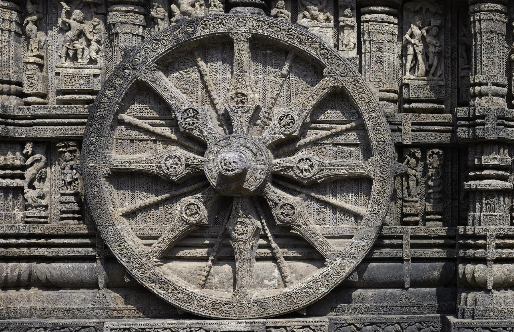
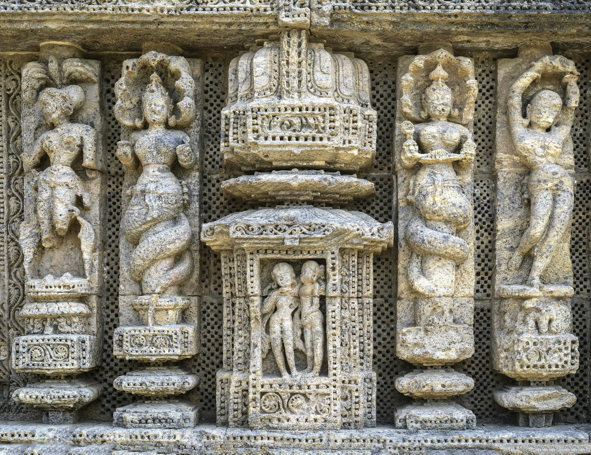
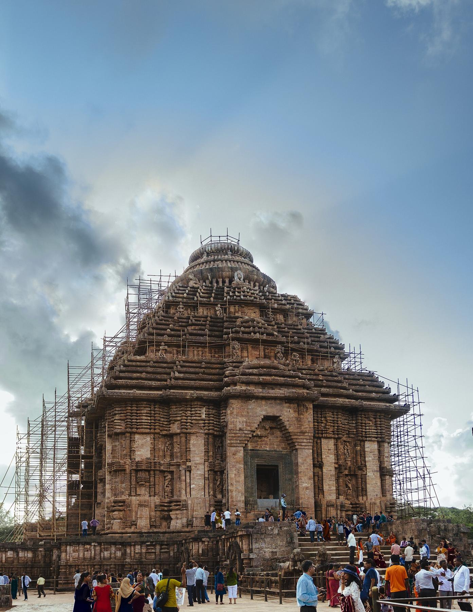

It is dawn on the Odisha coast, sometime in the 1250s. The sea is a sheet of grey light, and on the shore a crowd of thousands has stopped work to watch the sun come up. In front of them stands something that looks, for a moment, as if it might roll away: a vast stone chariot, its sides lined with giant wheels, its front pulled by rearing stone horses, and on its back a tower so tall that sailors far out at sea can see it. As the first ray clears the horizon, it shines straight through the doorway and onto the face of the god inside.

That was the idea, anyway. Today the tower is gone, the god has left, and the sea has moved two miles away. But the chariot is still there, black and enormous and covered from top to bottom in carvings of dancers, musicians, elephants, lovers and kings. It is the Sun Temple of Konark, and its story has a king, a boy who gave his life for it, a magnet that may never have existed, and a hall that was filled with sand for 120 years. Get comfortable. Here's how the sun got its chariot.

## A king who wanted a chariot

In the middle of the 13th century, the Eastern Ganga kings ruled the coast of what is now Odisha from the Ganges delta down to the Godavari. Their greatest ruler, Narasimhadeva I, came to the throne in the late 1230s. He was a soldier first: he fought the Muslim rulers of Bengal to the north and pushed them back, and those victories made him rich and confident. He wanted a monument to match.

He chose to build it for Surya, the sun god, at a place called Konark. The name comes from *kona*, corner, and *arka*, the sun: the sun of the corner, or the sun in the corner of the land. Sun worship was old here. There are older stories of sun shrines on this stretch of coast, near the mouth of a river called the Chandrabhaga, where pilgrims still come to bathe at sunrise each winter.

What Narasimhadeva built was not an ordinary temple. Hindu texts describe Surya crossing the sky each day in a chariot pulled by seven horses, and the architects took that image literally. They raised the whole temple on a high platform and carved its sides into a chariot: twelve pairs of giant wheels, each about 9 feet across, and seven horses straining at the front. Behind the wheels rose two buildings, as they do in most Odisha temples: a square audience hall with a pyramid roof, called the *jagamohana*, and behind it the sanctum, the *deula*, with a curving tower above the god.

No one knows exactly how tall that tower was. It fell long ago, and estimates from its base put it at more than 200 feet, which would have made it one of the tallest buildings in the world at the time. The audience hall alone, which still stands, is about 128 feet high.

The stone came from far away. The dark, iron-rich rock that gives the temple its color, the softer khondalite used for many carvings, and the chlorite for the finest statues were all brought in, probably by river and on rafts, because there is no good building stone at Konark itself. Iron beams, some of them more than 30 feet long, were laid into the structure to hold it together.

*One of the 24 wheels of the sun's chariot. Photo: [Joydeep](https://commons.wikimedia.org/wiki/File:Wheel_engraved_in_the_13th_century_built_Konark_Sun_Temple_in_Orissa,_India.jpg), CC BY-SA 4.0, via Wikimedia Commons*

## A world carved in stone

Walk around the platform and you start to see what took the sculptors so long. Almost every surface is carved. Along the base run elephants, hundreds of them, marching, fighting, being trapped and tamed. Above them are scenes from daily life: hunters, soldiers, a royal procession, a giraffe that must have come to the court as a gift from overseas traders. Women play drums and cymbals on the terraces of the audience hall, larger than life, as if the whole building were being played to the sun.

The wheels are the most famous part. Each has eight thick spokes and eight thin ones, and each spoke and rim is filled with tiny medallions of people: a woman looking in a mirror, a couple embracing, a man hunting. Many visitors are also surprised, or amused, by the erotic carvings on the outer walls. They are common on temples of this period across India, and scholars have long argued about what they mean: fertility, the joy of the world the god looks down on, or the idea that you leave the worldly behind when you walk through the door.

Inside, there were three great images of Surya, one for the morning, one for noon and one for evening, carved in green chlorite so finely that you can see the embroidery on his boots. They still stand in niches on the outside of the ruined sanctum. Surya is one of the few Indian gods shown wearing tall boots, a hint that sun worship had once come to India from the northwest, from Persia and Central Asia.

Centuries later, in the 1590s, Abul Fazl, the court historian of the Mughal emperor Akbar, wrote about Konark in his great survey of the empire. He said the king had spent the revenue of twelve years on it, and that even people who were hard to impress stood amazed when they saw it. By his time the temple was already old, and perhaps already damaged. Within another century, the god had left.

*The carved walls of the audience hall. Photo: [Joydeep](https://commons.wikimedia.org/wiki/File:13th_Century_stone_curvings_at_Konark_Sun_Temple_Puri_district,_Odisha,_India_5.jpg), CC BY-SA 4.0, via Wikimedia Commons*

## How the tower fell

Nobody saw the great tower come down, or if they did, they did not write it down. By the 1800s, when British surveyors began making drawings, it was a huge mound of fallen stone behind the audience hall, and sailors had long known the ruin as the Black Pagoda. On the coast to the south, the white-plastered Jagannath temple at Puri was the White Pagoda. Both were landmarks for ships feeling their way along a dangerous shore.

There are several explanations, and none is proven. The simplest is that the temple was too heavy for its ground. Konark stands on sandy soil, close to the sea, and the tower was enormous. If its foundations shifted, even a little, the iron beams could have rusted and failed in the salt air, and the stones would have split. Some scholars think the tower may never have been fully finished, or that it was weakened by lightning or an earthquake.

Then there is war. In 1568 the armies of the Bengal Sultanate invaded Odisha, led, according to Odia tradition, by a general known as Kalapahad, who is remembered as a destroyer of temples across the region. Local stories say he attacked Konark too, and damaged the shrine. Whether he did, or whether the temple was already failing, the worship of Surya there stopped. The main image is said to have been taken away for safety, and over the following centuries Konark was slowly abandoned to the sand and the forest.

Even its stone went elsewhere. In the late 1700s, a tall pillar called the Aruna Stambha, which once stood in front of the temple with a statue of Aruna, the sun's charioteer, on top, was moved to Puri. It still stands outside the Lion Gate of the Jagannath temple there.

## A hall full of sand

When the British began to take an interest in Konark in the 19th century, the audience hall itself was cracking. Pieces fell. Some of the finest carvings were carried off, a few of them to museums abroad. Engineers tried propping up the walls, and then, in 1903, the government of Bengal, then in charge of the region, chose a drastic solution: they filled the entire inside of the hall with sand and sealed it, to stop it from caving in.

It worked, in a way. The hall has stood for another 120 years. But no one could see inside, and over time the sand settled, leaving a gap of several feet at the top, and engineers began to worry that the sand itself was now part of the problem. In 2022, after years of study, the Archaeological Survey of India began removing the sand from the hall. The work is slow, with steel supports going in as the sand comes out, and it is still going on.

Meanwhile, the chariot has become a symbol. Konark was named a UNESCO World Heritage Site in 1984. A Konark wheel appears on the back of India's 10-rupee note issued in 2018. Each December, dancers perform classical Odissi on an open-air stage with the temple lit up behind them.

Stand at the eastern steps at sunrise today and you will see the sun come up over a line of casuarina trees, not the sea, which has retreated. The horses are worn and broken. The god's doorway leads into a wall of stone. But when the light comes, it still hits the wheels first, and for a minute the whole black chariot glows gold, as if it were about to move.

*The jagamohana, or audience hall, under scaffolding during the conservation work. Photo: [Subhrajyoti07](https://commons.wikimedia.org/wiki/File:Sun_Temple_Main_Structure,_Konark,_Orissa.jpg), CC BY-SA 4.0, via Wikimedia Commons*

## Legend or history?

> When the temple was nearly finished, the 1,200 craftsmen could not set the final crowning stone on the tower, and the king threatened to execute them all. The chief architect's 12-year-old son, Dharmapada, who had come looking for the father he had never met, solved the problem overnight. Then, to save the craftsmen from shame for having been bested by a child, he threw himself into the sea.

**What we know:** This is the best loved of all Konark stories, told in Odia poems and songs, but there is no record of it from the time. The numbers (1,200 craftsmen, 12 years) are round, and versions differ. A palm-leaf manuscript discovered in the 20th century, which some scholars believe records the temple's construction accounts, has been argued over for decades, and it does not mention a boy.

> A giant lodestone, a natural magnet, was set at the top of the tower. It held the iron frame together and made the image of the sun god float in mid-air. It was so strong that it pulled ships' compasses off course and drew them onto the rocks, until Portuguese sailors climbed up and removed it, and the temple collapsed.

**What we know:** There is no record of a magnet at Konark, and no physical evidence. A lodestone large enough to pull a ship from miles away is not possible. The story probably grew from three true things: the temple did have a lot of iron in it, the coast really was dangerous for ships, and sailors really did use the Black Pagoda as a landmark.

> Samba, a son of the god Krishna, was struck by leprosy as a curse. After twelve years of worship of the sun god on this shore, he was cured, and he built the first sun temple here in thanks.

**What we know:** This legend comes from the *Samba Purana* and other Hindu texts, and it is told about more than one sun shrine in India. It may preserve a memory of an older sun temple on the coast, but the temple standing today is firmly dated to the 13th century, by inscriptions of the Ganga dynasty that credit Narasimhadeva I.

## Local tellings

These are stories you will hear from guides and online. None of them can be confirmed.

- **The wheels are sundials.** Guides show how the shadow of a stick on the spokes tells the time to within minutes. You can make many carved wheels tell the time if you try, and there is no evidence the builders designed them as clocks, though it is a lovely trick to watch.
- **The god's image is hidden under the sand.** Some say the original Surya was buried in the sanctum and is still there. Archaeologists have dug in the sanctum, and the image is generally believed to have been moved to Puri or lost.
- **The temple was built in a single night.** A common tale for famous Indian temples. Konark took years, and its decoration may never have been fully finished.
- **The sea came right up to the steps.** Probably partly true: the coastline has moved over 750 years. But the temple was likely always set back a little from the beach, not on it.

## Things you probably didn't know

- **It is on your wallet.** If you have a 10-rupee note from the 2018 series, look on the back: that's a Konark wheel.
- **Surya wears boots.** The sun god's images here wear tall riding boots, a sign of sun worship's roots in Persia and Central Asia.
- **There's a giraffe.** One carved panel shows a giraffe, probably an animal sent to the Ganga court through Indian Ocean trade with Africa.
- **The tower may have been more than 200 feet tall.** That's taller than most of the cathedrals being built in Europe at the same time.
- **A piece of it is in Puri.** The Aruna Stambha, a pillar from Konark, has stood outside the Jagannath temple in Puri since the late 1700s.
- **It was sealed with sand in 1903.** The audience hall was filled to save it from collapse, and work to empty it began only in 2022.
- **The sea has moved.** The coastline is now about 2 miles away, so the temple no longer stands by the water.

## Timeline

- **c. 1238** Narasimhadeva I becomes king of the Eastern Ganga dynasty.
- **c. 1250** The Sun Temple at Konark is built.
- **1568** Bengal Sultanate armies invade Odisha; local tradition says Konark was attacked.
- **1590s** Abul Fazl, Akbar's historian, describes the temple and its cost.
- **1700s** Worship has ended; the Aruna Stambha pillar is moved to Puri.
- **1903** The audience hall is filled with sand and sealed to stop it collapsing.
- **1984** Konark becomes a UNESCO World Heritage Site.
- **2022** The Archaeological Survey of India begins removing the sand.

## If you go

Konark is about 40 miles (65 km) from Bhubaneswar, which has the nearest airport, and about 22 miles (35 km) up the coast from Puri. From the US, fly into Delhi, Mumbai or Kolkata and take a domestic flight to Bhubaneswar, then a car or bus. The temple is open every day from sunrise to sunset. Foreign visitors pay about ₹600 ($7), Indian citizens much less. Allow two to three hours, and add the small Archaeological Survey museum next door, which holds many of the fallen sculptures. Go at sunrise if you can, before the crowds and heat. October to March is the best season, and the Konark Dance Festival is usually held in the first week of December.

To stay close, [Lotus Eco Resort Konark](aff:agoda/partners/partnersearch.aspx?pcs=1&hid=567217) has cottages by Ramachandi beach, a few miles from the temple (8.6 from 307 reviews on Agoda, around $75 a night). Most visitors base themselves in Puri instead, where the [Mayfair Heritage](aff:agoda/partners/partnersearch.aspx?pcs=1&hid=303562) is a comfortable beach hotel (8.5 from 370+, around $160).

## Sources

- [Sun Temple, Konârak](https://whc.unesco.org/en/list/246/), UNESCO World Heritage Centre
- [Sun Temple, Konark](https://www.britannica.com/topic/Sun-Temple-Konark), Encyclopaedia Britannica
- [Konark Sun Temple](https://en.wikipedia.org/wiki/Konark_Sun_Temple), Wikipedia
- [Konark Sun Temple](https://www.worldhistory.org/Konark_Sun_Temple/), World History Encyclopedia
- [Why was Konark temple filled with sand by the British?](https://odishatv.in/odisha/why-was-konark-temple-filled-with-sand-by-the-british-10898777), Odisha TV

*Cover: the Konark Sun Temple from the front. Photo: [Joydeep](https://commons.wikimedia.org/wiki/File:Konark_Sun_Temple_Puri_district,_Odisha,_India_1.jpg), CC BY-SA 4.0, via Wikimedia Commons*
