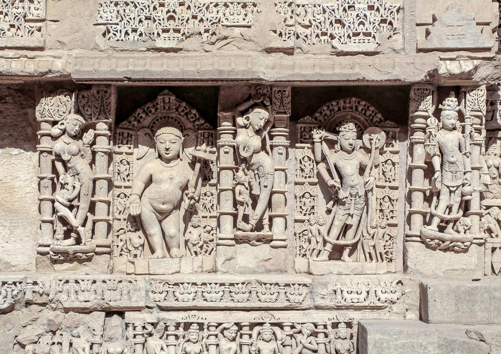
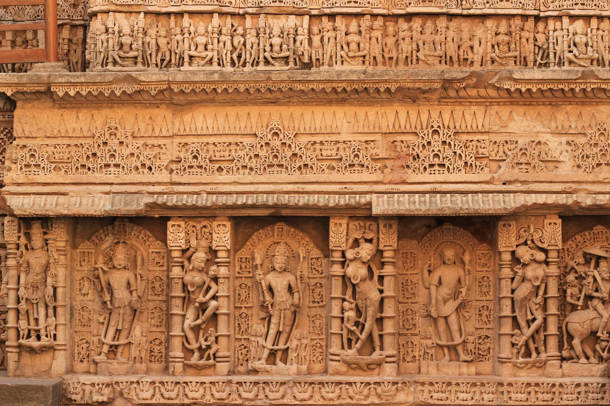
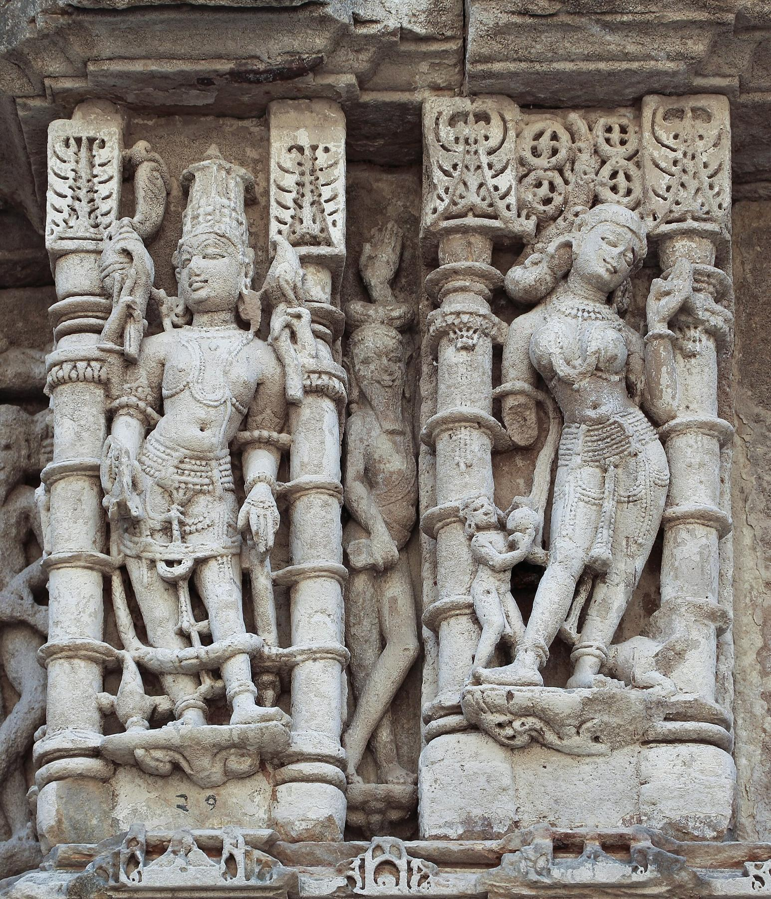

It is a hot afternoon in Patan, in the dry north of Gujarat, and you are walking across a flat, dusty lawn. There's nothing much to see: a few trees, a fence, a ticket booth. Then the ground in front of you simply stops, and you find yourself at the top of a staircase that falls away into the earth, terrace after terrace, seven stories down. Every wall is covered in stone people. Gods, goddesses, dancers, snake-women, a woman putting on her earrings, another brushing her hair. The air gets cooler with each step. At the bottom, where the light turns green, there is still water.

This is Rani ki Vav, the Queen's Stepwell, and for most of the last thousand years it was invisible. A river buried it so completely that farmers grew crops over it and travelers walked past without knowing it was there. Get comfortable. Here's the story of the queen who built a temple upside down, and the mud that saved it.

## A city of kings, and a queen alone

In the 11th century, Patan, then called Anahilapataka, was one of the great cities of western India, the capital of the Chaulukya kings, also known as the Solankis. It sat on the trade routes between the ports of the Gujarat coast and the cities of the north, and it was rich enough to be a target.

In 1025, the Afghan ruler Mahmud of Ghazni marched through Gujarat on his way to sack the famous temple of Somnath on the coast. The Chaulukya king at the time, Bhima I, fled before him rather than fight. It was a humiliation, but Bhima survived it. He rebuilt, he fought other wars, and he ruled for some forty years. During his reign the Sun Temple at Modhera, about 20 miles away, was built, and it still stands.

His queen was named Udayamati. We know very little about her: later chronicles say she was a princess from Saurashtra, the peninsula to the southwest. What we do know is that after Bhima died, around the 1060s, she commissioned a stepwell in his memory, on the bank of the Saraswati River at the edge of the city. A Jain monk named Merutunga, writing about 240 years later, noted that Udayamati's well at Patan outdid even the city's famous royal tank. It is one of the very few great monuments of medieval India known to have been commissioned by a woman.

## A temple turned upside down

Stepwells, called *vav* in Gujarati and *baoli* in Hindi, were common across Gujarat and Rajasthan. In a land where rain comes for a few weeks a year and then disappears, people dug down to reach groundwater, and built steps so they could follow the water level down as it fell through the dry months. Many were plain and practical. Some, built by kings, queens and merchants as acts of charity, became works of art: cool, shaded places where people could rest, gather, gossip and pray.

Rani ki Vav is the grandest of them all. Its builders treated it as an inverted temple, a shrine for water. You enter at ground level and walk down a long stepped corridor, about 210 feet from end to end. Every so often the corridor passes through a pavilion of pillars, each one a floor deeper than the last, so that looking back up you see a stack of colonnades, seven levels high. At the far end, a round well shaft drops about 90 feet to the water table.

The walls are where the queen's sculptors went to work. There are more than 500 main sculptures and over a thousand smaller ones. Many show the ten avatars of Vishnu: the fish, the tortoise, the boar, the man-lion, Rama, Krishna and others. Around them are the *apsaras*, celestial women, carved as if caught in everyday moments: one writes a letter, one looks into a mirror, one puts on makeup, one ties her ankle bells. There are snake-maidens with coiled tails, holy men and musicians. Down in the well shaft, Vishnu reclines on the serpent Shesha, floating on the cosmic ocean, which is a neat touch, because the real water is right below him.

*The goddess Durga slaying the buffalo demon, one of hundreds of panels. Photo: [Bernard Gagnon](https://commons.wikimedia.org/wiki/File:Sculptures_in_Rani_ki_vav_01.jpg), CC BY-SA 3.0, via Wikimedia Commons*

## The river that buried it

For a while, the well worked as it was meant to. Then the Saraswati River, which ran beside it, did what rivers on flat plains do: it flooded, shifted and dropped its silt. At some point, probably within a few centuries of its building, a flood filled the stepwell with mud. Then more floods added more. The terraces, the pavilions, the hundreds of carved figures disappeared under the earth, layer by layer, until only the top of the well shaft and a few broken pillars could still be seen.

In the meantime, the world above moved on. Patan was conquered by the armies of the Delhi Sultanate around 1300, and the capital of Gujarat moved to Ahmedabad in the 15th century. Patan became a quieter town, known for its weavers, who still make the double-ikat silk saris called *patola*. Some stones from the stepwell's upper parts were carted away for buildings. Nobody dug it out, and as a result nobody smashed its figures either.

By the late 1800s, British surveyors visiting Patan noted the ruins of a large well, mostly filled in, and wrote down its local name. It was only in the 20th century that people began to understand how much was down there. Excavation began in the 1940s, under the princely state of Baroda, which then ruled the area, and the Archaeological Survey of India took over and carried out years of digging, clearing and restoration, especially in the 1980s. As the mud came out, the sculptures emerged in remarkable condition, crisp and nearly complete, protected for centuries by the very flood that had buried them.

*Gods and celestial dancers on one of the terraces. Photo: [Snehrashmi](https://commons.wikimedia.org/wiki/File:Rani_ki_vav_-_Patan_-_Gujarat_-_DSC006.jpg), CC BY-SA 4.0, via Wikimedia Commons*

## A queen on a banknote

In 2014, UNESCO added Rani ki Vav to its World Heritage List, describing it as the finest example of the stepwell tradition. Four years later, the Reserve Bank of India put it on the back of the new lavender 100-rupee note, so that millions of people now carry a picture of Udayamati's well in their wallets without knowing her name.

Today you can walk down the stepped corridor, though not to the very bottom; the lowest levels and the well shaft are closed off for safety. The water you see is groundwater, as it was in the queen's day. Morning is the best time, when the low sun slants into the corridor and the sandstone turns gold, and the figures seem to step out of their niches to meet you.

Stand on the top step and look down. Somewhere at the bottom of all that carving is the reason it was built: a little water, in a land where water was everything, and a widow who wanted her husband remembered next to it.

*Figures carved for an 11th-century queen. Photo: [Bernard Gagnon](https://commons.wikimedia.org/wiki/File:Sculptures_in_Rani_ki_vav_03.jpg), CC0, via Wikimedia Commons*

## Legend or history?

> Queen Udayamati built the stepwell after the death of her husband, King Bhima I, as a memorial to him and as an act of charity, so that the people of Patan would always have water.

**What we know:** This is broadly supported. The 14th-century chronicle *Prabandha Chintamani* by Merutunga credits Udayamati with the well, and its style fits the second half of the 11th century. The exact year is not known; you will see dates from about 1050 to 1080 in different sources.

> Beneath the lowest step is a gate to a secret tunnel, about 20 miles long, that leads to the town of Sidhpur. The royal family used it to escape when the city was attacked.

**What we know:** There is a small opening near the bottom of the well that guides point out, but there is no evidence of a tunnel to Sidhpur. Secret escape tunnels are a stock feature of legends about forts and palaces across India, and a 20-mile tunnel through river silt would be an engineering marvel no one has ever found.

## Local tellings

These are stories you will hear from guides and online. None of them can be confirmed.

- **The water cured fevers.** People say medicinal plants once grew around the well and their goodness seeped into the water. It's a common belief about old wells; there's no record from the queen's time.
- **The flood was a punishment.** Some say the river rose because the queen's well was so grand it angered the gods, or a jealous rival. There's no source for this, and floods on the Saraswati were common.
- **The scorpion on her thigh.** One carved apsara has a scorpion climbing her leg, and guides tell different stories about why: a warning, a love charm, a joke by the sculptor. Nobody knows.
- **It was filled in deliberately to hide it from invaders.** The silt layers point to natural flooding, not people.

## Things you probably didn't know

- **It's on the 100-rupee note.** Since 2018, the back of India's lavender ₹100 note shows Rani ki Vav.
- **A woman built it.** It is one of the very few major monuments of medieval India commissioned by a queen.
- **The mud saved it.** Because it was buried for centuries, its sculptures escaped both weather and deliberate damage.
- **Vishnu lies at the bottom.** A sculpture of Vishnu sleeping on the cosmic serpent is carved deep in the well shaft, right above the water.
- **Its neighbor is a sun temple.** The Modhera Sun Temple, built under the same king, Bhima I, is about 20 miles away.
- **Patan still weaves.** The town is one of the last places making double-ikat *patola* silk, where both the warp and weft threads are dyed before weaving.

## Timeline

- **c. 1022** Bhima I becomes king of the Chaulukyas at Patan.
- **1025** Mahmud of Ghazni crosses Gujarat to raid Somnath.
- **c. 1060s–1080s** Queen Udayamati builds the stepwell in Bhima's memory.
- **Later centuries** Floods of the Saraswati fill the well with silt.
- **1304** Merutunga's chronicle credits Udayamati with the well.
- **1940s** Excavation begins under the state of Baroda.
- **1980s** The Archaeological Survey of India clears and restores the stepwell.
- **2014** UNESCO World Heritage Site; on the ₹100 note from 2018.

## If you go

Patan is about 80 miles (130 km) northwest of Ahmedabad, which has direct flights from the Gulf and good connections from Delhi and Mumbai. From the US, fly into Ahmedabad via a Gulf or European hub, or via Delhi or Mumbai. By car, it is about two and a half to three hours each way, and most people combine it with the Modhera Sun Temple, roughly on the way, for a full day trip. Rani ki Vav is open daily from about 8 am to 6 pm. Foreign visitors pay about ₹600 ($7). Allow an hour and a half, and save time for the Patola House museum in town. November to February is cool and dry.

If you would rather stay the night in Patan, [The Grand Raveta](aff:agoda/partners/partnersearch.aspx?pcs=1&hid=2982880) is a simple, well-reviewed hotel in town (8.8 from 250+ reviews on Agoda, around $25 a night).

## Sources

- [Rani-ki-Vav (the Queen's Stepwell) at Patan, Gujarat](https://whc.unesco.org/en/list/922/), UNESCO World Heritage Centre
- [Rani ki Vav](https://en.wikipedia.org/wiki/Rani_ki_vav), Wikipedia
- [Rani ki Vav](https://www.cyark.org/projects/rani-ki-vav/in-depth), CyArk
- [Rani ki Vav, Patan](https://www.incredibleindia.gov.in/en/gujarat/patan/rani-ki-vav), Incredible India (Ministry of Tourism)

*Cover: the stepped corridor of Rani ki Vav. Photo: [Bernard Gagnon](https://commons.wikimedia.org/wiki/File:Rani_ki_vav_02.jpg), CC BY-SA 3.0, via Wikimedia Commons*
