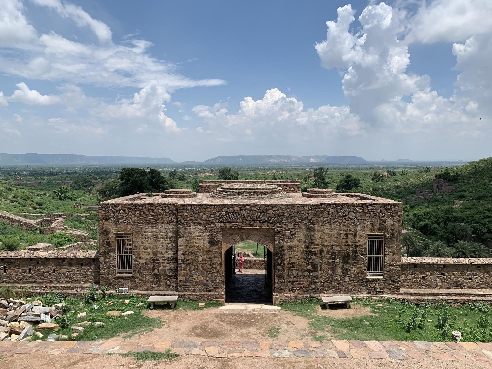
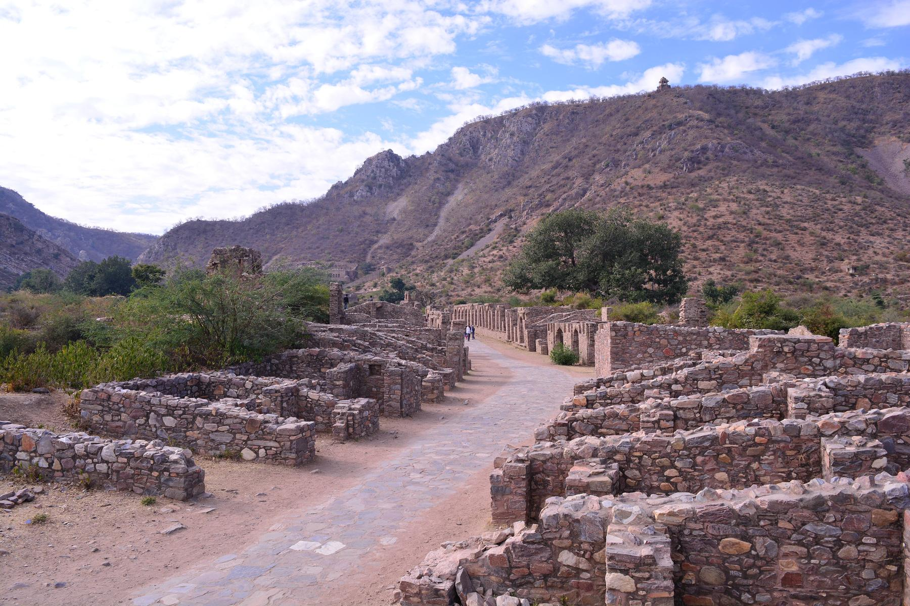
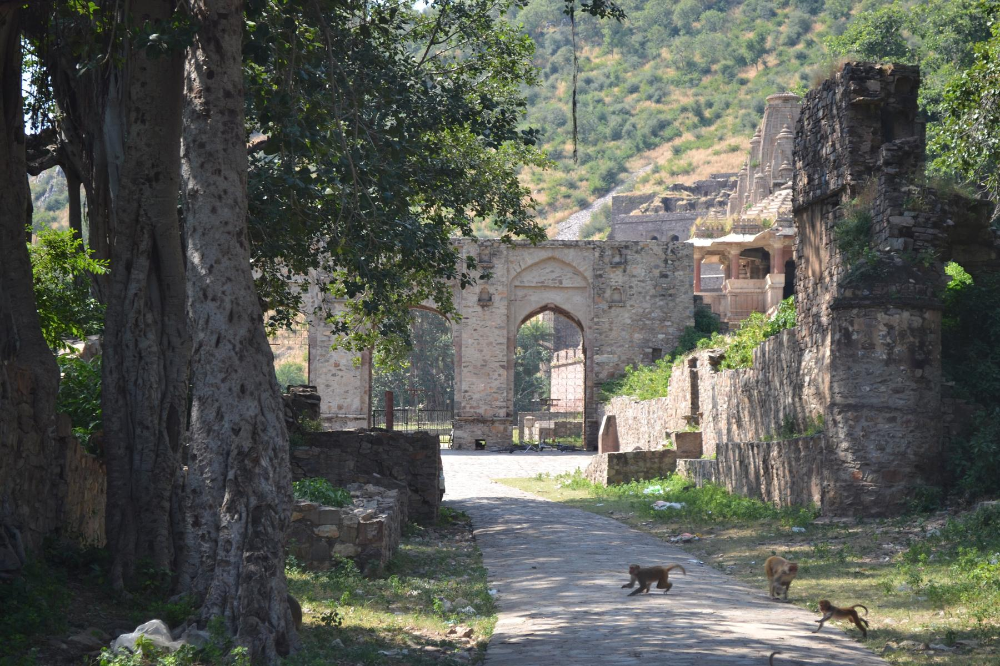

It is late afternoon in the Aravalli hills, and the light is turning orange. You are walking up a long, straight street paved with stone. On both sides are shops, dozens of them, their doorways open, their walls neatly built. Not one of them has a roof. A langur monkey watches you from a wall. Ahead, past a temple with carved pillars and a pool of green water, the street climbs toward a palace on the hillside, its upper floors broken off against the sky. There is no one here but tourists, monkeys and a guard who will soon start blowing a whistle, because at the gate there is a blue sign from the Archaeological Survey of India, and it says that entering after sunset is strictly forbidden.

This is Bhangarh, a town that was busy and prosperous four hundred years ago and is now completely empty. On the internet it is called the most haunted place in India. Locals will tell you about a curse, a holy man, a princess and a sorcerer. Get comfortable. Here are the stories, and here is what really happened.

## A prince's town

In the second half of the 16th century, the Kachwaha Rajputs of Amber, near today's Jaipur, made one of the most important decisions in Rajasthan's history. Instead of fighting the Mughal emperor Akbar, they allied with him. Raja Bharmal gave his daughter to Akbar in marriage, and the family's men became some of the emperor's most trusted generals. Bharmal's son, Bhagwant Das, and grandson, Man Singh, led Mughal armies from Kabul to Bengal.

That alliance made the family rich, and they spread their power through the hills around Amber. Bhagwant Das founded a new town at Bhangarh, at the foot of a steep hill in a valley about 50 miles northeast of Amber, and it became the seat of his younger son, Madho Singh, Man Singh's brother, who was himself a commander in Akbar's armies. The usual date given is 1573.

It was a planned town. A wall ran around it, with gates on each side. Inside, a straight main street, the market, ran up from the main gate, lined with shops built in identical rows. There were houses for merchants and officials, a dancers' quarter, a royal palace on the hill, and several fine temples: one to Gopinath, a form of Krishna, one to Someshwar, a form of Shiva, with a pool fed by a spring, and others to Keshav Rai and Mangla Devi. The temples are the best preserved buildings today, because they were built of better stone and their roofs were stone, not timber.

At its height, Bhangarh was probably home to a few thousand people. It had water, fields in the valley and a good position on the routes through the hills. Nothing about it suggests a town that was cursed.

*The remains of the royal palace on the hillside. Photo: [Chainwit.](https://commons.wikimedia.org/wiki/File:Bhangarh_Fort_-_Royal_Palace_Bhangarh_(July_2022)_-_img_02.jpg), CC BY-SA 4.0, via Wikimedia Commons*

## The slow emptying

What happened next is less dramatic than the legends. Madho Singh's descendants ruled Bhangarh for a few generations, but they were a minor branch of a great family, and as the Mughal empire weakened in the 1600s and 1700s, small states like theirs were squeezed. One of Madho Singh's grandsons, Ajab Singh, founded a new town, Ajabgarh, a few miles away, and moved there. Bhangarh lost its rulers and much of its reason to exist.

In the early 1700s, the area was taken over by Jai Singh II of Amber, the king who later built Jaipur. Bhangarh became a provincial outpost. Then, in the 1780s, a terrible famine swept across northern India. In many accounts it is this famine, coming after a long decline, that finally emptied the town: the people left for places with water and food, and they did not come back.

Once the people were gone, the buildings fell apart quickly. The houses and shops had roofs of timber and thatch, which rotted or were taken away. Stone was carried off to build villages nearby. The jungle and the monkeys moved in. By the time British officials passed through, Bhangarh was already a ruin, and the stories had already begun.

*Roofless houses in the old town, with the hills behind. Photo: [Nidhish 98](https://commons.wikimedia.org/wiki/File:Bhangarh_village_2.jpg), CC BY-SA 4.0, via Wikimedia Commons*

## The curse of the shadow

The oldest story about Bhangarh is about a holy man. When the town was founded, it is said, an ascetic named Guru Balu Nath lived on the hill and meditated there. He agreed to let the king build, on one condition: the shadow of the palace must never fall on his retreat. If it did, the town would be destroyed.

For a while the kings respected the bargain. Then a later ruler, in some versions Ajab Singh, raised the palace higher. Its shadow fell across the holy man's hermitage, and the curse took effect. The town was ruined overnight, and it is said that no roof built at Bhangarh will ever stay up. A small stone shrine, said to be Balu Nath's tomb, still stands in the ruins.

## The sorcerer and the princess

The second story is the one you'll hear most often. Bhangarh had a princess, Ratnavati, famous for her beauty. A sorcerer, a tantrik named Singhia who lived in the hills, fell in love with her and knew he could never marry her. One day he saw her maid buying scented oil in the market. He cast a spell on the oil so that whoever used it would fall in love with him.

The princess saw what he had done. She poured the oil onto a large rock, which rolled down the hill and crushed the sorcerer. As he died, he cursed the town: everyone in it would die, and their souls would never find rest. Not long afterward, Bhangarh went to war with Ajabgarh. The princess and the town's people were killed, and the ghosts, the story says, are still there after dark.

Both stories became famous much more recently than you might think. In the 2000s, Indian television shows, magazines and the early internet discovered Bhangarh, and the phrase "most haunted place in India" took off. The ASI sign at the gate, which in fact just says visitors are not allowed in between sunset and sunrise, became the most photographed part of the site. Today thousands of visitors come on weekends, many of them from Delhi and Jaipur, looking for a thrill.

Stand on the palace terrace in the last hour before closing and look down the empty street. It doesn't feel frightening so much as sad: a whole town, built with care, left to the wind. When the guard's whistle sounds and you walk back down to the gate, the monkeys take over again. Then the sun goes down, and nobody, living or otherwise, is allowed to see what happens next.

*The entrance to the fort complex, with its usual guards. Photo: [Himanshu Yogi](https://commons.wikimedia.org/wiki/File:Entrance_to_Bhangarh_Fort_Complex.JPG), CC BY-SA 3.0, via Wikimedia Commons*

## Legend or history?

> The Archaeological Survey of India has officially declared Bhangarh haunted, and its signboard warns that anyone who enters after dark will never come back.

**What we know:** The ASI board says only that entry before sunrise and after sunset is prohibited. Many protected sites close at sunset. At Bhangarh, the reasons are practical: it sits on the edge of Sariska Tiger Reserve, it has no lighting, and its broken walls and wells are dangerous in the dark. There is no official statement that it is haunted.

> The holy man Balu Nath cursed the town because a later king let the palace's shadow fall on his hermitage, and Bhangarh was destroyed overnight.

**What we know:** There is no record of a sudden destruction. The town declined over more than a century, after its ruling family moved to Ajabgarh and the area came under Amber, and it seems to have been finally abandoned after famine in the 1780s.

> The princess Ratnavati turned a sorcerer's love potion against him, and his dying curse doomed the town in a war with Ajabgarh.

**What we know:** There is no historical record of a princess Ratnavati of Bhangarh or a battle that destroyed the town. The story has the shape of many Rajasthani folk tales, and it has grown more detailed as it has been retold online.

## Local tellings

These are stories you will hear from guides, villagers and online. None of them can be confirmed.

- **Roofs won't stay up.** Villagers say any roof built near Bhangarh collapses. The real roofs of the old town were timber and thatch, and they rotted or were salvaged; the stone-roofed temples are still covered.
- **People who stayed the night disappeared.** Stories of vanished visitors circulate widely online, but none comes with names, dates or police records.
- **You can hear music from the dancers' quarter.** Visitors report bells and laughter at dusk. The valley is home to villages, temples and plenty of birds and monkeys, which make a lot of noise.
- **Cameras and phones stop working.** A common claim at "haunted" sites everywhere; heat, dust and dead batteries are likelier explanations.

## Things you probably didn't know

- **Its founder's family married into the Mughals.** The Kachwahas of Amber allied with Akbar, which is how they became rich enough to build towns like Bhangarh.
- **Its prince was a general.** Madho Singh, Bhangarh's first ruler, was the younger brother of Man Singh, one of Akbar's greatest commanders.
- **The temples are in better shape than the houses.** They had stone roofs; most of the town's buildings had roofs of wood and thatch.
- **There's a spring.** The Someshwar temple has a pool fed by a natural spring, and people still bathe there.
- **Tigers live next door.** Bhangarh is on the edge of Sariska Tiger Reserve, one of the reasons it is closed at night.
- **The "haunted" fame is recent.** Bhangarh became famous as a ghost site mostly in the 2000s, through television and the internet.

## Timeline

- **1562** The Kachwahas of Amber ally with the Mughal emperor Akbar.
- **c. 1573** Raja Bhagwant Das founds Bhangarh for his son Madho Singh.
- **1600s** Madho Singh's grandson Ajab Singh founds Ajabgarh nearby; Bhangarh declines.
- **Early 1700s** The area is absorbed by Jai Singh II of Amber.
- **1780s** Famine is said to empty what remains of the town.
- **2000s** Television and the internet make Bhangarh famous as "India's most haunted place."
- **Today** A protected monument of the Archaeological Survey of India, open from sunrise to sunset.

## If you go

Bhangarh is about 50 miles (80 km) northeast of Jaipur, a drive of two to two and a half hours, and about 150 miles (240 km) from Delhi. From the US, fly into Delhi and either drive down or take the train to Jaipur and hire a car for the day. The site is open from sunrise to sunset, and there is a small entry fee. Allow two to three hours to walk the market street, the temples and the climb to the palace, and wear good shoes. October to March is the best time; summer is fiercely hot. On the way, stop at the Chand Baori stepwell at Abhaneri, about an hour from Bhangarh, or combine the trip with a safari in Sariska.

There are few places to stay nearby with enough reviews to recommend, so most travelers make Bhangarh a day trip from Jaipur.

## Sources

- [Bhangarh Fort](https://en.wikipedia.org/wiki/Bhangarh_Fort), Wikipedia
- [Bhangarh Fort, Dausa](https://www.incredibleindia.gov.in/en/rajasthan/dausa/bhangarh-fort), Incredible India (Ministry of Tourism)
- [The Story of Bhangarh Fort, India's Most Notorious Haunted Site](https://theculturetrip.com/india/articles/the-story-of-bhangarh-fort-indias-most-notorious-haunted-site), Culture Trip
- [Bhangarh Fort Rajasthan](https://www.esamskriti.com/a/Rajasthan/Bhangarh-Fort-Rajasthan.aspx), eSamskriti

*Cover: the abandoned market street of Bhangarh. Photo: [BangDanC](https://commons.wikimedia.org/wiki/File:Bhangarh_Fort_of_Rajasthan.jpg), CC0, via Wikimedia Commons*
