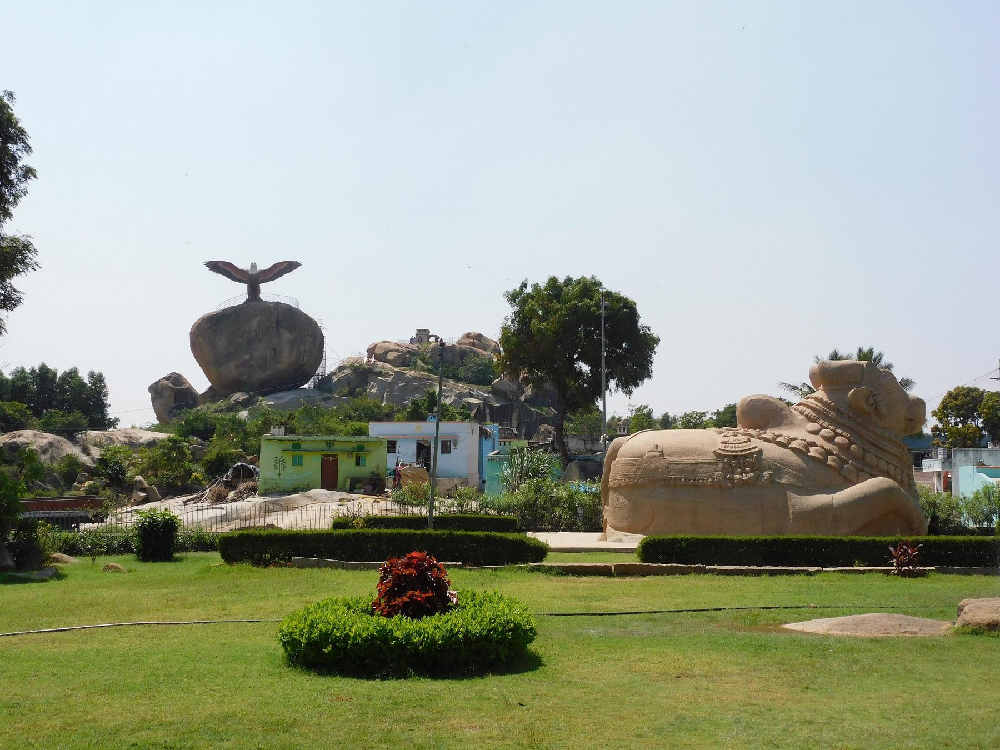
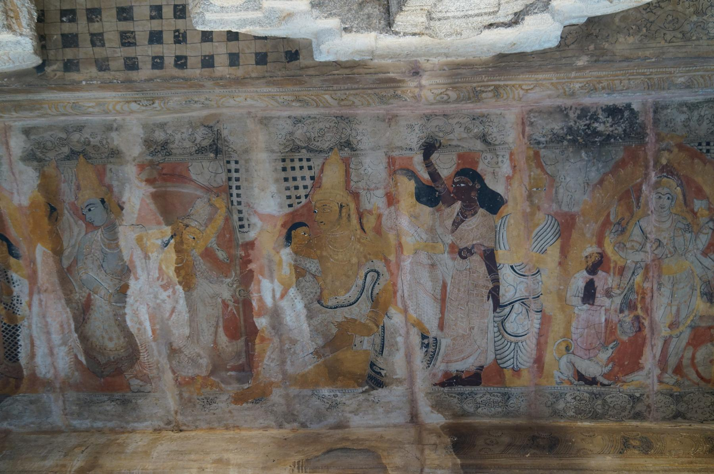
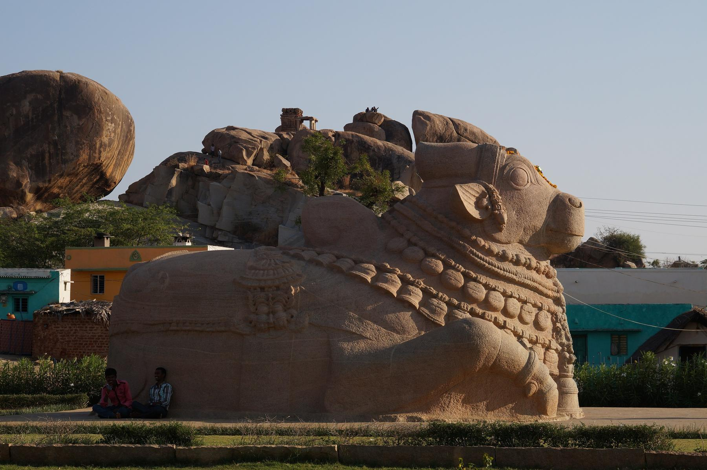
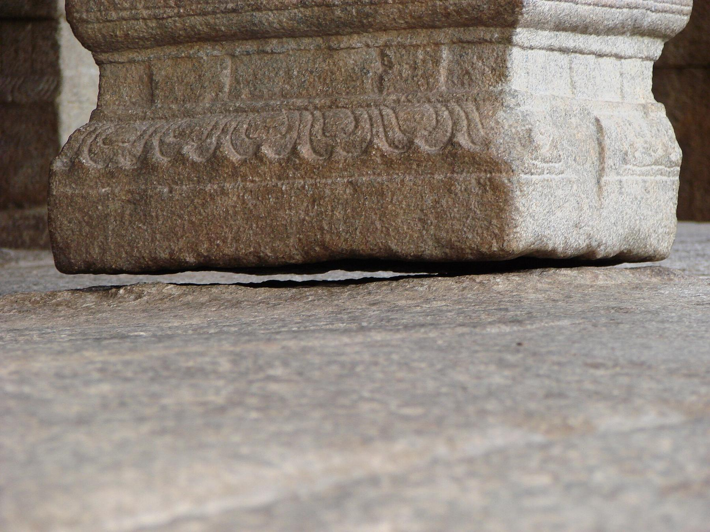

It is mid-morning in a dry, rocky corner of Andhra Pradesh, and a guide in a white shirt is crouching on the floor of a temple hall. He holds up a thin cotton cloth, the kind a man wears over his shoulder, and slowly slides it underneath one of the pillars, in one side and out the other. The pillar is about 15 feet tall and made of solid granite, and it is not quite touching the floor. A family from Bengaluru claps. A child asks to try. Somewhere above, painted gods look down from a ceiling that is nearly five hundred years old.

This is the Veerabhadra temple at Lepakshi, and the hanging pillar is only the beginning. Outside sits one of the biggest stone bulls in India. Inside, a seven-headed serpent coils over a lingam, and on a wall there are two dark red stains that people say were made by a man's eyes. Get comfortable. Here's the story of a wounded bird, two brothers, and a temple that gave a whole kingdom's crafts their name.

## Rise, O bird

The story of Lepakshi begins, as many stories in India do, with the Ramayana. After the demon king Ravana kidnapped Sita, the wife of Prince Rama, he carried her south through the sky in his flying chariot. An old vulture king, Jatayu, saw them and attacked. He fought bravely but he was old, and Ravana cut off his wing. Jatayu fell to earth.

When Rama and his brother Lakshmana came searching for Sita, they found the dying bird, who told them which way Ravana had gone. According to the local telling, Rama looked at him with compassion and said, in Telugu, *"Le, pakshi!"* "Rise, O bird!" And that, they say, is how the place got its name.

It's a lovely story, though there are a few problems with it, which we'll come to later. What matters is that people here have believed it for a very long time, and that the granite hill by the village, shaped a little like a tortoise, has been a sacred place for centuries. Today a huge modern sculpture of Jatayu, wings spread, stands on a rock near the temple to welcome visitors.

*The modern Jatayu sculpture on its rock, with the old stone Nandi beside it. Photo: [VasuVR](https://commons.wikimedia.org/wiki/File:LPK23_Lepakshi_-_Nandi_and_Jatayu.jpg), CC BY 4.0, via Wikimedia Commons*

## Two brothers and an empire

The temple you see today was built in the 1530s, at the height of the Vijayanagara empire, the great South Indian state whose capital was at Hampi. The emperor at the time was Achyuta Deva Raya, brother and successor of the famous Krishnadevaraya. His governor at Penukonda, a fortress town about 20 miles away, was a man named Virupanna, and he and his brother Viranna, both from a family of merchants, paid for a new temple on the tortoise-shaped hill at Lepakshi.

They dedicated it to Veerabhadra, a fierce warrior form of Shiva, born, in the myth, from Shiva's rage when his wife Sati died. And they spared no expense. The temple was built in the full Vijayanagara style: enclosure walls, gateways, a main shrine and a series of halls on pillars, every one of them carved with dancers, drummers, gods, sages and animals.

The great hall in front of the shrine, the dance hall or *natya mandapa*, has some of the finest carving. Its pillars show Shiva dancing, Brahma playing a drum, celestial musicians, and the river goddesses Ganga and Yamuna at the entrance. Look up and the ceiling is painted. The murals of Lepakshi are among the best surviving paintings of the Vijayanagara period anywhere, scenes from the epics and the Puranas in reds, ochres, greens and black, with figures in elaborate saris and turbans, as if the court of Hampi had been painted onto the ceiling. One painting of Veerabhadra is said to be about 24 feet by 14 feet, one of the largest single murals of its age in India.

*Part of the painted ceiling, one of the finest surviving Vijayanagara murals. Photo: [రహ్మానుద్దీన్](https://commons.wikimedia.org/wiki/File:Ceiling_painting_2,_Lepakshi.JPG), CC BY-SA 4.0, via Wikimedia Commons*

## A serpent before lunch

Around the back of the main shrine, carved directly into a granite boulder, is the temple's most startling sculpture: a giant serpent, its seven hooded heads raised and spread like an umbrella over a Shiva lingam. Its coils wrap around the lingam three times. It is cut from the living rock, and it is huge, perhaps the largest of its kind in India.

Nearby, a big Ganesha is carved into the same rock. And about 200 yards from the temple, facing the serpent and the lingam, lies Nandi, Shiva's bull. He is carved from a single boulder, about 15 feet high and 27 feet long, wearing bells and garlands carved in stone, and he is one of the largest monolithic Nandis in India. He sits with his head turned slightly, as if he has just heard someone call his name.

The temple also has a hall that was never finished: the *kalyana mandapa*, the wedding hall, meant for the ceremonial marriage of Shiva and Parvati. Its pillars stand in the open air, carved with gods and guests who never got their roof. The reason it was left unfinished, the story goes, is the darkest legend of Lepakshi, and we'll come to it below.

*The great Nandi, carved from a single boulder. Photo: [రహ్మానుద్దీన్](https://commons.wikimedia.org/wiki/File:Lepakshi_nandi_7.JPG), CC BY-SA 4.0, via Wikimedia Commons*

## The pillar that hangs

And then there is the pillar. The *natya mandapa* has about seventy pillars, and one of them, near the southwest corner, hangs. Its base sits a fraction of an inch above the floor, enough to slide a thin cloth, a sheet of paper or a slim stick underneath. For generations, visitors have passed cloths under it for luck.

How it came to hang is a puzzle. The most likely explanation is that it was never meant to: the roof of the hall is heavy, and over the centuries, as the building settled, the weight shifted onto the surrounding pillars and the roof beams, leaving this one slightly lifted. The popular version is more dramatic: during British rule, an engineer, curious to find out how the temple stood up, tried to move the pillar and found it held up by the roof. In some tellings he nudged it out of place, and it has hung ever since.

Lepakshi's fame spread far beyond the village. When the government of Andhra Pradesh set up its state handicrafts emporium, it named it Lepakshi, and today there are Lepakshi stores selling Kondapalli toys, Kalamkari cloth and Bidri metalwork in cities across India. In 2022, the temple was added to India's tentative list for UNESCO World Heritage status.

Come back to the hall in the late afternoon, when the light slants in low and gold. The guides have gone home. The hanging pillar stands in its corner, not quite touching the floor, as it has for longer than anyone can remember. Slide your hand underneath if you like. Nobody will clap, but it still feels like magic.

*The hanging pillar: the gap between its base and the floor. Photo: [Mahesh Telkar](https://commons.wikimedia.org/wiki/File:Hanging_Pillar,_Veerabhadra_Temple,_Lepakshi,_Andhra_Pradesh,_India_(2006).jpg), CC BY-SA 3.0, via Wikimedia Commons*

## Legend or history?

> When Rama found the vulture Jatayu dying after his fight with Ravana, he said "Le pakshi," Telugu for "Rise, O bird," and the place has been called Lepakshi ever since.

**What we know:** The Ramayana does tell of Jatayu's fight with Ravana and his meeting with Rama, but it places it elsewhere, and other towns in India also claim the spot where Jatayu fell. Rama would not have spoken Telugu, which developed more than a thousand years after the epic was first composed. The name is old, but its real origin is unknown.

> Virupanna built the temple with money from the royal treasury, without the king's permission. When the king found out, he ordered Virupanna blinded. Rather than wait for his punishment, Virupanna put out his own eyes and threw them at the wall of the unfinished wedding hall, where two red stains can still be seen. Some say the name means *lepa akshi*, "blinded eye."

**What we know:** There are reddish stains on the wall, but no inscription or record tells this story, and the temple's inscriptions credit the brothers as its builders and donors. The wedding hall may simply have been left unfinished when the Vijayanagara empire collapsed after its defeat at Talikota in 1565. The story is local tradition, and a very old one.

## Local tellings

These are stories you will hear from guides and online. None of them can be confirmed.

- **The serpent was carved while lunch was cooking.** Guides say the sculptors carved the seven-headed serpent in the time it took their mother to cook a meal, and when she saw it she was so amazed that she cracked it with her gaze. There is a crack in the rock; the carving would have taken weeks at least.
- **A British engineer moved the pillar.** It's widely told, but no name or record of the work has been found, and the gap may simply have come from the building settling.
- **There's a footprint of Sita.** A large footprint in the rock floor, always kept wet, is said to be Sita's, or Durga's. It is a revered spot, but its origin can't be known.
- **The Nandi faces the serpent for a reason.** People say the bull guards the lingam beneath the serpent's hoods. That fits the usual temple layout, where Nandi faces Shiva's shrine.

## Things you probably didn't know

- **It gave its name to a chain of shops.** Andhra Pradesh's state handicrafts emporium is called Lepakshi.
- **The Nandi is about 27 feet long.** It's carved from a single granite boulder.
- **The painted ceiling is about five hundred years old.** Lepakshi has some of the best surviving murals of the Vijayanagara period.
- **It's tied to Hampi.** Lepakshi was built by governors of the Vijayanagara empire; after the fall of Hampi in 1565, the emperors moved their capital to Penukonda, just 20 miles away. ([Read the story of Vijayanagara](/stories/2026/vijayanagara/).)
- **The hill is said to be shaped like a tortoise.** It's known as Kurma Shaila, the tortoise hill.
- **It's on India's UNESCO tentative list.** It was added in 2022.

## Timeline

- **1530s** Virupanna and Viranna, governors at Penukonda under Achyuta Deva Raya, build the Veerabhadra temple.
- **1565** The Vijayanagara empire is defeated at Talikota; its capital moves to Penukonda.
- **Later centuries** The wedding hall stays unfinished; worship continues.
- **20th century** The temple becomes a protected monument and a pilgrimage and tourist site.
- **2022** Lepakshi is added to India's tentative list for UNESCO.
- **Today** A working temple and a popular day trip from Bengaluru.

## If you go

Lepakshi is about 75 miles (120 km) north of Bengaluru, a drive of two to two and a half hours on the highway to Hyderabad, which makes it an easy day trip. From the US, fly into Bengaluru (Kempegowda International Airport, which is on the right side of the city for Lepakshi) and hire a car and driver for the day. There is no entry fee. The temple is a working shrine, so dress modestly and leave your shoes at the entrance. Mornings are cooler and quieter; afternoons in April and May are very hot. Allow two hours for the temple, the Nandi and the Jatayu statue, and combine it with the hill fort at Penukonda or the Nandi Hills on the way back.

Since Lepakshi is a day trip, stay in Bengaluru; there are no hotels near the temple that we can recommend.

## Sources

- [Veerabhadra Temple, Lepakshi](https://en.wikipedia.org/wiki/Veerabhadra_Temple,_Lepakshi), Wikipedia
- [Lepakshi Temple](https://www.incredibleindia.gov.in/en/andhra-pradesh/anantapur/lepakshi-temple), Incredible India (Ministry of Tourism)
- [The hanging pillar and legends of the Lepakshi temple](https://30stades.com/travel/hanging-pillar-legends-of-lepakshi-temple-veerbhadra-andhra-architecture-history), 30 Stades
- [Lepakshi: an underrated marvel hidden in plain sight](https://www.pressreader.com/india/the-hindu-visakhapatnam-9WWH/20240316/281633900216999), The Hindu

*Cover: the carved pillars of the Veerabhadra temple. Photo: [Nitinv29](https://commons.wikimedia.org/wiki/File:Pillars_at_the_Veerabhadra_Temple,_Lepakshi,_Andhra_Pradesh,_India_(2011).jpg), CC BY-SA 3.0, via Wikimedia Commons*
