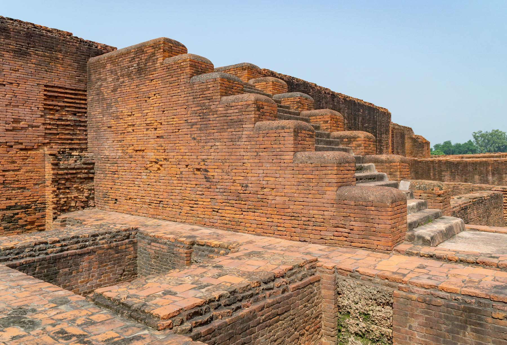
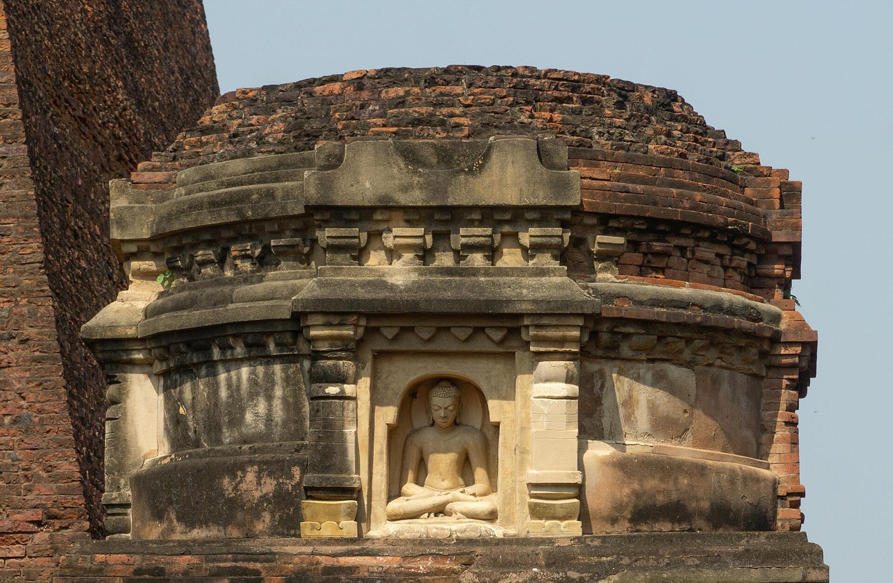

It is the year 637, and a Chinese monk in his mid-thirties is standing at a gate in the plains of eastern India. He has walked here from the city of Chang'an, across deserts and over the Hindu Kush, a journey that has taken him the best part of eight years. His name is Xuanzang. In front of him are rows of brick monasteries several stories high, temples with towers, ponds full of blue lotus, and crowds of monks in saffron robes. A gatekeeper steps out to test him. Many who arrive here, the gatekeepers say, turn back before they get in.

Xuanzang gets in. He will spend years here studying, and when he finally goes home he will carry hundreds of texts back to China. The place is called Nalanda, and for centuries it was the most famous center of learning in Asia. Then, in the space of a few generations, it disappeared, and for six hundred years nobody knew where it had been. Get comfortable. Here's the story of the great monastery, and the fire everyone has heard about.

## A university of monks

Nalanda began as a Buddhist monastery, a *mahavihara*, or great monastery, in the 5th century, during the reign of the Gupta kings, who ruled much of northern India from their capital at Pataliputra, today's Patna. A king named Kumaragupta is usually credited with founding it, and his successors added buildings, one after another.

The place was close to the heart of Buddhism. The Buddha himself had walked these plains a thousand years before, and his disciple Sariputra was said to have been born and died nearby. Monks had long gathered here. What made Nalanda different was what it became: not just a place to meditate and pray, but a place to study, argue and teach, with resident scholars, libraries and students from far away.

It grew for centuries. In the 7th century, the emperor Harsha gave it the revenue of whole villages. From the 8th century, the Pala kings of Bengal and Bihar, devoted Buddhists, became its great patrons, and it reached its widest fame. Monks came from China, Korea, Tibet, Sri Lanka and the islands of Southeast Asia. A king of Sumatra paid for a monastery there.

The site that archaeologists have uncovered is huge: a line of eleven large monasteries, each a square of small brick cells around a courtyard, facing a row of temples and stupas. Students lived two to a cell, slept on stone beds, kept their books in wall niches and cooked in shared kitchens. The biggest temple, today called Temple 3, was rebuilt at least seven times, each new version built over the last, until it became the great brick mound you see today.

*Part of Monastery 5, where students lived in small brick cells. Photo: [Sumitsurai](https://commons.wikimedia.org/wiki/File:Monastery_5_-_Nalanda_Mahavihara_(1).jpg), CC BY-SA 4.0, via Wikimedia Commons*

## What Xuanzang saw

Most of what we know about daily life at Nalanda comes from two Chinese monks. Xuanzang studied there in the 630s and 640s under its head, a very old teacher named Shilabhadra. Later, in the 670s and 680s, another Chinese monk named Yijing spent about ten years at Nalanda and wrote a detailed account of its rules.

They describe a place of discipline and debate. Days were organized by a water clock. Monks studied Buddhist philosophy, especially the subtle schools of the Mahayana, but also logic, grammar, medicine and the texts of other religions, so they could argue against them. Admission was hard: according to Xuanzang's biography, the gatekeepers questioned newcomers, and seven or eight in ten turned away. Chinese accounts speak of as many as several thousand monks living there at once, and one gives the number as ten thousand. Those numbers are probably generous, but even a fraction of them would make Nalanda one of the largest institutions of learning anywhere in the world at the time.

Its teachers became famous across Asia. Later Tibetan traditions remember scholars such as Shantarakshita, who helped bring Buddhism to Tibet in the 8th century, and Naropa, whose teachings are still studied in Tibetan monasteries today. Tibetan writers, much later, also describe Nalanda's library: three great buildings with poetic names, the Ocean of Jewels, the Sea of Jewels and the Delighter of Jewels, one of them nine stories high. No trace of those buildings has been identified, and the description may be more legend than blueprint, but it tells you how Nalanda was remembered.

*A stucco Buddha on one of the votive stupas around Temple 3. Photo: [Sumitsurai](https://commons.wikimedia.org/wiki/File:Temple_3_-_Sariputta_Stupa_-_Stucco_Works_-_Nalanda_Mahavihara_(19).jpg), CC BY-SA 4.0, via Wikimedia Commons*

## The raid

In the 1190s, a Turkish commander named Bakhtiyar Khalji, serving the new Delhi Sultanate, led raids into Bihar with a small force of cavalry. A Persian historian named Minhaj-i Siraj, writing about fifty years later, describes how Bakhtiyar attacked a fortified place full of shaven-headed men and books. His soldiers killed the men, and only afterward found out that the place was a college, a *madrasa*, and that the whole fort was a seat of learning. The Persian word they used for it gave its name to the region: *vihara*, monastery, became Bihar.

This passage is the main source for the famous story that Bakhtiyar burned Nalanda. But Minhaj does not name Nalanda, and many historians think the place he describes was another great monastery, Odantapuri, at what is now the town of Bihar Sharif, about 6 miles away. Nalanda may well have been raided in the same campaigns, but the evidence is not as clear as the story suggests.

What we do know is that Nalanda did not die in a single night. Around 1235, a Tibetan monk named Dharmasvamin traveled to Nalanda and later wrote about it. He found it damaged and largely deserted. But it was not empty: a ninety-year-old teacher named Rahula Shribhadra was still there, teaching about seventy students. While Dharmasvamin was there, Turkish soldiers came through again, and the old teacher and his student hid until they had gone.

After that, there is silence. Without royal patrons, with its monasteries damaged and Buddhism fading across northern India, Nalanda simply ran out of people. The brick buildings collapsed into mounds, the mounds were covered by earth and fields, and the name was half forgotten.

## Rediscovery and rebirth

In the early 1800s, a Scottish surveyor named Francis Buchanan noted large ruins near the village of Bargaon. In the 1860s, the British archaeologist Alexander Cunningham, using Xuanzang's travel account as a guidebook, identified them as Nalanda. Clay seals found later in the excavations confirmed it: they were stamped with the name of the community of monks of the great monastery of Nalanda.

Excavations by the Archaeological Survey of India, mainly between 1915 and 1937, uncovered the monasteries and temples you can walk through today. Even now, only part of the ancient site has been dug. In 2016, UNESCO added the Archaeological Site of Nalanda Mahavihara to its World Heritage List.

Nalanda has also come back to life in another way. In 2010, the Indian government passed a law to found a new Nalanda University, with the support of countries across East Asia, and it began teaching a few years later. Its new campus, near the town of Rajgir, about 10 miles from the ruins, opened in 2024.

Walk through the old site in the early morning, when the mist hangs over the lawns and the bricks are dark red with dew. Stand in a student's cell, with its stone bed and its book niche, and look out at the courtyard. Fourteen hundred years ago, someone sat here memorizing a difficult text, a long way from home, and hoping to pass the gatekeepers' test.

## Legend or history?

> In about 1193, Bakhtiyar Khalji burned the library of Nalanda, and it held so many books that the fire burned for three months, filling the sky with smoke.

**What we know:** The "three months" detail appears in modern retellings, not in any record from the time. The only near-contemporary source, Minhaj-i Siraj, describes Bakhtiyar's men sacking a monastery full of books in Bihar, but does not name Nalanda, and many historians identify that place as Odantapuri. A Tibetan visitor found Nalanda damaged but still teaching in the 1230s, so its end was gradual, not a single fire.

> Nalanda's library was burned by two angry Hindu mendicants, who set fire to it after being insulted by young monks.

**What we know:** This version comes from Tibetan histories written centuries later, especially one by the Tibetan scholar Taranatha in the early 1600s. Some modern writers have promoted it as the "real" story, but it is no better supported by early evidence than the Bakhtiyar version. Both should be treated as later traditions.

> Nalanda was the world's first residential university, with ten thousand students and two thousand teachers.

**What we know:** These numbers come from the biography of Xuanzang, written by his disciples, and they are probably rounded up. Other residential centers of learning existed in India and elsewhere at the time. But Nalanda was certainly one of the largest and most famous institutions of learning in the medieval world.

## Local tellings

These are stories you will hear from guides and online. None of them can be confirmed.

- **Aryabhata taught here.** The great 5th-century astronomer is often said to have been head of Nalanda. There is no evidence for it, though he worked in the region.
- **There are still books under the ground.** Guides sometimes say unexcavated parts of the library survive. Palm-leaf and birch-bark manuscripts would not survive centuries in damp earth.
- **Nagarjuna founded it.** The great Buddhist philosopher Nagarjuna is linked to Nalanda in Tibetan tradition, but he lived centuries before the monastery existed as we know it.
- **The ashes are still visible.** Visitors are sometimes shown dark layers in the walls as signs of the great fire. Archaeologists did find traces of burning, but fires happened at different times and can't all be tied to one raid.

## Things you probably didn't know

- **Students lived two to a cell.** Each small room had stone beds and niches for books and lamps.
- **There was an entrance exam.** Xuanzang's biography says most applicants failed the gatekeepers' questions.
- **A Sumatran king paid for a monastery.** An inscription records a grant made at the request of a king of the Srivijaya empire.
- **Temple 3 was rebuilt at least seven times.** Each version was built over the last.
- **Its seals confirmed its name.** Clay seals reading the name of the monks of Nalanda were found in the excavations.
- **Bihar is named after monasteries.** The word comes from *vihara*, a Buddhist monastery.
- **It's been refounded.** A new Nalanda University opened its campus near Rajgir in 2024.

## Timeline

- **5th century** Nalanda is founded under the Gupta kings.
- **630s–640s** Xuanzang studies at Nalanda.
- **670s–680s** Yijing spends about ten years there.
- **8th–12th century** The Pala kings are its great patrons.
- **c. 1193–1200** Bakhtiyar Khalji's raids in Bihar.
- **c. 1235** Dharmasvamin finds Nalanda damaged but still teaching.
- **1860s** Alexander Cunningham identifies the ruins.
- **1915–1937** Main excavations by the Archaeological Survey of India.
- **2016** UNESCO World Heritage Site; a new Nalanda University campus opens in 2024.

## If you go

The ruins are about 55 miles (90 km) southeast of Patna, which has the nearest major airport; the drive takes about two and a half to three hours. Gaya airport, near Bodh Gaya, is a similar distance. From the US, fly into Delhi or Kolkata and connect to Patna or Gaya. The site is open daily from about 9 am to 5 pm, and foreign visitors pay a few hundred rupees. Allow two to three hours, plus an hour for the small museum across the road and the Xuanzang Memorial Hall nearby. October to March is the best season; summer is extremely hot. Most visitors stay in Rajgir, about 8 miles away, and combine Nalanda with Bodh Gaya, where the Buddha attained enlightenment.

In Rajgir, the [Indo Hokke Hotel](aff:agoda/partners/partnersearch.aspx?pcs=1&hid=59534569), built for Buddhist pilgrims, is quiet and well run (8.8 from 84 reviews on Agoda, around $45 a night), and [The Rajgir Residency](aff:agoda/partners/partnersearch.aspx?pcs=1&hid=8496026) is a reliable alternative (8.1 from 240+, around $50).

## Sources

- [Archaeological Site of Nalanda Mahavihara at Nalanda, Bihar](https://whc.unesco.org/en/list/1502/), UNESCO World Heritage Centre
- [Nalanda](https://en.wikipedia.org/wiki/Nalanda_mahavihara), Wikipedia
- [Nalanda](https://www.britannica.com/place/Nalanda), Encyclopaedia Britannica
- [Did Bakhtiyar Khilji destroy Nalanda University?](https://thewire.in/history/did-bakhtiyar-khilji-destroy-nalanda-university), The Wire
- [Turkish raiders destroy Buddhist university of Nalanda](https://www.ebsco.com/research-starters/history/turkish-raiders-destroy-buddhist-university-nalanda), EBSCO Research Starters

*Cover: the great stupa of Temple 3 at Nalanda. Photo: [Sumitsurai](https://commons.wikimedia.org/wiki/File:Temple_3_-_Sariputta_Stupa_-_Nalanda_Mahavihara_(10).jpg), CC BY-SA 4.0, via Wikimedia Commons*
