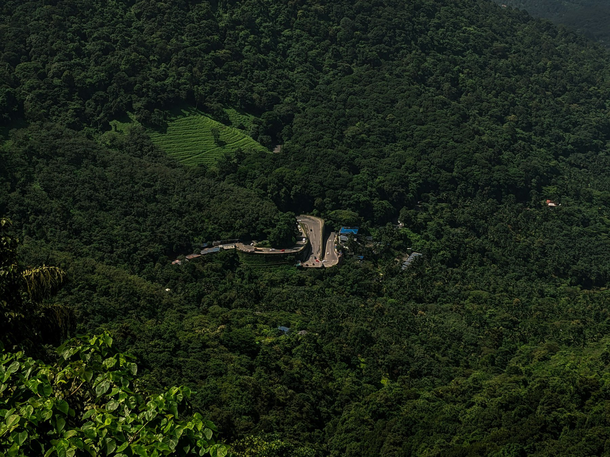
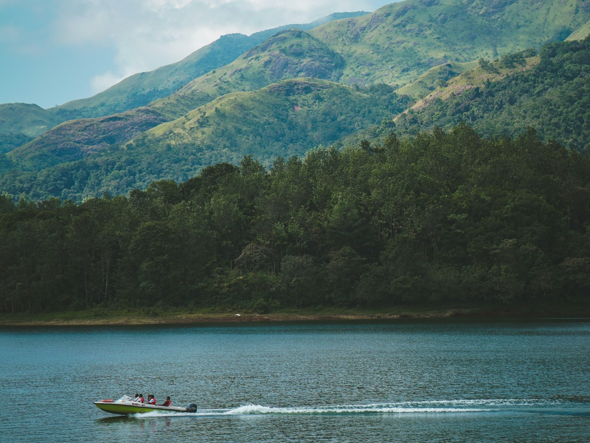
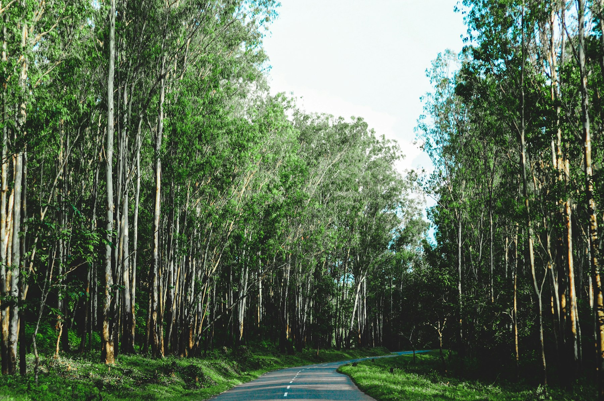
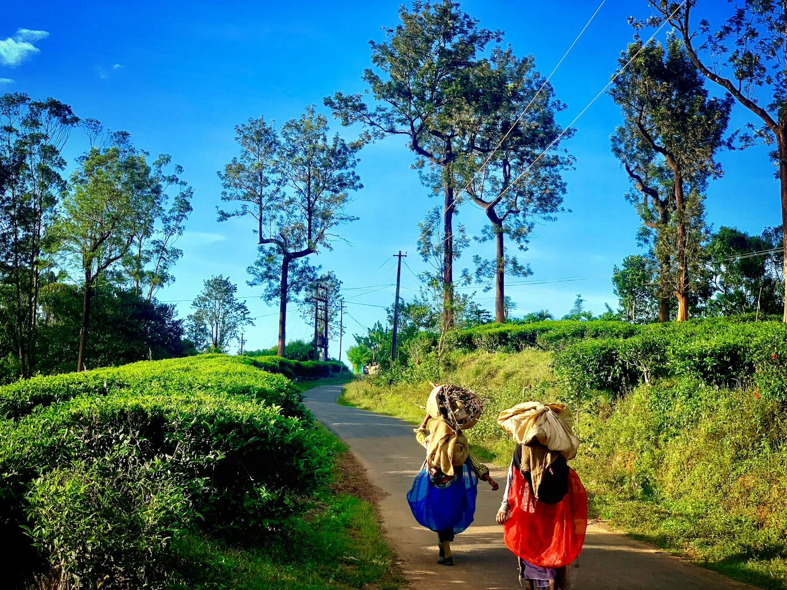

At ten to nine at night the cars at the Muthanga checkpost start to bunch up, engines running, drivers glancing at the clock on the dashboard. At nine the barrier comes down and stays down until six in the morning, and the 20 km of forest road between Kerala and Bandipur goes back to the elephants. Get through before it, and an hour later you're in a cold room in Sulthan Bathery with coffee bushes outside the window and the smell of rain on laterite.

Wayanad is the easiest hill country to reach from Bengaluru that still feels wild. It's for people who want a long weekend of forest drives, a proper climb, a jeep safari and very good Malabar food, without the queues of Ooty or Coorg's resort sprawl. You can do it in your own car or on an overnight bus, and four days is enough.

## At a glance

| | |
| --- | --- |
| Best time to go | October to May; June to September is heavy monsoon |
| Days you need | 4 days, 3 nights |
| Getting there | Drive via Mysuru and Bandipur, or an overnight KSRTC bus |
| Daily budget | ₹3,000 – ₹10,200 (about $35 – $120) |
| Language | Malayalam; Kannada and English widely understood |
| Currency | Indian Rupee (₹); UPI almost everywhere |
| Good for | Wildlife, short treks, coffee estates, food, long weekends |

## Why go

Wayanad is a plateau at about 700–2,100 metres, wedged between Karnataka's Bandipur and Nagarhole and Tamil Nadu's Mudumalai. That makes it the Kerala end of one of Asia's largest forest blocks, and you feel it: elephants cross the highway near Muthanga, and the jeep safaris here are cheaper and quieter than across the border. The farms in between grow coffee, pepper, tea, cardamom and the district's own scented rice.

It also has more history than most hill stations. Edakkal's rock carvings are thousands of years old, Sulthan Bathery takes its name from Tipu Sultan's ammunition store, and Pazhassi Raja fought the British from these forests with Kurichiya archers until he was killed in 1805. Wayanad has the largest Adivasi population in Kerala, and their crafts, rice and food are part of the trip if you look for them.

## Getting there

**By road (the usual way):** Bengaluru to Sulthan Bathery is about 260 km via Mysuru, Gundlupet and the Bandipur–Muthanga forest on NH766, roughly 6–7 hours. The forest stretch is closed to private vehicles from 21:00 to 06:00, so leave Bengaluru by 06:00 and you'll have the morning light in Bandipur. The other route, via Mysuru, HD Kote and Bavali into Mananthavady, passes through Nagarhole and closes earlier in the evening. Both checkposts are strict, so plan your return to clear them well before closing.

**By bus:** Over 90 buses a night run from Bengaluru to Kalpetta, including KSRTC (both Karnataka's and Kerala's) and private sleepers. Most leave between 21:00 and 23:00 and arrive at 05:00–07:00, and fares run about ₹550–1,400 by class. Compare them on [redBus](aff:redbus/bus-tickets/bangalore-to-kalpetta), which also lists [buses to Sulthan Bathery](aff:redbus/bus-tickets/bangalore-to-sulthan-bathery) if you'd rather start in the east.

**By train and air:** There's no railway in Wayanad. The fastest rail option is a train to Mysuru (about 2–3 hours on [IRCTC](aff:irctc/nget/train-search)), then a bus or cab for the last 110 km to Sulthan Bathery. From the Kerala side, Kozhikode station and Kozhikode airport (CCJ) are about 75–100 km from Kalpetta up the Thamarassery ghat, and Kannur airport is about 90 km from Mananthavady.

*The ghat road's hairpins from above. Photo: [Vishnu vs](https://unsplash.com/photos/a-scenic-view-of-a-lush-green-valley-Mxx9c6KA20I) on Unsplash*

## Getting around

Wayanad's sights are spread over a district about 70 km across, between three small towns: Sulthan Bathery in the east, Kalpetta in the middle and Mananthavady in the north.

- **Your own car:** the easiest option. Roads are good but narrow and twisty, and buses take the middle of them. Watch for elephants after dusk near Muthanga and Tholpetty, and never stop to photograph them.
- **Hired car or jeep:** expect ₹2,800–3,500 a day with a driver for 8 hours and about 100 km. Taxi stands in all three towns quote fixed sightseeing packages, and drivers know which sights are open that week.
- **KSRTC buses:** Kerala's red buses link Kalpetta, Bathery and Mananthavady every 10–20 minutes for ₹30–110 a ride. They're fine for town-to-town hops but slow for the sights, which sit off the main roads.
- **Scooters and autos:** Kalpetta and Vythiri rent scooters for about ₹500 a day. There's no Uber or Ola, so agree auto fares before you get in.

## Where to stay

- **Vythiri and Lakkidi:** at the top of the ghat, near Pookode Lake and Lakkidi's viewpoint; the coolest, greenest base and the closest for Kozhikode. [Dhanagiri Homestay](aff:agoda/partners/partnersearch.aspx?pcs=1&hid=3084301) is the best-reviewed stay (9.3 from nearly 190 reviews, around ₹6,500), [Abad Brookside](aff:agoda/partners/partnersearch.aspx?pcs=1&hid=26059817) is the reliable mid-range resort (8.7 from 740+, around ₹6,500), and [Leaves Resort](aff:agoda/partners/partnersearch.aspx?pcs=1&hid=45386359) is the budget pick (8.9, around ₹3,600). For a splurge, CGH Earth's [Wayanad Wild](aff:agoda/partners/partnersearch.aspx?pcs=1&hid=1637402) sits in rainforest on the edge of Lakkidi (9.1 from 440+, around ₹18,500).
- **Kalpetta:** the district's main town, central for Banasura and Karlad, with the most restaurants and bus links. [Woodrose Resort](aff:agoda/partners/partnersearch.aspx?pcs=1&hid=38142681) is a short walk from town (9.2 from 50+, around ₹4,800), and [Munderi Green Mounts](aff:agoda/partners/partnersearch.aspx?pcs=1&hid=82218895) has family rooms and a pool for under ₹2,000 (8.6). Backpackers should head to [Crossroads Hostel 1957](aff:agoda/partners/partnersearch.aspx?pcs=1&hid=63719119) at Varadoor, 15 km east of Kalpetta (8.9 from 120+, around ₹1,200 for two).
- **Sulthan Bathery:** best for Edakkal, Muthanga and Phantom Rock. [Sterling Wayanad](aff:agoda/partners/partnersearch.aspx?pcs=1&hid=2735465) is the dependable family resort (8.4 from 1,000+, around ₹6,000) and [Elephant House](aff:booking/hotel/in/elephant-house-the-royal-resorts-amp-villas.html) is a smaller, newer pick (9.4, around ₹3,400). [Pepper Trail](aff:agoda/partners/partnersearch.aspx?pcs=1&hid=2818356), a working coffee and pepper estate, is one of Wayanad's top-rated stays (9.3 from 180+, from about ₹15,900).
- **Mananthavady:** quieter, closest to Thirunelli, Kuruva and Tholpetty. [Parisons Plantation Experiences](aff:agoda/partners/partnersearch.aspx?pcs=1&hid=770141) puts you in an old planter's estate (9.0 from 160+, around ₹9,500), and [Royal Wooden Villa](aff:agoda/partners/partnersearch.aspx?pcs=1&hid=49484905) is the value choice (8.9 from 210, around ₹3,600).

*Ratings are guest scores on the booking site each link goes to, and prices are typical December weeknight rates for two, both checked in November 2026.*

## Top things to do

### Climb to the carvings in Edakkal Caves

Edakkal isn't really a cave. A huge boulder fell into a crack in Ambukuthi Mala and left a high, narrow chamber whose walls are covered in carved figures, animals and symbols, some of them several thousand years old. The climb from the parking area is about a kilometre, steep at the end, with iron ladders and steps. The caves open from about 08:30 to 16:00, are closed on Mondays, and admit a capped number of visitors a day, so arrive when the counter opens. Tickets are cash only and inexpensive.

### Take a jeep safari in Muthanga

Muthanga is the Kerala side of the Bandipur–Mudumalai forest, and on a two-hour jeep drive you'll usually see elephants, gaur, spotted deer and langurs, with a small chance of a tiger. Jeeps run from about 07:00 to 10:00 and 15:00 to 17:00. There's no advance booking: the forest office hands out permits in the order people arrive, so be there by 06:30 for the morning slot. A jeep for up to seven costs about ₹600 plus a per-person entry fee and the guide. Pack [compact binoculars](aff:amazon/s?k=compact+binoculars+10x25) for birds and the distant animals.

### Ride the reservoir at Banasura Sagar

Banasura Sagar, 21 km from Kalpetta at Padinjarathara, is India's largest earth dam. The water flooded the valley below Banasura Hill and left a scatter of green islands. Walk out along the dam wall, then take a speedboat or pedal boat out among the islands, best in the afternoon light. Entry is a small fee and boats cost extra. The car park and boat queue get busy at weekends, so a weekday morning is calmest.

*A speedboat on the water below Wayanad's hills. Photo: [Firosnv. Photography](https://unsplash.com/photos/white-and-red-boat-on-water-during-daytime-luMDvpazO_Y) on Unsplash*

### Stand at the top of the ghat at Lakkidi

Lakkidi is where NH766 tops the Thamarassery ghat after nine hairpin bends, and the viewpoint looks straight down the drop to the Kozhikode plains. Come early, when cloud often fills the valley below. Nearby, on the highway, is the "chain tree", a fig with a chain around it. The legend says it holds the spirit of Karinthandan, a Paniya man who showed a British engineer the route up the pass and was killed for it.

### Row on Pookode Lake

Pookode is a small, natural freshwater lake in the forest 3 km from Lakkidi, run by the district tourism council. Pedal boats and rowing boats go out for half an hour, and a path runs all the way around under the trees. It's busiest from 11:00 to 15:00, so come at opening (about 09:00). Wear shoes you don't mind getting muddy. The stalls at the gate sell Wayanad coffee, honey, spices and bamboo crafts at fair prices.

### Cross to Kuruvadweep on a bamboo raft

Kuruvadweep (Kuruva Island) is a cluster of forested islands in the Kabini River, about 17 km from Mananthavady. You reach them on bamboo rafts, then walk forest trails between river channels where you'll see more birds than people. Since the 2024 landslides it has opened with a daily visitor cap, and it closes completely from June to September. Check with the DTPC or your stay before driving over, arrive by opening time and carry cash.

### Pay your respects at Thirunelli

Thirunelli is an ancient Vishnu temple in a forest clearing at the foot of the Brahmagiri hills, about 32 km from Mananthavady. Its granite pillars and stone aqueduct date back centuries, and a short walk downhill leads to the Papanasini stream, where pilgrims perform rites for their ancestors. Non-Hindus can see the temple from the outer courtyard. The forest road there from Tholpetty is beautiful, and elephants often stand by it in the early morning.

*The forest road towards Thirunelli. Photo: [Yadukrishnan K S](https://unsplash.com/photos/gray-asphalt-road-between-green-trees-during-daytime-t_mEjjikgyQ) on Unsplash*

### Wake up on a coffee and pepper estate

The best part of Wayanad isn't a single sight. It's waking on a plantation to mist, coffee bushes and pepper vines climbing silver oaks. Many homestays include a free estate walk: you'll see how robusta is picked and sun-dried from December to February, and how pepper vines are trained. Buy coffee and pepper from the estate itself, not from the highway shops, and ask your host to show you the fruiting coffee cherries.

*Tea pickers heading home along an estate road. Photo: [Arnold Antoo](https://unsplash.com/photos/people-walking-on-pathway-between-green-grass-field-during-daytime-YP6fOHZFDvs) on Unsplash*

## Off the beaten path

### Phantom Rock and the Ambalavayal museum

Phantom Rock is a granite outcrop near Ambalavayal, a few kilometres from Edakkal. Its shape looks like a skull from the road below, and the scramble to the top takes 20 minutes. Pair it with the Ambalavayal Heritage Museum nearby, which displays tools, weapons, ornaments and pottery from Wayanad's tribal communities and the area's prehistoric past.

### The Jain temple that gave Sulthan Bathery its name

In the middle of Sulthan Bathery stands a 13th-century granite Jain temple in the Vijayanagara style. Tipu Sultan used it to store ammunition in the 18th century, and the British called the town "Sultan's Battery". It's a protected monument, free to visit and usually empty, a quiet 20 minutes between Edakkal and Muthanga.

### Sunrise on Kurumbalakotta

Kurumbalakotta is a grassy hill about 15 km from Kalpetta that local photographers climb before dawn for the sea of clouds below. From the end of the road it's a 20–30 minute walk. Go between October and February, start at 05:30 with a torch, and check the forecast: clouds form after clear, cold nights.

### Uravu bamboo village

At Thrikkaipetta, about 12 km from Kalpetta, the Uravu collective trains local craftspeople to work bamboo into lamps, furniture and baskets. You can watch the workshop, buy straight from the makers, and stay in their bamboo cottages if you book ahead. It's one of the better places to spend money that stays in the district.

### Pazhassi Raja's tomb

Mananthavady keeps the tomb of Pazhassi Raja, the Kottayam prince who fought the East India Company from Wayanad's forests until he was killed in 1805. A small museum tells his story. It's worth 30 minutes on your way to Thirunelli or Kuruva.

### Karlad Lake

Karlad is a small lake near Thariyode, 15 km from Kalpetta, with kayaks, a zipline and a lakeside walk. It's quieter than Pookode and a good alternative on a busy weekend, especially in the late afternoon. Combine it with Banasura Sagar, 10 km further on.

## Things you probably didn't know

- **The name means "land of paddy fields".** Wayanad is usually traced to *vayal nadu*, from the Malayalam word for paddy field.
- **Its rice is protected.** Wayanad's two scented rices, Gandhakasala and Jeerakasala, have geographical-indication tags, as does Wayanad Robusta coffee.
- **A policeman found Edakkal.** Fred Fawcett, a British police superintendent in Malabar, came across the carvings while hunting in the 1890s and wrote the first account of them.
- **Sulthan Bathery is named for an ammunition dump.** The town's old name was Ganapathivattam until Tipu Sultan's "battery" stuck.
- **It's India's largest earth dam.** Banasura Sagar is built of earth and rock, not concrete, and holds back a tributary of the Kabini.
- **A tribal army held off the British.** Pazhassi Raja's guerrilla war in the 1790s and 1800s relied on Kurichiya and Kurumba archers who knew these forests far better than the Company's soldiers.
- **One in six people here is Adivasi.** Wayanad has the largest share of Scheduled Tribes of any district in Kerala, around 18%.

## What to eat

- **Malabar biryani:** fragrant dum biryani made with the short-grained Jeerakasala or Kaima rice, with fried onions and cashews. Kalpetta's family restaurants serve it at lunch, and it sells out.
- **Kappa and fish curry:** boiled tapioca mashed with coconut and chilli, eaten with a fiery red fish curry. It's the standard toddy-shop and lunch-home meal.
- **Porotta and beef fry:** layered flaky bread with beef slow-fried in coconut oil, pepper and curry leaves, best from a busy evening hotel.
- **Bamboo rice payasam:** a sweet pudding made with the seeds bamboo produces when it flowers, cooked with jaggery and coconut milk. Look for it at tribal-run stalls and the Pookode shops.
- **Pazham pori:** ripe nendran banana dipped in batter and fried, with a glass of tea at any roadside stall in the afternoon.
- **Sulaimani:** Malabar's black tea with lemon, sugar and sometimes cardamom, served after a heavy biryani.
- **Wayanad filter coffee:** strong local robusta brewed with chicory, at estate stays and town coffee houses.

## A suggested itinerary

### Day 1: Through Bandipur to Sulthan Bathery

- Morning: Leave Bengaluru at 06:00; breakfast in Mysuru, then through Bandipur and Muthanga by noon.
- Afternoon: Check in near Sulthan Bathery; the Jain temple and a biryani lunch.
- Evening: Muthanga jeep safari at 15:00, then an early night.

### Day 2: Edakkal and Banasura

- Morning: Edakkal Caves at 08:30 (not a Monday), then Phantom Rock and the Ambalavayal museum.
- Afternoon: Drive west to Banasura Sagar for the dam walk and a speedboat.
- Evening: Check in at Vythiri or Kalpetta; kappa and fish curry for dinner.

### Day 3: The top of the ghat

- Morning: Lakkidi viewpoint before the cloud lifts, then rowing on Pookode Lake at opening.
- Afternoon: Uravu bamboo village or kayaks at Karlad Lake.
- Evening: An estate walk with your host, then porotta and beef fry.

### Day 4: Thirunelli and home

- Morning: Early drive to Thirunelli via Tholpetty, then Kuruvadweep if it's open.
- Afternoon: Pazhassi tomb in Mananthavady, lunch, then head home via Sulthan Bathery.
- Evening: Clear the Muthanga checkpost well before 21:00; Bengaluru by about 23:00.

## What it costs

| Item | Budget | Mid-range |
| --- | --- | --- |
| Stay (per night) | ₹1,500 | ₹5,500 |
| Food (per day) | ₹500 | ₹1,200 |
| Local transport (per day) | ₹600 | ₹3,000 |
| Entry fees and safaris (per day) | ₹400 | ₹500 |
| **Total per day** | **₹3,000** | **₹10,200** |

On top of this, budget ₹1,100–2,800 for the bus there and back, or about ₹3,500 in fuel and tolls if you drive yourself. The mid-range column assumes a hired car with a driver; driving your own car brings it down by about ₹2,500 a day.

## Good to know

- **The 2024 landslides.** On 30 July 2024 landslides destroyed Mundakkai, Chooralmala and Punchirimattom near Meppadi and killed nearly 300 people. The area is closed, survivors are still being rehoused, and it is not a sightseeing spot. The rest of Wayanad is open, and tourism money matters more than ever.
- **Check closures before you go.** Since 2024, some forest sights open and close with the weather and with Forest Department orders, and everything shuts on red-alert rain days. Chembra Peak's heart-shaped lake trek, Soochipara Falls and the 900 Kandi glass bridge have all been closed at times, so ask your stay or the DTPC office in Kalpetta that morning.
- **Plan around the night ban.** Bandipur–Muthanga closes 21:00–06:00, and the Nagarhole–Bavali route closes earlier. A breakdown or a long lunch can leave you stuck at a checkpost for the night.
- **Elephants have right of way.** If one is on or near the road, stop well back, keep the engine running, and wait. Never get out, honk or follow it for photos.
- **Monsoon means leeches.** From June to October, forest trails are full of them. [Leech socks](aff:amazon/s?k=leech+socks) work, and a [light rain jacket](aff:amazon/s?k=packable+rain+jacket) helps on misty mornings even in winter.
- **Temples have dress codes.** At Thirunelli men remove their shirts inside, and women should cover their shoulders and knees.
- **Cash still matters.** UPI works in towns, but Edakkal, Kuruva and safari counters often want cash, and signal is weak in the forest. Keep a [power bank](aff:amazon/s?k=power+bank+10000mah) and offline maps. Visiting from abroad? An [Airalo India eSIM](aff:airalo/india-esim) gets you data the moment you land.
- **Plastic is restricted.** Wayanad's forest checkposts and many sights ban single-use plastic. Carry a steel bottle; refills are easy at hotels.

## Final word

The barrier at Muthanga comes down at nine every night, and that's the point of Wayanad: it is still forest first and holiday destination second. Spend four days there and you'll have climbed into a cave full of carvings, watched elephants from a jeep and woken to coffee and mist, all within a day's drive of Bengaluru. Then you'll be back at the checkpost, watching the clock, wishing you'd booked one more night.

*Cover: a tea estate in Wayanad at sunrise. Photo: [Anil Jose Xavier](https://unsplash.com/photos/a-lush-green-hillside-covered-in-lots-of-trees-Qb8cxypbx8s) on Unsplash.*
