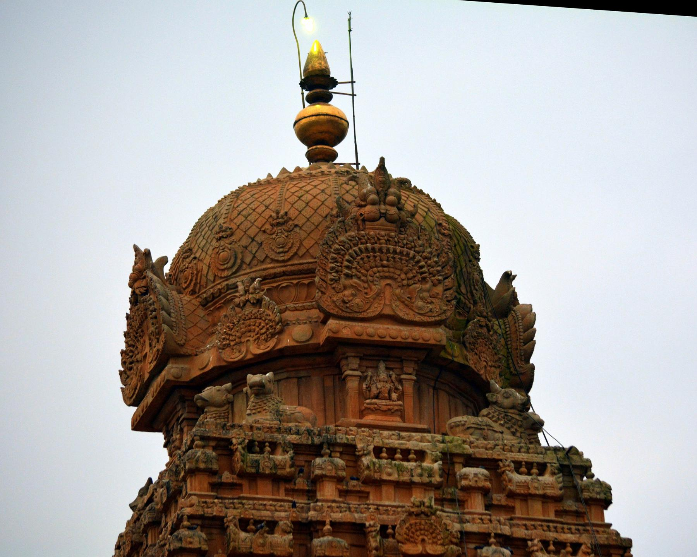
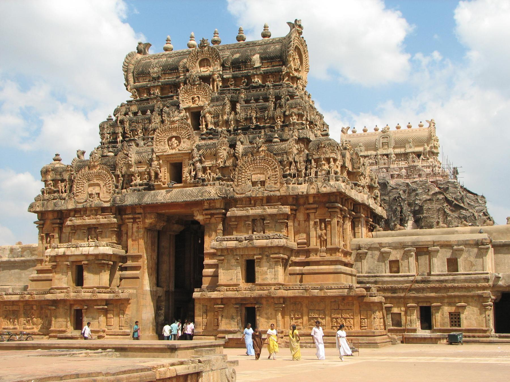
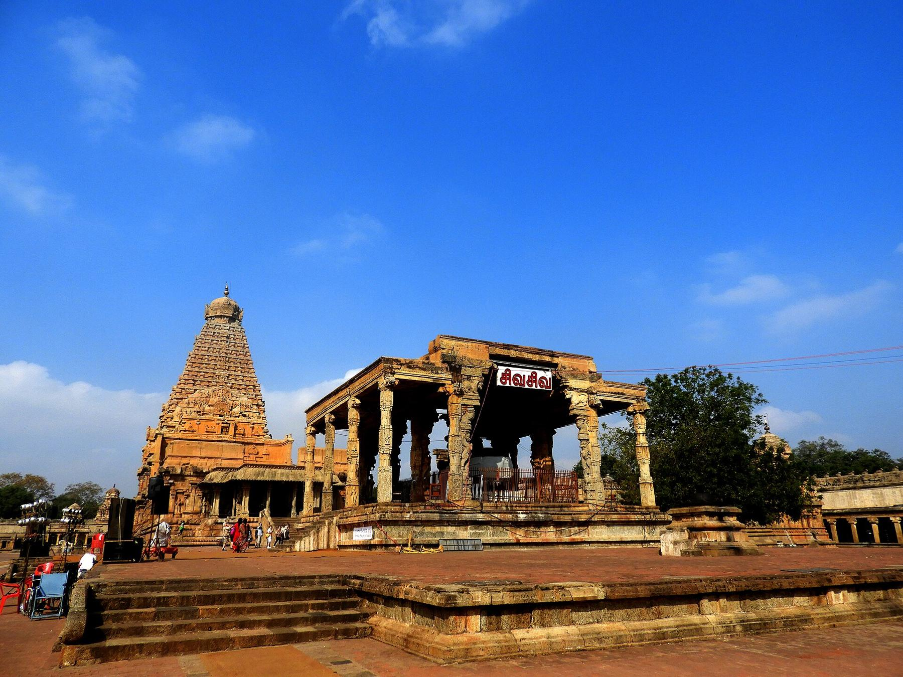

It is the year 1010, in the Chola capital of Thanjavur, in the green rice country of the Kaveri delta. A crowd has gathered in a huge courtyard paved with stone. In front of them rises a tower of granite so tall that it seems to lean back against the sky: thirteen stories of carved stone, tapering to a single, enormous dome at the top. Drums are beating. Priests are pouring holy water over the dome from scaffolding high above. Watching from a place of honor is a king in his mid-fifties, who has spent the last twenty-five years conquering half of South India and the last several building this. His name is Rajaraja, the king of kings.

A thousand years later, the drums still beat here every morning. The Brihadeeswarar temple, the Big Temple, is one of the largest and oldest temples in India where worship has never stopped. Get comfortable. Here's the story of the king who built it, how he did it, and why so many people believe its shadow never touches the ground.

## The king of kings

The Cholas were one of the oldest royal families in South India, mentioned in inscriptions from the time of the emperor Ashoka. But for centuries they were a minor power. Then, in the 9th century, they took Thanjavur, and within a few generations they had become the strongest kingdom in the south.

Rajaraja came to the throne in 985. Over the next three decades he defeated the Pandyas and the Cheras, the other great Tamil dynasties, conquered northern Sri Lanka, sent a fleet to the Maldives and pushed his frontiers deep into the Deccan. He also built a government that ran on paper, or rather on stone and palm leaf: he surveyed the land, assessed taxes, and recorded his decisions in inscriptions, many of them long and detailed.

He was a devotee of Shiva, and around the year 1003, at the height of his power, he began a temple for Shiva in his capital. It was to be called Rajarajeshvaram, after himself, and it was to be larger than anything that had been built in South India before. The Tamil name used today, Peruvudaiyar Kovil, means the temple of the Great Lord; Brihadeeswarar is the Sanskrit equivalent.

## A mountain of granite

The tower over the shrine, called the *vimana*, rises about 216 feet. It is built entirely of granite, a hard stone that is beautiful but exhausting to carve, and there is no granite quarry near Thanjavur: the stone had to be brought from the hills dozens of miles away, probably on carts, rafts and by elephant. The total weight of stone in the temple runs to many tens of thousands of tons.

The tower is hollow for its lower part and then solid, built up in thirteen diminishing stories. On top sits the crowning dome, the *shikhara*, an octagonal stone cap. It is usually said to weigh about 80 tons and to be carved from a single block, though some studies suggest it is made of several pieces fitted together. Either way, it had to be raised more than 200 feet into the air without cranes.

How? Nobody knows for certain. The most popular explanation is a ramp: a sloping earth embankment, several miles long, up which the stones were dragged by elephants and men. There's a village near Thanjavur called Sarapallam, which some say means "scaffold hollow," and local tradition says the ramp started there. It's a good story, and ramps were certainly used in ancient building, but there is no record of it from the time. Other engineers have suggested the tower was built with timber scaffolding and ramps that climbed around it as it rose.

The architect's name was recorded too, a rare thing for the period: an inscription credits a master builder called Kunjara Mallan Raja Raja Perunthachan.

*The crowning dome of the tower, said to weigh about 80 tons. Photo: [simianwolverine](https://commons.wikimedia.org/wiki/File:Top_of_Brihadisvara_Temple,_Thanjavur.jpg), CC BY 2.0, via Wikimedia Commons*

## Every gift written down

Inside the shrine is a lingam, the emblem of Shiva, about 12 feet tall, one of the largest in India. In the dark passage that runs around it, the walls were once covered with paintings. And on the outer walls of the temple, Rajaraja did something that tells us more about medieval India than almost any other building: he had everything written down.

The temple's inscriptions, in Tamil, record the gold, silver, jewels and lamps that he, his sister Kundavai, his queens and his officials gave to the god, each item weighed and described. They record the villages whose revenues were assigned to keep the temple running. And they record its staff: some four hundred temple dancers, named one by one, with the streets they lived on, along with drummers, singers, carpenters, accountants, washermen, barbers and astrologers. The temple was not just a shrine; it was the center of a city's economy.

The dancers' art is carved into the building as well. On an upper floor of the tower, sculptors began a series of panels showing the 108 *karanas*, the basic poses of classical dance described in the ancient treatise on drama, the *Natya Shastra*. They finished 81 of them. They are some of the earliest such carvings known.

In 1931, a scholar studying the dark passage around the sanctum noticed that the 17th-century paintings on its walls had something underneath. Behind them were Chola murals from Rajaraja's own time: Shiva as a dancer, holy men, celestial women, and a scene that may show Rajaraja himself with his guru. They are among the finest surviving paintings from medieval India.

*One of the gateway towers leading into the temple. Photo: [Bernard Gagnon](https://commons.wikimedia.org/wiki/File:Brihadeeswarar_Temple_02.jpg), CC BY-SA 3.0, via Wikimedia Commons*

## A thousand years of worship

After Rajaraja died in 1014, his son Rajendra went even further: he sent armies to the Ganges and a fleet across the Bay of Bengal to raid the Srivijaya kingdom in Sumatra and Malaya. He built himself a new capital, Gangaikonda Cholapuram, with its own great temple, which some say was deliberately made a little smaller than his father's.

The Chola empire faded in the 13th century, and Thanjavur passed to the Pandyas, then to Vijayanagara governors, the Nayaks, and finally to the Marathas, who ruled the city until the British took over. Each of them added to the temple. The great stone bull, Nandi, that sits facing the shrine today, and the pavilion over it, were added by the Nayak rulers in the 16th century; the original Chola Nandi now sits in a gallery along the courtyard wall.

In 1987, UNESCO made the temple a World Heritage Site, and later added Rajendra's temple at Gangaikonda Cholapuram and the temple at Darasuram to make the Great Living Chola Temples. In 2010, the temple's thousandth birthday was celebrated with dance, music and a commemorative coin.

Come in the evening. The granite turns from grey to honey to gold, the lamps are lit in the shrine, and families sit on the warm stone of the courtyard while children run around the Nandi. The bells ring, the drums start, and the king's temple does what it was built to do, as it has every evening for a thousand years.

*The Nandi pavilion, added by the Nayak kings, in front of the Chola tower. Photo: [Sumita Roy Dutta](https://commons.wikimedia.org/wiki/File:Vimana_of_the_Brihadisvara_Temple_DSCN8363_1.jpg), CC BY-SA 4.0, via Wikimedia Commons*

## Legend or history?

> The tower is designed so that its shadow never falls on the ground at noon, at any time of year.

**What we know:** It does. There are plenty of photographs of the tower's shadow on the courtyard. Because the tower is so wide at the base and tapers so steeply, at midday in some seasons its shadow falls mostly on its own lower stories, which may be how the story began. But it is not true all year, and there is no evidence the builders intended it.

> The 80-ton capstone was dragged up a ramp of earth more than 4 miles long that began at the village of Sarapallam.

**What we know:** Ramps of earth were used in ancient building, and something like this may well have been used. But there is no record of the ramp from the Chola period, the name of the village is the main evidence, and engineers have suggested other ways it could have been done. The capstone's weight and whether it is a single block are also debated.

> Rajaraja's architect promised him that even the shadow of the temple would never fall on the king, and so it was built to cast no shadow.

**What we know:** This is a modern story, and it doesn't appear in the temple's own detailed inscriptions, which record many other promises and gifts.

## Local tellings

These are stories you will hear from guides and online. None of them can be confirmed.

- **There's a carving of a European.** Guides point to a small figure in a hat on the tower, said to be a foreigner, proving contact with Europe. It's tiny and hard to read; it may show a Chinese or other foreign merchant, or nothing of the kind.
- **Politicians who enter by the main gate lose power.** A widely repeated superstition in Tamil Nadu says leaders who visit fall from office soon after. It's a good story for newspapers; it can't be tested.
- **There are secret tunnels.** Tunnels are said to lead from the temple to the palace and other temples. None has been found.
- **The lingam was brought from the Narmada.** Some say the great lingam came from the Narmada River in central India. Its origin isn't recorded.

## Things you probably didn't know

- **It was on a banknote.** India's 1,000-rupee note of 1954 showed the Brihadeeswarar temple.
- **The architect's name is known.** An inscription credits Kunjara Mallan Raja Raja Perunthachan.
- **Four hundred dancers are named.** The inscriptions list the temple dancers one by one, with their addresses.
- **There are 81 dance poses.** Carvings of classical dance poses were planned for all 108 karanas; 81 were finished.
- **There are paintings under the paintings.** Chola murals from Rajaraja's time were found in 1931 beneath 17th-century paintings.
- **The big Nandi is a later addition.** The bull facing the shrine was added in the 16th century; the Chola original is in a side gallery.
- **It is still a working temple.** Daily worship has gone on here for over a thousand years.

## Timeline

- **985** Rajaraja Chola I becomes king.
- **c. 1003** Work begins on the temple.
- **1010** The temple is consecrated, in the 25th year of Rajaraja's reign.
- **1014** Rajaraja dies; his son Rajendra I expands the empire.
- **16th century** The Nayak rulers add the great Nandi and its pavilion.
- **1931** Chola murals are discovered beneath later paintings.
- **1987** UNESCO World Heritage Site.
- **2010** The temple's thousandth anniversary is celebrated.

## If you go

Thanjavur is about 35 miles (55 km) from Tiruchirappalli (Trichy), which has the nearest airport, with flights from Chennai, Bengaluru and some Gulf cities. From the US, fly into Chennai and either take a short flight to Trichy or a train or car south, about seven hours by road. The temple is open daily, roughly 6 am to 12:30 pm and 4 pm to 8:30 pm, and there's no entry fee. It is a working temple, so dress modestly and leave your shoes at the gate. Come in the late afternoon and stay into the evening. October to March is the most comfortable season. Allow two hours, and add the Thanjavur palace and its bronze gallery, and Gangaikonda Cholapuram and Darasuram, each a day trip away.

In Thanjavur, [Hotel Gnanam](aff:agoda/partners/partnersearch.aspx?pcs=1&hid=665777) is a well-run hotel in the center, a short ride from the temple (8.5 from 1,260 reviews on Agoda, around $47 a night), and [Hotel Sangam](aff:agoda/partners/partnersearch.aspx?pcs=1&hid=294640) has gardens and a pool (8.5 from 900+, around $63).

## Sources

- [Great Living Chola Temples](https://whc.unesco.org/en/list/250/), UNESCO World Heritage Centre
- [Brihadisvara Temple, Thanjavur](https://en.wikipedia.org/wiki/Brihadisvara_Temple,_Thanjavur), Wikipedia
- [Rajaraja I](https://www.britannica.com/biography/Rajaraja-I), Encyclopaedia Britannica
- [Chola dynasty](https://www.britannica.com/topic/Chola-dynasty), Encyclopaedia Britannica

*Cover: the Brihadeeswarar temple at dusk during Maha Shivaratri. Photo: [Rainer Halama, edited](https://commons.wikimedia.org/wiki/File:Brihadisvara_Temple_during_Maha_Shivaratri-WUS03611_(edit).jpg), CC BY-SA 4.0, via Wikimedia Commons*
