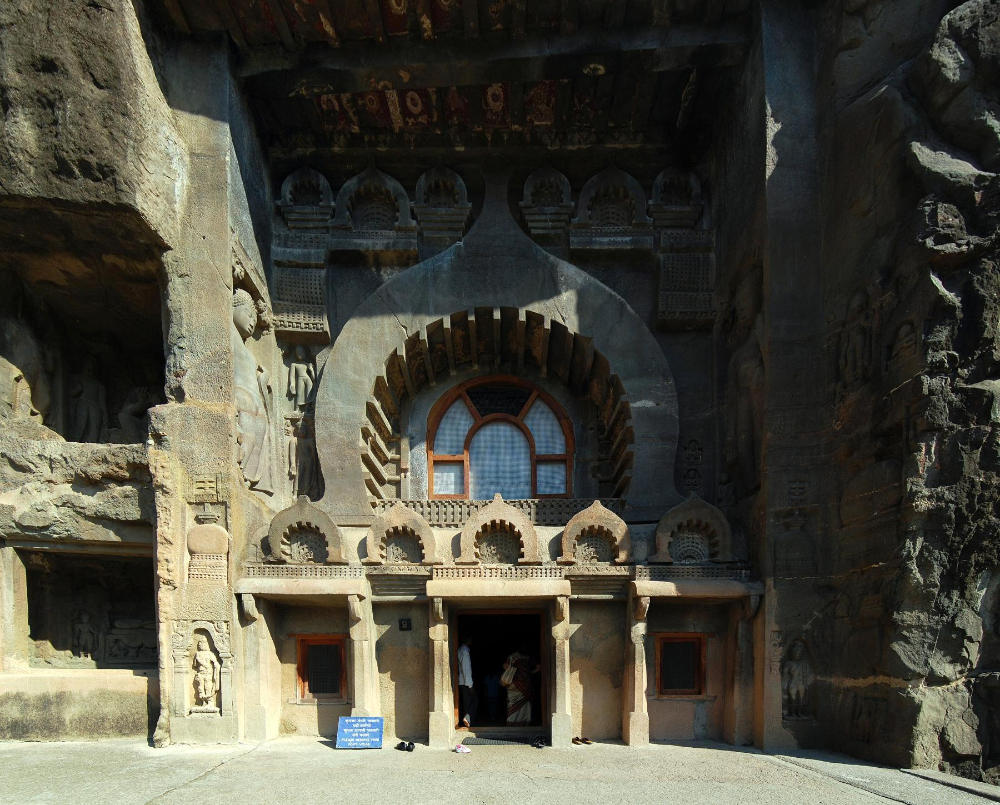
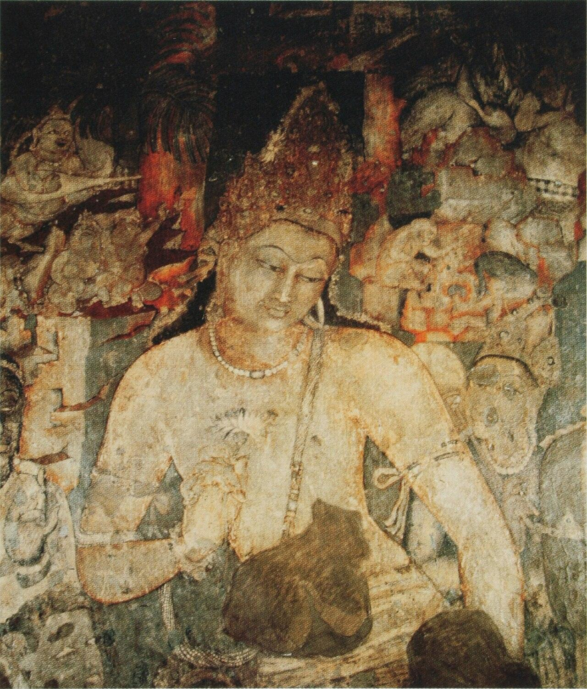
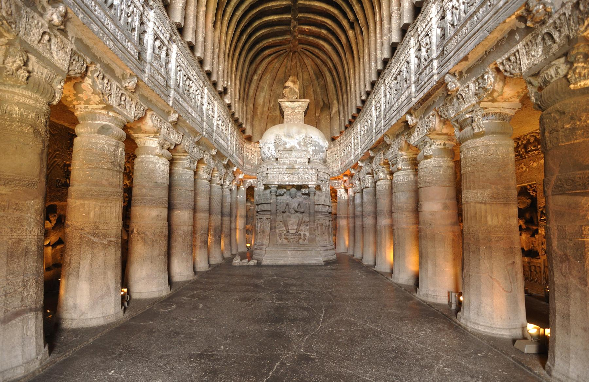

It is the 28th of April, 1819, and a party of British officers is out hunting in the hills of the Deccan, in what is now Maharashtra. It is the hottest time of year. The men are following a tiger through a steep, wooded ravine where a river curls round in a great horseshoe. A local boy is guiding them. At some point, one of the officers, a cavalryman named John Smith, looks across the ravine and sees something strange in the cliff on the other side: a dark arch, half hidden by bushes, and next to it, carved columns.

Smith climbs over. Inside, in the gloom, the walls are covered with paintings: princes and dancers, elephants and monkeys, a man holding a lotus flower with an expression of perfect calm. Before he leaves, he scratches his name and the date into one of the pillars, where you can still see it. Then he goes back to hunting.

He had found Ajanta, a set of Buddhist caves that had been abandoned for some 1,300 years. Get comfortable. Here's the story of the monks who carved them, the emperor's court that painted them, and the people who nearly lost them all over again.

## The first caves

The story starts long before the British, around the 2nd century BCE. Buddhism was spreading across India, and Buddhist monks, who traveled for much of the year, needed places to stay during the monsoon. Along the trade routes of the Deccan, merchants and local rulers paid for monasteries to be cut into the rock: cool, safe, and close to the roads.

The ravine at Ajanta, with its curving cliff of hard basalt and the Waghora River below, was a perfect spot. The first monks and their patrons carved a few caves there. There were two kinds: the *vihara*, a monastery, which is a square hall with small cells for monks around it; and the *chaitya*, a prayer hall, long and tall like a church nave, with a ribbed ceiling copied from wooden buildings and a stupa at the far end. Cave 10, the oldest prayer hall, may date to the 2nd century BCE. Its walls still carry faint traces of paintings from that time, some of the oldest surviving paintings in India.

Then, for several centuries, nothing new was carved. The caves may have been used, but they were not extended.

*The facade of Cave 9, one of the early prayer halls. Photo: [Marcin Białek](https://commons.wikimedia.org/wiki/File:Ajanta_cave_no._9_2010.jpg), CC BY-SA 4.0, via Wikimedia Commons*

## An emperor's golden age

In the 5th century CE, much of the Deccan was ruled by the Vakataka dynasty, allies and in-laws of the great Gupta emperors of the north. The last great Vakataka emperor, Harishena, ruled from about 460 to 477. Under him, Ajanta came alive again.

The patrons this time were not mainly monks and merchants but members of the court: Harishena's prime minister, a man named Varahadeva, paid for Cave 16, and a local king who served Harishena paid for Cave 17, and they left inscriptions saying so. Within a few busy decades, more than twenty new caves were begun along the cliff, many of them large and elaborately decorated. The American scholar Walter Spink, who spent decades studying the caves, argued that almost all this work happened in a burst of less than twenty years.

This is the Ajanta of the famous paintings. The painters covered the walls and ceilings of the caves with a plaster of clay, dung and rice husk, then a thin coat of lime, and painted on it in ochres, lampblack, malachite and lapis lazuli brought from Afghanistan. They painted the *Jatakas*, stories of the Buddha's earlier lives, when he was born as a prince, a monkey king, an elephant, a merchant. And they painted the world around them: palaces with women gossiping on balconies, musicians, horses, ships, beggars and kings.

The most famous figure is in Cave 1: a bodhisattva, a being who has delayed his own enlightenment to help others, holding a blue lotus. He is usually called Padmapani, the lotus-bearer, and his downcast eyes and gentle face have become one of the best known images of Indian art.

*The bodhisattva Padmapani, Cave 1. Photo: [Unknown author](https://commons.wikimedia.org/wiki/File:Bodhisattva_Padmapani,_cave_1,_Ajanta,_India.jpg), public domain, via Wikimedia Commons*

## Abandoned

And then, suddenly, the work stopped. When Harishena died around 477, the Vakataka kingdom fell apart, and the patrons disappeared. Some caves were left half cut, with rough blocks of rock still in place. A few were finished in a hurry, with images added wherever there was space. Monks seem to have lived at Ajanta for some time after that, but within a few generations, the site was empty.

The forest grew back. The river flooded. Bats and bees moved into the caves, and mud and rubble covered the entrances. Because it was so remote, Ajanta was spared the deliberate damage that hit many Indian monuments. It was simply forgotten, for about 1,300 years, by everyone except the people who lived nearby.

Then John Smith came hunting.

## Copies, fires and varnish

After 1819, word spread quickly, and visitors began to come, some of whom took pieces of paintings as souvenirs. In 1844, the East India Company sent an army officer and artist, Robert Gill, to copy the paintings. He set up camp at Ajanta and spent about twenty years there, painting large copies in oils and later taking some of the first photographs of the caves. His copies were sent to London and displayed at the Crystal Palace. In 1866, a fire at the Crystal Palace destroyed most of them.

In the 1870s, a teacher at the Bombay School of Art, John Griffiths, took his students to Ajanta and made a new set of copies over many years. Many of those were destroyed in another fire, at the South Kensington Museum in London, in 1885. Ajanta's paintings seemed to be cursed in copy, if not in the original.

The originals had their own troubles. In the 1920s, the government of the Nizam of Hyderabad, which then ruled the area, brought in Italian restorers to clean and preserve the murals. They coated many of them in shellac varnish, which seemed a good idea at the time and has since darkened and yellowed, making the paintings harder to see. Conservators have been carefully removing it for decades.

In 1983, Ajanta became one of India's first UNESCO World Heritage Sites, together with Ellora, about 60 miles away. Today, visitors are taken to the caves by shuttle bus, and walk along a path that follows the curve of the cliff, in and out of the caves one by one. Inside, the light is kept dim to protect the paintings, and your eyes take a minute to adjust. Then the walls come alive: faces, hands, jewels, animals, all looking back at you across fifteen centuries.

*The prayer hall of Cave 26, carved in the 5th century. Photo: [Dey.sandip](https://commons.wikimedia.org/wiki/File:Cave_26,_Ajanta.jpg), CC BY-SA 3.0, via Wikimedia Commons*

## Legend or history?

> John Smith, out hunting a tiger in 1819, discovered the caves, which no one had seen for more than a thousand years.

**What we know:** Smith's visit on 28 April 1819 is real, and his name and the date are still scratched on a pillar in Cave 10. But "discovered" is a stretch. Local people knew the caves were there; a local boy is said to have guided him to them. What Smith's visit did was bring Ajanta to the attention of the outside world.

> The caves were made over a thousand years by generation after generation of monks.

**What we know:** There were two distinct phases, centuries apart: a small group of caves in the 2nd and 1st centuries BCE, and a big burst of work in the 5th century CE, under the Vakataka emperor Harishena. Walter Spink argued that almost all the later caves were made in less than twenty years, though some scholars allow a longer span.

## Local tellings

These are stories you will hear from guides and online. None of them can be confirmed.

- **The tiger was in the cave.** Some versions say Smith followed the tiger right into Cave 10. Smith's own account doesn't survive in detail; it makes a better story than it does history.
- **The monks painted by mirror light.** Guides say painters used metal mirrors or white cloth to reflect sunlight into the dark caves. It's plausible, but no record says how they lit their work.
- **The Dying Princess is Sundari.** A famous painting in Cave 16 shows a fainting woman, often said to be the wife of the Buddha's half-brother Nanda, grieving when he became a monk. It's a well-supported reading, but the painting has no label, and others are possible.
- **The painter and Paro.** Many people tell of a love affair between Robert Gill, the copyist, and a local woman named Paro. It has been retold in novels, but the details can't be checked.

## Things you probably didn't know

- **John Smith's graffiti is still there.** He scratched his name and the date on a pillar in Cave 10.
- **The paint came from far away.** The blue was made from lapis lazuli, brought from Afghanistan.
- **Two sets of copies burned.** Robert Gill's copies burned at the Crystal Palace in 1866, and many of John Griffiths' at the South Kensington Museum in 1885.
- **A prime minister paid for a cave.** Cave 16 was dedicated by Varahadeva, minister to the emperor Harishena, and his inscription says so.
- **The varnish was a mistake.** Shellac put on the murals in the 1920s has darkened, and conservators are still removing it.
- **Ajanta is closed on Mondays.** Ellora, nearby, is closed on Tuesdays.

## Timeline

- **2nd–1st century BCE** The first caves, including prayer hall Cave 10, are carved.
- **c. 460–477 CE** Under the Vakataka emperor Harishena, more than twenty new caves are made and painted.
- **Late 5th century** Work stops after Harishena's death; the caves are gradually abandoned.
- **1819** John Smith, a British cavalry officer, sees the caves while hunting a tiger.
- **1844–1860s** Robert Gill copies the paintings; most copies burn in 1866.
- **1920s** Italian restorers varnish many paintings.
- **1983** UNESCO World Heritage Site, together with Ellora.

## If you go

Ajanta is about 60 miles (100 km) from Chhatrapati Sambhajinagar (formerly Aurangabad), which has flights from Mumbai, Delhi, Hyderabad and Bengaluru. From the US, fly into Mumbai and take a short flight, or the train, to Sambhajinagar. The drive to Ajanta takes about two and a half hours. Private cars stop at the visitor center, and shuttle buses run up to the caves. Ajanta is closed on Mondays. Foreign visitors pay about ₹600 ($7). Allow at least three hours; Caves 1, 2, 16, 17 and 26 matter most. Bring a flashlight, as some caves are very dark, and expect to leave your shoes outside the painted ones. October to March is the best season; in the monsoon, waterfalls pour into the ravine. Most visitors pair Ajanta with Ellora, with its [great rock-cut Kailasa temple](/stories/2026/kailasa-temple/).

In Sambhajinagar, the [Welcomhotel Rama International](aff:agoda/partners/partnersearch.aspx?pcs=1&hid=9116746) has big gardens and a pool (8.7 from 940 reviews on Agoda, around $115 a night), and the [Lemon Tree Hotel](aff:agoda/partners/partnersearch.aspx?pcs=1&hid=108509) is a reliable alternative (8.3 from 1,000+, around $95).

## Sources

- [Ajanta Caves](https://whc.unesco.org/en/list/242/), UNESCO World Heritage Centre
- [Ajanta Caves](https://en.wikipedia.org/wiki/Ajanta_Caves), Wikipedia
- [How Ajanta Caves were rediscovered](https://livehistoryindia.com/story/monuments/how-ajanta-caves-were-rediscovered), Live History India
- [All the attempts to restore the Ajanta caves](https://scroll.in/article/1092095/for-young-readers-all-the-attempts-to-restore-the-ajanta-caves-from-19th-century-to-present-day), Scroll
- [Copy of painting inside the caves, by Robert Gill](https://collections.vam.ac.uk/item/O115444/copy-of-painting-inside-the-oil-painting-gill-robert), Victoria and Albert Museum

*Cover: the caves along the curve of the Ajanta cliff. Photo: [Vyacheslav Argenberg](https://commons.wikimedia.org/wiki/File:Ajanta_Caves,_India,_Panoramic_view_of_Ajanta_basalt_cliffs_and_caves.jpg), CC BY 4.0, via Wikimedia Commons*
