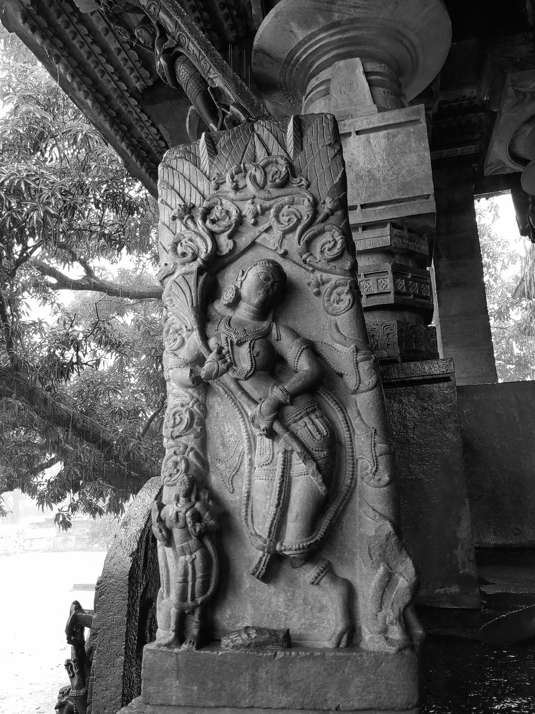
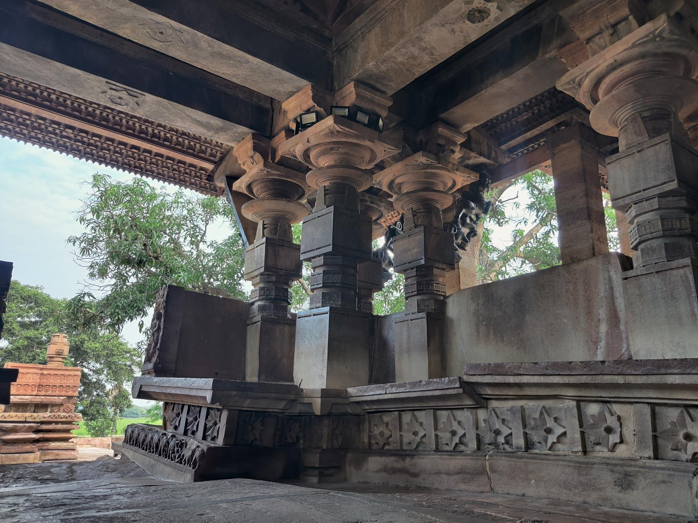
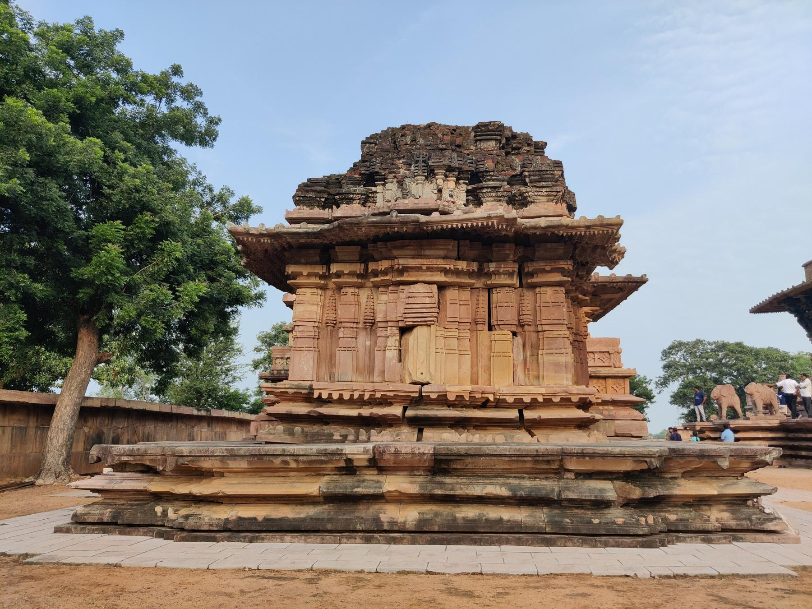

It is early morning in the countryside of northern Telangana. Mist lies over a wide lake, and on its shore, among paddy fields and palm trees, a pale sandstone temple sits on a raised platform shaped like a star. You climb the steps and look up. Leaning out from the top of the pillars, as if they were about to jump down, are slim female figures carved in shiny black stone: a dancer twisting on one foot, a woman pulling a thorn from her heel, a hunter with a bow. They are so smooth that the morning light slides off them like water.

This is the Ramappa temple, built more than eight hundred years ago by a general of the Kakatiya kings. It is one of the few temples in India known by the name of the man said to have carved it, and its tower is built of bricks so light that they float. Get comfortable. Here's the story of a kingdom at its peak, a temple built to last, and how it was nearly forgotten.

## The Kakatiyas

In the 12th and 13th centuries, the Telugu-speaking lands of the eastern Deccan were ruled by the Kakatiya dynasty, from their capital at Orugallu, today's Warangal. They began as vassals of larger kingdoms and became one of the great powers of South India. They were also great builders of water works. The Deccan is dry, rain is unreliable, and the Kakatiyas built thousands of tanks, or reservoirs, across their lands, some of them still in use. The lake beside the Ramappa temple is one of them.

Their greatest king, Ganapati Deva, ruled for more than sixty years, from 1199 to 1262. Under him, the kingdom reached from the coast of the Bay of Bengal deep into the interior. His successor was his daughter, Rudrama Devi, one of the very few women to rule a major Indian kingdom in her own name. The Venetian traveler Marco Polo, who landed on that coast toward the end of the 13th century, praised the queen who ruled there as just and much loved.

Ganapati Deva's generals were powerful men in their own right, and they built their own temples. One of them, Recharla Rudra, chose a spot by his new tank at a place called Palampet, and in 1213 he dedicated a temple there to Shiva, under the name Rudreshwara, the Lord of Rudra. An inscription on a stone slab in the temple records the date and the gift.

## Bricks that float and a bed of sand

The Kakatiya builders were engineers as much as artists, and two of their techniques are what most visitors come to hear about.

The first is the tower, the *vimana*, over the shrine. Most of the temple is sandstone, but the tower is built of brick, and not ordinary brick. The Ramappa bricks are porous and very light, so light that a loose one dropped in water will float. Engineers who have studied them say they were made from clay mixed with materials like sawdust or husk, which burned away in the kiln and left tiny air pockets. A tower of these bricks would weigh much less than one of stone, putting less load on the walls below. When UNESCO inscribed the temple, it mentioned the floating bricks specifically.

The second is underground. Under the temple, the builders dug a deep pit and filled it with sand mixed with lime, jaggery (unrefined cane sugar) and the crushed fruit of the myrobalan tree, then built the foundation on top of it. This "sandbox" is thought to act as a cushion, spreading the weight of the temple and absorbing the shaking of an earthquake. A strong earthquake is said to have hit the region in the 17th century, and while the floors were damaged, the temple stood.

*One of the madanika bracket figures, carved in black stone. Photo: [Torchtelangana](https://commons.wikimedia.org/wiki/File:MADANIKA_-_RAMAPPA_TEMPLE.jpg), CC BY-SA 4.0, via Wikimedia Commons*

## Dancers in black stone

For all its clever engineering, what makes Ramappa unforgettable is its sculpture. The outer pillars of the hall are topped with brackets in the form of women, called *madanikas* or *salabhanjikas*, carved in a hard, dark stone and polished until they shine. They are dancers, drummers and musicians, a woman applying makeup in a mirror, a woman pulling a thorn from her foot, a huntress. Their poses are so dynamic that they look as if they are about to step off the pillar.

Inside, the hall's pillars are of the same black stone, turned on a lathe-like method and polished to such a finish that, it is said, you can see your reflection in them. The ceiling is carved with scenes of dance, music and the gods. Around the base of the temple run friezes of elephants, dancers and everyday life.

The dancers matter for another reason. A Kakatiya general named Jayapa wrote a treatise on dance in the 1250s, and in the 20th century the dancer and scholar Nataraja Ramakrishna used that text and the carvings at Ramappa to reconstruct a vigorous, almost martial dance style called Perini Shivatandavam, which had been lost for centuries. Today it is performed at festivals, sometimes in front of the temple itself.

The name Ramappa comes from the chief sculptor. Local tradition says the temple was named after him, not after the god or the king, and that it's one of the only temples in India named for its sculptor.

*The pillared hall, with its polished black stone columns. Photo: [Khushi Shah 280](https://commons.wikimedia.org/wiki/File:WHS_Ramappa_Temple_28.jpg), CC BY-SA 4.0, via Wikimedia Commons*

## Survival and recognition

In the early 14th century, the armies of the Delhi Sultanate marched south. After several campaigns, they took Warangal in 1323, and the Kakatiya kingdom ended. Many temples in and around the capital were damaged. Ramappa, far out in the country by its lake, seems to have suffered less, though some of its sculptures were broken. In the centuries that followed, it was left to the villagers of Palampet, and to the forest.

The temple was never completely forgotten, but for a long time it was known mostly to locals and to scholars of temple architecture. Its smaller shrines crumbled. Its brick tower lost much of its plaster. Then, in the 20th century, it was protected by the government and slowly repaired.

In July 2021, UNESCO added the Kakatiya Rudreshwara (Ramappa) Temple to its World Heritage List, the 39th site in India, praising its floating bricks, its sandbox foundation and its sculpture. Visitor numbers have grown sharply since.

Come early, when the lake is still and the light is soft. Walk around the platform and watch the dancers on the brackets catch the sun one by one as it rises. The tower, light as it is, has stood for more than eight hundred years. The bricks have never had to float.

*One of the smaller shrines in the temple complex. Photo: [Khushi Shah 280](https://commons.wikimedia.org/wiki/File:WHS_Ramappa_Temple_14.jpg), CC BY-SA 4.0, via Wikimedia Commons*

## Legend or history?

> The Venetian traveler Marco Polo visited the Kakatiya kingdom and called the Ramappa temple "the brightest star in the galaxy of temples."

**What we know:** Marco Polo did visit the Kakatiya coast in the late 13th century, and his book describes a kingdom ruled by a wise queen, usually identified as Rudrama Devi. But his account says nothing about Ramappa, which lies far inland. The "brightest star" line is widely quoted online and in some official material, but it has not been traced to his book.

> The temple is named after its chief sculptor, Ramappa, making it the only temple in India named after the man who carved it.

**What we know:** The temple's inscription calls the god Rudreshwara, and the name Ramappa is old and in common use. The tradition that it honors a sculptor is strong, but there's no inscription naming Ramappa as the sculptor, and "the only one in India" is hard to prove.

## Local tellings

These are stories you will hear from guides and online. None of them can be confirmed.

- **You can hear music from the pillars.** Some guides tap pillars to show they ring. Many dense stone pillars ring when tapped, and there's no evidence they were tuned as instruments here.
- **The sculptor took forty years.** A number often repeated by guides. The inscription gives the year of dedication, not how long it took.
- **The floating bricks can't be copied today.** Engineers in India have studied and reproduced similar lightweight bricks; the technique is clever, not lost.
- **The earthquake that the temple survived destroyed everything else.** The 17th-century earthquake is mentioned in heritage reports, but its details and damage elsewhere are not well recorded.

## Things you probably didn't know

- **Its bricks float.** Bricks from the tower are light and porous enough to float in water.
- **It sits on sand.** The temple stands on a foundation pit filled with sand, lime, jaggery and myrobalan.
- **It was India's 39th World Heritage Site.** UNESCO inscribed it in July 2021.
- **A lost dance was rebuilt from its carvings.** Perini Shivatandavam was reconstructed in the 20th century from the temple's sculptures and a 13th-century treatise.
- **The lake is part of the story.** Ramappa Lake is a Kakatiya-era reservoir, still used for irrigation.
- **The kingdom was ruled by a queen.** Rudrama Devi, Ganapati Deva's daughter, ruled the Kakatiya kingdom in the later 13th century.

## Timeline

- **1199** Ganapati Deva becomes Kakatiya king.
- **1213** Recharla Rudra dedicates the Rudreshwara temple at Palampet.
- **1250s** Jayapa, a Kakatiya general, writes his treatise on dance.
- **1262** Rudrama Devi succeeds her father.
- **1323** The Delhi Sultanate captures Warangal; the Kakatiya kingdom ends.
- **17th century** An earthquake damages the floors, but the temple stands.
- **2021** UNESCO World Heritage Site, India's 39th.

## If you go

Ramappa is at Palampet, about 40 miles (65 km) northeast of Warangal and about 130 miles (210 km) from Hyderabad. From the US, fly into Hyderabad, then drive, about four hours each way, or take the train to Warangal and hire a car from there. The temple is open daily from about 6 am to 6 pm; check current entry fees with the Archaeological Survey of India. Allow two hours for the temple, the smaller shrines and a walk by the lake. October to February is the most pleasant season. Combine it with Warangal's fort, the Kakatiya stone gateways and the Thousand Pillar Temple at Hanamkonda.

Hotels near the temple are basic, and none in the area had enough good reviews for us to recommend, so most visitors stay in Hyderabad or Warangal and make it a long day trip.

## Sources

- [Kakatiya Rudreshwara (Ramappa) Temple, Telangana](https://whc.unesco.org/en/list/1570/), UNESCO World Heritage Centre
- [Ramappa Temple](https://en.wikipedia.org/wiki/Ramappa_Temple), Wikipedia
- [Floating bricks, sandbox tech: the engineering behind Ramappa's UNESCO tag](https://theprint.in/india/floating-bricks-sandbox-tech-engineering-skill-behind-13th-c-telangana-temples-unesco-tag/706524), ThePrint
- [Kakatiya Rudreshwara (Ramappa) Temple](https://indianculture.gov.in/unesco/heritage-sites/kakatiya-rudreshwara-ramappa-temple-telangana), Indian Culture portal (Government of India)

*Cover: the Ramappa temple on its star-shaped platform. Photo: [Rangan Datta Wiki](https://commons.wikimedia.org/wiki/File:Ramappa_Temple_8.jpg), CC BY-SA 4.0, via Wikimedia Commons*
