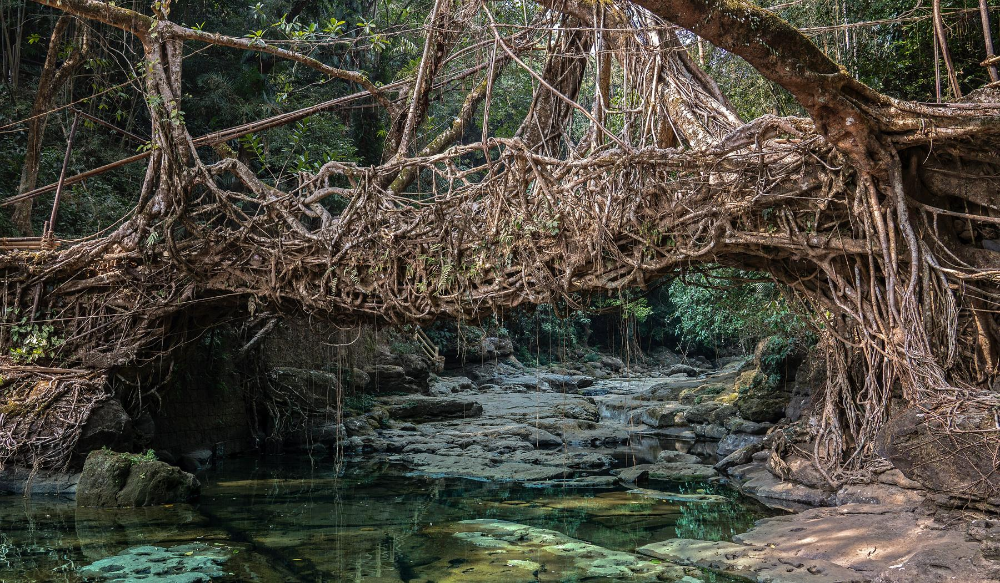
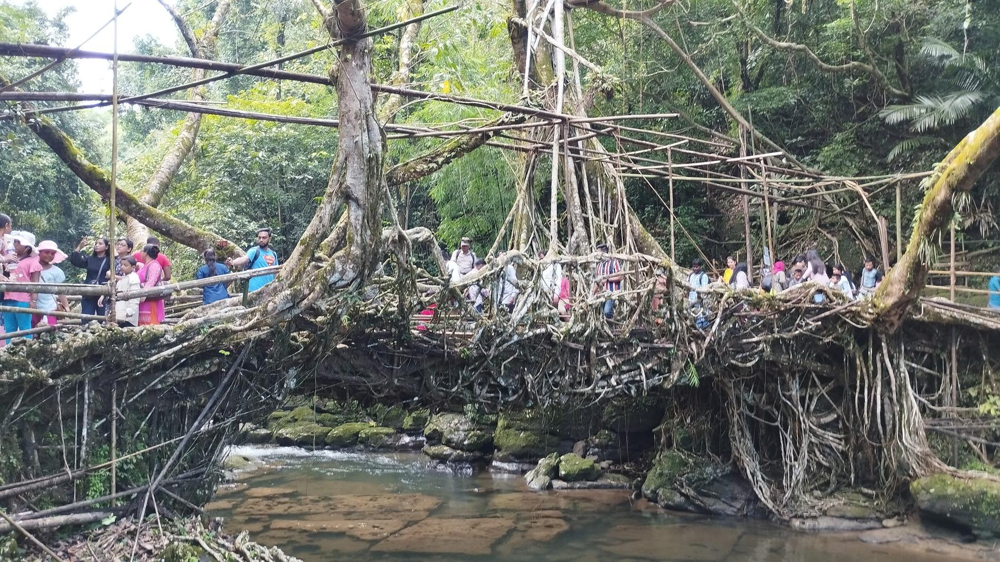

It is raining in the Khasi Hills. Not a drizzle but the heavy, steady rain of the monsoon, the kind that falls here almost every day for months and has made this one of the wettest places on Earth. You are standing at the bottom of a steep valley, after a long walk down thousands of stone steps, beside a river that is roaring white over the boulders. In front of you, the river is crossed by a bridge. It has a handrail and a walkway, and dozens of people have walked across it today. And it is alive. It is made of the roots of a tree, twisted and fused together, thick with moss and ferns, and it is still growing.

Nobody knows exactly how long people in these hills have been growing bridges. They were here when the first British officers came, and the oldest still in use may be well over a century old. Get comfortable. Here's how you grow a bridge, the people who know how, and why the rest of the world is only now taking notice.

## The wettest hills in the world

Meghalaya means "abode of the clouds," and it earns its name. The state is a high plateau in northeast India, just north of Bangladesh. When the summer monsoon blows in from the Bay of Bengal, it crosses the flat plains of Bangladesh and slams straight into the southern edge of the plateau. The clouds rise, cool and drop their water. Sohra, also known as Cherrapunji, and the village of Mawsynram, a few miles away, compete for the title of wettest place on Earth, with averages of more than 450 inches of rain a year.

The southern slopes of the plateau are cut by deep gorges full of tropical forest. The villages of the Khasi and Jaintia peoples sit on the ridges and in the valleys, with their fields and orchards of areca nut, betel leaf, oranges and bay leaf. To get from one village to another, or to their fields and markets, people have always had to cross rivers that can rise many feet in a few hours.

A bridge of wood or bamboo might last a few years in that climate before it rotted or was swept away. So people looked for something stronger. They found it in a tree.

## How to grow a bridge

The rubber fig, *Ficus elastica*, grows well on riverbanks in these hills. Like many figs, it sends down aerial roots from its branches, and those roots are remarkably strong and flexible. When two roots touch and press against each other, they fuse together and grow as one, a process called inosculation. Over time, a tangle of roots becomes a single, solid lattice.

To make a bridge, villagers start with a fig tree on one bank of a stream, sometimes one they planted themselves. They lay a guide across the stream: a long trunk of areca palm, split and hollowed, or a framework of bamboo. Then they take the young, pliable roots and train them along the guide, toward the other bank. When the roots reach the far side, they plant them in the soil, where they take hold.

Then they wait. Over the years, more roots are guided along, twisted together, tied and woven into handrails. Stones are pressed into the gaps to make a walking surface. The guide rots away; the roots carry on. It usually takes 10 to 15 years before a new bridge is strong enough to walk on, and it keeps getting stronger as long as the tree is healthy. A wooden bridge gets weaker with age. A root bridge gets stronger.

The Khasi call these bridges *jingkieng jri*, the bridge of the rubber tree. Building one is never the work of one person. It takes a village, and often more than one generation: the people who start a bridge may never cross it, and the people who use it maintain it for their grandchildren.

*A single living root bridge over a forest stream. Photo: [Joydeep Chakraborty](https://commons.wikimedia.org/wiki/File:Living_root_bridge,_Maghalaya,_India1.jpg), CC BY-SA 4.0, via Wikimedia Commons*

## A lieutenant's notebook

The first written description of a root bridge comes from a young British army engineer named Henry Yule. In 1844 he published "Notes on the Kasia Hills and People" in the *Journal of the Asiatic Society of Bengal*, describing the bridges, with a drawing of one, as something remarkable he had seen on his travels. Yule went on to become one of the great scholars of the British Empire: he translated Marco Polo's travels into English and co-wrote *Hobson-Jobson*, the famous dictionary of Anglo-Indian words.

For the next century and a half, the bridges were mentioned now and then by travelers, missionaries and botanists, but they were known mostly to the people who used them. Many fell out of use in the 20th century, as roads and steel bridges came to the hills. Some were cut down. Others were left to grow wild.

Things began to change in the 2000s. Photographs of the bridges, especially the remarkable two-level bridge at the village of Nongriat, began to spread online, and travelers began to come. Local guides and villagers started projects to train new bridges, and researchers from India and Europe began to map them. A team from Germany, working with local communities, has documented more than 70 living root bridges across Meghalaya, some of which had never been recorded.

## The double-decker

The most famous bridge is at Nongriat, a village at the bottom of a deep valley near Sohra. There, at a place called Umshiang, two root bridges cross the same stream, one above the other. Villagers estimate the lower one is around 180 years old; the upper one was grown later, when the river was running high enough to reach the first. Nearby are several other root bridges, natural swimming pools and waterfalls.

Getting there is half the experience: from the village of Tyrna, a path of thousands of concrete and stone steps winds down the side of the gorge, about 3,000 of them by most counts, through areca groves and past steel suspension bridges over the rivers. It takes about an hour and a half to go down, and much longer to come back up.

In 2022, India added the living root bridge cultural landscapes of Meghalaya to its tentative list for UNESCO World Heritage, naming dozens of villages where root bridges grow. It's not a guarantee of inscription, but it is a start.

Stand on the lower deck at Nongriat and put your hand on the handrail. It is cool and slightly damp, and it is not wood. It is a living thing that someone you'll never meet started training across this river long before you were born, and someone else will be walking across it long after you've gone.

*The single-decker root bridge at Riwai, near Mawlynnong. Photo: [Arindambasu2](https://commons.wikimedia.org/wiki/File:Single_Decker_Living_Root_Bridge_at_Riwai.jpg), CC BY-SA 4.0, via Wikimedia Commons*

## Legend or history?

> Long ago, the people of the Khasi Hills were linked to heaven by a golden ladder, or a living vine, on a sacred hill. People could climb up and down freely, until a wrongdoing on Earth caused the ladder to be cut, and humans were left on the ground.

**What we know:** This is part of Khasi oral tradition about the Seven Huts, the ancestors of the Khasi people, and it is associated with a sacred hill called U Lum Sohpetbneng, "the navel of heaven." It is a myth of origins, not history, but it is easy to see why people who grow bridges from living trees might tell of a bridge to heaven.

> The double-decker bridge at Nongriat is 500 years old.

**What we know:** Root bridges can't be dated precisely, and there are no written records for most of them. Local estimates for the Nongriat bridge are usually around 180 to 200 years. The oldest bridges may be older, but claims of many centuries are guesses.

## Local tellings

These are stories you will hear from guides and online. None of them can be confirmed.

- **Each bridge can carry 50 people.** Guides often say so. The bigger bridges carry many people at once, but there are no official load tests, and responsible guides ask visitors not to crowd them.
- **The bridges were invented by one man.** Some stories credit a single clever ancestor. The technique is far more likely to have developed slowly, shared between villages.
- **You can't plant a new one anymore.** New root bridges are being trained right now in several villages.
- **The Khasi learned it from the monkeys.** A popular joke more than a legend, told to visitors on the trail.

## Things you probably didn't know

- **They get stronger with age.** As the roots thicken and fuse, a healthy root bridge becomes sturdier every year.
- **It takes 10 to 15 years to grow one.** Many builders never use the bridges they started.
- **Their first describer translated Marco Polo.** Henry Yule wrote about the bridges in 1844 and later published a famous edition of Marco Polo's travels.
- **Sohra is one of the wettest places on Earth.** It and nearby Mawsynram average more than 450 inches of rain a year.
- **There are also root ladders.** Khasi villagers have grown ladders from roots to climb steep slopes.
- **Khasi society is matrilineal.** Children take their mother's clan name, and family property traditionally passes through the youngest daughter.

## Timeline

- **Unknown date** Khasi and Jaintia villagers begin growing root bridges.
- **1844** Henry Yule describes the bridges in the *Journal of the Asiatic Society of Bengal*.
- **20th century** Many bridges fall out of use as roads and steel bridges arrive.
- **2000s** Photographs of the Nongriat double-decker draw travelers to Meghalaya.
- **2010s** Researchers and local guides map the bridges and begin training new ones.
- **2022** India adds the living root bridges to its tentative list for UNESCO.

## If you go

The nearest major airport is Guwahati, in Assam, about 4 hours by road from Sohra; Shillong also has a small airport with a few flights. From the US, fly into Delhi or Kolkata and connect to Guwahati. Sohra is about 35 miles (55 km) from Shillong. For the double-decker, start early from Tyrna village and take water, snacks and good shoes: the steps are steep and slippery when wet, and coming back up is hard work. Allow a full day, or stay a night in one of the simple guesthouses in Nongriat. For an easier visit, the single-decker bridge at Riwai, near the village of Mawlynnong, is a short walk from the road. Local village committees charge a small fee for each bridge. October to April is the best time; in the monsoon, the trails are wet and some swimming spots are dangerous.

In Sohra, the [Sacred Grove Resort](aff:agoda/partners/partnersearch.aspx?pcs=1&hid=77376716) has cottages near the edge of the plateau (8.2 from 310 reviews on Agoda, around $140 a night), and [Iana Sohra](aff:agoda/partners/partnersearch.aspx?pcs=1&hid=86517173) is a simple, friendly budget stay (8.4 from 65, around $20).

## Sources

- [Jingkieng Jri: Living Root Bridge Cultural Landscapes](https://whc.unesco.org/en/tentativelists/6606/), UNESCO World Heritage Centre tentative list
- [Living root bridge](https://en.wikipedia.org/wiki/Living_root_bridge), Wikipedia
- [In one of the wettest places on the planet, Indigenous people build bridges out of living tree roots](https://www.smithsonianmag.com/travel/in-one-of-the-wettest-places-on-the-planet-indigenous-people-build-bridges-and-ladders-out-of-living-tree-roots-180988405/), Smithsonian Magazine
- [Meghalaya's living root bridges are headed for global recognition](https://thediplomat.com/2022/04/meghalayas-living-root-bridges-are-headed-for-global-recognition/), The Diplomat
- [Rooted in tradition: nature-based architecture bridges generations](https://india.mongabay.com/2024/11/rooted-in-tradition-nature-based-architecture-bridges-generations/), Mongabay India

*Cover: the double-decker root bridge at Nongriat. Photo: [Chiranjeeb Baul](https://commons.wikimedia.org/wiki/File:Double_decker_living_root_bridge_02.jpg), CC BY-SA 4.0, via Wikimedia Commons*
