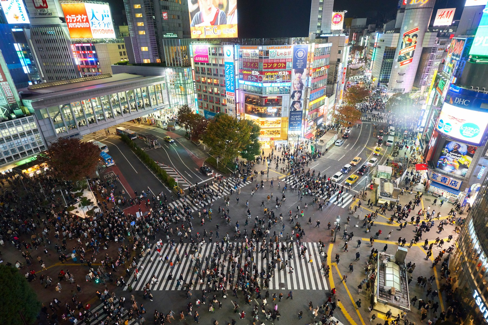
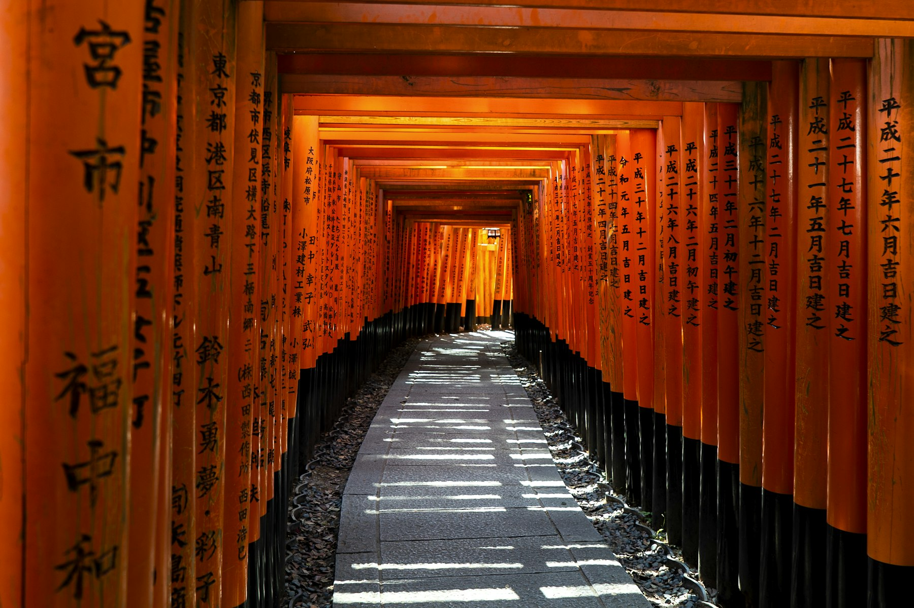
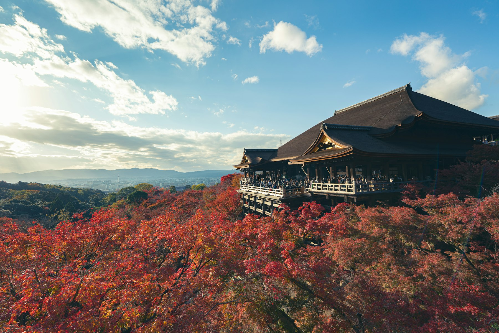
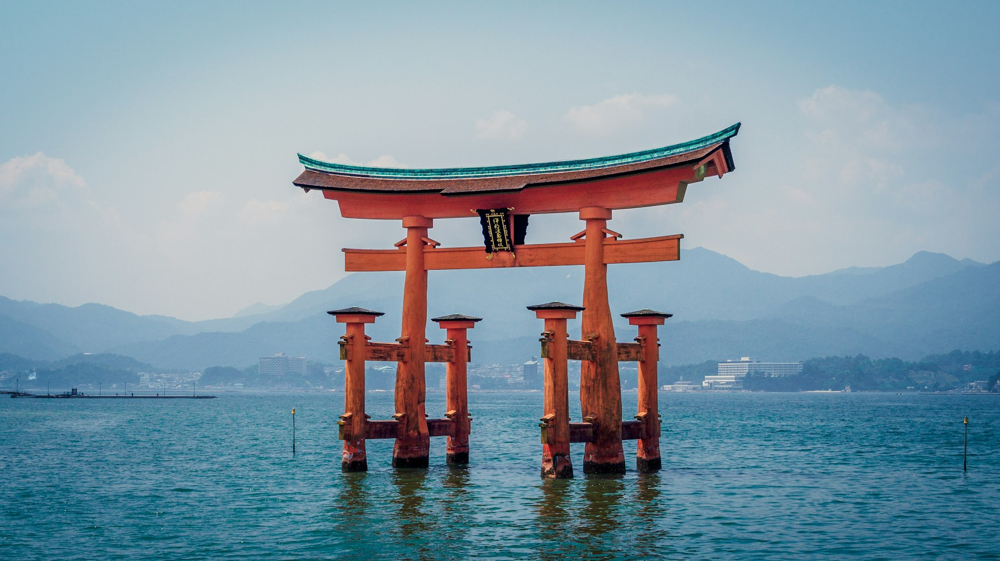
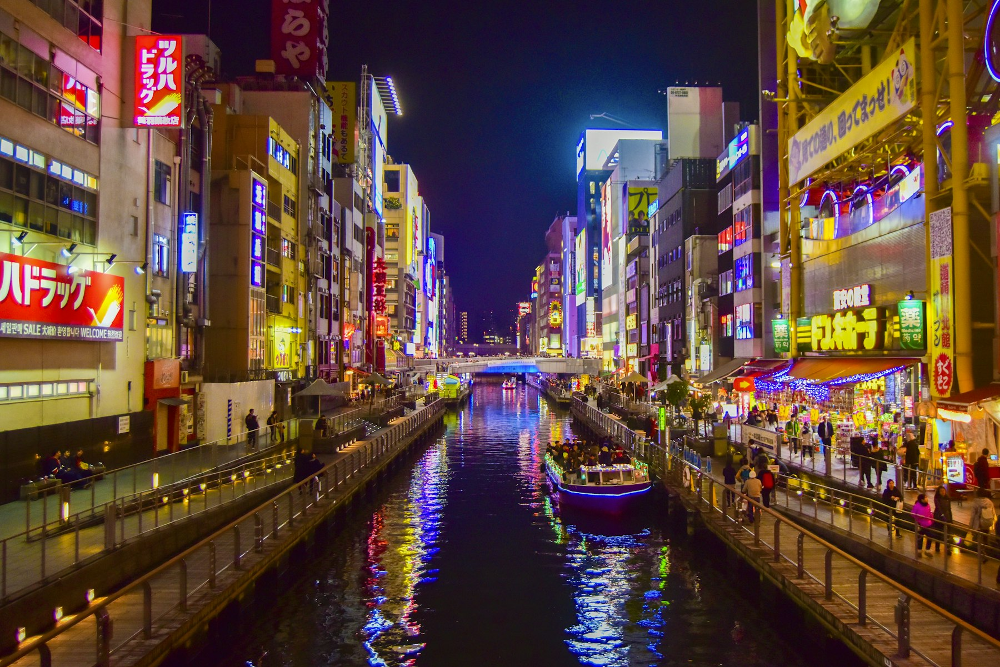
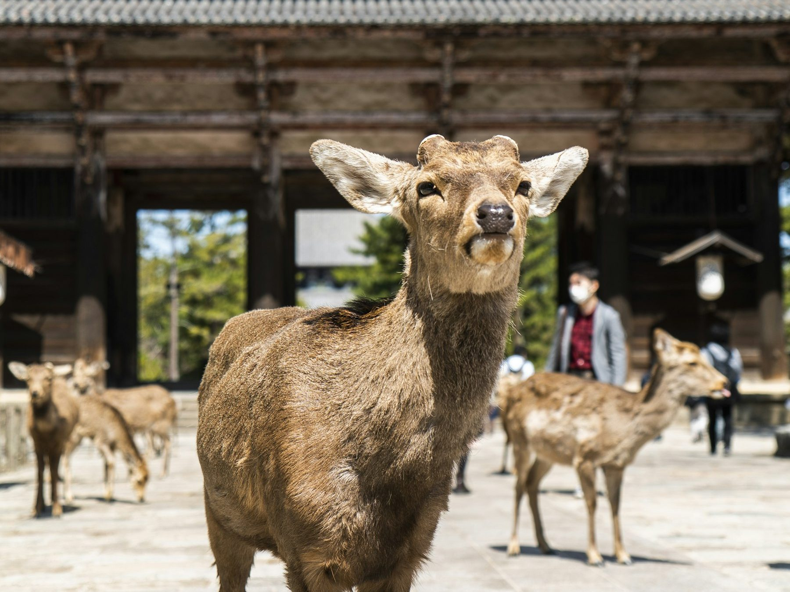

At 06:00 the lower slopes of Fushimi Inari are almost empty. The orange gates run uphill in a tunnel, each one painted with the name of the business that paid for it, and the only sounds are crows, your own footsteps and, somewhere above, a shrine attendant sweeping. By nine the same path is shoulder to shoulder. Japan rewards the people who get up early, plan a little and then let the trains do the rest.

This is a first trip for people who want the classics without rushing them: Tokyo's neighbourhoods and food, a night in a hot-spring inn under Mount Fuji, Kyoto's temples, Hiroshima and the floating gate at Miyajima, and Osaka's street food. It runs in one direction, Tokyo to Osaka, so you never backtrack, and every leg is a train ride you'll remember.

## At a glance

| | |
| --- | --- |
| Best time to go | Late March to May and October to early December; avoid Golden Week (late April to early May) |
| Days you need | 12 days, 11 nights |
| Getting there | Fly into Tokyo (Narita or Haneda), out of Osaka (Kansai) |
| Daily budget | ₹10,500 – ₹21,000 (about $125 – $250) |
| Language | Japanese; English on trains, stations and most signs |
| Currency | Japanese yen (¥); ¥1,000 is about ₹590 |
| Good for | Food, trains, temples, gardens, first trips to East Asia |

## Why go

Japan is the easiest hard-to-imagine country you'll ever visit. Trains leave to the second, streets are spotless, nothing gets stolen, and the food is good everywhere, from a ¥200 rice ball at 7-Eleven to a ten-course dinner at a ryokan. It's also endlessly varied: a megacity of 37 million people, volcanic lakes and hot springs two hours away, then a former capital with over 1,500 temples.

The route below is the classic first-timer's line along the Tokaido and Sanyo Shinkansen. It gives you four kinds of Japan in twelve days: modern Tokyo, the mountains and onsen of Hakone, old Kyoto and Nara, and the harder, more moving history of Hiroshima, before ending in Osaka, where the whole city seems to be out eating.

*Shibuya's scramble crossing at dusk. Photo: [Timo Volz](https://unsplash.com/photos/shibuya-scramble-intersection-in-tokyo-DGsqL2j028E) on Unsplash*

## Getting there

**Flights:** Direct flights run from Delhi and Mumbai to Tokyo; from other Indian cities, connect through Delhi, Singapore, Bangkok or Hong Kong. Book an open-jaw ticket, into Tokyo and out of Osaka's Kansai airport (KIX), so the trip runs one way.

**From the airport:** From Narita, the [Keisei Skyliner](aff:klook/activity/1410-skyliner-tokyo/) reaches Ueno in about 40 minutes (4.9 from 81,900 reviews, about ₹1,290). Haneda is closer, with trains and the monorail into the city in 20–30 minutes. At the end, the [JR Haruka express](aff:klook/activity/18400-jr-haruka-airport-express-train-tickets-osaka/) runs from Kyoto and Osaka to Kansai airport (4.8 from 47,600 reviews, about ₹900).

**Entry rules:** Indian passport holders need a visa. Japan's single-entry tourist eVISA is applied for through the Japan Visa Application Centres in India; check documents and fees on the [Embassy of Japan in India's site](https://www.in.emb-japan.go.jp/) before you book. Fill in [Visit Japan Web](https://www.vjw.digital.go.jp/) before you fly to get QR codes for immigration and customs.

## Getting around

- **Shinkansen:** the bullet trains link every stop on this route. Odawara (for Hakone) to Kyoto takes about two hours on a Hikari and costs around ¥12,300; Kyoto to Hiroshima takes about 1 hour 40 minutes on a Nozomi (about ¥11,100–11,700); Hiroshima to Shin-Osaka is about 1 hour 25 minutes. Book on Klook's [Shinkansen tickets page](aff:klook/japan-rail/shinkansen/) (4.7 from 90,500 reviews) and scan the QR code at the station.
- **Skip the JR Pass on this route.** The 7-day pass now costs ¥53,000 when bought abroad, and the three long rides here add up to about ¥34,000 bought one by one. The pass only pays off if you go much further, for example to Kyushu.
- **IC card:** a Suica or ICOCA covers city trains, subways, buses and convenience stores everywhere on the route. Add one to your phone's wallet, or get a [physical Suica card](aff:klook/activity/16917-suica-ic-card-tokyo/) (4.8 from 14,200 reviews).
- **Tokyo Subway Ticket:** unlimited rides on all Tokyo Metro and Toei lines for 24, 48 or 72 hours. The [Klook version](aff:klook/activity/1552-subway-ticket-tokyo/) (4.8 from 89,900 reviews, from about ₹560) pays off after four or five rides a day. It doesn't cover JR lines such as the Yamanote.
- **Send your bags ahead.** Japan's luggage delivery (*takkyubin*) carries suitcases between hotels for about ¥2,000–3,000 a bag. Use it before Hakone, where trains, cable cars and boats are no place for big cases.

## Where to stay

- **Tokyo, Asakusa and Ueno:** the old east side, cheaper, near the Skyliner and temples. [Asakusa Tobu Hotel](aff:agoda/partners/partnersearch.aspx?pcs=1&hid=12439649) is 100 m from Asakusa station (9.2 from 23,100 reviews, around ₹12,600), [LANDABOUT TOKYO](aff:agoda/partners/partnersearch.aspx?pcs=1&hid=10609116) is a stylish budget pick by Uguisudani station (8.9 from 15,500, around ₹7,500), and [Hotel Sardonyx Ueno](aff:agoda/partners/partnersearch.aspx?pcs=1&hid=81791) is close to Ueno Park (8.7 from 27,400, around ₹11,100).
- **Tokyo, Shinjuku and Shimbashi:** the west side, best for nightlife and day trips. [Hotel Gracery Shinjuku](aff:agoda/partners/partnersearch.aspx?pcs=1&hid=706347), the one with Godzilla on the roof, is in the middle of Kabukicho (8.7 from 30,800, around ₹11,100). [Hotel Sunroute Plaza Shinjuku](aff:agoda/partners/partnersearch.aspx?pcs=1&hid=1935) is next to the Hakone highway bus (8.6 from 42,500, around ₹12,700), and [The Royal Park Hotel Iconic Tokyo Shiodome](aff:agoda/partners/partnersearch.aspx?pcs=1&hid=51463) is the comfortable splurge near Shimbashi (8.9 from 20,800, around ₹14,500).
- **Hakone:** stay one night in a hot-spring inn. [Hakone Hostel 1914](aff:agoda/partners/partnersearch.aspx?pcs=1&hid=2156031) at Miyanoshita is a top-rated budget stay (9.5 from 1,200, around ₹3,400), and [Onsen Guest House Tsutaya](aff:agoda/partners/partnersearch.aspx?pcs=1&hid=10639928) by Kowakidani station has its own hot-spring baths (9.3 from 3,100, around ₹9,800). [Yumoto Fujiya Hotel](aff:agoda/partners/partnersearch.aspx?pcs=1&hid=70830) is the easy onsen hotel by Hakone-Yumoto station (9.0 from 8,700, around ₹12,500), and the historic [Fujiya Hotel](aff:agoda/partners/partnersearch.aspx?pcs=1&hid=45575) at Miyanoshita has hosted guests since 1878 (9.1 from 3,700, around ₹15,400). For lake views, [Hakone Ashinoko Hanaori](aff:agoda/partners/partnersearch.aspx?pcs=1&hid=1999073) sits above Lake Ashi at Togendai (9.0 from 10,900, around ₹20,400).
- **Kyoto:** stay near Kyoto Station for trains, or Shijo and Kawaramachi for food and Gion. [Onyado Nono Kyoto Shichijo](aff:agoda/partners/partnersearch.aspx?pcs=1&hid=11105749) has tatami floors and a natural hot-spring bath, 430 m from the station (9.1 from 24,100, around ₹9,100). [Cross Hotel Kyoto](aff:agoda/partners/partnersearch.aspx?pcs=1&hid=4987031) is in the centre near Kawaramachi (9.2 from 17,100, around ₹8,600), and [Hotel The M's Kyoto](aff:agoda/partners/partnersearch.aspx?pcs=1&hid=21951014) is the budget pick by Kujo subway (9.0 from 18,200, around ₹4,000). [Hotel Granvia Kyoto](aff:agoda/partners/partnersearch.aspx?pcs=1&hid=81775) is built into the station itself (9.0 from 13,900, around ₹14,900).
- **Hiroshima:** [THE KNOT HIROSHIMA](aff:agoda/partners/partnersearch.aspx?pcs=1&hid=14876615) is a short walk from the Peace Park (8.9 from 12,800, around ₹6,800), [Hotel Granvia Hiroshima](aff:agoda/partners/partnersearch.aspx?pcs=1&hid=8189) is at the station for the train onwards (9.0 from 15,700, around ₹5,100), and [Hilton Hiroshima](aff:agoda/partners/partnersearch.aspx?pcs=1&hid=33656022) is the upgrade (9.1 from 9,000, around ₹7,900). Backpackers like [WeBase Hiroshima](aff:agoda/partners/partnersearch.aspx?pcs=1&hid=9358665) (9.0 from 5,000, around ₹3,600).
- **Osaka:** stay in Namba for Dotonbori and the Kansai airport trains. [Sotetsu Fresa Inn Osaka-Namba](aff:agoda/partners/partnersearch.aspx?pcs=1&hid=6944397) (9.0 from 23,700, around ₹7,800) and [Hotel Forza Osaka Namba Dotonbori](aff:agoda/partners/partnersearch.aspx?pcs=1&hid=20990836) (9.1 from 17,500, around ₹8,000) are the best-value picks, and [Cross Hotel Osaka](aff:agoda/partners/partnersearch.aspx?pcs=1&hid=72857) is right on Dotonbori (9.0 from 21,900, around ₹14,200). On a tight budget, try [Sotetsu Grand Fresa Osaka Namba](aff:agoda/partners/partnersearch.aspx?pcs=1&hid=1095363) (8.7 from 38,200, around ₹4,800).

*Ratings are guest scores on the booking site each link goes to, and prices are typical December weeknight rates for two, both checked in November 2026.*

## Top things to do

### See old and new Tokyo in a day

Start at Senso-ji in Asakusa, Tokyo's oldest temple, through the huge red lantern of the Kaminarimon gate and up the stalls of Nakamise. Then cross the city to the forested calm of Meiji Jingu and the backstreets of Harajuku, and finish at Shibuya Crossing. Watch it from above at [Shibuya Sky](aff:klook/activity/70672-shibuya-sky-tokyo/), the open-air rooftop 230 metres up (4.7 from 47,100 reviews, about ₹1,650). Book a slot an hour before sunset; they sell out.

### Step inside teamLab Planets

At teamLab Planets in Toyosu you walk barefoot through knee-deep water, mirrored rooms and a garden of floating orchids, all part of a digital art installation that responds to you. Book [teamLab Planets on Klook](aff:klook/activity/25300-teamlab-planets-toyosu-tokyo-ticket/) (4.7 from 22,000 reviews, from about ₹2,100) for a weekday morning, wear shorts or trousers you can roll up, and allow two hours. Pair it with breakfast at Tsukiji's outer market nearby.

### Take a day trip to Mount Fuji

Fuji is often hidden in cloud, and it's clearest on cold mornings from November to February. The easiest day out is a coach tour to the Fuji Five Lakes: the [Mount Fuji day tour](aff:klook/activity/93901-mtfuji-one-day-tour-tokyo/) from Tokyo or Shinjuku stations (4.8 from 37,100 reviews, about ₹4,600) stops at Lake Kawaguchi, Oshino Hakkai's spring-fed ponds and the convenience store famous for the view of Fuji rising behind it. English-speaking guides are available on some departures.

### Loop Hakone and sleep in an onsen

Hakone is a ring of volcanic hills and hot springs 90 minutes from Shinjuku by the Romancecar. The [Hakone Freepass](aff:klook/activity/821-hakone-transport-day-pass-tokyo/) (4.6 from 11,800 reviews, about ₹4,100) covers the circuit: the switchback mountain railway, the cable car, a ropeway over the steaming sulphur vents of Owakudani, and a "pirate ship" across Lake Ashi to the red torii of Hakone Shrine. Stop at the Hakone Open-Air Museum on the way. Then soak in your inn's bath, eat dinner in a cotton yukata and sleep on a futon.

### Walk Fushimi Inari at dawn

Fushimi Inari Taisha, the head shrine of Inari, the god of rice and business, has thousands of vermilion torii lining the paths up Mount Inari. Take the JR Nara line two stops from Kyoto Station and start by 07:00. Most visitors turn back at the Yotsutsuji crossroads, about 40 minutes up, which has the best view over Kyoto. The full loop to the summit takes two to three hours. Entry is free and it never closes.

*The torii tunnel at Fushimi Inari. Photo: [David Emrich](https://unsplash.com/photos/torii-gates-in-kyoto-EJvGBYjrwEA) on Unsplash*

### Kiyomizu-dera and an evening in Gion

Kiyomizu-dera's great wooden stage juts out over the hillside on a frame of wooden pillars some 13 metres high, built without a single nail, with Kyoto spread out below. Walk down through the stone lanes of Sannenzaka and Ninenzaka into Gion, the old geisha district. A [Gion walking tour](aff:klook/activity/148681-kyoto-geisha-gion-history-walking-tour/) (4.9 from 1,500 reviews, about ₹760) explains what you're seeing. Gion's private lanes have been closed to tourists since 2024, so stay on the main streets and never photograph geiko or maiko without asking.

*Kiyomizu-dera in autumn. Photo: [Ritz](https://unsplash.com/photos/a-building-on-top-of-a-hill-surrounded-by-trees-LECGKbTdZhI) on Unsplash*

### Hiroshima's Peace Park and Miyajima's floating gate

On 6 August 1945, the first atomic bomb used in war exploded above Hiroshima. The Peace Memorial Park and Museum tell that story plainly and powerfully, around the ruined Atomic Bomb Dome, which is now a World Heritage Site. Allow two to three hours and go in the morning. Then take the train and the ten-minute ferry to Miyajima, where the torii of Itsukushima Shrine stands in the sea. Check the tide tables: at high tide it seems to float; at low tide you can walk out to it.

*The torii of Itsukushima Shrine at Miyajima. Photo: [Nicki Eliza Schinow](https://unsplash.com/photos/itsukushima-shrine-torii-gate-in-japan-BjJP2TN8WoI) on Unsplash*

### Eat your way down Dotonbori

Osaka calls itself the nation's kitchen, and its motto is *kuidaore*, "eat until you drop". Dotonbori's canal is lined with giant mechanical crabs, glowing signs and stalls selling takoyaki and okonomiyaki. Go after dark, then visit Osaka Castle by day. The [Osaka Amazing Pass](aff:klook/activity/82312-amazing-pass-osaka/) (4.7 from 22,100 reviews, about ₹1,900) covers the subway, a canal cruise, the castle tower and many other sights for a day.

*The Dotonbori canal after dark. Photo: [Juliana Barquero](https://unsplash.com/photos/boat-on-river-between-high-rise-buildings-during-nighttime-WaHPhFveWLk) on Unsplash*

## Off the beaten path

### Yanaka, the old Tokyo that survived

Yanaka, a walk from Nippori station, came through both the 1923 earthquake and the wartime firebombing, so its lanes still have wooden houses, small temples, craft shops and a large, leafy cemetery. Walk down Yanaka Ginza's shopping street for croquettes and street snacks, then on to Nezu Shrine's tunnel of torii. It's the easiest escape from Tokyo's crowds.

### The Sagano train through Arashiyama

Most visitors to Arashiyama see the bamboo grove (go before 08:00) and leave. Instead, take the old-fashioned [Sagano Romantic Train](aff:klook/activity/17066-sagano-romantic-train-ticket-kyoto/) (4.5 from 4,900 reviews, about ₹520) along the Hozu gorge, and come back down the river on a [Hozugawa boat ride](aff:klook/activity/74947-kyoto-arashiyama-hozugawa-river-boat-ride/) (4.7 from 3,500 reviews, about ₹3,550), with boatmen poling you through the rapids.

### Nara and its bowing deer

Nara was Japan's capital before Kyoto, and it's 45 minutes from either Kyoto or Osaka. About 1,200 deer roam its park, protected as a natural monument, and many bow for the rice crackers sold at stalls. Todai-ji's Great Buddha, a 15-metre bronze, sits in one of the world's largest wooden buildings. Go by train, or join a guided [Kyoto and Nara day tour](aff:klook/activity/110001-kyoto-nara-deer-arashiyama-fushimi-inari-day-tour/) from Osaka (4.9 from 11,800 reviews, about ₹4,240).

*Deer at Todai-ji's great gate in Nara. Photo: [David Emrich](https://unsplash.com/photos/brown-deer-on-white-sand-during-daytime-9e5hzTjT4iU) on Unsplash*

### Mount Misen on Miyajima

Most day-trippers to Miyajima stay by the shrine. Take the ropeway up Mount Misen instead, then walk the last 30 minutes to the rocky summit for views over the islands of the Inland Sea. Wild deer and monkeys live on the mountain, and a temple near the top has kept a sacred flame burning, it is said, for over 1,200 years.

### Shinsekai's retro streets

Shinsekai, south of Namba, was built in 1912 as Osaka's "new world" and has hardly been updated since. Under the Tsutenkaku tower, the stalls serve kushikatsu: meat, vegetables and seafood on skewers, battered and deep-fried. Dip them once in the shared sauce, never twice.

## Things you probably didn't know

- **The bullet train is older than you think.** The first Shinkansen ran in October 1964, nine days before the Tokyo Olympics opened.
- **Kyoto was nearly a target.** It was on the shortlist for the atomic bomb in 1945, and was removed by the US Secretary of War, Henry Stimson.
- **Hakone's black eggs are said to add seven years to your life.** They're boiled in Owakudani's hot springs, and the sulphur turns the shells black.
- **Japan has over 100 active volcanoes.** Fuji last erupted in 1707.
- **Tipping can cause confusion.** Staff may chase you down the street to return the money. Good service is simply expected.
- **Nara's deer are sacred.** Legend says a god arrived in Nara riding a white deer, and the deer have been protected ever since.
- **The world's oldest company was in Osaka.** Kongo Gumi, a temple builder founded in 578, ran independently for over 1,400 years.

## What to eat

- **Ramen:** Tokyo's soy-based shoyu, rich pork-bone tonkotsu and miso, ordered from a ticket machine at the door.
- **Sushi:** from conveyor-belt chains to the counters of Tsukiji's outer market; breakfast sushi is a Tokyo treat.
- **Kaiseki:** the many-course seasonal dinner served at Hakone's inns and Kyoto's restaurants.
- **Okonomiyaki:** savoury pancakes; Osaka's are mixed, Hiroshima's are layered with noodles and cabbage. Try both.
- **Takoyaki:** octopus balls cooked in a dimpled pan and topped with sauce, mayonnaise and bonito flakes, on every Osaka street.
- **Matcha everything:** Kyoto's tea from nearby Uji appears in ice cream, parfaits and tea ceremonies.
- **Tamago sando:** a soft egg-salad sandwich on crustless white bread, the star of every 7-Eleven, Lawson and FamilyMart, along with onigiri rice balls.

## A suggested itinerary

### Day 1: Arrive in Tokyo

- Morning: Land at Narita; Skyliner to Ueno and drop your bags.
- Afternoon: Senso-ji and Nakamise in Asakusa.
- Evening: A walk along the Sumida River with the Skytree lit up, then ramen.

### Day 2: East Tokyo

- Morning: Breakfast at Tsukiji's outer market, then teamLab Planets.
- Afternoon: Akihabara's electronics and anime shops.
- Evening: Yanaka at dusk and dinner in Ueno.

### Day 3: West Tokyo

- Morning: Meiji Jingu and Harajuku's Takeshita Street.
- Afternoon: Shibuya, then Shibuya Sky before sunset.
- Evening: Shinjuku's Omoide Yokocho for skewers and a drink.

### Day 4: Mount Fuji

- Morning: Fuji day tour from Shinjuku or Tokyo Station.
- Afternoon: Lake Kawaguchi and Oshino Hakkai.
- Evening: Back in Tokyo; send your big bags on to Kyoto.

### Day 5: Into Hakone

- Morning: Romancecar from Shinjuku to Hakone-Yumoto.
- Afternoon: Mountain railway to Gora, the Open-Air Museum, then the ropeway over Owakudani.
- Evening: Onsen, kaiseki dinner and an early night.

### Day 6: Lake Ashi to Kyoto

- Morning: Pirate ship across Lake Ashi and the torii at Hakone Shrine.
- Afternoon: Bus to Odawara, then the Shinkansen to Kyoto.
- Evening: Pontocho's lanes and the edge of Gion.

### Day 7: Eastern Kyoto

- Morning: Fushimi Inari at dawn.
- Afternoon: Kiyomizu-dera, Sannenzaka and Ninenzaka.
- Evening: Gion walking tour, then dinner by the Kamo River.

### Day 8: Arashiyama and the Golden Pavilion

- Morning: Bamboo grove before 08:00 and Tenryu-ji's garden.
- Afternoon: Sagano train and the Hozugawa boats, or Kinkaku-ji.
- Evening: Nishiki Market and an early night before the train.

### Day 9: Hiroshima

- Morning: Shinkansen to Hiroshima.
- Afternoon: Peace Memorial Park, the museum and the Atomic Bomb Dome.
- Evening: Hiroshima okonomiyaki at Okonomimura.

### Day 10: Miyajima to Osaka

- Morning: Ferry to Miyajima for the shrine and Mount Misen.
- Afternoon: Shinkansen to Shin-Osaka.
- Evening: Dotonbori's lights and street food.

### Day 11: Nara and Osaka

- Morning: Train to Nara for the deer and Todai-ji.
- Afternoon: Osaka Castle and its park.
- Evening: Kushikatsu in Shinsekai.

### Day 12: Fly home

- Morning: Kuromon Market for a last breakfast and souvenir shopping.
- Afternoon: Train to Kansai airport.
- Evening: Your flight home.

## What it costs

| Item | Budget | Mid-range |
| --- | --- | --- |
| Stay (per night) | ₹6,000 | ₹12,000 |
| Food (per day) | ₹2,500 | ₹5,000 |
| Local transport (per day) | ₹800 | ₹1,500 |
| Entry fees and activities (per day) | ₹1,200 | ₹2,500 |
| **Total per day** | **₹10,500** | **₹21,000** |

On top of this, budget about ₹20,000 a person for the three Shinkansen rides, ₹4,100 for the Hakone Freepass and around ₹2,200 for the airport trains. Your night in a Hakone onsen inn will cost more than an average night, especially with dinner included.

## Good to know

- **Klook codes for trains.** In November 2026, Klook's Shinkansen page listed code JPRAILYESALE for 3% off Japan rail tickets with no minimum spend, and SBICKLOOK20 for 20% off with an SBI Visa credit card on bookings over about ₹5,600. Codes change often and may have caps, so check the terms at checkout.
- **Tax-free shopping has changed.** Since 1 November 2026, shops charge the full price including the 10% consumption tax. You claim it back at customs when you leave, so keep your purchases unopened and your receipts together.
- **Pay small taxes in cash or by card.** Miyajima adds a ¥100 visitor tax to the ferry fare, and Kyoto, Tokyo and some other cities add a small accommodation tax at check-in.
- **Get data before you land.** A [Japan eSIM on Klook](aff:klook/activity/124754-japan-softbank-esim/) (4.7 from 870 reviews) installs by QR code and works on the SoftBank network.
- **Onsen rules.** Wash thoroughly at the showers before you get in, go in naked, keep your small towel out of the water, and don't swim. Some baths still turn away visitors with tattoos; private baths are the easy answer.
- **Shoes off.** Take them off at ryokan, temples and some restaurants; look for slippers and a raised step.
- **Carry your rubbish.** There are very few public bins, so keep a bag for wrappers and bottles until you reach a konbini or your hotel.
- **Plugs.** Japan uses 100 V and flat two-pin sockets, so bring a [universal travel adapter](aff:amazon/s?k=universal+travel+adapter) for Indian plugs.

## Final word

Japan rewards a little planning and a lot of curiosity. Book the big things ahead (Shibuya Sky, teamLab, your onsen night and the Shinkansen), then leave room to wander: a side street in Yanaka, an extra hour in a Kyoto garden, a second plate of takoyaki in Osaka. By the time you're on the Haruka to the airport, you'll be planning the next trip, and probably the next twelve days.

*Cover: Mount Fuji and Lake Ashi from Hakone. Photo: [Evgeni Gitlits](https://unsplash.com/photos/mount-fuji-red-torii-gate-forested-hills-and-lake-WWgigtQMQCs) on Unsplash.*
