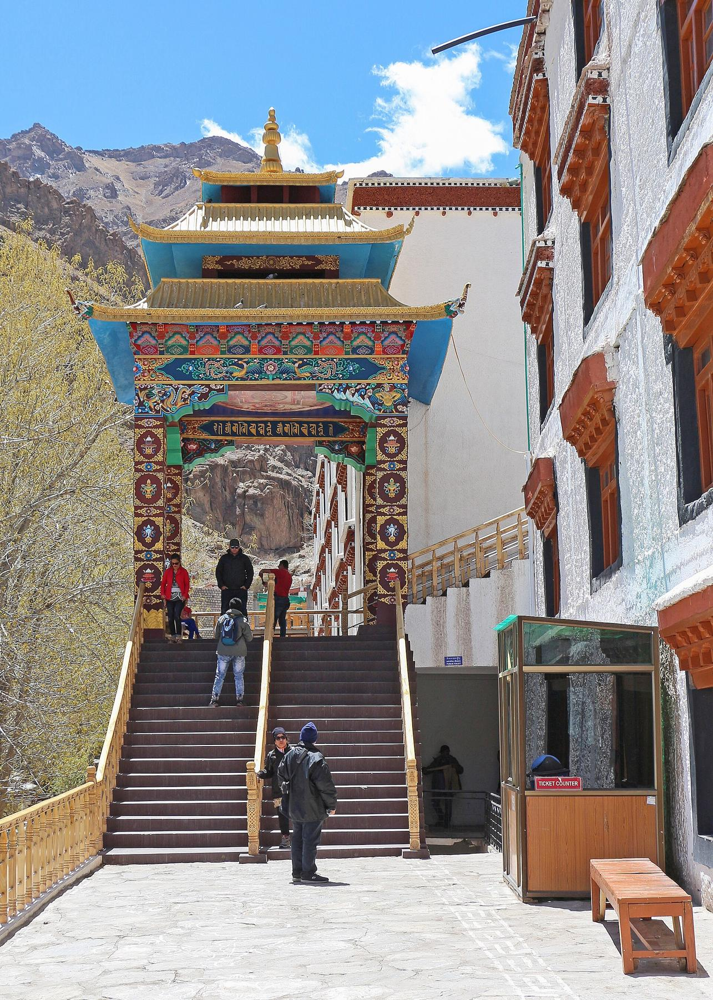
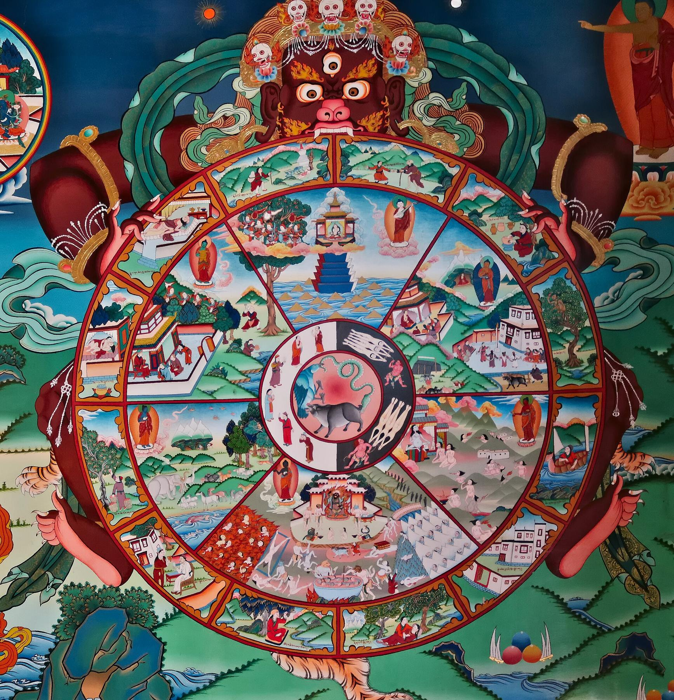
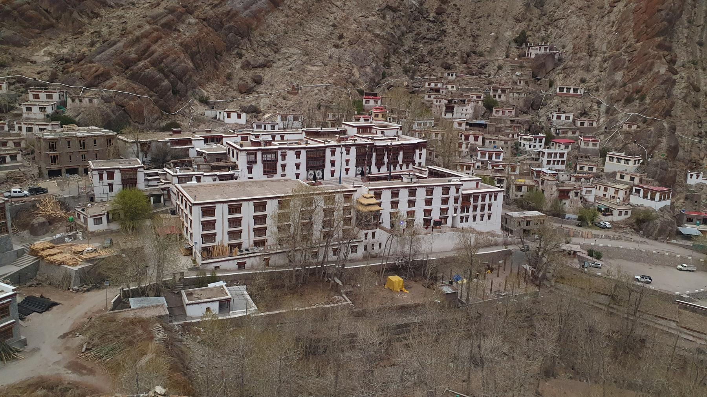

It is the autumn of 1887, in the high desert of Ladakh. A young Russian traveler named Nicolas Notovitch, so he will later say, has fallen from his horse in the mountains and broken his leg. He is carried to a monastery tucked into a side valley of the Indus, where red-robed monks look after him. While he is lying there, the head lama tells him about some old manuscripts in the library. They describe, the lama says, the life of a holy man named Issa, who came to India as a young man to study, and who later went back to his own land and was put to death. Notovitch asks for them to be read aloud, and an interpreter translates as he writes it all down.

Seven years later, in Paris, he publishes the story, and it becomes one of the most famous religious controversies of the 19th century. The monastery was Hemis. Get comfortable. Here's the story of the great monastery of Ladakh, its dances and its giant painting, and the scrolls that, as far as anyone has been able to find, were never there.

## A king and a lama

Ladakh is a high, dry land of mountains, deserts and valleys, on the western edge of the Tibetan plateau. For a thousand years it was a Buddhist kingdom, and its culture, language and religion are close to Tibet's. Its kings ruled from Leh, a market town on the trade routes that linked India with Tibet and Central Asia, and they built monasteries, called *gompas*, on hills and in valleys all across the country.

The greatest of the Ladakhi kings was Sengge Namgyal, the "Lion King," who ruled in the first half of the 17th century. He built the great palace that still towers over Leh. He was also a devoted patron of the Drukpa, one of the schools of the Kagyu tradition of Tibetan Buddhism, and he invited a famous Drukpa master, Stagtsang Raspa, to Ladakh. With the king's support, Stagtsang Raspa founded or rebuilt several monasteries, the most important of which was at Hemis. Sources give different dates for the founding, from the 1630s to 1672; there may have been a small hermitage there before.

The site is classic Ladakh: a narrow, hidden valley off the main road along the Indus, with a stream, a few poplar trees, and walls of red and brown rock rising on every side. The monastery grew into the largest and richest in Ladakh, with lands and villages of its own, and a treasury of statues, paintings and books.

*The main gate of Hemis Monastery. Photo: [Bernard Gagnon](https://commons.wikimedia.org/wiki/File:Hemis_Monastery_01.jpg), CC BY-SA 4.0, via Wikimedia Commons*

## The festival of the Lotus-Born

Every summer, on the tenth day of the fifth month of the Tibetan calendar, which usually falls in June or July, Hemis holds its great festival, the Tsechu. It celebrates the birthday of Padmasambhava, the "Lotus-Born," also known as Guru Rinpoche, the 8th-century master who is said to have brought Buddhism to Tibet and subdued its demons.

For two days, the monastery's courtyard fills with people: villagers in their best clothes and turquoise headdresses, monks, and, more and more, visitors from all over the world. To the sound of long horns, drums and cymbals, monks in brilliant silk robes and enormous painted masks perform the *cham*, a sacred dance. They play gods, demons, skeletons and animals, acting out the victory of good over evil, in slow, spinning steps that are themselves a form of meditation.

And once every twelve years, in the Tibetan Year of the Monkey, something extra happens. At dawn on the first day, the monks unroll a giant *thangka*, a painted and embroidered scroll several stories high, over the front of the monastery. It shows Padmasambhava, and it is said to be one of the largest in the world. The thangka was last shown in 2016 and is next due to be unrolled in 2028.

*A painting of the Wheel of Life on a wall at Hemis. Photo: [Ingo Mehling](https://commons.wikimedia.org/wiki/File:Hemis_Gompa_-_Wall_Painting_-_1.jpg), CC BY-SA 3.0, via Wikimedia Commons*

## The unknown life of Jesus Christ

Now back to Notovitch. In 1894 he published, in French, a book called *The Unknown Life of Jesus Christ*. In it he told the story of his broken leg and his stay at Hemis, and reproduced what he said was a translation of the manuscripts he had been read: the *Life of Saint Issa, Best of the Sons of Men*. According to this text, Jesus had left Judea at the age of thirteen, traveled to India, studied with Brahmins and Buddhists, preached against the caste system, and then returned home at twenty-nine to begin his ministry. The book filled the famous gap in the Gospels between Jesus's childhood and his adult life.

It was a sensation. It was translated into English, German, Italian and other languages and went through many editions. And it was immediately challenged. The great Sanskrit scholar Max Müller, at Oxford, published a sharp critique the same year, pointing out the many improbabilities in the story. He also wrote to the head lama of Hemis to ask.

Then, in 1895, an English professor named J. Archibald Douglas, who taught at a college in Agra, decided to go and see for himself. He made the long journey to Hemis and interviewed the head lama, with an interpreter, and asked him about every claim in the book. The lama's answer, as Douglas published it in 1896, was clear: no Westerner with a broken leg had been treated at the monastery in the fifteen years he had been head lama; he had never told anyone such a story; and there was no such manuscript in the monastery. When Douglas read parts of Notovitch's book aloud, the old lama reportedly asked whether there was no way to punish such a liar.

Most historians since have concluded that Notovitch invented the story. But it refused to die. In the 1920s, an Indian monk of the Ramakrishna order, Swami Abhedananda, visited Hemis and, according to a later account by his followers, was shown a manuscript about Issa. The Russian painter Nicholas Roerich, who traveled through the region around the same time, wrote that he had heard of legends about Issa. No one has ever produced the manuscript, photographed it, or found it in a catalog of the monastery's library, and books and documentaries still argue about it.

## The monastery today

Hemis itself has always been more interested in its own traditions than in this famous foreign story. Its monks still keep its daily rituals, train novices, and look after its museum, which displays old thangkas, copper statues, masks and ritual objects. Above the main monastery, a steep path climbs to a hermitage on the cliff, where Stagtsang Raspa's successors went to meditate.

Beyond the monastery is Hemis National Park, one of the largest protected areas in India and one of the best places in the world to look for snow leopards in winter.

Come in the morning, when the courtyard is quiet and the light is clean and sharp, as it is at 12,000 feet. Sit on the steps beneath the prayer flags and listen. There may be chanting from the assembly hall, and the snap of flags in the wind. The monks have heard the story of the lost gospel many times. They will usually smile, and change the subject to the festival.

*Hemis in its hidden side valley off the Indus. Photo: [Stanzin1945](https://commons.wikimedia.org/wiki/File:17th_century_Hemis_Monastery_in_Ladakh.jpg), CC BY-SA 4.0, via Wikimedia Commons*

## Legend or history?

> In 1887, a Russian traveler was nursed at Hemis after breaking his leg, and the lamas read him ancient Buddhist scrolls describing how Jesus spent his lost years studying in India.

**What we know:** The only source for this is Notovitch himself. The head lama of Hemis told the professor J. Archibald Douglas in 1895 that no such visitor had been treated there and no such manuscript existed, and Max Müller pointed out many problems with the story. Most historians consider it a hoax, and no one has ever produced the scrolls.

> An Indian swami saw the Issa manuscript at Hemis in 1922, proving Notovitch right.

**What we know:** The account of Swami Abhedananda's visit was published later by his followers, and the manuscript was not photographed, copied or seen by anyone else. Scholars generally treat it as unconfirmed.

> The giant thangka of Hemis is unveiled only once every twelve years.

**What we know:** This is true. The largest thangka is shown in the Year of the Monkey, most recently in 2016, with the next due in 2028. Smaller thangkas are displayed at the festival every year.

## Local tellings

These are stories you will hear from guides and online. None of them can be confirmed.

- **The manuscript is hidden in a secret room.** Some say the monks keep the Issa scrolls locked away from outsiders. There's no evidence for it, and the monastery has always said there are no such scrolls.
- **Notovitch confessed.** Some accounts say he later admitted he made it up. It's often repeated, but the details are unclear.
- **Jesus is buried in Kashmir.** A separate and much later legend links a tomb in Srinagar to Jesus. It has no connection to Hemis and no historical support.
- **The cave above Hemis was Stagtsang Raspa's.** The hermitage above the monastery is associated with the founder and his followers. That's the tradition; the details can't be checked.

## Things you probably didn't know

- **It's Ladakh's richest monastery.** Hemis has long been the largest and wealthiest monastery in Ladakh.
- **The giant thangka comes out every 12 years.** The next unrolling is due in 2028, the Year of the Monkey.
- **The festival marks a birthday.** Hemis Tsechu celebrates the birth of Padmasambhava, said to have brought Buddhism to Tibet.
- **Max Müller wrote to the head lama.** The Oxford scholar challenged Notovitch's book in the year it appeared.
- **Snow leopards live next door.** Hemis National Park is one of the best places in the world to see them.
- **It's at about 12,000 feet.** Visitors need several days in Leh to acclimatize first.

## Timeline

- **c. 1616–1642** Reign of Sengge Namgyal, the "Lion King" of Ladakh.
- **1630s–1672** Hemis is founded or rebuilt under royal patronage by the Drukpa master Stagtsang Raspa.
- **1887** Nicolas Notovitch says he stayed at Hemis.
- **1894** Notovitch publishes *The Unknown Life of Jesus Christ*; Max Müller challenges it.
- **1895** J. Archibald Douglas visits Hemis and interviews the head lama.
- **1922** Swami Abhedananda visits Hemis.
- **2016** The giant thangka is shown; next due in 2028.

## If you go

Hemis is about 28 miles (45 km) southeast of Leh, about an hour's drive along the Indus. From the US, fly into Delhi and take one of the daily flights to Leh, a spectacular hour over the Himalayas. Leh is at about 11,500 feet, so rest for at least two days before doing anything strenuous. The monastery is open daily from morning to evening, and there's a small fee for the museum. Hemis Tsechu falls in June or July; check the date for your year and book hotels in Leh well ahead, especially for 2028, when the giant thangka will be shown. The best season for Ladakh is May to September; in winter, Hemis National Park offers snow leopard tours for the very well dressed.

In Leh, [The Grand Dragon](aff:agoda/partners/partnersearch.aspx?pcs=1&hid=110648) is the town's best-known upscale hotel, with heating and mountain views (9.1 from 337 reviews on Agoda, around $300 a night in June).

## Sources

- [Hemis Monastery](https://en.wikipedia.org/wiki/Hemis_Monastery), Wikipedia
- [Nicolas Notovitch](https://en.wikipedia.org/wiki/Nicolas_Notovitch), Wikipedia
- [Hemis Monastery](https://www.sahapedia.org/hemis-monastery), Sahapedia
- [The Unknown Life of Jesus Christ](https://www.gutenberg.org/ebooks/29288), Nicolas Notovitch, on Project Gutenberg

*Cover: the courtyard of Hemis Monastery. Photo: [Ingo Mehling](https://commons.wikimedia.org/wiki/File:Hemis_Gompa_-_Prayer_Hall.jpg), CC BY-SA 3.0, via Wikimedia Commons*
