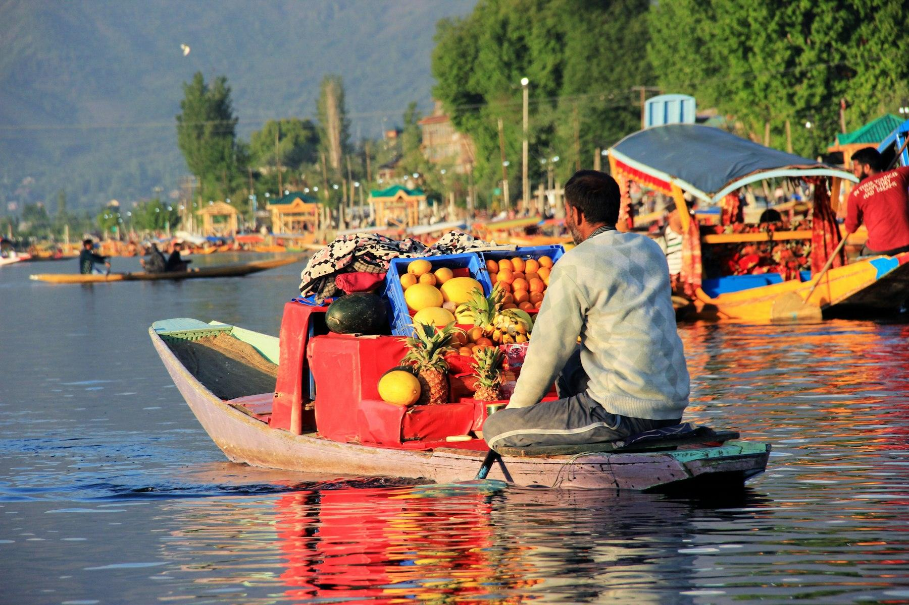
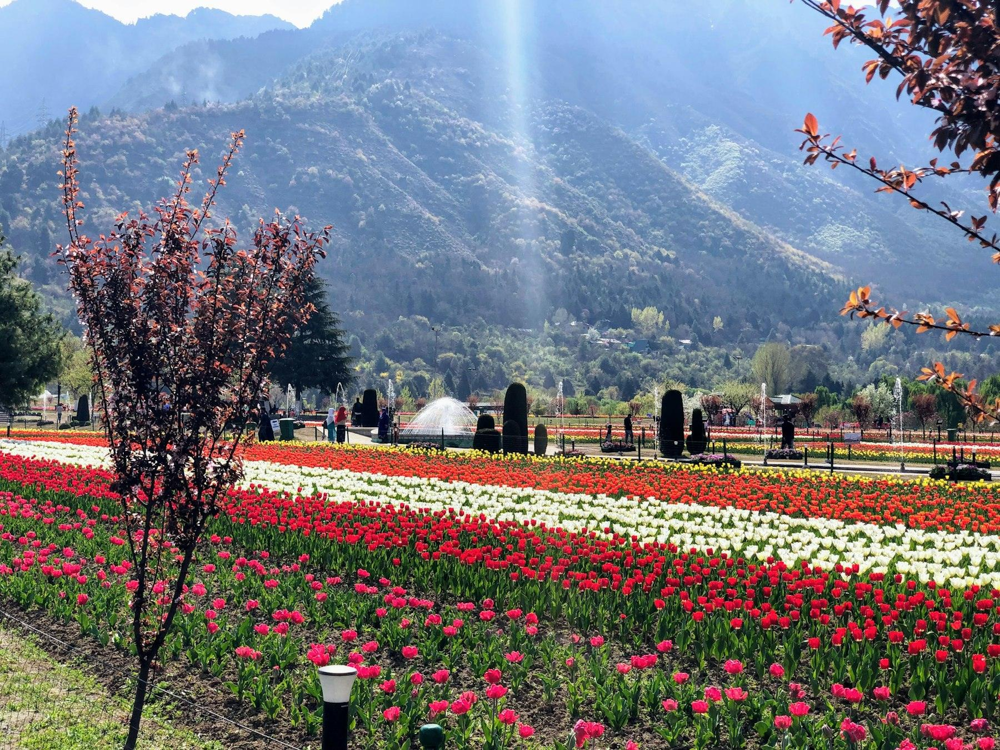
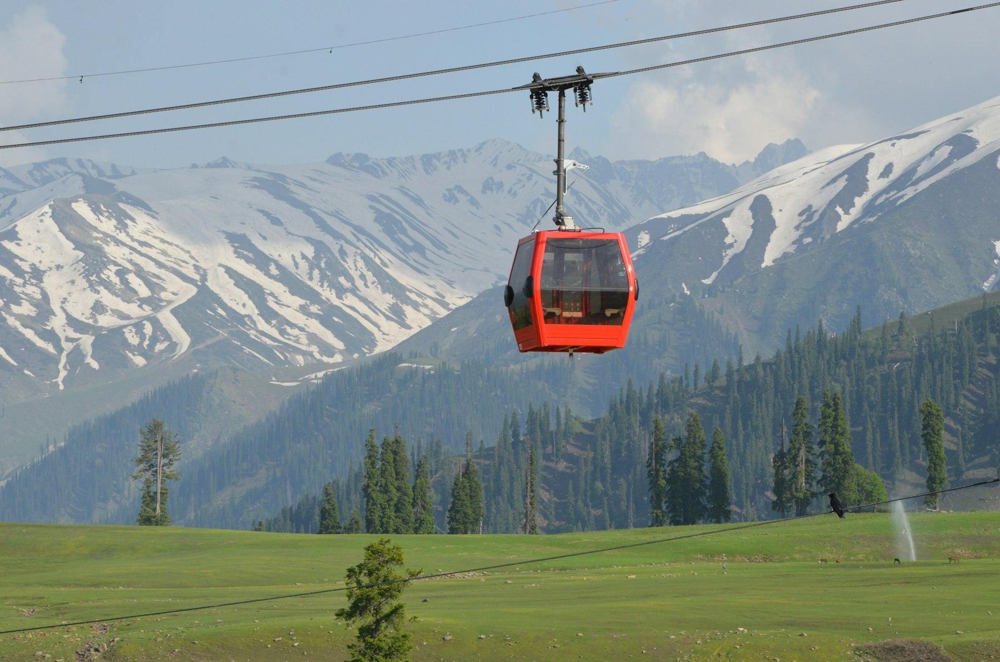
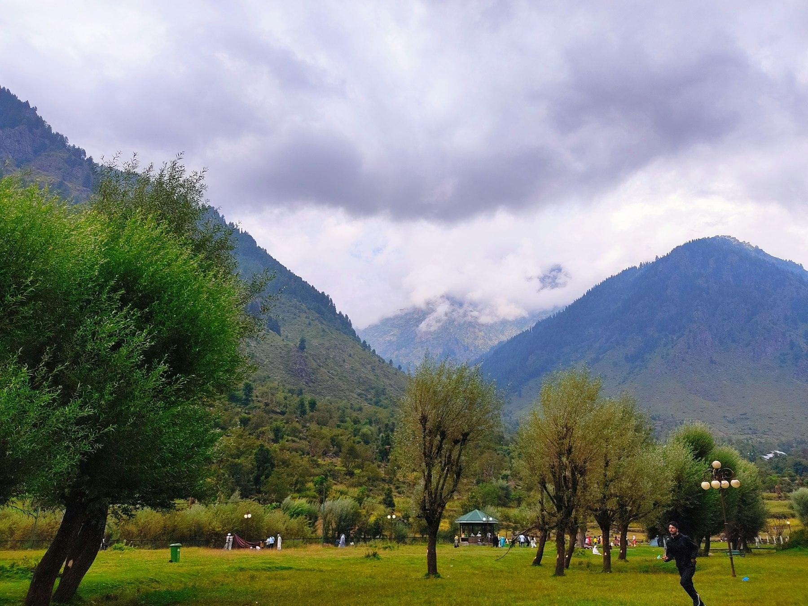
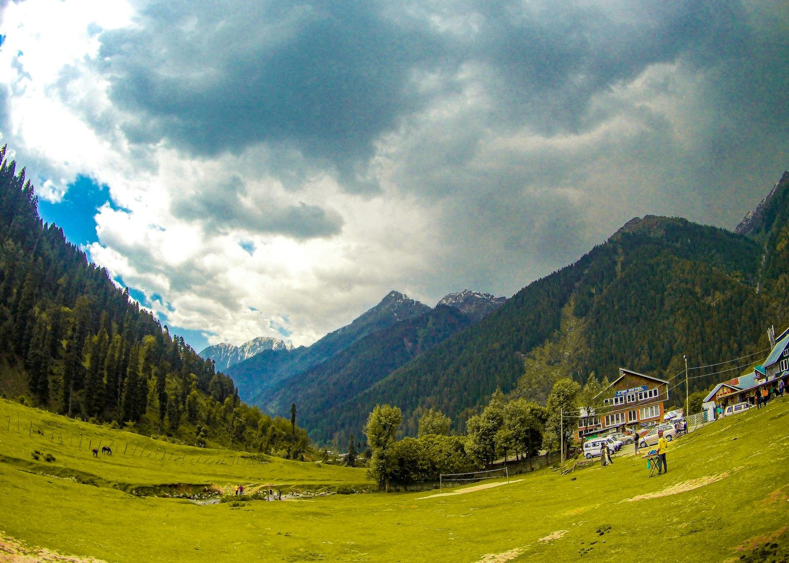
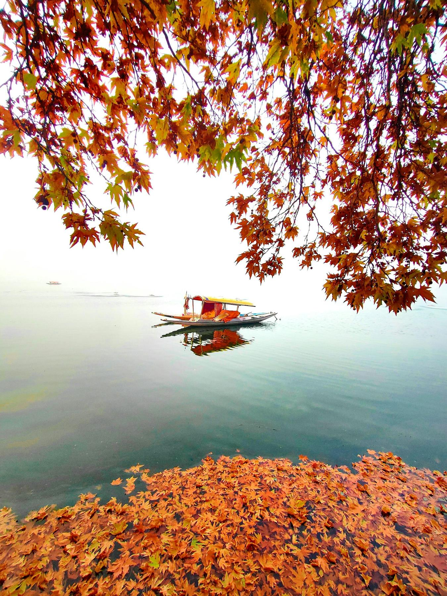

At half past five the lake is still grey, and the only sound is a paddle knocking against the side of the shikara. Then, out of the mist near Gudri, come the boats of the floating market: farmers in pherans sitting cross-legged among heaps of turnips, lotus stems and collard greens, haggling quietly from boat to boat. By seven it's over, the sun is on the Zabarwan hills, and your boatman is pouring kahwa from a flask.

Kashmir is the easiest big-mountain trip from Delhi: a 90-minute flight puts you on a houseboat by lunchtime. This five-night route is for first-timers who want the classic three, Srinagar's lakes and gardens, Gulmarg's meadows and gondola, and Pahalgam's river valleys, without a rushed package tour. It works in any season, with snow from December to February and flowers from April.

## At a glance

| | |
| --- | --- |
| Best time to go | April to June and September to October; December to February for snow |
| Days you need | 6 days, 5 nights |
| Getting there | 90-minute flight Delhi to Srinagar, or Vande Bharat trains via Katra |
| Daily budget | ₹7,100 – ₹16,800 (about $80 – $190) |
| Language | Kashmiri and Urdu; Hindi and English widely understood |
| Currency | Indian Rupee (₹); UPI works, but carry cash |
| Good for | Mountains, lakes, gardens, snow, food, couples and families |

## Why go

Few places pack this much into a short trip. In Srinagar you sleep on a carved cedar houseboat, drift through floating gardens and walk terraced Mughal gardens built for emperors in the 1600s. Two hours away, Gulmarg's gondola lifts you to almost 4,000 m, among the highest cable cars in the world. Pahalgam, where the Lidder River tumbles out of pine forest, is the base for Betaab and Aru, two of the prettiest valleys in the Himalayas you can drive to.

The food alone is worth the flight: wazwan feasts, noon chai the colour of rose petals, and bakeries that bake bread at dawn. Kashmir is also a place still recovering from hard years, and tourism keeps many families going. Visiting thoughtfully, with local drivers, guides and houseboat owners, makes a real difference here.

*The floating market on Dal Lake. Photo: [Amit Jain](https://unsplash.com/photos/man-sitting-on-boat-selling-different-fruits-SVMS7i2wKho) on Unsplash*

## Getting there

**By air:** IndiGo, Air India and SpiceJet fly Delhi to Srinagar (SXR) many times a day in about 1 hour 30 minutes. One-way fares run about ₹4,500–9,000, rising in May, June and around holidays, so book a few weeks ahead. Take a left-side window seat on the way in for the Pir Panjal range. Security at Srinagar airport is strict: arrive two and a half hours before your return flight, since there are checks at the airport gate as well as inside.

**By train:** There's no direct train yet, but you can now ride the rails all the way. The Vande Bharat from New Delhi to Shri Mata Vaishno Devi Katra takes about 8 hours, and a second Vande Bharat runs from Katra to Srinagar in about 3 hours, over the Chenab bridge and through long tunnels under the Pir Panjal. Chair car on the Katra–Srinagar leg costs about ₹700. Book both on [IRCTC](aff:irctc/nget/train-search) and plan a night in Katra, since same-day connections are tight. A direct Delhi–Srinagar sleeper is planned; check IRCTC for its launch.

**From the airport:** Prepaid taxis to Dal Lake (about 14 km) cost around ₹800–1,000. Most houseboats and hotels will send a car if you ask.

## Getting around

- **Hire one taxi for the whole trip:** The easiest plan is a Srinagar taxi with a driver for all six days. Expect about ₹3,000–3,500 a day for a sedan and more for an Innova, plus the driver's stay. Book through your houseboat or a registered Srinagar taxi stand, and agree the route and price in writing.
- **Pahalgam's union taxis:** Outside cars can drop you in Pahalgam but can't take you to the valleys. For Betaab, Aru and Chandanwari you hire from the local taxi stand, at about ₹2,500–3,000 per car for the circuit. Confirm which points are included before you set off.
- **Gulmarg:** The town is small enough to walk, and ponies wait at every turn. Prices aren't fixed, so agree on the route, time and fare (often ₹800–1,500) before you get on.
- **Shikaras:** The tourism department's rate card puts a Dal Lake ride at about ₹700–800 an hour per boat for up to four people. Boatmen at the ghats will often ask for much more; point to the rate board and agree before boarding.
- **Your phone:** Prepaid SIMs from outside Jammu and Kashmir don't work here; postpaid connections do. If you're on prepaid, switch to postpaid before you leave, or plan to rely on hotel Wi-Fi.

## Where to stay

- **Srinagar:** spend at least one night on a houseboat. Nigeen Lake is quieter and cleaner than Dal; Dal is livelier and closer to the gardens. [WelcomHeritage Gurkha Houseboats](aff:agoda/partners/partnersearch.aspx?pcs=1&hid=256857) on Nigeen are among the best-run (9.1 from 100+ reviews, around ₹13,900), and [THE Bombay Group of House Boat](aff:agoda/partners/partnersearch.aspx?pcs=1&hid=81067696) on Dal is the budget pick (8.9 from 89, from about ₹1,100). On land, [Taj Dal View](aff:agoda/partners/partnersearch.aspx?pcs=1&hid=288010) sits high above the lake (8.9 from 350+, around ₹35,000), and [The LaLiT Grand Palace](aff:agoda/partners/partnersearch.aspx?pcs=1&hid=154806) is the old Maharaja's palace with lawns down to the water (8.6 from 280+, around ₹19,400). Backpackers like [Whostels](aff:agoda/partners/partnersearch.aspx?pcs=1&hid=48549584) near the Boulevard (8.4 from 420+, from about ₹1,500) and [Zostel Srinagar](aff:agoda/partners/partnersearch.aspx?pcs=1&hid=5950737) (8.2 from 970+).
- **Gulmarg:** most hotels sit around the meadow, a short walk from the gondola. [The Khyber Himalayan Resort & Spa](aff:agoda/partners/partnersearch.aspx?pcs=1&hid=394085) is the luxury choice, with mountain views from the pool (8.8 from 570+, around ₹32,800). [The Vintage Gulmarg](aff:agoda/partners/partnersearch.aspx?pcs=1&hid=460460) is a cosy wooden hotel close to the gondola (8.5 from 500, around ₹9,100), [Heevan Retreat](aff:agoda/partners/partnersearch.aspx?pcs=1&hid=446656) is a good mid-range option (8.5 from 120+, around ₹8,700), and [Hotel Pine Spring](aff:agoda/partners/partnersearch.aspx?pcs=1&hid=547952) is the value pick (8.2 from 170+, around ₹7,500).
- **Pahalgam:** stay along the Lidder for the sound of the river. [Welcomhotel Pine N Peak](aff:agoda/partners/partnersearch.aspx?pcs=1&hid=400632) is the town's best-reviewed hotel (8.9 from 260+), the newer [Fortune Pahalgam](aff:agoda/partners/partnersearch.aspx?pcs=1&hid=66858803) is also part of ITC (8.7, around ₹11,200), and [Zostel Pahalgam](aff:agoda/partners/partnersearch.aspx?pcs=1&hid=47031682) is a friendly hostel at Sallar, about 12 km down the valley (8.9 from 330+, around ₹3,600 for a private room).

*Ratings are guest scores on Agoda, and prices are for two on a December weeknight, both checked in November 2026. Summer prices, especially in May and June, can be twice as high.*

## Top things to do

### Ride a shikara to the floating market

The floating vegetable market near Gudri, in the middle of Dal Lake, starts around 5:30 am and is done by 7. Farmers from the floating gardens trade vegetables from boat to boat, and flower and saffron sellers paddle up to tourists. Book your shikara the evening before so the boatman is ready in the dark. Stay out for sunrise over the Zabarwan hills, then glide back past Char Chinar island and the houseboats on the lake.

### Walk the Mughal gardens

Three Mughal gardens line the east shore of Dal Lake, a short drive apart. Shalimar Bagh was laid out by Emperor Jahangir in 1619, Nishat Bagh by Asaf Khan in 1633, and both step down the hillside in terraces with water channels and fountains under huge chinar trees. Chashme Shahi is smaller, built around a spring whose water people still drink. Entry is about ₹25–30 each, and they're open roughly 9 am to 7 pm (shorter in winter). Finish at Pari Mahal on the hill above for the best view over the lake.

*The tulip garden below the Zabarwan hills in spring. Photo: [Arif Khan](https://unsplash.com/photos/field-of-flowers-beside-trees-4hr8MStXT7s) on Unsplash*

### See the tulips in spring

From mid-March to about the third week of April, the Indira Gandhi Memorial Tulip Garden, Asia's largest, blooms with more than a million tulips in long coloured stripes below the hills. Entry is about ₹70. Go at 9 am when it opens, because by midday the paths are packed. Outside tulip season, the neighbouring botanical garden is still a pleasant walk.

### Explore Srinagar's old city

Downtown Srinagar is where the city's history lives. The Jamia Masjid, rebuilt many times since the 1400s, has a courtyard garden ringed by 378 pillars, each cut from a single deodar trunk. Down by the Jhelum, Khanqah-e-Moula has a carved wooden façade, and the interior is covered in painted papier-mâché (women may look in from the doorway). Go with a local guide, dress modestly, and stop at a kandur bakery for warm girda bread.

### Ride the Gulmarg gondola

Gulmarg's gondola runs in two stages: the first climbs from the meadow to Kongdoori at about 3,050 m, and the second to Apharwat at about 3,980 m, where there's snow most of the year. Phase 1 costs about ₹750–810 and Phase 2 about ₹950–1,010 per person. Tickets are sold online in time slots and sell out, so book a few days ahead on the official J&K Cable Car Corporation site. Go early: Phase 2 often closes in the afternoon when the wind picks up.

*The Gulmarg gondola. Photo: [Digjot Singh](https://unsplash.com/photos/red-cable-car-on-focus-photography-Vkkg9XoUcZI) on Unsplash*

### Spend a morning in Betaab Valley

Betaab Valley, 15 km above Pahalgam, is a wide green meadow ringed by pine forest and snowy peaks, with a clear stream running through it. It takes its name from the 1983 Bollywood film *Betaab*, which was shot here. There's a small entry fee. Walk to the far end of the park, away from the crowds near the gate. Visitors have recently had to leave by 4 pm, so plan to go in the morning.

*Betaab Valley. Photo: [Abdul Muiz Khan](https://unsplash.com/photos/a-grassy-field-with-trees-and-mountains-in-the-background-mW9mGEeW1hY) on Unsplash*

### Drive up to Aru Valley

Aru, 12 km up the Lidder from Pahalgam, is a village at the edge of a long, open meadow, the starting point of treks to Lidderwat and the Kolahoi glacier. You'll see Gujjar shepherds' huts, horses grazing, and snow peaks at the end of the valley. Take a short walk along the river or ride a pony to the viewpoints above the village. Aru reopened in September 2025; check at the taxi stand that it's open on the day.

*Aru Valley near Pahalgam. Photo: [Shail Sharma](https://unsplash.com/photos/a-lush-green-field-with-a-house-in-the-background-ELB1sDPY4Zo) on Unsplash*

## Off the beaten path

### Pampore's saffron fields

On the highway to Pahalgam, 15 km from Srinagar, the karewa plateaus of Pampore grow most of India's saffron. In late October and early November the fields turn purple with crocus flowers, and you can watch families picking them at dawn. At other times, stop at a roadside shop to buy saffron with its GI tag, and taste a cup of kahwa made with it.

### Awantipora's temple ruins

About 30 km from Srinagar on the same road, the ruins of the Avantiswami temple were built in the 9th century by King Avantivarman. Walls carved with gods, river goddesses and musicians stand inside a colonnaded courtyard, half buried for centuries until it was dug out. It's a quiet, 30-minute stop that most tour buses skip, and the entry fee is small.

### Drung waterfall

Drung, a village near Tangmarg on the way up to Gulmarg, has a waterfall that freezes solid into blue-white ice in December and January. In summer it's a pleasant splash among the pines. It's a 10-minute detour from the Gulmarg road, and your driver will know it.

### Pari Mahal at sunset

Pari Mahal, the "palace of fairies", is a ruined 17th-century garden and school of astronomy built by Dara Shikoh above Chashme Shahi. Its arched terraces look straight down over Dal Lake, and at sunset the whole lake turns gold. It's small, so you need only half an hour, and it closes around sunset.

### Mamleshwar temple

In Pahalgam, a 15-minute walk from the main market across the Lidder, stands Mamleshwar, a small stone Shiva temple that is among the oldest in Kashmir. A spring-fed pool sits in front of it, and the walk takes you through a quiet village above the river. Go in the evening, when the day-trippers have left.

*Dal Lake in autumn, when the chinar leaves turn red. Photo: [Murtaza Ali](https://unsplash.com/photos/a-boat-floating-on-top-of-a-lake-surrounded-by-leaves-uxhQCPPL1wU) on Unsplash*

## Things you probably didn't know

- **Houseboats exist because of a land law.** Under the Dogra maharajas, outsiders couldn't buy land in Kashmir, so British visitors built floating homes on the lakes instead.
- **Gulmarg means "meadow of flowers".** The name dates from the 16th century; before that it was called Gaurimarg, after the goddess Gauri.
- **Jamia Masjid stands on 378 tree trunks.** Each pillar in the great mosque is a single deodar cedar.
- **Kashmir's saffron has a GI tag.** Pampore's saffron is known for its deep colour and strong aroma, and it takes the stigmas of about 150,000 flowers to make one kilogram.
- **The world's highest railway bridge is on the way.** The Chenab bridge, on the line to Srinagar, stands 359 m above the river, taller than the Eiffel Tower.
- **Chinars are counted and protected.** The great plane trees of Kashmir, some hundreds of years old, are protected by law, and many now carry a geo-tag.
- **Winter has its own timetable.** Chillai Kalan, the 40 coldest days from 21 December to the end of January, is when lakes freeze at the edges and people carry kangris, small clay fire-pots, under their pherans.

## What to eat

- **Rogan josh:** mutton slow-cooked with Kashmiri chillies and fennel, deep red but mild. It's the best-known dish of the wazwan feast.
- **Gushtaba:** soft mutton meatballs in a yoghurt gravy, traditionally the last dish of a wazwan. Try it at Ahdoo's on Residency Road or Mughal Darbar.
- **Nadru monje:** crisp fritters of lotus stem from the lakes, sold at stalls and in Dal Lake's floating market.
- **Noon chai:** pink, salted tea made with milk and baking soda, drunk with girda or kulcha bread in the morning.
- **Kahwa:** green tea brewed with saffron, cardamom and cinnamon, topped with almonds. It's offered everywhere, including on shikaras.
- **Harissa:** slow-cooked mutton and rice porridge, a winter breakfast sold from big copper pots in the old city's harissa shops.

## A suggested itinerary

### Day 1: Fly into Srinagar

- Morning: Flight from Delhi to Srinagar.
- Afternoon: Check into a houseboat on Nigeen or Dal Lake.
- Evening: Sunset shikara ride and kahwa on the deck.

### Day 2: Srinagar's lake and city

- Morning: Floating market by shikara, then the old city and Jamia Masjid.
- Afternoon: Shalimar, Nishat and Chashme Shahi gardens.
- Evening: Pari Mahal for sunset, then a wazwan dinner.

### Day 3: Gulmarg

- Morning: Drive to Gulmarg (about 2 hours), stopping at Drung waterfall.
- Afternoon: Gondola to Kongdoori and Apharwat.
- Evening: A walk on the meadow and a night in Gulmarg.

### Day 4: Across to Pahalgam

- Morning: Early walk to St Mary's Church on the Gulmarg meadow.
- Afternoon: Drive to Pahalgam via Pampore's saffron fields and Awantipora.
- Evening: Riverside dinner by the Lidder.

### Day 5: Pahalgam's valleys

- Morning: Betaab Valley by local taxi.
- Afternoon: Aru Valley and a riverside walk.
- Evening: Mamleshwar temple and the village above the river.

### Day 6: Back to Delhi

- Morning: Drive to Srinagar airport (about 3 hours).
- Afternoon: Flight to Delhi.
- Evening: Home, with saffron and walnuts in your bag.

## What it costs

| Item | Budget | Mid-range |
| --- | --- | --- |
| Stay (per night) | ₹2,500 | ₹9,000 |
| Food (per day) | ₹800 | ₹1,800 |
| Local transport (per day) | ₹3,000 | ₹4,000 |
| Entry fees, gondola and shikaras (per day) | ₹800 | ₹2,000 |
| **Total per day** | **₹7,100** | **₹16,800** |

On top of this, budget about ₹9,000–18,000 per person for return flights from Delhi. The taxi is the biggest daily cost, so it's cheaper per person in a group of three or four. Gulmarg's gondola, both phases, adds about ₹1,800 per person on the day you ride it.

## Good to know

- **Check what's open before you go.** Some places have been closed since the April 2025 attack at Baisaran: Baisaran itself, Tulian Lake and several trekking routes were still on the closed list in October 2026. Betaab and Aru are open. Ask your hotel or driver the day before, and follow the [J&K Tourism website](https://www.jktourism.jk.gov.in/) for notices.
- **Expect security, and stay calm about it.** Checkpoints, armed police and occasional bag searches are normal. Carry your ID, keep hotel bookings handy, and use only registered taxis and guides.
- **Pack for cold, even in summer.** Gulmarg and Pahalgam drop to near freezing at night in May, and winter days stay below zero. Bring [thermal innerwear](aff:amazon/s?k=thermal+innerwear) and a warm jacket; you can buy a pheran in Srinagar.
- **Carry cash.** UPI works in Srinagar, but shikaras, ponies and small stalls often want cash, and networks can be patchy in the mountains.
- **Dress modestly.** Kashmir is conservative. Cover your shoulders and knees, especially in mosques and the old city, and women should carry a scarf for shrines.
- **Ponywallahs and touts are persistent.** Say no firmly, or agree on a price, route and time before you start, and pay at the end.
- **Plan around the Amarnath Yatra.** In July and August the pilgrimage brings heavy traffic and security on the Pahalgam road, and Chandanwari is busy. Choose other months if you can.
- **Avoid peak weeks if you can.** May, June and the New Year holidays bring the highest prices and longest queues, especially for the gondola.

## Final word

Five nights isn't long, but it's enough to see why people keep coming back to Kashmir: the stillness on Dal Lake at dawn, the snow line from Apharwat, the sound of the Lidder outside your window in Pahalgam. Book the shikara for 5:30 am, wrap your hands around a cup of kahwa, and watch the floating market drift out of the mist.

*Cover: houseboats on Dal Lake, Srinagar. Photo: [Isa](https://unsplash.com/photos/green-and-brown-wooden-house-on-lake-near-snow-covered-mountain-during-daytime-72GwiojCwoI) on Unsplash.*
