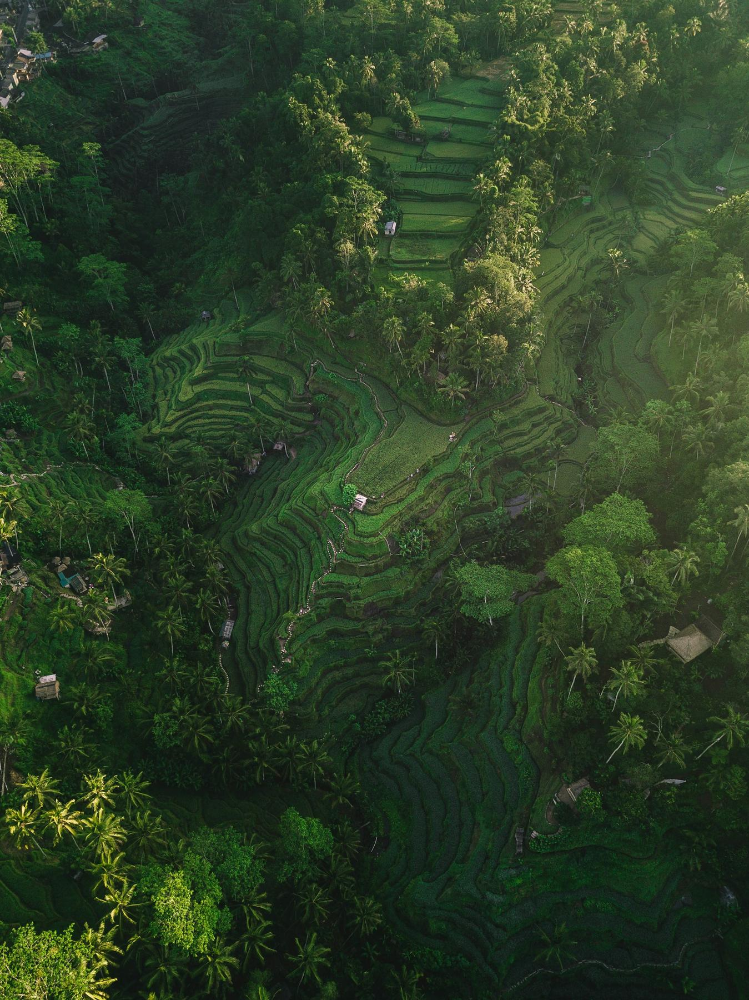
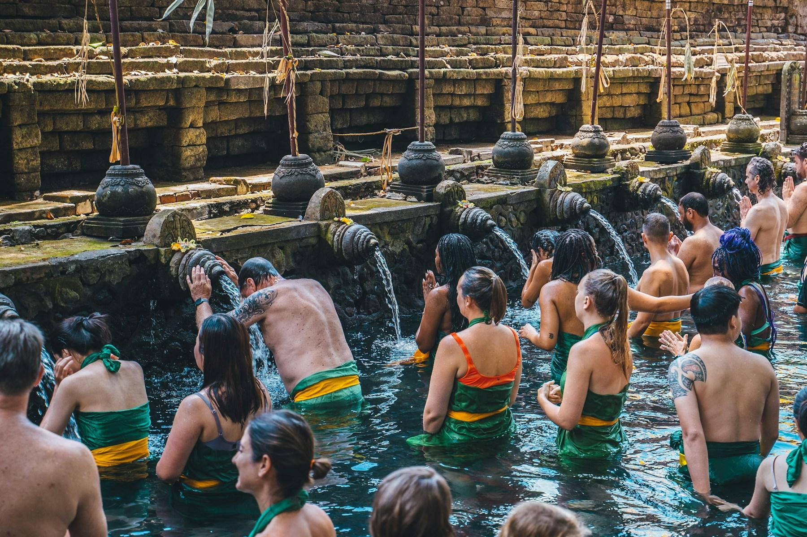
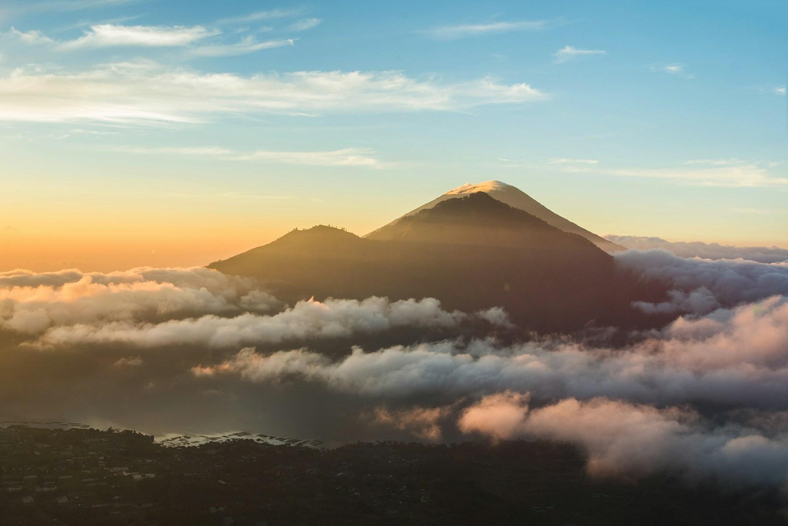
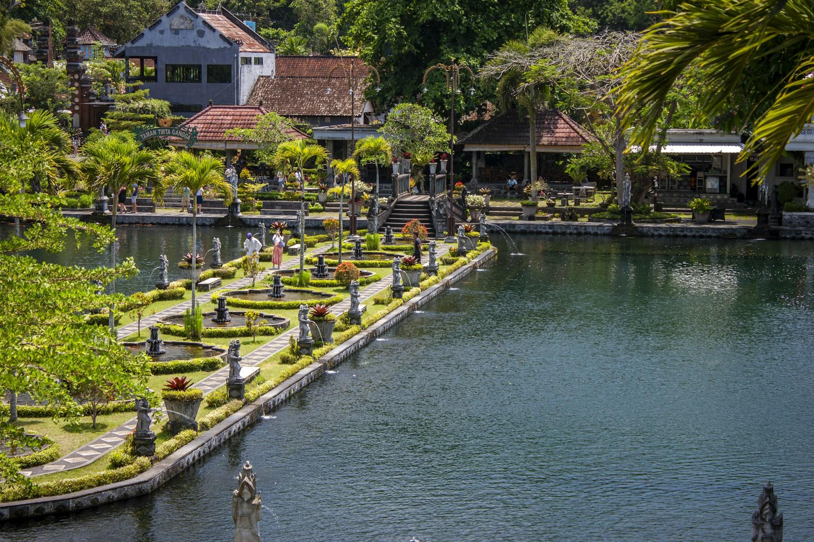
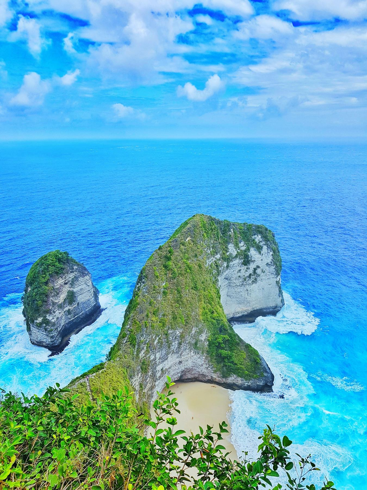
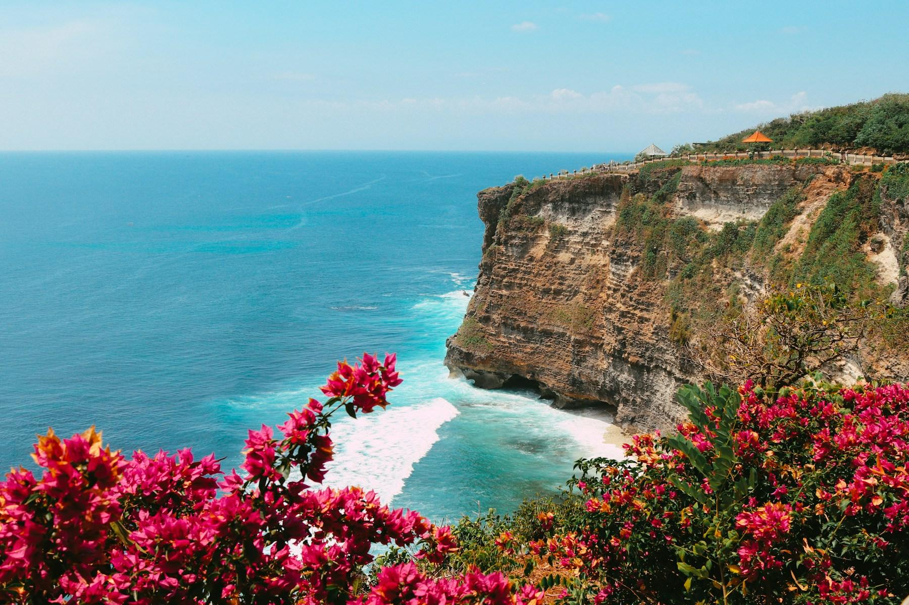
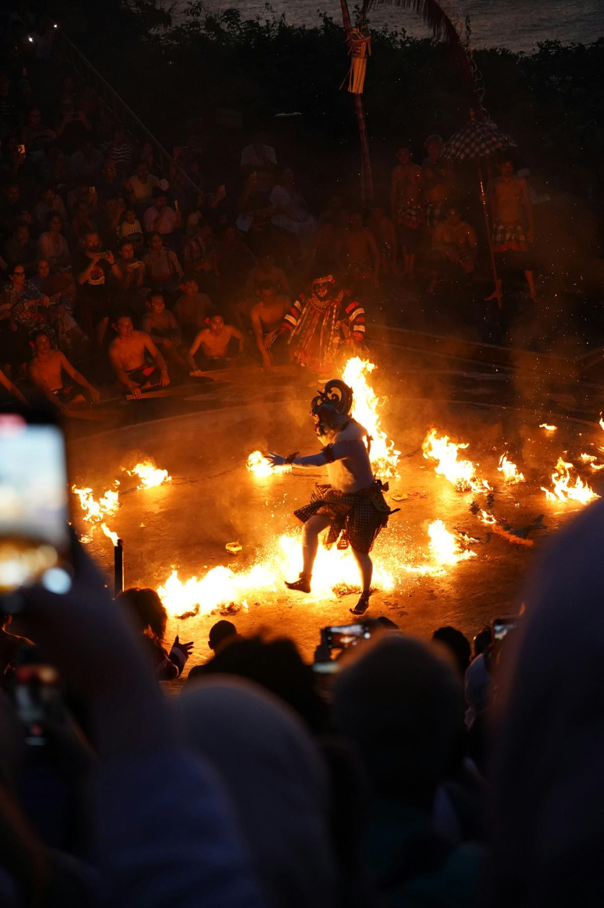

It's just after six in Sidemen, and the valley is still in shadow. A farmer in a conical hat is walking the narrow dyke between two flooded terraces, a basket of offerings in one hand: a palm-leaf tray of marigolds, rice and a stick of incense, which she sets down at a tiny shrine at the corner of the field. Behind her, Mount Agung pushes its head out of the cloud. A cockerel crows, a gamelan practice starts somewhere in the village, and the first scooter of the day putters up the hill.

Bali is the island most Indians know from honeymoon photos of infinity pools and swings over the jungle, and you'll find those. But twelve days gives you time for the Bali behind them: Hindu temples where families still bring offerings every morning, rice terraces watered by a thousand-year-old system, volcano sunrises, and wild cliffs on the islands across the strait. This route is for first-timers who want a mix of culture, nature and beach, without spending half the holiday in traffic.

## At a glance

| | |
| --- | --- |
| Best time to go | April to October (dry season); May, June and September are quieter than July and August |
| Days you need | 12 days, 11 nights |
| Getting there | Nonstop flights of about 6.5–8 hours from Delhi and Bengaluru, or one stop via Singapore, Kuala Lumpur or Bangkok |
| Daily budget | ₹14,000 – ₹32,500 for two (about $160 – $370) |
| Language | Balinese and Indonesian; English is widely spoken in tourist areas |
| Currency | Indonesian rupiah (IDR); ₹1 is roughly IDR 190. Cards work in hotels, but carry cash |
| Good for | Temples, rice terraces, beaches, snorkelling, surfing, couples, families and yoga |

## Why go

Bali is a Hindu island in the world's largest Muslim-majority country, and its culture is alive in a way you feel every day. Every morning, offerings of flowers and rice appear on doorsteps, dashboards and shop counters. Every evening, somewhere, a temple is celebrating its anniversary with gamelan music and processions of women carrying towers of fruit on their heads. For Indian travellers there's a strange familiarity: the Ramayana and Mahabharata turn up in dances and stone carvings, but told in a completely Balinese way.

The landscape is just as varied. In a single day you can climb an active volcano for sunrise, bathe in a holy spring and watch the sun set from a cliff above the Indian Ocean. The island is small, flights from India are short, and outside July and August it's still very good value.

*The terraces at Tegallalang. Photo: [Silas Baisch](https://unsplash.com/photos/aerial-photography-of-rice-terraces-during-daytime-rf5R1qXwlDU) on Unsplash*

## Getting there

**Flights:** Air India flies nonstop from Delhi to Denpasar (DPS), and IndiGo flies nonstop from Bengaluru and some other cities, in about 6.5 to 8 hours. From elsewhere, connect through Singapore, Kuala Lumpur or Bangkok on Singapore Airlines, Malaysia Airlines, AirAsia or Thai. Return fares usually run ₹30,000–55,000 per person, more in May–June school holidays and around Diwali and Christmas. Schedules change often, so check the airlines' own sites before you plan around a nonstop.

**Visa:** Indian passport holders need a visa for Indonesia. The easiest is the electronic visa on arrival (e-VOA) at evisa.imigrasi.go.id, which costs IDR 500,000 (about ₹2,600) and lets you stay 30 days, extendable once. Apply a few days before you fly, and use only the official site. You can also buy the visa on arrival at Denpasar airport, but the queues are long.

**Before you land:** Pay Bali's one-time tourist levy of IDR 150,000 (about ₹800) per person at lovebali.baliprov.go.id and keep the QR voucher; it may be checked at the airport or at major sights. Indonesia also asks arrivals to fill in a free online arrival declaration covering customs and health, in the days before your flight. Ignore look-alike websites that charge for either.

**From the airport:** Ubud is about 1.5 hours away by road. A pre-booked car costs about IDR 300,000–400,000; most hotels can arrange one.

## Getting around

- **Hire a driver:** The easiest way to travel between areas is a car with a driver, usually IDR 600,000–900,000 for a 10-hour day including fuel. Many drivers are excellent informal guides. Book through your hotel or a driver with good reviews, and agree the route and hours first.
- **Ride-hailing apps:** Grab and Gojek work in most of Bali and are much cheaper than taxis. Some villages, especially around Ubud and Uluwatu, don't allow app pickups in certain zones, so you may need to walk to a pickup point or use a local taxi.
- **Scooters:** They're everywhere and cheap to rent, at about IDR 70,000–100,000 a day, but Bali's traffic and steep roads are no place to learn. You need an International Driving Permit with a motorcycle licence, police do check, and travel insurance often won't pay out without one.
- **Fast boats:** Boats from Sanur beach to Nusa Lembongan take about 30–40 minutes, at roughly IDR 200,000–300,000 one way. Book a day ahead in high season, and expect to wade ashore in shorts.
- **Your phone:** Buy a Telkomsel or XL tourist SIM at the airport, or set up an eSIM before you fly. Keep the receipt; tourist SIMs must be registered to your passport.

## Where to stay

- **Ubud:** stay central for walking to the palace, market and cafés, or in the valleys for jungle views and quiet. [Komaneka at Bisma](aff:agoda/partners/partnersearch.aspx?pcs=1&hid=161671) has a pool hanging over the Campuhan valley, a short walk from town (9.3 from 3,800+ reviews, around ₹20,900), and [Bisma Eight](aff:agoda/partners/partnersearch.aspx?pcs=1&hid=759784) is a stylish small hotel on the same road (9.2 from 3,000+, around ₹24,100). For the full jungle-view splurge, [The Kayon Jungle Resort](aff:agoda/partners/partnersearch.aspx?pcs=1&hid=5324904) is a 25-minute drive out (9.1 from 4,800+, around ₹31,300). [Alaya Resort Ubud](aff:agoda/partners/partnersearch.aspx?pcs=1&hid=426266) on Hanoman Road is the best-value central resort (9.0 from 6,800+, around ₹11,300), and [Adiwana Monkey Forest](aff:agoda/partners/partnersearch.aspx?pcs=1&hid=6420143) is right by the forest (9.2 from 1,400+, around ₹12,800). [The Udaya Resorts and Spa](aff:agoda/partners/partnersearch.aspx?pcs=1&hid=1636392), 15 minutes north, has rice-field views (9.3 from 2,400+, around ₹10,800). On a budget, [Sri Ratih Cottages](aff:agoda/partners/partnersearch.aspx?pcs=1&hid=230546) is a calm garden hotel in Campuhan (8.8 from 2,600, around ₹6,500), and [Puri Garden Hotel and Hostel](aff:agoda/partners/partnersearch.aspx?pcs=1&hid=5608429) has private rooms and dorms around a pool (9.2 from 1,500+, around ₹7,300).
- **Sidemen:** small villas and guesthouses on the valley sides, facing rice terraces and Mount Agung. [Wapa di Ume Sidemen](aff:agoda/partners/partnersearch.aspx?pcs=1&hid=4437100) is the comfortable choice, with an infinity pool over the fields (9.4 from 1,600+, around ₹18,300). [Sawah Indah Villa](aff:agoda/partners/partnersearch.aspx?pcs=1&hid=489934) is a well-loved mid-range option among the paddies (9.2 from 2,500+, around ₹9,400), [Darmada Eco Resort](aff:agoda/partners/partnersearch.aspx?pcs=1&hid=52085909) has bamboo bungalows by the river (9.3 from 730, around ₹9,600), and [Subak Tabola Villa](aff:agoda/partners/partnersearch.aspx?pcs=1&hid=818414) is a quiet traditional hotel (9.1 from 370) that was full on my date.
- **Nusa Lembongan:** [Batu Karang Lembongan](aff:agoda/partners/partnersearch.aspx?pcs=1&hid=255257) has villas on the hillside above Jungutbatu (9.1 from 760+, around ₹13,500), and [The Tamarind Resort](aff:agoda/partners/partnersearch.aspx?pcs=1&hid=2811477) is a small, friendly resort near Mushroom Bay (9.2 from 640+, around ₹20,200). [Le Pirate Beach Club](aff:agoda/partners/partnersearch.aspx?pcs=1&hid=487581) on Nusa Ceningan is a fun adults-only option with candy-striped huts (8.8 from 1,000+), and [The Point Resort](aff:agoda/partners/partnersearch.aspx?pcs=1&hid=1538251) (8.9 from 510) and [Lembongan Beach Club](aff:agoda/partners/partnersearch.aspx?pcs=1&hid=446142) (8.7 from 890) are both on the water; all three were full on my date, so book early.
- **Uluwatu:** clifftop hotels on the Bukit peninsula, close to the surf beaches and the temple. [Alila Villas Uluwatu](aff:agoda/partners/partnersearch.aspx?pcs=1&hid=148738) is the famous splurge, with pool villas on the cliff edge (9.1 from 730, around ₹74,900). [Renaissance Bali Uluwatu](aff:agoda/partners/partnersearch.aspx?pcs=1&hid=2562742) is the best value of the big resorts (9.1 from 3,500+, around ₹13,900), and [Radisson Blu Uluwatu](aff:agoda/partners/partnersearch.aspx?pcs=1&hid=2822896) is good for families (8.9 from 3,100, around ₹22,100). Near the beaches, [Suarga Padang Padang](aff:agoda/partners/partnersearch.aspx?pcs=1&hid=2974104) is an eco-resort on the cliffs (8.3 from 680, around ₹18,800). Cheaper picks are [Hideaway Villas Bali](aff:agoda/partners/partnersearch.aspx?pcs=1&hid=1135348) (8.2 from 2,000, around ₹7,100) and [Bingin Garden](aff:agoda/partners/partnersearch.aspx?pcs=1&hid=61711545), a short walk from Bingin beach (8.5 from 280, around ₹3,900).

*Ratings are guest scores on Agoda, and prices are for two on a May 2027 weeknight, both checked in November 2026. July, August, Christmas and New Year cost noticeably more.*

## Top things to do

### Walk the Tegallalang rice terraces

Twenty minutes north of Ubud, the Tegallalang terraces curve down a steep valley in green steps shaded by coconut palms. They're watered by *subak*, Bali's cooperative irrigation system, which dates back more than a thousand years and is on UNESCO's World Heritage list. Go at 7 am, before the tour buses and the swing operators set up. Paths through the fields are free, but farmers ask small donations at a few points; carry small notes.

### Bathe at Tirta Empul

At Tirta Empul, a temple built around a sacred spring in the 10th century, Balinese Hindus queue waist-deep in the pools to bow under each of the carved water spouts in turn. Visitors may join, in a sarong and with a guide or a temple attendant to show the order of the spouts. Entry is about IDR 50,000–75,000, and sarongs are provided. Go at opening, around 8 am.

*The purification pools at Tirta Empul. Photo: [Roméo A.](https://unsplash.com/photos/a-group-of-people-in-a-body-of-water-52u9zOxZegA) on Unsplash*

### Climb Mount Batur for sunrise

Mount Batur (1,717 m) is an active volcano, and the hike to its rim for sunrise is Bali's classic adventure. Pickup from Ubud is around 2 am, and the climb takes about two hours on loose volcanic gravel by torchlight. At the top, the sun rises behind Mount Agung, and your guide cooks eggs in the volcano's steam. The [guided sunrise hike with a hot spring](aff:getyourguide/mount-batur-l84533/mount-batur-sunrise-hike-and-natural-hot-spring-visit-t102566/) is the most popular (4.8 from 10,400+ reviews on GetYourGuide, from about ₹2,800). Not a hiker? The [shared jeep sunrise tour](aff:getyourguide/south-batur-l176090/ubud-mount-batur-jeep-sunrise-and-natural-hot-spring-tour-t760601/) drives to a viewpoint on the lava fields instead (4.8 from 4,400+, from about ₹1,800).

*Sunrise above the clouds from Mount Batur. Photo: [Hugo Villegas](https://unsplash.com/photos/mountain-over-bed-of-clouds-gJiG3zJZmr8) on Unsplash*

### Learn Ubud's arts and food

Ubud has been Bali's centre for painting, dance and crafts since the 1930s. Watch a Legong or Barong dance at Ubud Palace in the evening (tickets around IDR 100,000 at the gate), and spend an hour in the Sacred Monkey Forest, an old temple forest with about 1,200 long-tailed macaques. Then try your hands: a [Balinese cooking class with a market visit](aff:getyourguide/ubud-l32246/ubud-cooking-class-with-optional-market-visit-t628481/) (4.9 from 1,400+, from about ₹1,800) happily does vegetarian versions, and the [silver jewellery class near the Monkey Forest](aff:getyourguide/ubud-l32246/silver-making-class-ubud-make-your-own-unique-jewelry-t742184/) lets you take home a ring you made yourself (4.9 from 2,300+, from about ₹2,300).

### Slow down in Sidemen and see the east

Sidemen is the Bali of thirty years ago: a long green valley of rice terraces, weaving workshops and small villages under Mount Agung. Walk the paths through the fields with a local guide, or go [rafting on the Telaga Waja river](aff:getyourguide/karangasem-regency-l190139/bali-sidemen-private-rafting-on-telaga-waja-river-with-lunch-t749071/) (4.7 from 160+, from about ₹2,100). From here, East Bali's sights are close. Lempuyang's "Gates of Heaven" are famous for the photo framing Mount Agung, but expect a long queue and go at dawn; Tirta Gangga, a former royal water palace with stepping stones across its ponds, is a calmer stop on the way back.

*Tirta Gangga water palace. Photo: [Jayde Keroi](https://unsplash.com/photos/water-palace-with-statues-and-lush-greenery-2GyhO8mAlPA) on Unsplash*

### Cross to Nusa Penida's cliffs

From Nusa Lembongan, Nusa Penida is a short boat ride away, and its west coast has Bali's most dramatic scenery. Kelingking Beach is a headland shaped like a dinosaur's back above a white beach; the path down is very steep and only for the fit. On the water, snorkelling trips visit Manta Point, where reef manta rays come in to be cleaned. If you'd rather go from Bali, the [Nusa Penida east and west full-day tour](aff:getyourguide/bali-l347/bali-nusa-penida-east-west-highlights-full-day-tour-t449366/) includes the boat (4.7 from 8,600+, from about ₹2,800).

*Kelingking Beach on Nusa Penida. Photo: [Sua Truong](https://unsplash.com/photos/green-covered-island-under-blue-sky-7RvPpfof4P4) on Unsplash*

### Watch the Kecak at Uluwatu

Pura Luhur Uluwatu, one of Bali's six most sacred temples, stands on a cliff 70 m above the waves at the southern tip of the island. Entry is about IDR 50,000; hold on to your sunglasses, as the monkeys here snatch them. At sunset, around 70 men sit in circles in the clifftop amphitheatre and chant "cak-cak-cak" as the Kecak fire dance tells the story of Rama and Sita, ending with Hanuman kicking burning coconut husks. Tickets cost about IDR 150,000 at the gate, or buy a [temple and Kecak ticket](aff:getyourguide/bali-l347/bali-uluwatu-and-kecak-ticket-t684070/) ahead (4.2 from 4,500+, from about ₹800). Arrive an hour early.

*The cliffs below Uluwatu temple. Photo: [Jared Schwitzke](https://unsplash.com/photos/brown-rocky-mountain-beside-blue-sea-during-daytime-aVvckzTWWCc) on Unsplash*

### Surf and swim on the Bukit beaches

The Bukit peninsula's beaches hide at the bottom of cliff stairways: Padang Padang through a crack in the rock, Bingin below its jumble of guesthouses, and Melasti with its wide white sand and calm water for swimming. The waves here are world-famous, and beginners can learn on the gentler breaks; the [beginner and intermediate surf lesson](aff:getyourguide/uluwatu-l105742/uluwatu-beginner-intermediate-surf-lesson-with-equipment-t564000/) includes boards and a coach (4.9 from 1,300+, from about ₹3,000). Finish with grilled seafood on the sand at Jimbaran as the sun goes down.

## Off the beaten path

### The Campuhan Ridge Walk, Ubud

This paved path runs along a grassy ridge between two river valleys, starting near the Warwick Ibah hotel in Ubud. It takes about an hour each way to the village of Bangkiang Sidem, past tall elephant grass and coconut palms, with rice fields and cafés at the far end. Walk it at sunrise, before it gets hot.

### Gunung Kawi, Tampaksiring

Down 300-odd steps into a river valley, ten shrines are carved 7 m high into the cliff faces, believed to be memorials to an 11th-century Balinese king and his family. Rice terraces line the way down, and you'll often have the place almost to yourself. A sarong is provided at the gate.

### Kertha Gosa, Klungkung

On the road from Ubud to Sidemen, Klungkung's old court of justice has ceilings painted in the traditional Kamasan style, showing the punishments awaiting sinners in the afterlife in vivid and gruesome detail. It's a 30-minute stop with a small museum next door.

### Tukad Cepung waterfall

Near Bangli, a short walk down a jungle path leads to a waterfall inside a narrow canyon. On sunny mornings between about 9 and 11, shafts of light fall through the gap in the rock. Wear shoes you don't mind getting wet.

### Nusa Ceningan

Cross the narrow yellow suspension bridge from Lembongan to its smaller sister island, where seaweed farmers work the shallows at low tide. The Blue Lagoon, a cove of startlingly blue water below low cliffs, is a five-minute ride from the bridge. Rent a scooter or a bicycle for the morning.

*The fire dance at the end of the Uluwatu Kecak. Photo: [Qdal Studio](https://unsplash.com/photos/a-balinese-dancer-performs-in-a-fire-ceremony-9DWB9SRNqI8) on Unsplash*

## Things you probably didn't know

- **Bali goes completely silent for a day.** On Nyepi, the Balinese New Year in March, the whole island stops for 24 hours: no lights, no traffic, no work, and even the airport closes. Visitors must stay in their hotels.
- **Your name tells your birth order.** Most Balinese are named Wayan, Made, Nyoman or Ketut, for first, second, third and fourth child. A fifth child starts again with Wayan.
- **The Kecak is less than a century old.** The dance was developed in the 1930s from an older trance ritual, with help from the German painter Walter Spies, who lived in Ubud.
- **Bali's rice fields are run by water temples.** The subak system shares water between farmers through a network of temples and priests. It was listed by UNESCO in 2012.
- **Bali is two and a half hours ahead of India.** Bali uses Central Indonesian Time (UTC+8), which is IST plus 2 hours 30 minutes.
- **Mount Agung is Bali's mother mountain.** At about 3,030 m, it's the island's highest peak, and the most important temples are built to face it. Its 1963 eruption killed more than a thousand people.
- **Offerings are everywhere, so watch your step.** The small palm-leaf trays called *canang sari* are placed on pavements every morning. Try not to step on them, but don't panic if you do; by evening they've done their job.

## What to eat

- **Nasi campur:** rice with small portions of several dishes, such as satay, vegetables, egg and sambal. Every warung has its own version, and it's the easiest lunch on the island.
- **Babi guling:** Bali's famous spit-roasted suckling pig, stuffed with turmeric and spices, served with crackling and lawar. Ibu Oka in Ubud is the best-known place.
- **Sate lilit:** minced fish or chicken with coconut and spices, wrapped around lemongrass stalks and grilled.
- **Bebek betutu:** duck stuffed with spice paste, wrapped in banana leaves and slow-cooked for hours until it falls apart.
- **Gado-gado:** blanched vegetables, tofu, tempeh and egg in a peanut sauce, and a reliable vegetarian choice. Ubud also has dozens of vegetarian and vegan cafés.
- **Kopi Bali and jaje:** strong, unfiltered Balinese coffee with colourful rice-flour sweets from the morning market. Skip kopi luwak tastings, which usually involve caged civets.

## A suggested itinerary

### Day 1: Arrive in Ubud

- Morning: Land at Denpasar and drive to Ubud (about 1.5 hours).
- Afternoon: Check in and rest by the pool.
- Evening: Dinner on Jalan Goutama and a dance at Ubud Palace.

### Day 2: Terraces and holy springs

- Morning: Tegallalang rice terraces at 7 am.
- Afternoon: Tirta Empul and Gunung Kawi.
- Evening: Back to Ubud for a Balinese massage.

### Day 3: Mount Batur

- Morning: Sunrise hike up Mount Batur, then the hot springs.
- Afternoon: Rest; you'll need it.
- Evening: An early night in Ubud.

### Day 4: Ubud's arts

- Morning: Campuhan Ridge Walk at sunrise, then the Monkey Forest.
- Afternoon: Cooking class or silver jewellery class.
- Evening: Dinner and a Kecak or Legong performance.

### Day 5: To Sidemen

- Morning: Drive towards Sidemen, stopping at Kertha Gosa in Klungkung.
- Afternoon: Walk through the rice terraces with a local guide.
- Evening: Sunset over Mount Agung from your villa.

### Day 6: East Bali

- Morning: Lempuyang temple at dawn.
- Afternoon: Tirta Gangga water palace, or rafting on the Telaga Waja.
- Evening: A quiet dinner in Sidemen.

### Day 7: Across to Nusa Lembongan

- Morning: Drive to Sanur and take the fast boat to Lembongan.
- Afternoon: Cross the yellow bridge to Nusa Ceningan and the Blue Lagoon.
- Evening: Sunset at Devil's Tear, where waves explode through the rocks.

### Day 8: Nusa Penida

- Morning: Snorkelling at Manta Point and Crystal Bay.
- Afternoon: Kelingking Beach and Broken Beach with a driver.
- Evening: Seafood by the water in Jungutbatu.

### Day 9: To Uluwatu

- Morning: Fast boat back to Sanur and transfer to Uluwatu (about 1 hour).
- Afternoon: Swim at Melasti beach.
- Evening: Sunset drinks on the cliffs.

### Day 10: Surf and Kecak

- Morning: Surf lesson.
- Afternoon: Padang Padang or Bingin beach.
- Evening: Uluwatu temple and the Kecak at sunset.

### Day 11: Last beach day

- Morning: A lazy breakfast and a final swim.
- Afternoon: Spa, or shopping in Seminyak if you need gifts.
- Evening: Grilled seafood on the sand at Jimbaran.

### Day 12: Fly home

- Morning: Pack, and leave three hours for the airport in case of traffic.
- Afternoon: Flight home.
- Evening: Home, with a sarong and a bag of Bali coffee.

## What it costs

| Item | Budget | Mid-range |
| --- | --- | --- |
| Stay (per night, for two) | ₹7,000 | ₹18,000 |
| Food (per day, for two) | ₹2,500 | ₹5,000 |
| Local transport (per day) | ₹2,000 | ₹4,500 |
| Entry fees and tours (per day, for two) | ₹2,500 | ₹5,000 |
| **Total per day** | **₹14,000** | **₹32,500** |

On top of this, budget ₹30,000–55,000 per person for return flights, about ₹2,600 per person for the e-VOA and ₹800 per person for the Bali levy. A driver for the transfer days is the biggest transport cost; on the other days, Grab and short taxi rides keep it low. Warung meals cost IDR 25,000–60,000 (₹130–320), while smart cafés in Ubud and Uluwatu charge Indian big-city prices.

## Good to know

- **Get the paperwork right.** Apply for the e-VOA and pay the Bali levy only on the official .go.id sites, and carry printouts or screenshots of both.
- **Dress for temples.** Every temple requires a sarong and sash, usually lent at the gate; cover your shoulders too. Balinese custom also asks women who are menstruating not to enter temples.
- **Drugs mean prison or worse.** Indonesia has some of the world's harshest drug laws, including the death penalty for trafficking. Don't touch anything offered on a beach.
- **Watch the monkeys.** At the Monkey Forest and Uluwatu, macaques grab sunglasses, phones and anything shiny. Keep bags zipped and don't carry food.
- **Use authorised money changers.** Change money only at counters signed as authorised (look for "PT" in the name), count your notes before leaving, and avoid "no commission" deals in back rooms. ATMs inside banks and malls are safest.
- **Drink bottled or filtered water.** "Bali belly" is real. Many hotels have refill stations, so carry a bottle.
- **Plan for traffic.** Bali's roads are narrow and jammed in the south, especially between Seminyak, Canggu and the airport. A 20 km drive can take an hour and a half.
- **Avoid the rainy season if you can.** From November to March, afternoons often bring heavy rain and the sea crossings to the Nusa islands get rough.

## Final word

Twelve days lets Bali show you more than its pool villas: the hush of Sidemen before the scooters start, the steam rising from Batur's crater at dawn, the cliffs of Penida and the chant of the Kecak as the sun drops into the Indian Ocean. Apply for the e-VOA, pay the levy, set the alarm for 2 am on your Batur day, and leave space in your bag for a sarong.

*Cover: rice terraces and Mount Agung in Sidemen. Photo: [Geio Tischler](https://unsplash.com/photos/person-walking-through-green-rice-terraces-7hww7t6NLcg) on Unsplash.*
