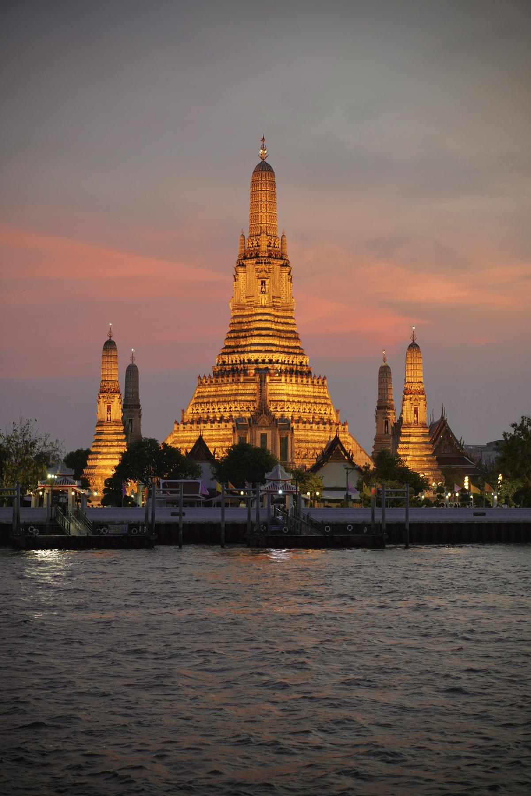
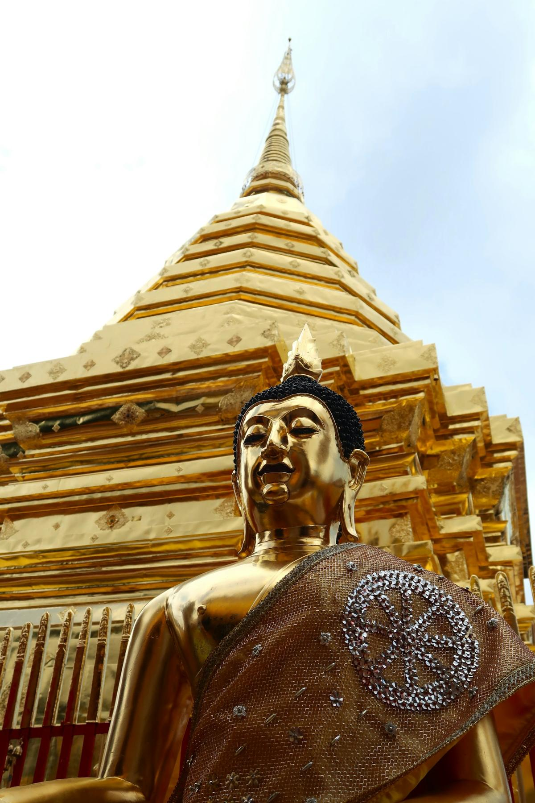
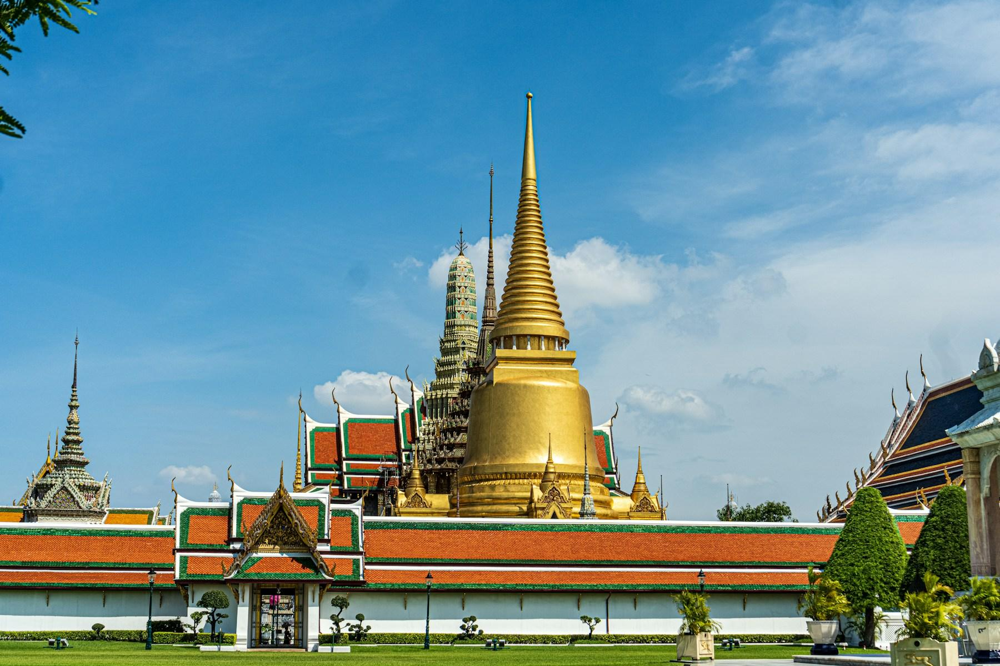
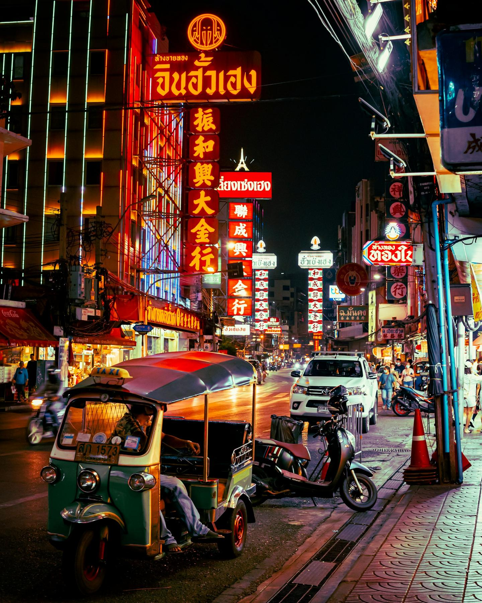
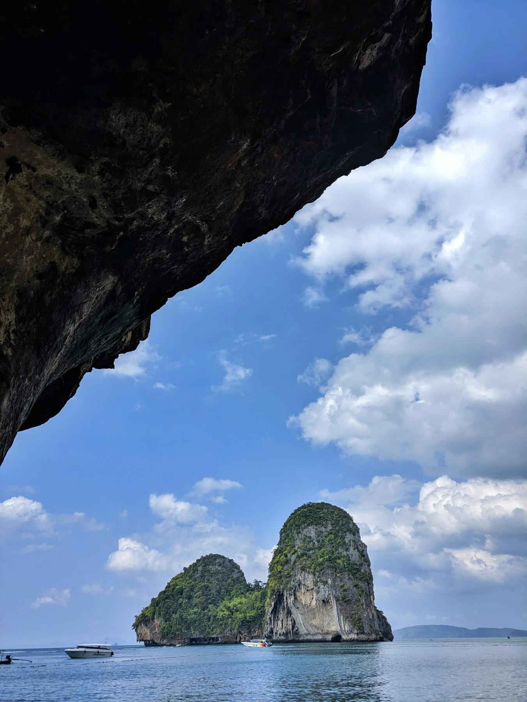
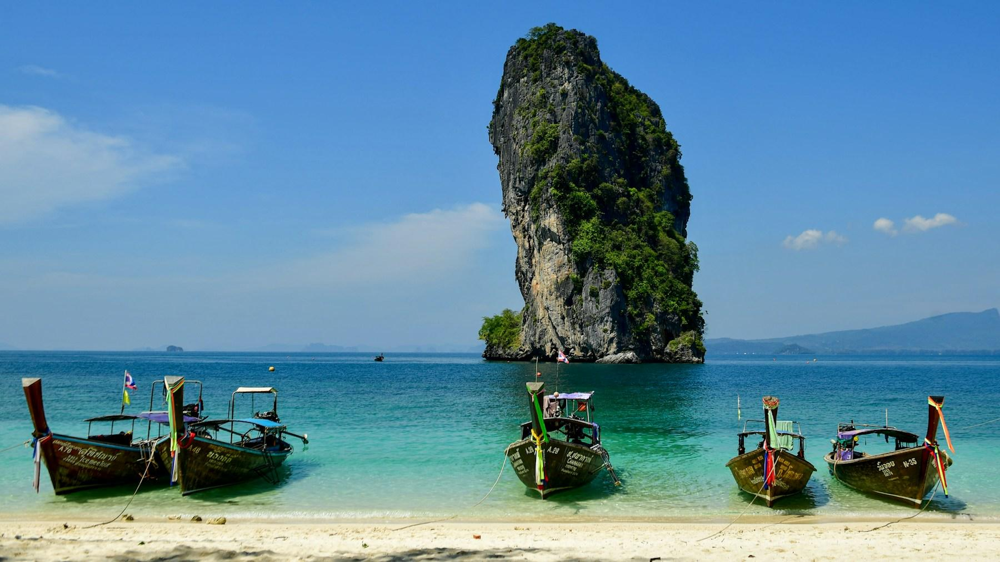

On Christmas morning at Railay, the first longtail boats nose onto the sand before eight, their prows still hung with garlands. The tide is out, the limestone cliffs are lit orange, and the beach smells of sunscreen and coconut. Somebody has strung tinsel across a beach bar, and a rock climber is already halfway up the wall above Phra Nang. By lunchtime you're swimming in water as warm as a bath.

Christmas week is the best time of year to visit Thailand, and also the busiest. The rains are over, the north is cool, and the Andaman Sea is calm and clear. This ten-day route covers the three places most first-timers want, Chiang Mai, Bangkok and the Krabi coast, in an order that puts you on a beach for Christmas Eve and Christmas Day. It's written for travelers flying from the US, with prices in dollars, and it's a good way to use the long holiday break.

## At a glance

| | |
| --- | --- |
| Best time to go | November to February; Christmas week is peak season, so book early |
| Days you need | 10 days on the ground, plus about two days of travel from the US |
| Getting there | One-stop flights to Bangkok via Tokyo, Seoul, Taipei, Hong Kong, Doha or Dubai, about 18–24 hours |
| Daily budget | $135 – $340 for two |
| Language | Thai; English is common in hotels and tourist areas |
| Currency | Thai baht (฿); $1 is roughly ฿33. Cards and QR payments work in cities, but carry cash |
| Good for | Beaches, islands, temples, street food, couples, families and first-timers |

## Why go

Thailand packs three very different trips into one short holiday. Chiang Mai, in the hills of the north, is a walled old city with more than a hundred temples, a cooking-class capital and, in December, mornings cool enough for a jacket. Bangkok is all energy: gilded palaces, river boats, rooftop bars and Chinatown's street food. Krabi, on the Andaman coast, has 300-foot limestone towers rising straight out of turquoise water, and longtail boats to take you between them.

Christmas isn't a Thai holiday, but you won't miss it. Malls put up huge trees, beach resorts lay on Christmas Eve dinners, and the weather is at its best everywhere at once. It's a long flight from the US, but once you're there your dollars go a long way, and Americans don't need a visa.

*Wat Arun at dusk across the Chao Phraya. Photo: [SHAN LU](https://unsplash.com/photos/a-large-building-sitting-on-top-of-a-river-8KVnMbjkOoY) on Unsplash*

## Getting there

**Flights:** There are no nonstop flights from the US to Thailand, but one-stop connections are easy. From the West Coast, fly through Tokyo, Seoul, Taipei or Hong Kong on ANA, Japan Airlines, Korean Air, EVA Air, Cathay Pacific or United; from the East Coast, Qatar Airways, Emirates and Turkish Airlines connect through the Gulf or Istanbul. Expect 18–24 hours door to door and about $1,100–1,800 round trip in Christmas week, rising every week, so book now. Most flights land in Bangkok late at night or early in the morning; to start this route on 19 December, leave the US on the 17th.

**Inside Thailand:** You need two domestic flights. Bangkok to Chiang Mai takes about 1 hour 10 minutes, and Bangkok to Krabi about 1 hour 20 minutes, on Thai AirAsia, Thai Lion Air, Nok Air, Thai Airways or Bangkok Airways, usually $35–80 one way in December. Check which Bangkok airport each flight uses: low-cost carriers mostly fly from Don Mueang (DMK), international flights land at Suvarnabhumi (BKK), and a transfer between the two takes an hour or more. If you land at night, sleep at an airport hotel and fly north in the morning. For the trip home, fly Krabi to Bangkok and connect onto your international flight, leaving at least three hours between them.

**Entry rules:** US passport holders can visit Thailand visa-free for tourism for up to **30 days**, cut from 60 days on 15 September 2026; some older websites still say 60. You also need to fill in the free Thailand Digital Arrival Card (TDAC) online at tdac.immigration.go.th within 72 hours before you land, and show the QR code at immigration. Your passport should be valid for at least six months, and officers sometimes ask to see your onward ticket.

## Getting around

- **In Bangkok:** The BTS Skytrain and MRT metro are fast and air-conditioned; tap in with a contactless credit card or buy tokens. The orange-flag Chao Phraya Express boat is the best way to reach the old royal quarter around Tha Chang and Tha Tien piers, at about ฿16–30 (50 cents to $1) a ride.
- **Grab and Bolt:** Ride-hailing apps work in all three places and show the price up front, which saves haggling with tuk-tuk and taxi drivers. Install Grab before you leave home and link a card.
- **In Chiang Mai:** Red songthaews (shared pickup trucks) go almost anywhere in town for about ฿30–50 per person; agree the fare before you get in. The old city is small enough to walk or cycle.
- **In Krabi:** Longtail boats are the local buses. From Ao Nang beach, a shared longtail to Railay costs about ฿100–150 per person each way and leaves when eight people have gathered; after dark, a private boat costs ฿600–800 ($18–24). Buy tickets at the boat-club counters on the beach.
- **Your phone:** Most US carriers' international plans are expensive in Thailand. Set up a Thai eSIM before you fly, or buy a tourist SIM from AIS, True or dtac in the airport arrivals hall for about $10–15 for two weeks of data.

## Where to stay

- **Chiang Mai:** stay inside or just outside the old city walls, within walking distance of the temples and the Sunday market. [The Inside House](aff:agoda/partners/partnersearch.aspx?pcs=1&hid=4408208) is a white colonial-style boutique hotel with a big pool (9.4 from 3,400+ reviews, around $435), and [Tamarind Village](aff:agoda/partners/partnersearch.aspx?pcs=1&hid=2594) is a Lanna-style hideaway under bamboo in the middle of the old city (9.0 from 2,500, around $385). [137 Pillars House](aff:agoda/partners/partnersearch.aspx?pcs=1&hid=288296) is the splurge, in a restored teak house by the river (9.2 from 530+, around $635). For value, [Buri Siri Boutique Hotel](aff:agoda/partners/partnersearch.aspx?pcs=1&hid=1317010) (8.6 from 5,700, around $55) and [Bodhi Serene](aff:agoda/partners/partnersearch.aspx?pcs=1&hid=95212) (8.6 from 4,100+, around $60) are both a short walk from Tha Phae Gate, and [Chiang Mai Thai House](aff:agoda/partners/partnersearch.aspx?pcs=1&hid=863244) is the budget pick (8.4 from 1,400+, around $30). [U Chiang Mai](aff:agoda/partners/partnersearch.aspx?pcs=1&hid=104366) (9.0 from 3,500+), [Rachamankha](aff:agoda/partners/partnersearch.aspx?pcs=1&hid=45518) (9.0 from 1,300+) and [Thapae Gate Lodge](aff:agoda/partners/partnersearch.aspx?pcs=1&hid=2386242) (9.2 from 1,000+) were already full on 19 December when I checked, which tells you how early people book.
- **Bangkok:** the riverside is the place for a short stay, close to the temples and the boats. [Chakrabongse Villas](aff:agoda/partners/partnersearch.aspx?pcs=1&hid=276597) is a few villas in a royal family's garden facing Wat Arun (9.4 from 550, around $180), and [Riva Surya](aff:agoda/partners/partnersearch.aspx?pcs=1&hid=304327) sits on the river by Phra Sumen Fort, a walk from Khao San Road (9.0 from 4,100+, around $195). [Praya Palazzo](aff:agoda/partners/partnersearch.aspx?pcs=1&hid=237760) is a restored Italianate mansion reached by its own boat (8.6 from 1,100+, around $205). In Chinatown, [Shanghai Mansion](aff:agoda/partners/partnersearch.aspx?pcs=1&hid=69201) is a lantern-hung 1930s-style hotel on Yaowarat Road (8.9 from 8,400, around $100), and [Arun Residence](aff:agoda/partners/partnersearch.aspx?pcs=1&hid=339934) is a small hotel by Wat Pho with a terrace looking at Wat Arun (8.4 from 800, around $105). For the full luxury river experience, the [Mandarin Oriental](aff:agoda/partners/partnersearch.aspx?pcs=1&hid=10713) is Bangkok's legend (9.3 from 1,500+, around $1,065). On a budget, [Lub d Bangkok Siam](aff:agoda/partners/partnersearch.aspx?pcs=1&hid=230759) is a well-run hostel with private rooms across from MBK and the Skytrain (8.6 from 5,900+, around $50).
- **Krabi:** choose between Railay, which has no roads and feels like an island, and Ao Nang, which is busier and cheaper with more restaurants. On Railay, [Railay Bay Resort & Spa](aff:agoda/partners/partnersearch.aspx?pcs=1&hid=48990) runs right across the peninsula from beach to beach (8.3 from 15,000+, around $195), and [Bhu Nga Thani](aff:agoda/partners/partnersearch.aspx?pcs=1&hid=128846) (8.8 from 3,900, around $425) and [Railay Village Resort](aff:agoda/partners/partnersearch.aspx?pcs=1&hid=44909) (8.4 from 4,800+, around $350) are the other good resorts. [Rayavadee](aff:agoda/partners/partnersearch.aspx?pcs=1&hid=10835) is the famous splurge on Phra Nang (9.4 from 3,000), and both it and [Sand Sea Resort](aff:agoda/partners/partnersearch.aspx?pcs=1&hid=3090442) (8.7 from 3,300+) were full on Christmas Eve when I checked. Near Ao Nang, [The Tubkaak](aff:agoda/partners/partnersearch.aspx?pcs=1&hid=1712) is a quiet beach resort facing the Hong Islands (9.1 from 3,200, around $390), [Dusit Thani Krabi](aff:agoda/partners/partnersearch.aspx?pcs=1&hid=916106) is a big family resort on Klong Muang beach (9.0 from 4,500+, around $625), and [Pakasai](aff:agoda/partners/partnersearch.aspx?pcs=1&hid=10824) has hillside views over Ao Nang bay (8.6 from 5,600, around $315). The most affordable reliable options are [Kokotel Krabi Ao Nang](aff:agoda/partners/partnersearch.aspx?pcs=1&hid=2314897) (8.8 from 5,700+, around $240) and [GLOW Ao Nang](aff:agoda/partners/partnersearch.aspx?pcs=1&hid=2598442) (8.5 from 10,000+, around $140).

*Ratings are guest scores on Agoda, and prices are for two on the trip dates (19 December in Chiang Mai, 21 December in Bangkok and Christmas Eve in Krabi), all checked in November 2026. Krabi costs two to three times its usual rate over Christmas and New Year. Many beach resorts also add a compulsory Christmas Eve gala dinner, so read the booking conditions before you pay.*

## Top things to do

### Climb to Wat Phra That Doi Suthep

The temple that watches over Chiang Mai sits at more than 3,300 feet on Doi Suthep, 9 miles from the old city. Climb the 300-odd steps of the naga staircase, or take the funicular, to a golden chedi said to hold a relic of the Buddha, ringed by bells and umbrellas. Foreigners pay a small entry fee. Go before 8 am, when monks chant and the view over the city is still clear, or take the [morning tour that adds the forest temple of Wat Pha Lat](aff:getyourguide/chiang-mai-l271/half-day-morning-wat-pha-lat-wat-phra-that-doi-suthep-tour-t822051/) (4.9 from 490+ reviews on GetYourGuide, from $22).

*The golden chedi at Doi Suthep. Photo: [Marloes van der Veer](https://unsplash.com/photos/a-golden-buddha-statue-in-front-of-a-golden-pagoda-P_xUaqmteHE) on Unsplash*

### Walk Chiang Mai's weekend markets

On Saturday evening, Wualai Road south of the old city closes for the Saturday Walking Street, known for its silverwork. On Sunday from about 4 pm, Ratchadamnoen Road becomes the Sunday Walking Street, half a mile of crafts, street food and temple courtyards turned into food courts, from Tha Phae Gate to Wat Phra Singh. This route puts you in Chiang Mai for both. Arrive by 5 pm, before the crowds, and leave room for khao soi and grilled sai ua sausage.

### Spend a morning with elephants or in a kitchen

Chiang Mai is the place for both. If you visit elephants, choose a sanctuary where nobody rides them. The [half-day feeding program at Pon Elephant Sanctuary](aff:getyourguide/chiang-mai-l271/chiang-mai-elephant-sanctuary-feeding-program-half-day-tour-t911878/) is the most popular (4.9 from 7,200+, from $25); the strictest welfare groups prefer sanctuaries where you only watch. Or learn to cook: a [cooking class with a market visit and herb garden](aff:getyourguide/chiang-mai-l271/chiang-mai-cooking-class-market-thai-herbs-garden-tour-t633010/) (4.9 from 6,500+, from $30) teaches you four or five dishes, with vegetarian versions on request.

### See the Grand Palace and Wat Pho

The Grand Palace was the royal residence from 1782, and inside its walls Wat Phra Kaew holds the Emerald Buddha, Thailand's most sacred image. Tickets cost ฿500 (about $15), and it opens at 8:30 am; go at opening, as by 10 the tour groups arrive. Next door, Wat Pho (฿300) has the 150-foot Reclining Buddha and Thailand's oldest school of massage, where a 30-minute foot massage costs a few hundred baht. A [guided tour of the Grand Palace, Wat Pho and Wat Arun](aff:getyourguide/bangkok-l169/bangkok-grand-palace-wat-pho-and-wat-arun-guided-tour-t840436/) handles the tickets and the dress code (4.8 from 6,000, from $22).

*The Grand Palace and Wat Phra Kaew. Photo: [Sung Shin](https://unsplash.com/photos/gold-and-red-temple-under-blue-sky-KipWnQeqUhc) on Unsplash*

### Cross the river to Wat Arun at sunset

From Tha Tien pier behind Wat Pho, a cross-river ferry costs a few baht and takes two minutes to reach Wat Arun, the Temple of Dawn (฿200). Its central prang is covered in pieces of Chinese porcelain, and you can climb partway up. The best view, though, is from the other side: take a seat at one of the rooftop bars around Tha Tien for sunset, when the temple turns gold and then lights up.

### Eat your way down Yaowarat

Bangkok's Chinatown comes alive after dark, when Yaowarat Road's neon signs light up and the stalls set out plastic stools. Try rolled-noodle soup (guay jub), grilled seafood, crispy pork, and mango with sticky rice for dessert. Many stalls close on Mondays. If you'd rather have a guide, the [Bangkok backstreets food tour](aff:getyourguide/bangkok-l169/chef-designed-bangkok-food-tour-for-8-exclusive-guests-t177729/) does more than 15 tastings in small groups (4.9 from 3,500, from $62).

*Yaowarat Road after dark. Photo: [Mentozs Sys](https://unsplash.com/photos/a-street-with-neon-signs-and-scooters-XjbqwZsLtX0) on Unsplash*

### Spend Christmas Day on Railay and Phra Nang

Railay is on the mainland, but cliffs cut it off, so you can only arrive by boat. Railay West has the sunsets; a ten-minute walk away, Phra Nang beach sits under an overhanging cliff, with a cave shrine full of carved wooden offerings to the sea goddess. Swim, kayak out to Happy Island, or try a [half-day rock-climbing session](aff:getyourguide/krabi-l2174/half-day-rock-climbing-tours-in-railay-beach-t58063/) on the limestone (4.9 from 760, from $48). Fit walkers can scramble up the steep, muddy path to the viewpoint and lagoon; wear proper shoes.

*Looking out from Phra Nang Cave Beach. Photo: [Somesh Kumar](https://unsplash.com/photos/brown-rock-formation-under-blue-sky-and-white-clouds-during-daytime-s-vVfg5YHFk) on Unsplash*

### Go island-hopping from Ao Nang

December has the calmest, clearest sea of the year. The classic trip is the 4 Islands tour by longtail boat: Poda, Chicken Island, Tup Island, whose sandbar appears at low tide, and Phra Nang. The [premium 4-island day trip](aff:getyourguide/ao-nang-l89867/krabi-premium-4-island-day-trip-by-longtail-boat-t746660/) includes lunch and snorkels (4.6 from 6,300+, from $33). For bigger scenery, the [Hong Islands by speedboat](aff:getyourguide/krabi-l2174/krabi-hong-islands-day-trip-by-speedboat-with-lunch-t144153/) visit a lagoon enclosed by cliffs (4.6 from 4,800+, from $41), and the [Phi Phi early-bird speedboat tour](aff:getyourguide/krabi-l2174/from-krabi-phi-phi-early-bird-4-islands-by-speedboat-t467133/) reaches Maya Bay before the crowds (4.9 from 3,500+, from $79). National park fees of ฿200–400 per person are often payable in cash on the day; check what each tour includes.

*Longtail boats at Poda Island. Photo: [Margo Evardson](https://unsplash.com/photos/longtail-boats-on-a-tropical-beach-with-a-rocky-island-DX1e0lTvJuc) on Unsplash*

## Off the beaten path

### Talat Noi, Bangkok

Just south of Chinatown along the river, Talat Noi is a maze of old Chinese shophouses, car-parts workshops and street art. Find So Heng Tai, a 200-year-old Hokkien mansion with a swimming pool in its courtyard, and the riverside Holy Rosary Church. It's quiet in the morning, and a good place for coffee before the heat.

### Wat Umong, Chiang Mai

At the foot of Doi Suthep, this forest temple from the 1300s has tunnels dug into a hillside, lined with Buddha images and the faded remains of old murals. The monks keep the grounds wooded and quiet, with "talking trees" hung with Buddhist sayings. Entry is free, and it takes about an hour.

### Baan Kang Wat, Chiang Mai

An artists' village built around a garden near Wat Umong, with workshops for ceramics, weaving and painting, small cafés and craft shops. It's a calm place to buy gifts that aren't factory-made. Sunday mornings bring a small market.

### Ao Thalane mangroves, Krabi

North of Ao Nang, the mangrove channels and limestone cliffs of Ao Thalane are best seen by kayak, paddling through narrow passages where monkeys watch from the branches. The [mangrove kayaking tour with pickup](aff:getyourguide/krabi-l2174/krabi-ao-thalane-mangrove-kayaking-tour-with-pickup-t1161919/) is a gentle half-day (4.7 from 620+, from $24). Go at high tide, when the boats can reach the deepest channels.

### Krabi Town's weekend night market

On Friday, Saturday and Sunday evenings, Krabi Town holds the Walking Street market, with local food stalls, music and very few tourists compared with Ao Nang. Combine it with the Tiger Cave Temple, where more than 1,200 steps lead to a hilltop Buddha and a view over the whole coast.

## Things you probably didn't know

- **It's 2569 in Thailand.** Thailand uses the Buddhist Era, 543 years ahead, so your Christmas trip is in 2569. You'll see it on receipts and newspapers.
- **Bangkok isn't Bangkok in Thai.** Thais call it Krung Thep, and its full ceremonial name is the longest place name in the world, at 168 letters.
- **Railay is not an island.** It's part of the mainland, but the cliffs around it are so steep that the only way in is by boat.
- **Maya Bay was closed for nearly four years.** The beach from the film *The Beach* shut in 2018 to let its coral recover. It's open again, but swimming in the bay is banned and visitors are limited.
- **The national anthem stops the streets.** At 8 am and 6 pm it plays in parks, stations and some markets, and people stand still. Do the same.
- **Chiang Mai means "new city".** It was founded in 1296 as the capital of the Lanna kingdom, and parts of its moat and brick walls still stand.
- **Vapes are illegal.** Bringing in or using e-cigarettes can mean heavy fines or worse. Leave yours at home.

## What to eat

- **Khao soi:** Chiang Mai's signature dish, egg noodles in a curried coconut broth with chicken or beef, topped with crispy noodles, pickled mustard greens and shallots.
- **Sai ua:** the north's herby grilled sausage, full of lemongrass, kaffir lime and chili, sold in coils at markets.
- **Tom yum goong:** hot and sour shrimp soup with lemongrass and galangal; ask for *nam khon* for the creamy version.
- **Pad krapow:** stir-fried ground pork or chicken with holy basil and chili over rice, topped with a fried egg. Thailand's favorite quick lunch.
- **Massaman curry:** a mild, rich curry with peanuts and potatoes, a good start if you're wary of chili. Ask for *mai phet* (not spicy) anywhere.
- **Mango sticky rice:** ripe mango with sweet coconut sticky rice. December is not mango season, but it's sold everywhere anyway.
- **Pad pak ruam:** stir-fried mixed greens with garlic, an easy vegetarian order anywhere. For fully vegetarian stalls, look for yellow flags marked *jay*, Thai vegan food made without meat, fish sauce or garlic, and say *mai sai nam pla* for no fish sauce.

## A suggested itinerary

### Day 1: Into Chiang Mai

- Morning: Land in Bangkok and connect to Chiang Mai.
- Afternoon: Check in and rest, then walk the old city to Wat Chedi Luang.
- Evening: Saturday Walking Street on Wualai Road.

### Day 2: Doi Suthep and the Sunday market

- Morning: Doi Suthep before 8 am (jet lag helps), with Wat Pha Lat on the way down.
- Afternoon: Wat Umong and Baan Kang Wat.
- Evening: Sunday Walking Street and khao soi.

### Day 3: Elephants or cooking

- Morning: Elephant sanctuary, or a cooking class with a market visit.
- Afternoon: Massage and a slow afternoon by the pool.
- Evening: Dinner in Nimman, the café district.

### Day 4: Fly to Bangkok

- Morning: Flight to Bangkok, and check in by the river.
- Afternoon: Ferry to Wat Arun and a walk around Talat Noi.
- Evening: Sunset drinks facing Wat Arun, then Yaowarat for dinner.

### Day 5: Bangkok's palaces

- Morning: Grand Palace at 8:30 am, then Wat Pho.
- Afternoon: Foot massage at Wat Pho, then the malls of Siam to see the Christmas lights.
- Evening: Rooftop bar or a dinner cruise on the river.

### Day 6: Christmas Eve in Krabi

- Morning: Flight to Krabi.
- Afternoon: Check in and swim at Railay West or Ao Nang.
- Evening: Christmas Eve dinner on the beach.

### Day 7: Christmas Day on Railay

- Morning: Phra Nang beach and the cave shrine while it's quiet.
- Afternoon: Kayaking or a rock-climbing session.
- Evening: Sunset on Railay West, and a video call home as your family wakes up.

### Day 8: Island-hopping

- Morning: Phi Phi or 4 Islands tour.
- Afternoon: Snorkeling and Tup Island's sandbar.
- Evening: Seafood dinner in Ao Nang.

### Day 9: Mangroves and Krabi Town

- Morning: Kayaking in the Ao Thalane mangroves.
- Afternoon: Tiger Cave Temple, if you have the legs for it.
- Evening: Krabi Town's Sunday night market.

### Day 10: Fly home

- Morning: Last swim and breakfast by the sea.
- Afternoon: Flight to Bangkok.
- Evening: Overnight flight home, with dried mango in your bag and a tan.

## What it costs

| Item | Budget | Mid-range |
| --- | --- | --- |
| Stay (per night, for two) | $70 | $200 |
| Food (per day, for two) | $25 | $55 |
| Local transport (per day) | $10 | $25 |
| Entry fees and tours (per day, for two) | $30 | $60 |
| **Total per day** | **$135** | **$340** |

On top of this, budget about $1,100–1,800 per person for round-trip flights from the US and $70–160 per person for the two domestic flights. Krabi is the most expensive part over Christmas; Chiang Mai is the cheapest, and you can eat very well there for $10 a day. Thai ATMs charge foreign cards about ฿220 ($7) per withdrawal on top of your bank's fees, so take out larger amounts less often, and pay by card where you can with one that has no foreign transaction fees.

## Good to know

- **Book now.** Christmas week and New Year are Thailand's busiest days. Several of the best-reviewed hotels in Chiang Mai and Krabi were already full for these dates in early November, and flight prices rise every week.
- **Check the gala-dinner rule.** Many beach resorts charge a compulsory Christmas Eve or New Year's Eve dinner, sometimes $100 or more per person, added after you book. It's in the booking conditions; read them.
- **Plugs and tipping.** Most Thai sockets take US two-pin plugs, but the voltage is 220V, so check that hair dryers and straighteners are dual-voltage. Tipping isn't expected; round up in taxis and leave ฿20–100 or about 10% in sit-down restaurants.
- **Dress for temples.** Cover your shoulders and knees at the Grand Palace, Wat Pho and Doi Suthep; the Grand Palace turns people away. Take your shoes off before going into any temple building.
- **Respect the monarchy.** Criticizing or mocking the royal family is a serious crime in Thailand. Don't step on a coin or bill, since they carry the King's image.
- **Watch for the closed-palace scam.** A friendly stranger near the Grand Palace who says it's closed today and offers a tuk-tuk tour is leading you to a gem shop. The palace is open every day.
- **Pack for two climates.** Chiang Mai can drop to about 57°F at night in December, while Krabi stays above 86°F by day. Bring a light jacket, plus reef-safe sunscreen and a hat.
- **Get travel insurance.** Hospitals in Thailand are good but expensive for visitors, US health plans rarely cover you abroad, and scooter accidents are common. Don't ride a scooter unless you're licensed and insured.

## Final word

Ten days is enough to see why so many people come back to Thailand year after year: the chant of the monks on Doi Suthep, the smell of grilling pork on Yaowarat, and a Christmas morning when the only decision is which beach to swim from. Book the flights and the Krabi hotel this week, fill in the TDAC three days before you go, and pack a jacket for Chiang Mai.

*Cover: longtail boats on Railay Beach, Krabi. Photo: [Steven Watson](https://unsplash.com/photos/a-beach-with-boats-and-a-large-rock-formation-in-the-background-with-railay-beach-in-the-background-TAU5HLTy8eg) on Unsplash.*
