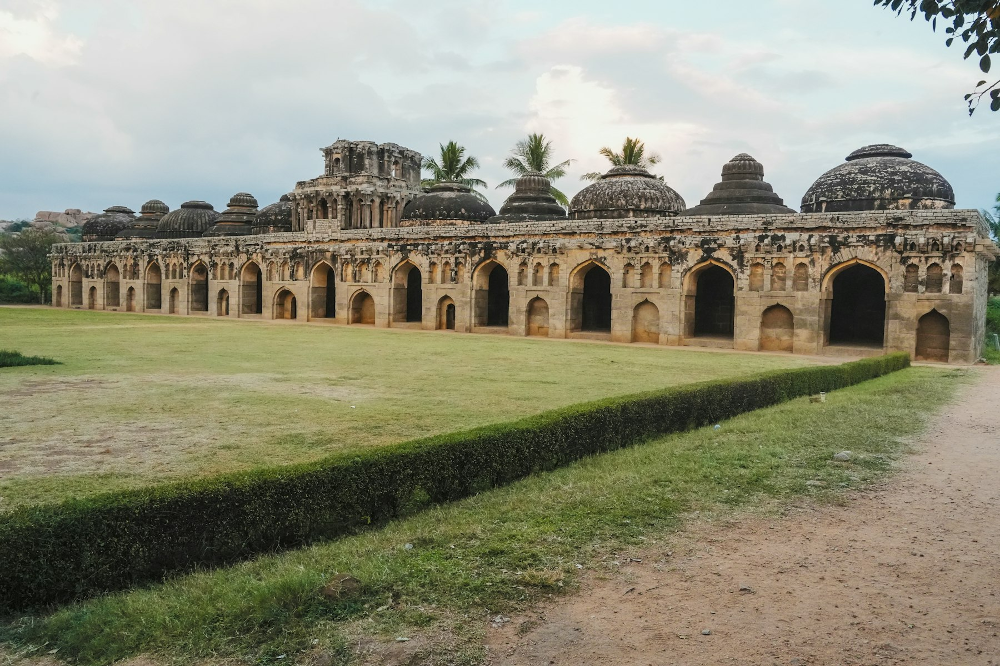
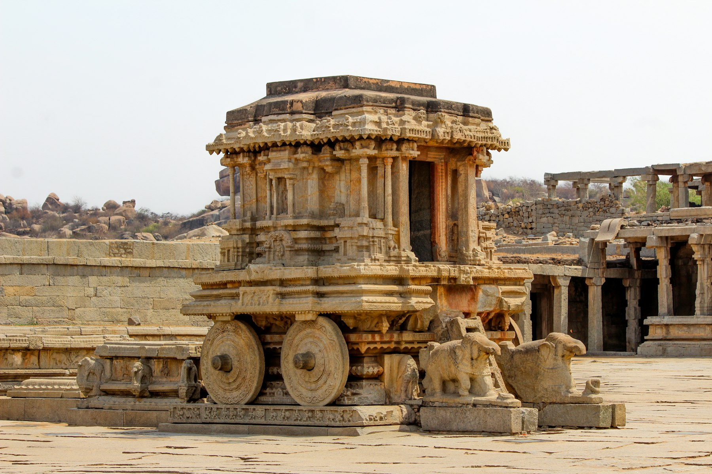
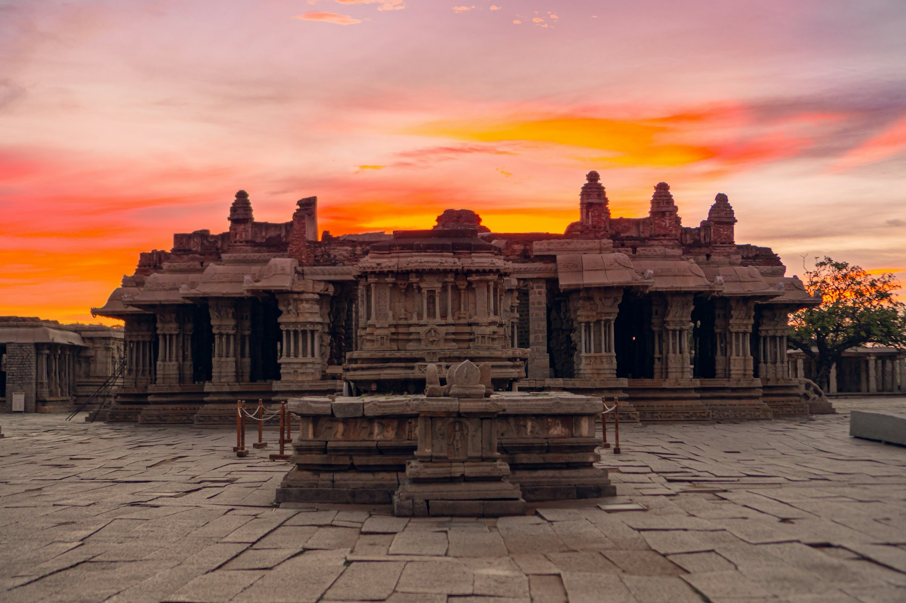

The evening light softened over Hemakuta Hill, turning the massive granite boulders a warm ochre. We sat, feeling the smooth, sun-warmed stone beneath us, as the Virupaksha Temple's gopuram stood silhouetted against the deepening sky. Across the Tungabhadra River, from our guesthouse in Virupapur Gaddi, the distant temple bells and rustle of banana leaves created a peaceful hum, a gentle end to a day spent among ancient stories.

Hampi is for those who find wonder in walking through history, tracing the lines of a powerful empire etched into stone. It is for explorers who appreciate a relaxed pace, the thrill of discovery, and the quiet awe that comes from a landscape where nature and human ingenuity intertwine so uniquely.

## At a glance

| | |
| --- | --- |
| Best time to go | Oct to Feb |
| Days you need | 3 days |
| Getting there | Hosapete Junction (HPT) |
| Daily budget | ₹1,000 – ₹3,400 (~$12-41) |
| Language | Kannada, English, Hindi |
| Currency | Indian Rupee (INR) |
| Good for | History, architecture, nature, photography |

## Why go

*The Elephant Stables, in Hampi's royal quarter. Photo: [Lens Fables](https://unsplash.com/photos/lEJ0C22iSkc) on Unsplash*

Hampi plunges us into the grandeur of the Vijayanagara Empire, a realm where colossal granite boulders frame sophisticated architecture. Its intricate temples and royal structures are not isolated fragments; they are an integral part of this dramatic landscape, a UNESCO World Heritage site where ancient human endeavour meets raw natural power.

As we wander, we encounter marvels like the musical pillars that once resonated with melodies, and royal enclosures engineered with ingenious cooling systems. These monuments vividly illustrate an advanced civilisation's ingenuity, inviting us to imagine life within its grand design.

## Getting there

Hampi does not have its own airport or railway station. The nearest major transport hub is Hosapete (Hospet).

From Bengaluru:
- **By Air:** Fly to Jindal Vijaynagar Airport (VDY), approx. 40 km away (1-hour flight), then ground transport. Alternatively, fly to Hubballi (HBX), 145 km away, then a 3-3.5 hour taxi. Bengaluru's Kempegowda International Airport (BLR) is a major hub.
- **By Train:** Take an overnight train like the Hampi Express to Hosapete Junction (HPT). The journey takes 8-12 hours. From Hosapete, local buses or auto-rickshaws go to Hampi.
- **By Bus:** KSRTC and private operators offer direct buses from Bengaluru to Hosapete (7-8 hours, ₹700-1200).
- **By Car:** The road trip is about 7-8 hours (338-350 km).

From Delhi and Mumbai:
- **By Air:** From Mumbai, fly to Hubballi (HBX) or Jindal Vijaynagar Airport (VDY) (limited flights). Alternatively, fly to Goa or Belgaum and then take a bus or cab to Hampi. From Delhi, fly to Bengaluru (BLR) or Hubballi (HBX) and connect as above. Direct flights to Hampi's closest airports are not available from Delhi.
- **By Train:** Direct trains to Hosapete Junction are available from Mumbai on specific days (14-17 hours). From Delhi, trains go to Bengaluru or Hubballi, requiring a connection to Hosapete.
- **By Bus:** Overnight A/C sleeper buses are available from Mumbai to Hosapete (around 16 hours, ₹1500-2000). Long-distance buses from Delhi would involve multiple transfers.

## Getting around

The ruins of Hampi are spread out, making various transport options useful for exploration.

- **Scooter/Bike Rental:** This is a popular and flexible way to see the widespread ruins. Expect costs around ₹500–700 per day, potentially higher in peak season (up to ₹1,000). A valid license is required.
- **Bicycle Rental:** Ideal for the sacred centre and areas like the road to Vittala Temple, costing about ₹100–250 per day.
- **Auto-Rickshaws:** Good for short trips or full-day sightseeing. Negotiate fares beforehand. Hosapete to Hampi costs ₹250–350, while a full day of sightseeing might be ₹1,200–1,800.
- **Local Bus:** Frequent buses run from Hosapete Bus Stand to Hampi Bazaar, costing ₹15–25.
- **Coracle Ferry:** A traditional circular boat to cross the Tungabhadra River, connecting Hampi Bazaar to the Virupapur Gaddi side. It costs ₹30–50 per person for a one-way crossing, operating roughly from 7:00 AM to 5:30 PM.
- **Walking:** Many clusters of monuments are best explored on foot.

## Where to stay

Hampi offers different vibes for accommodation:

- **Virupapur Gaddi:** Known for its relaxed atmosphere with guesthouses and cafes amidst banana plantations. It offers a more rustic experience and is accessed via coracle ferry. It suits budget to mid-range travellers seeking a quieter stay.
- **Hampi Bazaar:** Located right in the centre of Hampi, near the Virupaksha Temple. This area offers accommodation that puts you closest to many main sites and has a lively market atmosphere. Price band is typically budget to mid-range.
- **Hosapete (Hospet):** The nearest town, about 13 km away, offering more conventional hotels. It is a transport hub and convenient if you need to catch an early morning train. This area suits those looking for standard hotel amenities, often at a mid-range price.

## Top things to do

### Virupaksha Temple
This active temple dedicated to Lord Shiva is a central point of Hampi. Its towering gopuram and intricate carvings are impressive. Entry is free, but a still camera fee is ₹50. Photography is prohibited inside the sanctum. Visit in the morning or evening.

### Vittala Temple Complex
Home to the iconic Stone Chariot and the famed musical pillars (though tapping is now restricted to prevent damage). The complex includes the Lotus Mahal and Elephant Stables. A single ticket of ₹40 (Indians) or ₹600 (foreigners) covers these sites. An electric buggy takes you from the parking area to the temple for a small fee. Allow 2-3 hours.

*The Stone Chariot at the Vittala Temple. Photo: [Pavan Kumaar](https://unsplash.com/photos/9eZ7rB42xow) on Unsplash*

### Hemakuta Hill Sunset
This spot offers panoramic views of the Virupaksha Temple, the Tungabhadra River, and the unique boulder landscape. Arrive at least 30 minutes before sunset to find a good spot and enjoy the changing colours. Entry is free.

### Coracle Ride on the Tungabhadra River
Take a traditional circular coracle boat ride. It is a practical way to cross the Tungabhadra River between Hampi Bazaar and Virupapur Gaddi. A one-way crossing costs ₹30–50 per person.

### Royal Enclosure
Explore the remnants of the royal residential and administrative buildings. This vast area includes the Mahanavami Dibba and the Stepped Tank. Most structures here are open from sunrise to sunset with free entry. Allow 1-2 hours for a thorough walk.

### Queen's Bath
An elegant, Indo-Islamic style bathing chamber with an open-to-sky courtyard and decorative arches. Despite its name, it was likely a royal pleasure pavilion. It is generally free to visit and open during daylight hours.

### Hazara Rama Temple
This temple's inner and outer walls are covered with thousands of detailed bas-reliefs, narrating the entire Ramayana epic. It was once a private temple for the royal family. Entry is free and it is open during daylight hours. Allow 30-45 minutes to appreciate the intricate carvings.

## Off the beaten path

### Anegundi Village Exploration
Often called Hampi's "older sister," Anegundi is a charming village across the Tungabhadra, believed to be the mythical Kishkindha. It offers a glimpse into traditional village life, ancient temples, and local artisans. From Virupapur Gaddi, Anegundi is just a few kilometres away by scooter or bicycle.

### Sanapur Lake
A reservoir fed by the Tungabhadra canal, ringed by the same orange boulders as the ruins, about 4 km from the Virupapur Gaddi ferry point. Come for the view and a coracle ride in the late afternoon, when the rocks glow. Don't swim or cliff-jump: the lake has mugger crocodiles and has seen drownings, and local authorities have warned against entering the water. A scooter is the easiest way there.

### Matanga Hill Sunrise Trek
The highest point in Hampi, Matanga Hill offers a 360-degree panoramic view of the boulder landscape and the river, especially stunning at sunrise. The climb starts near Yeduru Basavanna and involves 200-250 steps, taking 20-30 minutes. Carry a flashlight for the pre-dawn ascent.

### Underground Shiva Temple (Prasanna Virupaksha Temple)
This ancient Shiva temple is partially submerged and often overlooked due to its below-ground location, accessible only during the dry season. It offers a mystical experience. It is located within the main Hampi complex, often near the Royal Enclosure. A phone flashlight is helpful inside.

### Daroji Sloth Bear Sanctuary
Located 15-20 km from Hampi, this sanctuary is dedicated to sloth bear conservation. It offers a unique wildlife viewing opportunity, especially during feeding times in the late afternoon (around 3:00 PM to 5:00 PM). It is best reached by scooter or auto-rickshaw.

### Onake Kindi Prehistoric Rock Art
This site showcases Neolithic rock paintings and engravings, offering a glimpse into human habitation thousands of years before the Vijayanagara Empire. Located near Anegundi village, you might need local guidance to find the exact spot. Visit during daylight hours.

## Things you probably didn't know

- **Global City Status.** By 1500 CE, Hampi-Vijayanagara was one of the world's largest cities, second only to Beijing, and was known as India's wealthiest city.
- **Singing Stones.** The Vittala Temple's famous 56 "musical pillars" were designed to produce melodic sounds when gently tapped, an early feat of acoustic engineering.
- **Natural Camera Obscura.** The Virupaksha Temple's main gopuram creates an inverted image of itself on a wall inside, functioning like a natural pinhole camera, a marvel of ancient optics.
- **Ingenious Rock Splitting.** Hampi's builders split massive granite boulders by drilling holes, inserting dry wooden pegs, and then soaking them with water, causing the pegs to expand and crack the stone.
- **Royal Air Cooling.** The Lotus Mahal likely had an ancient air-conditioning system, with water channels circulating through its walls to keep the interiors cool even in the Hampi heat.
- **Epic Story in Stone.** The Hazara Rama Temple's walls are entirely covered with thousands of miniature bas-reliefs, depicting the entire Ramayana epic in continuous narrative panels.

## What to eat

- **South Indian Thali:** A wholesome meal with rice, curries, sambar, rasam, and papad. Available at most local eateries.
- **Paddu:** Savory rice dumplings, a popular breakfast item. Look for small, local joints for fresh ones.
- **Jowar Roti Meal:** Sorghum flatbread served with various curries, a traditional North Karnataka staple. Often served on banana leaves for an authentic experience.
- **Banana Flower/Stem Curry:** A local delicacy, often found in guesthouses on the Virupapur Gaddi side. Ask if it is available.
- **Fresh Fruit Juice:** Given the banana plantations, fresh banana juice or other seasonal fruit juices are widely available and refreshing.

## A suggested itinerary

### Day 1: Sacred Centre and River Views
- **Morning:** Arrive at Hosapete and take an auto-rickshaw to Hampi. Check into your accommodation in Virupapur Gaddi. Cross the Tungabhadra via coracle ferry to Hampi Bazaar.
- **Afternoon:** Explore Virupaksha Temple, the active heart of Hampi. Walk through Hampi Bazaar. Visit the Monolithic Nandi and the Kadalekalu Ganesha.
- **Evening:** Head to Hemakuta Hill for a memorable sunset view over the boulder landscape and Virupaksha Temple.

### Day 2: Royal Grandeur and Architectural Wonders
- **Morning:** After breakfast, rent scooters from Virupapur Gaddi and ride to the Royal Enclosure. Explore the Mahanavami Dibba, Stepped Tank, and Queen's Bath. Visit the Hazara Rama Temple.
- **Afternoon:** Continue to the Vittala Temple Complex. Spend ample time here admiring the Stone Chariot and musical pillars. Take the electric buggy from the parking to the temple.
- **Evening:** Enjoy a leisurely coracle ride on the Tungabhadra River, soaking in the serene riverine landscape. Explore the cafes and relaxed atmosphere of Virupapur Gaddi.

### Day 3: River Views and Departure
- **Morning:** Begin with an early morning trek up Matanga Hill for a panoramic sunrise view of Hampi. Afterwards, ride your scooter to explore Anegundi village, Hampi's 'older sister,' and stop at Sanapur Lake for the view.
- **Afternoon:** Explore the unique Underground Shiva Temple (Prasanna Virupaksha Temple) for a different historical perspective. Enjoy a final meal in Hampi Bazaar. Collect your belongings from your accommodation.
- **Evening:** Depart from Hampi, taking an auto-rickshaw back to Hosapete Junction for your onward journey.

## What it costs

| Item | Budget | Mid-range |
| --- | --- | --- |
| Stay per night | ₹800 | ₹1,200 |
| Food per day | ₹500 | ₹800 |
| Local transport per day | ₹500 (scooter rental) | ₹700 (auto/scooter + ferry) |
| Entry fees | ₹40 | ₹650 |
| **Total per day** | **₹1,840** | **₹3,350** |

## Good to know

- **Dress Modestly:** When visiting temples, cover your shoulders and knees. Remove footwear before entering sanctums.
- **Stay Hydrated:** December offers pleasant weather, but exploring ruins still requires plenty of water. Carry a bottle.
- **Carry Cash:** Mobile network and UPI payments can be unreliable. Carry sufficient cash (₹2,000–₹3,000 per day) for small purchases, auto fares, and entry fees.
- **Mind the Monkeys:** Monkeys are common and can be bold. Keep food and bags secure.
- **Safety After Dark:** Avoid isolated ruins after sunset. The rocky terrain is home to wildlife like snakes and sloth bears.
- **Negotiate Fares:** Bargaining is expected with auto drivers and at Hampi Bazaar shops. Agree on a price before starting your journey.
- **Comfortable Footwear:** You will do a lot of walking over uneven terrain and boulders. Sturdy walking shoes are essential.
- **Power Bank:** Power interruptions can occur in budget guesthouses; a power bank is useful.
- **Entry Fee Variations:** Entry fees for sites like Vittala Temple vary significantly for Indian nationals (₹40) and foreign nationals (₹600). Factor in camera fees (e.g., Virupaksha Temple, ₹50) as well.

## Final word

*Hampi's temple ruins at dusk. Photo: [Arun Prakash](https://unsplash.com/photos/Q0mSdYr7EFQ) on Unsplash*

As the last light faded, leaving the boulders in deep shadow, we carried with us the echo of ancient chants and the feel of sun-baked stone. The memory of the Hemakuta Hill sunset, the gentle rocking of the coracle on the Tungabhadra, and the scent of banana leaves on a scooter ride, all form a lasting impression. Hampi is a journey through time and terrain, an experience that lingers, calling us back to its ancient stories and dramatic boulder landscape.

*Cover: the Virupaksha Temple and the Tungabhadra from above. Photo: [Adarsh Sudheesan](https://unsplash.com/photos/yADr4J5jzOM) on Unsplash.*

## Sources

- [myquicktrippers.com](https://www.myquicktrippers.com/blog/hampi-in-december-winter-guide)
- [theweather.guide](https://theweather.guide/india/karnataka/hampi/)
- [pikme.org](https://pikme.org/activity/attractions/safety-tips-visiting-hampi-ruins)
- [indiago.app](https://indiago.app/en/hampi/bike-rental/)
- [trypdeals.com](https://www.trypdeals.com/destination/hampi/local-transport-in-hampi/)
- [makemytrip.com](https://www.makemytrip.com/tripideas/hampi/hampi-weather-in-december)
- [tripgenius.in](https://www.tripgenius.in/visit/hampi/december)
- [weatherspark.com](https://weatherspark.com/m/108598/12/Average-Weather-in-December-in-Hampi-Karnataka-India)
- [holidify.com](https://www.holidify.com/places/hampi/how-to-reach.html)
- [happyfares.in](https://www.happyfares.in/flights/flights-to-hampi)
- [indiago.app](https://indiago.app/en/hampi/how-to-get-there/)
- [google.com](https://www.google.com/travel/flights/flights-to-hampi.html)
