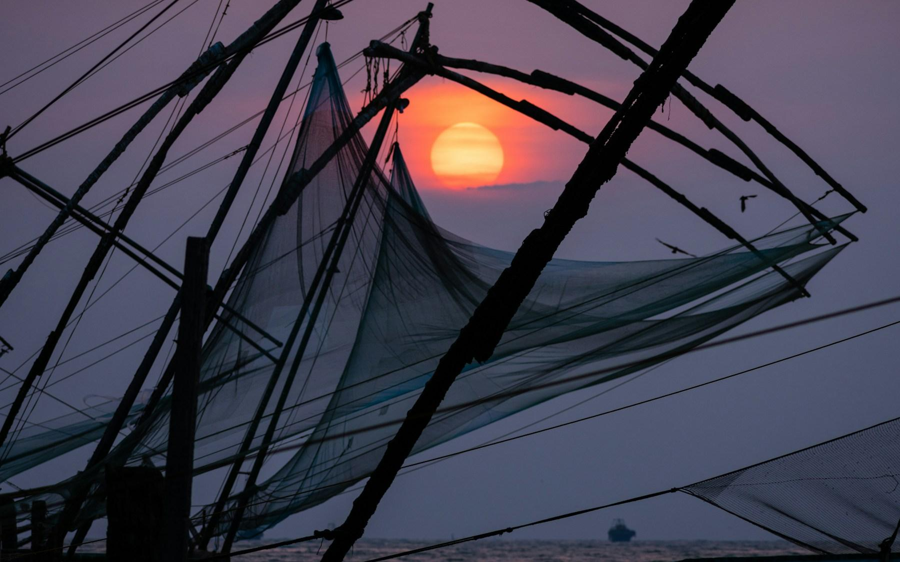
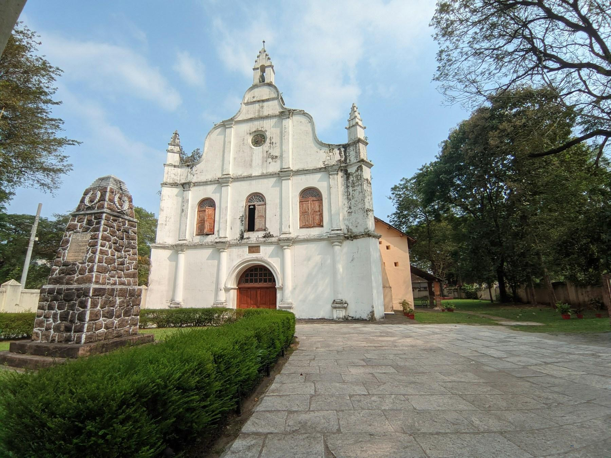
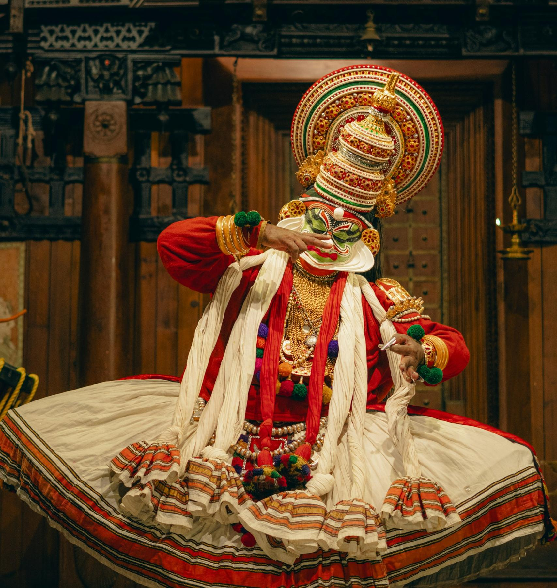
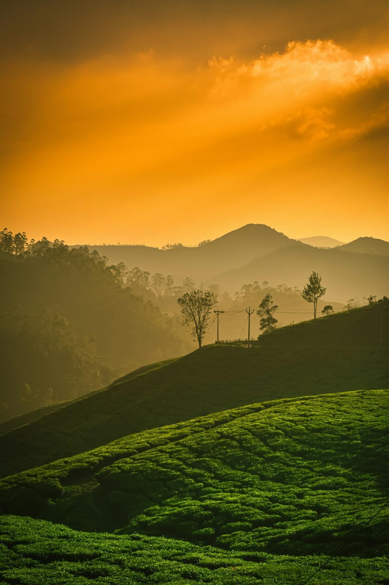
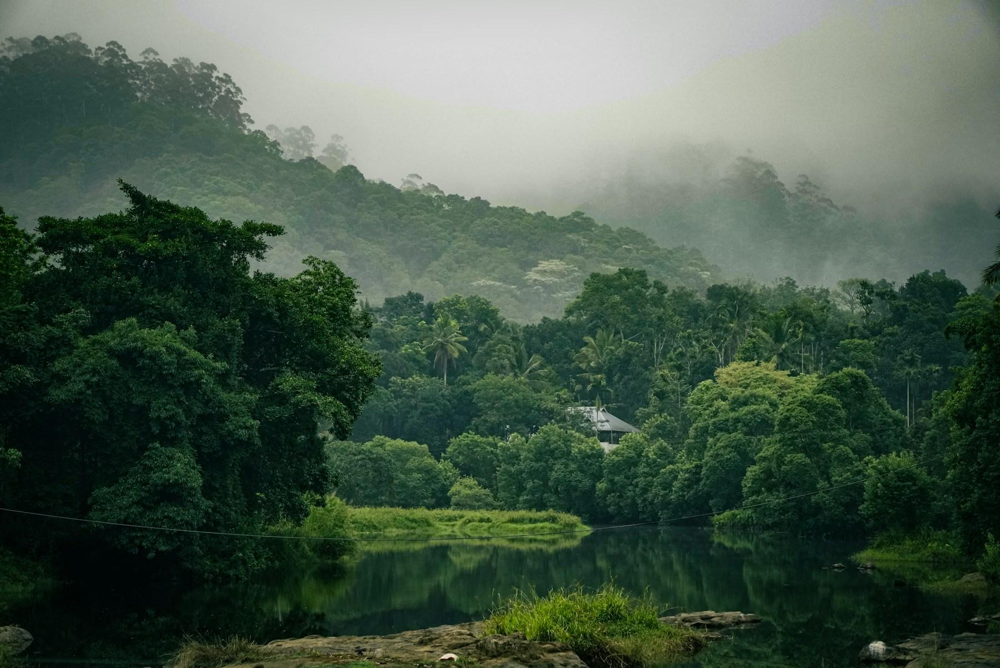
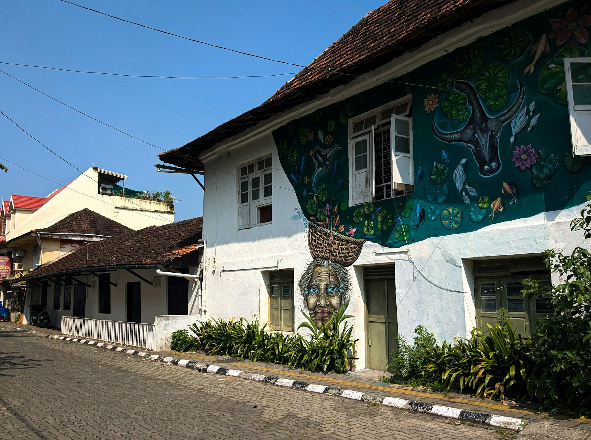

On Christmas Eve in Fort Kochi, every house seems to have a paper star hanging over its porch. They glow red, yellow and green in the dusk along Princess Street, swaying a little in the sea breeze, while a brass band practices carols somewhere behind St. Francis Church. A man on a bicycle sells slices of plum cake from a glass box. Down by the water, the fishermen are lowering the great cantilevered nets for the last catch of the day, and the sunset turns the harbor pink.

Kerala, on India's southwest coast, is the gentlest introduction to India you'll find: green, relaxed, safe and spotless by Indian standards, with superb food and a large Christian community that celebrates Christmas in style. Fifteen days lets you see all of it at an easy pace, from colonial Kochi to the cool tea hills of Munnar, the forests of Periyar, a night on a houseboat in the backwaters and a quiet beach for New Year. It's written for travelers flying from the US, with prices in dollars.

## At a glance

| | |
| --- | --- |
| Best time to go | November to February; Christmas to New Year is peak season, so book early |
| Days you need | 15 days on the ground, plus about two days of travel from the US |
| Getting there | One-stop flights to Kochi (COK) via Doha, Dubai or Abu Dhabi, about 20–28 hours |
| Daily budget | $155 – $370 for two |
| Language | Malayalam; English is widely spoken |
| Currency | Indian rupee (₹); $1 is roughly ₹88. Cards work in hotels, but carry cash |
| Good for | Backwaters, tea hills, wildlife, food, Ayurveda, culture, couples and families |

## Why go

Kerala packs a lot into a narrow strip of land between the Arabian Sea and the Western Ghats. Fort Kochi is a seaside town of Portuguese, Dutch and British buildings, spice warehouses and a 450-year-old synagogue. Three hours inland, Munnar's tea estates roll over hills at 5,000 feet, where December nights are cool enough for a sweater. Below them, Periyar's forest shelters elephants, gaur and a few tigers, and on the coast the backwaters are a maze of canals, lagoons and rice fields where life still moves by boat.

Christmas is a big deal here. About one in five Keralites is Christian, from a church that traces its origins to the apostle Thomas, and in December every Christian home hangs a star lantern, churches fill for midnight Mass, and bakeries sell plum cake by the ton. For an American, it's Christmas with palm trees, fireworks and fish curry.

*The Chinese fishing nets of Fort Kochi at sunset. Photo: [Ankur Khanna](https://unsplash.com/photos/black-sailing-boat-under-sunset-TbPRyHcxw7o) on Unsplash*

## Getting there

**Flights:** There are no nonstop flights from the US to Kerala, but the Gulf airlines make it easy. Qatar Airways (via Doha), Emirates (via Dubai) and Etihad (via Abu Dhabi) all fly from major US cities to Kochi (COK) with one stop, in about 20–28 hours. Air India connects through Delhi or Mumbai. Christmas fares usually run $1,200–1,900 round trip and climb steadily from October, so book as soon as you can. Many Gulf flights land in Kochi in the early morning; to start on 20 December, leave the US on the 18th.

**Visa:** US citizens need a visa for India. The easiest is the e-Tourist Visa at indianvisaonline.gov.in, the official site; ignore look-alike agencies that charge more. The 30-day e-Visa costs $25 for travel between July and March, plus a small bank fee, and the 1-year version costs $40. Apply at least four days before you fly; approval usually comes by email within 72 hours. You'll need a passport valid for six months with two blank pages and a digital passport photo.

**Before you land:** India now asks foreign visitors to fill in a free online e-Arrival Card within 72 hours before arrival, through the same official portal. It's separate from the visa.

**From the airport:** Kochi airport is about 1 hour 15 minutes from Fort Kochi, longer in traffic. A prepaid taxi costs about ₹1,500–1,800 ($17–20); your hotel can also send a car.

## Getting around

- **Hire a car and driver:** This is how almost everyone tours Kerala, and it's good value. A sedan with a driver costs about ₹3,000–4,000 ($35–45) a day, including gas and the driver's food and lodging, for the whole trip. Book through your first hotel or a well-reviewed local agency, and agree the route, total price and tolls in writing.
- **Uber and Ola:** Both work in Kochi and are cheap; out of town, you'll rely on your driver or local taxis.
- **Auto-rickshaws:** Great for short hops around Fort Kochi and Mattancherry. Agree the fare before you get in, and ignore drivers who offer a ₹50 "tour" that ends in a shop.
- **Ferries:** The government ferry from Fort Kochi to Ernakulam costs a few rupees and is a lovely 20-minute ride across the harbor. Kochi's Water Metro runs modern electric boats on other routes.
- **Your phone:** Set up an Indian eSIM before you fly, or buy a Jio or Airtel SIM at the airport with your passport and a photo. US carriers' day passes add up quickly over two weeks.

## Where to stay

- **Fort Kochi:** stay in the old town, walking distance from the churches, the nets and the cafés. [Brunton Boatyard](aff:agoda/partners/partnersearch.aspx?pcs=1&hid=43752) is a grand colonial-style hotel on the harbor, built on the site of a Victorian shipyard (9.2 from 490+ reviews, around $380), and [Eighth Bastion](aff:agoda/partners/partnersearch.aspx?pcs=1&hid=462899) is its smaller sister in the old town (9.5 from 600, around $210). [Old Harbour Hotel](aff:agoda/partners/partnersearch.aspx?pcs=1&hid=81469) is a 300-year-old building with a garden pool facing the nets (9.5 from 55, around $250), and [The Malabar House](aff:agoda/partners/partnersearch.aspx?pcs=1&hid=300818) is a stylish boutique hotel in an 18th-century mansion (8.6 from 90, around $265). [Neemrana's Tower House](aff:agoda/partners/partnersearch.aspx?pcs=1&hid=5743891) faces the sea on the waterfront (8.4 from 490+, around $160). On a budget, [Zostel Fort Kochi](aff:agoda/partners/partnersearch.aspx?pcs=1&hid=2849265) has private rooms and dorms in an old house (8.2 from 610+, around $40). [Forte Kochi](aff:agoda/partners/partnersearch.aspx?pcs=1&hid=4899182) (9.3 from 230+) was already full on 20 December.
- **Munnar:** stay out of the crowded town center, among the tea estates. [Windermere Estate](aff:agoda/partners/partnersearch.aspx?pcs=1&hid=4665679) is a planter's bungalow set in its own cardamom and coffee estate (9.3 from 210+, around $300), and [Blanket Hotel & Spa](aff:agoda/partners/partnersearch.aspx?pcs=1&hid=2099970) faces the Attukad waterfall (9.1 from 1,500+, around $285). [Spicetree Munnar](aff:agoda/partners/partnersearch.aspx?pcs=1&hid=4367226) has private cottages on a hillside (9.1 from 210, around $210), [Chandys Windy Woods](aff:agoda/partners/partnersearch.aspx?pcs=1&hid=762713) is a family favorite with big views (9.0 from 1,000+, around $185), and [The Panoramic Getaway](aff:agoda/partners/partnersearch.aspx?pcs=1&hid=782205) is the best value, with a valley-view pool (9.0 from 1,500, around $140). Prices are for Christmas Eve.
- **Thekkady:** most hotels line the road into Kumily, a short drive from the Periyar boat jetty. [Spice Village](aff:agoda/partners/partnersearch.aspx?pcs=1&hid=544795) is the classic, with thatched cottages in a spice garden (9.2 from 590+, around $345). [Forest Canopy](aff:agoda/partners/partnersearch.aspx?pcs=1&hid=1165251) is a well-run mid-range hotel close to the park (9.2 from 410+, around $115), [Cardamom County](aff:agoda/partners/partnersearch.aspx?pcs=1&hid=111131) has cottages around a pool (8.8 from 440+, around $150), and [The Elephant Court](aff:agoda/partners/partnersearch.aspx?pcs=1&hid=339094) (8.6 from 640+, around $120) and [Amritara Shalimar Spice Garden](aff:agoda/partners/partnersearch.aspx?pcs=1&hid=432895) (8.5 from 420+, around $135) are both good choices.
- **The houseboat:** boats leave Alleppey around noon and return at 9 am, with meals cooked on board. [Spice Coast Cruises](aff:agoda/partners/partnersearch.aspx?pcs=1&hid=1413688), run by the CGH Earth group, is the best-reviewed and most expensive (9.4 from 1,200+, around $790 for two, all meals included). [Venice Premium Houseboats](aff:agoda/partners/partnersearch.aspx?pcs=1&hid=43376484) is a good mid-range choice (8.1 from 770+, around $220). Rates double between Christmas and New Year, so book this first.
- **Marari:** a long, quiet beach backed by coconut groves and fishing villages, 30 minutes from Alleppey. [Marari Beach Resort](aff:agoda/partners/partnersearch.aspx?pcs=1&hid=544677) has thatched villas in a palm garden (9.2 from 650, around $455), [Abad Turtle Beach](aff:agoda/partners/partnersearch.aspx?pcs=1&hid=201283) is the best value on the beach (9.1 from 780, around $180), and [Tree of Life Marari Sands](aff:agoda/partners/partnersearch.aspx?pcs=1&hid=1178410) is another good option (8.2 from 220, around $180). [Marari Villas](aff:agoda/partners/partnersearch.aspx?pcs=1&hid=3087126), with private pools (9.2 from 220), was already full on 28 December.

*Ratings are guest scores on Agoda, and prices are for two on the trip dates (20 December in Kochi, 24 December in Munnar, 25 December in Thekkady, 27 December on the houseboat and 28 December in Marari), before tax, all checked in November 2026. Expect higher rates on 31 December, and many hotels add a compulsory New Year's Eve gala dinner.*

## Top things to do

### Walk Fort Kochi and Mattancherry

Start at St. Francis Church, built by the Portuguese in 1503 and the oldest European church in India; Vasco da Gama was buried here in 1524 before his body was taken home to Portugal. Then walk past Dutch and British bungalows to the Chinese fishing nets on the shore, and on to Mattancherry, where the Dutch Palace has some of India's finest mural paintings. A [private tuk-tuk tour](aff:getyourguide/kochi-l743/kochi-private-tuk-tuk-city-tour-with-hotel-pickup-t392659/) covers it all in four hours (4.8 from 340+ reviews on GetYourGuide, from $17).

*St. Francis Church, Fort Kochi. Photo: [Sathyaraj Natarajan](https://unsplash.com/photos/a-large-white-church-with-a-clock-on-its-side-d6ar7QaEDTs) on Unsplash*

### Explore Jew Town and the spice market

Mattancherry's Jew Town is a lane of antique shops and spice warehouses that ends at the Paradesi Synagogue, built in 1568, with a floor of hand-painted blue Chinese tiles. The synagogue is closed on Fridays, Saturdays and Jewish holidays, so plan around it. The [Stories of Jew Town walk](aff:getyourguide/kochi-l743/stories-of-jew-town-guided-heritage-walk-in-kochi-t1066302/) tells the story of a community that lived here for centuries (4.8 from 40+, from $12). Then follow the smell of pepper and ginger to the wholesale spice warehouses along Bazaar Road.

### Watch Kathakali

Kathakali is Kerala's classical dance-drama, performed by men in towering headdresses and green-painted faces, telling stories from the Mahabharata and Ramayana through eye movements and hand gestures alone. In Fort Kochi, arrive an hour before the show to watch the actors paint their own faces. The [Kathakali, Theyyam and Kalaripayattu evening show](aff:getyourguide/kochi-l743/kochi-kathakali-theyyam-and-kalaripayattu-evening-show-t977030/) adds a martial-arts display (4.7 from 140, from $12).

*A Kathakali performer. Photo: [Chethan Kanakamurthy](https://unsplash.com/photos/kathakali-performer-in-traditional-kerala-costume-x3dZS_TPqII) on Unsplash*

### Spend Christmas Eve in the Munnar tea hills

Munnar was a summer retreat for British tea planters, and its little stone churches still hold midnight Mass on Christmas Eve, with carols in Malayalam and English. By day, walk through the tea estates: the [tea trail with a factory visit and tasting](aff:getyourguide/munnar-l1555/munnar-tea-trail-tea-factory-and-tea-tasting-tour-t790434/) (4.9 from 80, from $13) and the [half-day guided trek](aff:getyourguide/munnar-l1555/munnar-half-day-guided-trek-t784719/) (4.9 from 40, from $13) both get you off the roads. In Eravikulam National Park, the endangered Nilgiri tahr, a wild mountain goat, grazes close to the path below Anamudi, the highest peak in South India (8,842 feet). Foreigners pay about ₹500 ($6); book online, as tickets sell out in holiday weeks.

*Tea estates in Munnar. Photo: [Navi](https://unsplash.com/photos/tea-plantations-on-rolling-hills-nZniGS757fY) on Unsplash*

### Look for elephants in Periyar

The Periyar Tiger Reserve surrounds a lake created by a dam in 1895, and the best way to see it is from a boat at dawn, when elephants, gaur and wild boar come down to the water's edge. Book the first 7:30 am boat on the official Periyar Tiger Reserve website a few weeks ahead; foreigners pay about ₹500 entry plus the boat fare. For a deeper look, the forest department's guided nature walks and bamboo rafting trips take small groups into the forest with armed guards. Then visit a spice plantation to see pepper, cardamom and nutmeg growing.

*The forests of Thekkady. Photo: [Rishi Sreekar](https://unsplash.com/photos/a-body-of-water-surrounded-by-lush-green-trees-7OjZUOyO_FI) on Unsplash*

### Spend a night on a houseboat

The *kettuvallam*, a long rice barge with a woven bamboo roof, has been converted into a floating hotel with bedrooms, a deck and a cook. You board in Alleppey around noon and drift through canals lined with coconut palms, past rice fields, churches, ducks and children walking to school along the dykes, stopping overnight on a quiet lake. Choose a boat with air-conditioned bedrooms, and ask for the route through the narrower canals. To get into the smallest channels, add a [shikara ride with a village visit](aff:getyourguide/alappuzha-l2626/alleppey-shikara-boat-ride-with-village-tour-canal-cruise-t890180/) (4.6 from 120+, from $19).

### Celebrate New Year in Fort Kochi

Fort Kochi throws Kerala's biggest New Year party. The Cochin Carnival fills the last week of December with music, games and processions, and on New Year's Eve a giant effigy of "Pappanji", an old man representing the departing year, has traditionally been burned at midnight on the Parade Ground. The celebrations have been scaled back or canceled in some recent years, so check what's planned before you go, and expect roads into Fort Kochi to close to cars from the afternoon of the 31st. Either way, it's a festive place to see in the new year.

*Street art in Fort Kochi. Photo: [Sai Sumith](https://unsplash.com/photos/a-building-with-a-mural-on-the-side-of-it-KhpZJF-TofM) on Unsplash*

## Off the beaten path

### Kumbalangi

Half an hour south of Fort Kochi, Kumbalangi is a village of fish farms, mangroves and crab ponds on an island in the backwaters. Locals take visitors out in canoes to watch them fish with stake nets and catch crabs by hand. The [backwater village eco cruise with lunch](aff:getyourguide/kochi-l743/7-hours-village-backwater-cruise-in-cochin-t39150/) is a gentle way to see this side of Kochi (4.8 from 610+, from $33).

### Kolukkumalai at sunrise

Kolukkumalai, an hour from Munnar by jeep over a rough track, is one of the highest tea estates in the world, at about 7,000 feet. Leave at 4 am to watch the sun rise over a sea of cloud and the hills of Tamil Nadu, then tour the small, old-fashioned factory where the tea is still processed by machines from the 1930s.

### Kuttanad by canoe

The rice fields of Kuttanad, south of Alleppey, lie up to 7 feet below sea level, protected by dykes, one of the few places in the world where people farm below the sea. Hire a canoe in the villages around Kainakary for an hour and you'll glide through channels too narrow for the houseboats.

### The fishermen of Marari

Early in the morning on Marari beach, teams of fishermen push their wooden boats into the surf, then haul the nets back to shore together, singing to keep time. Walk along the beach at 6:30 am and you can watch, or join in the pulling.

### Hill Palace, Tripunithura

The former palace of the Kochi royal family, 30 minutes from Ernakulam, is now Kerala's largest museum, with crowns, palanquins, old weapons and paintings in a cluster of buildings around a deer park. Few foreign tourists make it here. It's closed on Mondays.

## Things you probably didn't know

- **Christianity reached Kerala before Europe.** Kerala's Syrian Christians trace their church to the apostle Thomas, said to have landed near Kochi in AD 52.
- **India's first Christmas cake was baked here.** In 1883, Mambally Bapu of the Royal Biscuit Factory in Thalassery baked a plum cake for a British planter, using local cashews, raisins and a brandy made from cashew fruit. Kerala still eats mountains of it every December.
- **Star lanterns mean Christmas.** The paper stars hung outside Christian homes, called *nakshatra vilakku*, go up in early December and stay until Epiphany in January.
- **Kerala is the most literate state in India.** Its literacy rate is above 90%, and Malayalam newspapers have huge circulations.
- **The tea hills bloom every 12 years.** The *neelakurinji* shrub turns the slopes around Munnar blue-purple once every twelve years. The last bloom was in 2018; the next is due in 2030.
- **Kochi's synagogue is still in use.** The Paradesi Synagogue is the oldest active synagogue in the Commonwealth, though only a handful of Jews still live in Kochi.
- **Kerala was the world's spice market.** Pepper from the Malabar coast drew Arab, Chinese, Portuguese, Dutch and British traders for 2,000 years, and the Romans paid for it in gold.

## What to eat

- **Appam and stew:** lacy rice pancakes, crisp at the edges and soft in the middle, with a mild coconut-milk stew of chicken, mutton or vegetables. It's the traditional Christmas breakfast in Christian homes.
- **Karimeen pollichathu:** pearl spot fish from the backwaters, marinated in spices, wrapped in banana leaf and roasted. You'll find it on every houseboat.
- **Meen moilee:** fish in a gentle turmeric and coconut-milk curry, a good start if you're wary of spice.
- **Kerala duck roast:** a Christmas special, duck slow-cooked with onions, pepper and coconut oil, eaten with appam.
- **Sadya:** a vegetarian feast of rice and a dozen or more dishes served on a banana leaf and eaten with your hand, ending with sweet payasam. Many restaurants serve a smaller version at lunch.
- **Puttu and kadala:** steamed cylinders of rice and coconut with a black chickpea curry, Kerala's everyday breakfast.
- **Plum cake:** dense, dark and studded with cashews, sold everywhere in December. Bakeries in Fort Kochi and Ernakulam sell it by the pound.

## A suggested itinerary

### Day 1: Arrive in Fort Kochi

- Morning: Land in Kochi and transfer to Fort Kochi.
- Afternoon: Sleep off the flight, then a gentle walk to the fishing nets.
- Evening: Sunset on the waterfront and a seafood dinner.

### Day 2: Fort Kochi and Mattancherry

- Morning: St. Francis Church, the Dutch Palace and Jew Town.
- Afternoon: Spice warehouses and the Paradesi Synagogue.
- Evening: Kathakali performance.

### Day 3: To Munnar

- Morning: Drive to Munnar (about 4 hours), stopping at Cheeyappara waterfalls.
- Afternoon: Check in among the tea estates.
- Evening: Sunset over the hills and an early night.

### Day 4: Eravikulam and the tea museum

- Morning: Eravikulam National Park for the Nilgiri tahr.
- Afternoon: Tea museum and a factory visit.
- Evening: A fireside dinner; nights are cool.

### Day 5: Christmas Eve in Munnar

- Morning: Tea trail trek through the estates.
- Afternoon: Rest, or a cooking class.
- Evening: Midnight Mass at one of Munnar's old churches.

### Day 6: Christmas Day, to Thekkady

- Morning: Christmas breakfast of appam and stew.
- Afternoon: Drive to Thekkady (about 3 hours) through cardamom hills.
- Evening: A Kalaripayattu martial-arts show in Kumily.

### Day 7: Periyar

- Morning: The 7:30 am boat on Periyar Lake.
- Afternoon: Spice plantation tour.
- Evening: Dinner and a quiet night in the forest.

### Day 8: The houseboat

- Morning: Drive to Alleppey (about 4 hours).
- Afternoon: Board the houseboat and cruise the backwaters.
- Evening: Sunset on the lake and dinner on deck.

### Day 9: To Marari

- Morning: Breakfast on board, then step ashore at 9 am.
- Afternoon: Transfer to Marari beach (30 minutes) and swim.
- Evening: Sunset walk on the sand.

### Day 10: Marari

- Morning: Watch the fishermen haul their nets at dawn.
- Afternoon: Cycle through the coconut groves and villages.
- Evening: Seafood dinner at your hotel.

### Day 11: Kuttanad and rest

- Morning: Canoe trip through Kuttanad's below-sea-level rice fields.
- Afternoon: An Ayurvedic massage.
- Evening: A final quiet night by the sea.

### Day 12: New Year's Eve in Fort Kochi

- Morning: Drive back to Fort Kochi (about 1.5 hours).
- Afternoon: Wander the Carnival stalls and decorations before the roads close.
- Evening: New Year's Eve on the Parade Ground, or a gala dinner.

### Day 13: New Year's Day

- Morning: Sleep in.
- Afternoon: The New Year's Day procession, if it's held, or a ferry ride across the harbor.
- Evening: Dinner in Mattancherry.

### Day 14: Kumbalangi

- Morning: Backwater village cruise to Kumbalangi.
- Afternoon: Hill Palace in Tripunithura, or last-minute shopping for spices and plum cake.
- Evening: A farewell sunset at the fishing nets.

### Day 15: Fly home

- Morning: Transfer to Kochi airport.
- Afternoon: Fly to your Gulf hub.
- Evening: Connect home, with a bag of pepper and a tin of plum cake.

## What it costs

| Item | Budget | Mid-range |
| --- | --- | --- |
| Stay (per night, for two) | $70 | $220 |
| Food (per day, for two) | $20 | $50 |
| Car and driver (per day) | $45 | $55 |
| Entry fees, boats and tours (per day, for two) | $20 | $45 |
| **Total per day** | **$155** | **$370** |

On top of this, budget about $1,200–1,900 per person for round-trip flights from the US and $25 per person for the e-Visa. The houseboat night is the biggest single cost; a mid-range boat costs $200–250 for two over Christmas, including meals. Food is very cheap: a full Kerala meal in a local restaurant costs $3–5, and even good hotel restaurants rarely charge more than $15–20 a person. Use a card with no foreign transaction fees where you can.

## Good to know

- **Book early.** Christmas to New Year is Kerala's busiest season. Houseboats, Munnar hotels and Periyar boat tickets sell out weeks ahead, and several hotels I checked were already full in November.
- **Plugs and power.** India uses round-pin sockets (types C, D and M) at 230V. Bring a universal adapter, and check that hair dryers are dual-voltage.
- **Tipping.** Tip your driver about ₹500–1,000 ($6–12) a day at the end of the trip, and the houseboat crew ₹1,000–2,000 between them. In restaurants, 5–10% is generous.
- **Dress modestly.** Cover your shoulders and knees in churches and temples, and take your shoes off before entering temples and homes. Many Hindu temples in Kerala don't admit non-Hindus.
- **Alcohol is limited.** Kerala has strict liquor rules: beer and wine are served in licensed hotels and some restaurants, but many places are dry. Toddy, a mild palm wine, is sold in toddy shops.
- **Watch for strikes.** A *hartal* (general strike) can shut shops and roads across Kerala for a day at short notice. Your driver will know; build in a spare day if you can.
- **Drink bottled or filtered water.** Most hotels provide it. Street food is usually fine if it's cooked fresh and hot.
- **Get travel insurance.** Private hospitals in Kochi are excellent, but US health plans rarely cover you abroad.

## Final word

Fifteen days in Kerala over Christmas gives you some of India's best moments: star lanterns over Princess Street, carols in a tea planters' church, elephants at the lake's edge at dawn, and a night afloat on the backwaters with nothing to do but watch the palms go by. Apply for the e-Visa, book the houseboat first, and leave room in your bag for pepper and plum cake.

*Cover: a houseboat on the backwaters of Alleppey. Photo: [Abhishek Prasad](https://unsplash.com/photos/houseboat-on-alappuzha-backwaters-ii0oWs5abCo) on Unsplash.*
