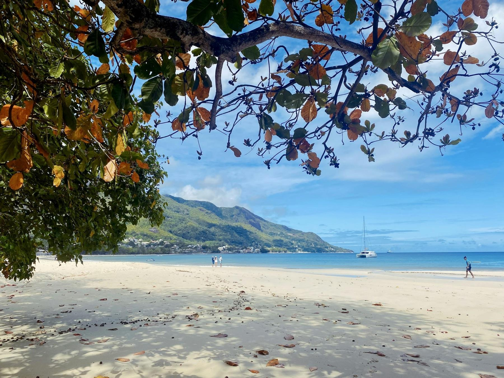
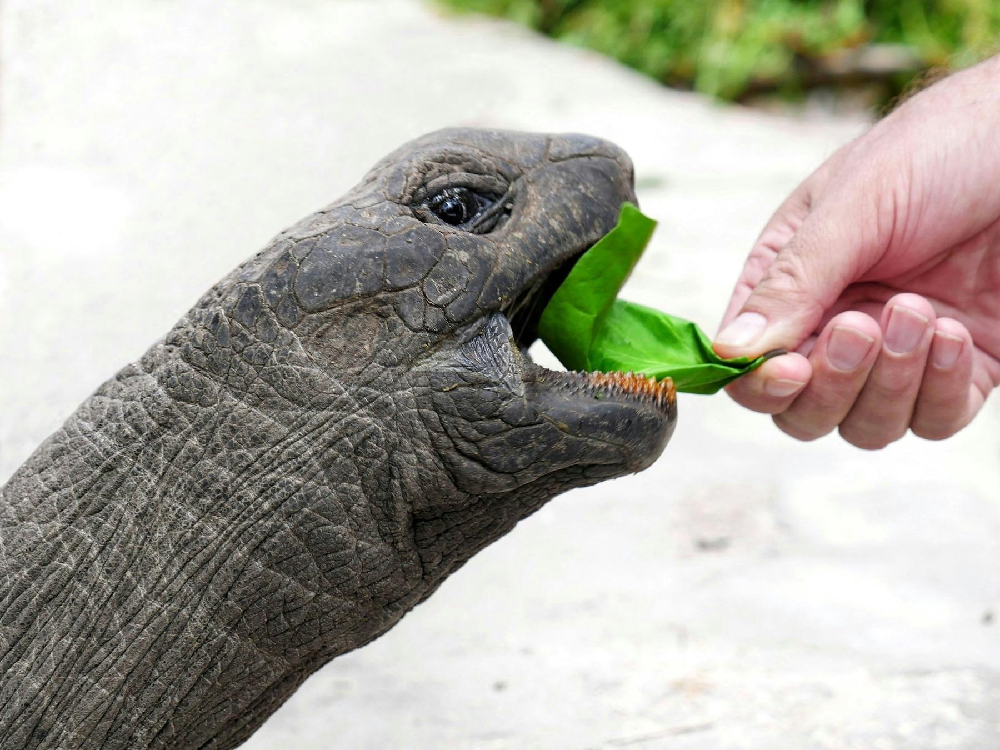
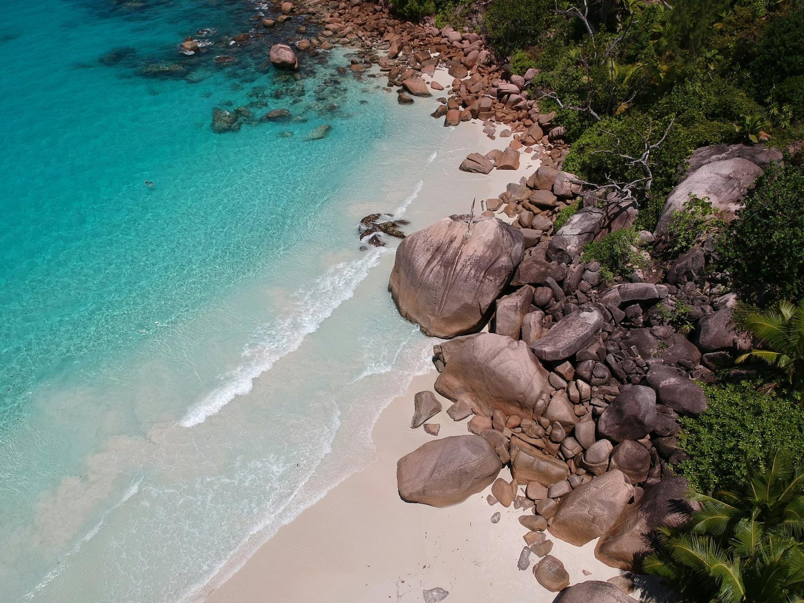
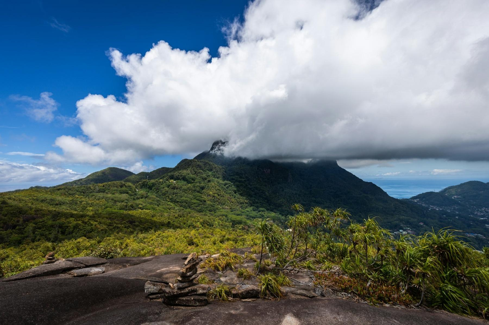
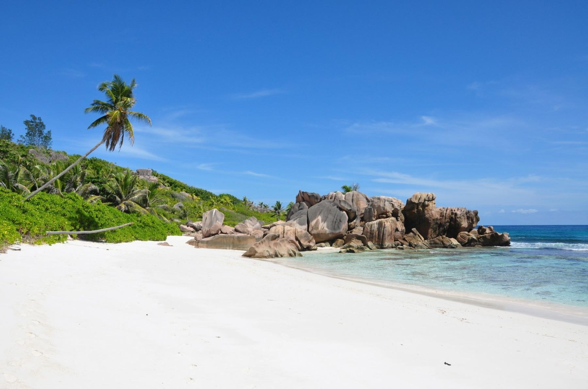
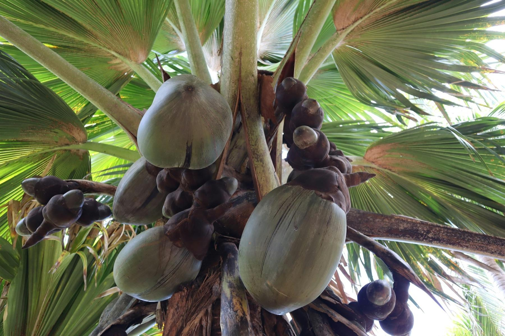

At seven in the morning the tide is out at Anse Source d'Argent, and the water inside the reef is ankle-deep and as warm as a bath. The granite boulders, smoothed into rounded shapes over hundreds of millions of years, are still pink from the sunrise. Back up the path, a giant tortoise in the L'Union Estate pen chews a leaf with great seriousness. You came on a rented bicycle, and you have the beach to yourself for at least another hour.

This trip is for anyone in the US who wants the Seychelles' famous beaches without spending the whole time at one resort. It covers the three main islands in ten days: Mahé for mountains and reefs, Praslin for the coco de mer forest, and La Digue for bikes and the best-known beach of all. It runs on ferries, a rental car and pedal power, and it works with guesthouses as well as hotels.

## At a glance

| | |
| --- | --- |
| Best time to go | April to May or October to November, when seas are calmest |
| Days you need | 10 days, 9 nights |
| Getting there | One connection via Dubai, Doha, Abu Dhabi, Istanbul or Addis Ababa |
| Daily budget | $290 – $630 (about SCR 4,100 – 9,000) |
| Language | Seychellois Creole, English and French; English works everywhere |
| Currency | Seychellois rupee (SCR); $1 is about SCR 14 |
| Good for | Beaches, snorkeling, giant tortoises, rainforest hikes, couples |

## Why go

The Seychelles' inner islands are made of granite, not coral, which is why they look like nowhere else in the tropics: gray and pink boulders the size of houses tumble onto white sand, with forested mountains rising behind. Mahé's peaks climb to 2,969 ft (905 m), and the reefs around them shelter turtles, rays and parrotfish. Praslin hides the Vallée de Mai, a UNESCO-listed forest of coco de mer palms that grow nowhere else on Earth except neighboring Curieuse.

It's also easier than it looks. Ferries link the three islands in under two hours, English is an official language, and the islands sit outside the cyclone belt, so there's no real storm season. It isn't cheap, but guesthouses and self-catering apartments cost a fraction of the resorts, and the best beaches are public.

*Beau Vallon beach on Mahé. Photo: [Kirill Sirazheev](https://unsplash.com/photos/a-beach-with-a-boat-in-the-water-and-a-tree-with-a-hill-in-the-background-8UxrK13xZdg) on Unsplash*

## Getting there

**Flights:** There are no nonstop flights from the US to the Seychelles, so you connect once. Emirates via Dubai and Qatar Airways via Doha are the most common choices, with good connections from New York, Washington, Chicago, Houston, Dallas and Los Angeles. Etihad (via Abu Dhabi), Turkish Airlines (via Istanbul) and Ethiopian Airlines (via Addis Ababa) are also worth checking. Expect 20 to 30 hours door to door and round-trip fares of about $900–1,600 in economy. Every international flight lands at Seychelles International Airport (SEZ) on Mahé, about 6 miles south of Victoria.

**Time difference:** The Seychelles are eight hours ahead of New York and eleven ahead of Los Angeles during US daylight saving time, so plan a slow first day.

**Entry rules:** US citizens don't need a visa. You get a free visitor's permit on arrival, but first you must apply online for a Seychelles Travel Authorization on the [official government site](https://seychelles.govtas.com/), which costs about €11 (about $12). Apply a few days before you fly, and ignore look-alike sites that charge more. At the border you'll need a return ticket, proof of where you're staying and a passport valid for your whole stay.

## Getting around

- **Mahé by car:** Renting a small car (about $45–60 a day) is the easiest way to see the island, and your US license works. Driving is on the left, and the mountain roads are narrow, steep and twisty, with deep drains instead of shoulders. Go slowly and don't drive after dark if you can help it.
- **Mahé by bus:** Public buses cover most of the island from Victoria's bus station for a few rupees, paid in cash. They're cheap and crowded, and they stop running in the early evening.
- **Ferries between islands:** Cat Cocos runs the fast ferry from Victoria to Praslin, about 1 hour 15 minutes for about €56 (about $63) one way. The Cat Rose and Inter Island boats cross from Praslin to La Digue in about 15 minutes for about €15 ($17), and Cat Cocos sails from La Digue back to Mahé for about €68 ($76). Book online a few days ahead, and take a seasickness tablet from June to September, when the southeast trade winds raise the swell.
- **Flying to Praslin:** Air Seychelles flies small planes from Mahé to Praslin in about 15 minutes. It costs more than the ferry but saves a rough crossing.
- **La Digue by bike:** La Digue has few cars, and everyone cycles. Rent a bicycle near the jetty for about SCR 100–150 ($7–10) a day; e-bikes and electric buggies cost more. Praslin has buses and rental cars.

## Where to stay

- **Mahé:** stay in Beau Vallon in the north for an easy swimming beach and restaurants, or on the quieter west and south coasts. [Savoy Seychelles Resort & Spa](aff:booking/hotel/sc/savoy-resort-amp-spa.html) is the big, well-run resort on Beau Vallon beach (9.2 from 2,460 reviews, around $550), and [Rowsvilla Guest House](aff:booking/hotel/sc/rowsvilla-guest-house.html) is a friendly budget choice a short walk from the same beach (8.7 from 360, around $100). On the west coast, [Avani+ Barbarons](aff:booking/hotel/sc/avani-seychelles-barbarons-resort-amp-spa.html) is a calm mid-range resort (9.1 from 335, around $335). For self-catering, [Blue Lagoon](aff:booking/hotel/sc/blue-lagoon-chalets.html) has chalets on the lagoon at Anse à la Mouche (9.4 from 435, around $180), and [Ocean Terrace](aff:booking/hotel/sc/ocean-terrace.html) has sea-view apartments above Anse Royale (9.5 from 555, around $220).
- **Praslin:** Côte d'Or (Anse Volbert) is the liveliest beach, with restaurants and boat-trip pickups; Grand Anse is close to the ferry and airport. [Paradise Sun Hotel](aff:booking/hotel/sc/paradise-sun.html) sits right on Côte d'Or beach (9.0 from 1,250, around $515), and [Exotic Guest House](aff:booking/hotel/sc/exotic-guest-house.html) is a small, very well-reviewed guesthouse in the same area (9.5 from 270, around $155). [Palm Beach Hotel](aff:booking/hotel/sc/palm-beach.html) is a good-value beach hotel at Grand Anse (9.0 from 650, around $190), and [Coco de Mer Hotel and Black Parrot Suites](aff:booking/hotel/sc/coco-de-mer-and-black-parrot-suites.html) is a quiet resort on the southwest coast (9.1 from 455, around $520).
- **La Digue:** most places are in La Passe, by the jetty, or at Anse Réunion, a flat ride from L'Union Estate. [Le Domaine de L'Orangeraie](aff:booking/hotel/sc/le-domaine-de-l-orangeraie.html) is the island's best-known resort, with villas on the hillside above Anse Sévère (9.2 from 895, around $540), and [Le Repaire](aff:booking/hotel/sc/le-repaire-boutique-amp-restaurant.html) is a boutique hotel with a good Italian restaurant near the jetty (9.1 from 490, around $380). [Buisson Guesthouse](aff:booking/hotel/sc/buisson-guesthouse.html) in La Passe is among the best-reviewed places on the island (9.7 from 300, around $195), and [Villa Antonia](aff:booking/hotel/sc/villa-antonia.html) is a simple, spotless budget pick at Anse Réunion (9.4 from 410, around $115).

*Ratings are guest scores on the booking site each link goes to, and prices are typical May weeknight rates for two, both checked in November 2026. Bigger hotels add a sustainability levy of SCR 75–100 per person per night.*

## Top things to do

### Walk through the Vallée de Mai

The Vallée de Mai on Praslin is a steep valley of old palm forest, a UNESCO World Heritage Site since 1983, and home to thousands of coco de mer palms. Their fan-shaped leaves clatter overhead in the wind, and the female trees carry the famous double coconuts. Listen for the whistling call of the black parrot, found only on Praslin and Curieuse. Entry is about SCR 450 ($32), and the trails take one to three hours. Arrive when it opens at 8 am, when the light is soft and the birds are active.

### Cycle to Anse Source d'Argent

La Digue's most famous beach is reached through L'Union Estate, an old coconut and vanilla plantation with a copra mill, a colonial house and a pen of giant tortoises. The estate entry, about SCR 150 ($10), covers the beach for the day. The shallow water behind the reef is perfect for floating, and the boulders make every cove look different. Check the tide tables: at high tide the sand almost disappears, so aim for a falling or low tide.

### Snorkel in Sainte Anne Marine Park

Just off Victoria, six small islands and their reefs form the Sainte Anne Marine Park, the easiest place in the Seychelles to see turtles, rays and big shoals of fish. The [reef safari with lunch](aff:getyourguide/mahe-l1014/mahe-st-anne-marine-national-park-reef-safari-with-lunch-t389173/) combines a semi-submarine ride, snorkeling and a Creole lunch on Moyenne Island (4.7 from 326 reviews, from about $163). For a smaller group, the [semi-private snorkeling trip](aff:getyourguide/saint-anne-marine-national-park-l149849/mahe-island-st-anne-marine-park-semiprivate-snorkeling-tri-t674147/) visits three reefs in four hours (4.8 from 85, from about $171).

### Meet giant tortoises on Curieuse

Curieuse Island, a 15-minute boat ride from Praslin, is a national park where hundreds of Aldabra giant tortoises wander around the ranger station. A boardwalk crosses the mangroves to Anse José and the old doctor's house of the island's former leper colony. The [Curieuse and St Pierre full-day trip](aff:getyourguide/grand-anse-l184416/praslin-curieuse-st-pierre-full-day-boat-trip-with-lunch-t662789/) adds snorkeling at St Pierre, a tiny granite islet, and a barbecue lunch on the beach (4.9 from 1,925 reviews, from about $90). Check whether the park fee is included.

*A giant tortoise at feeding time on La Digue. Photo: [Philipp Meeh](https://unsplash.com/photos/person-feeding-gray-tortoise-during-daytime-Bu-fUI69fRo) on Unsplash*

### Swim at Anse Lazio

At Praslin's northwest tip, Anse Lazio is a long curve of white sand framed by granite boulders at both ends, with water that stays calm for most of the year. Snorkel along the rocks at either end, where the fish gather. Two beach restaurants serve grilled fish and cold drinks, and there's shade under the takamaka trees. It's a 25-minute drive from Côte d'Or, or the end of the Vallée de Mai and Anse Lazio day tours.

*Anse Lazio from above. Photo: [Alin Meceanu](https://unsplash.com/photos/brown-rocks-near-body-of-water-fiz0Ie9IDBU) on Unsplash*

### Hike the Copolia trail

Mahé's best short hike starts on the Sans Souci road above Victoria and climbs about a mile through rainforest to a bare granite dome at about 1,630 ft (497 m). On the way you'll pass cinnamon trees, wild orchids and the endemic Seychelles pitcher plant. From the top you can see Victoria, the Sainte Anne islands and the forested slopes of Morne Seychellois. Start by 8 am, before the heat and the clouds build, and allow about two hours there and back.

*The view from the Copolia trail on Mahé. Photo: [Luca Cavallin](https://unsplash.com/photos/a-view-of-a-mountain-with-a-cloud-in-the-sky-8Pp797RCUug) on Unsplash*

### Spend a morning in Victoria

Victoria is one of the world's smallest capitals, and you can see it in a morning. Start at the Sir Selwyn Selwyn-Clarke Market, where fishermen sell tuna and red snapper downstairs and vendors sell spices, chili sauces and vanilla upstairs; Saturday mornings are busiest. Walk past the silver Clock Tower to the Hindu temple on Quincy Street, then visit the Botanical Garden, which has coco de mer palms and giant tortoises. The market closes on Sundays.

## Off the beaten path

### Anse Marron with a guide

Anse Marron, at the wild southern tip of La Digue, is a hidden beach with natural pools behind a wall of granite. There's no proper path: you scramble over boulders and wade along the shore, so you need a guide and the right tide. The [Anse Marron tour](aff:getyourguide/grand-anse-l184416/anse-marron-tour-on-la-digue-t673137/) starts from Grand Anse (4.8 from 104 reviews, from about $59). Wear shoes with grip.

### Grand Anse to Anse Cocos

On La Digue's east coast, a bike ride over the hill brings you to Grand Anse, a wide beach with big waves. From there, a 30-minute walk on a rocky path leads past Petite Anse to Anse Cocos, where boulders shelter a natural rock pool that's safe to swim in. The open sea along this coast has strong currents, so stay in the pools unless the water is completely calm.

*Anse Cocos on La Digue. Photo: [Sebastien](https://unsplash.com/photos/landscape-photography-of-coastline-DJ34H32U7YE) on Unsplash*

### Nid d'Aigle, La Digue's summit

The Eagle's Nest, La Digue's highest point at 1,093 ft (333 m), is a steep hour's walk on a forest track from La Passe. From the top you look across to Praslin, Félicité and Marianne islands. Go early in the morning, take plenty of water, and stop for a fresh juice at the Belle Vue café on the way down.

### Mission Lodge ruins

High in the hills above Victoria, Mission Lodge holds the ruins of a 19th-century school for the children of freed slaves, under an avenue of old trees. A wooden gazebo, built for Queen Elizabeth II's visit in 1972, looks over the forest to the west coast. Entry is free. Combine it with a tasting at the nearby tea factory on the same road.

### Fond Ferdinand

Fond Ferdinand, on Praslin's southern hills, is the Vallée de Mai's quieter neighbor: a coco de mer reserve with guided walks up to a viewpoint over the islands. You'll see the palms up close and often have the guide to yourself. Entry is about SCR 300 ($21) with a guide; book ahead, since walks run at set times.

*Coco de mer nuts at Fond Ferdinand on Praslin. Photo: [Bram Wouters](https://unsplash.com/photos/large-coconuts-hanging-from-a-palm-tree-MvQNOPfufIg) on Unsplash*

### Anse Georgette

Anse Georgette, on Praslin's northwest coast, is often called one of the most beautiful beaches in the Seychelles, and few people see it because it lies inside the Constance Lemuria resort. Non-guests can visit: call the resort or ask at the gate a day ahead, and staff usually take you down by buggy. The swimming is excellent when the sea is calm, but there's little shade.

## Things you probably didn't know

- **The coco de mer has the heaviest seed of any plant.** A single nut can weigh up to 55 lb (25 kg), and it takes years to ripen. You need an official certificate to take one home.
- **Nobody lived here until 1770.** French settlers arrived with enslaved Africans that year, and today's Seychellois descend from African, French, British, Indian and Chinese ancestors.
- **It's Africa's smallest country.** About 120,000 people live across its 115 islands, and most of them on Mahé.
- **The islands are pieces of an old continent.** The inner islands are granite left over from the breakup of the supercontinent Gondwana, which makes them some of the world's oldest ocean islands.
- **Aldabra has more tortoises than the country has people.** The remote atoll, far to the southwest, is home to about 100,000 giant tortoises.
- **Victoria's clock tower came from London.** The silver "Lorloz" was put up in 1903, modeled on a clock near Victoria Station.
- **Creole is the national language.** Seychellois Creole, mostly French-based, has been an official language since 1981, and street signs and newspapers use it.

## What to eat

- **Octopus curry (kari zourit):** octopus slow-cooked in coconut milk with curry spices, served with rice. Try it at any Creole takeaway.
- **Grilled red snapper (bourzwa):** whole fish grilled over coconut husks and served with a spicy tomato Creole sauce. Beach restaurants at Anse Lazio do it well.
- **Shark chutney (satini reken):** boiled shark, flaked and cooked with bilimbi, lime and onion. It's milder than it sounds and is usually served with rice and lentils.
- **Ladob:** ripe plantain or breadfruit simmered in coconut milk with sugar, nutmeg and vanilla, eaten as a dessert. A savory version is made with salted fish.
- **Breadfruit chips:** thin, crisp slices of fried breadfruit, sold in bags at markets and roadside stalls.
- **SeyBrew and Takamaka rum:** the local lager and the rum distilled on Mahé, where you can tour the La Plaine St André distillery.

## A suggested itinerary

### Day 1: Arrive on Mahé

- Morning: Land at Seychelles International Airport and pick up your rental car.
- Afternoon: Check in at Beau Vallon and sleep off the flight.
- Evening: Sunset swim and grilled fish on the beach.

### Day 2: Copolia and Victoria

- Morning: Hike the Copolia trail before the heat.
- Afternoon: Victoria's market, Clock Tower and Botanical Garden.
- Evening: Beau Vallon's Bazar Labrin street market on Wednesdays, or dinner in town.

### Day 3: Sainte Anne Marine Park

- Morning: Reef safari from Eden Island with snorkeling and the semi-submarine.
- Afternoon: Creole lunch on Moyenne Island and a last snorkel.
- Evening: Mission Lodge for the view, then the tea factory.

### Day 4: Ferry to Praslin

- Morning: Cat Cocos ferry from Victoria to Praslin.
- Afternoon: Drop bags at Côte d'Or and head to Anse Lazio.
- Evening: Dinner at Côte d'Or.

### Day 5: Coco de mer forest

- Morning: Vallée de Mai at opening time.
- Afternoon: Anse Georgette, if you booked access.
- Evening: Octopus curry at a Creole takeaway.

### Day 6: Curieuse and St Pierre

- Morning: Boat to Curieuse to see the tortoises and walk the mangrove boardwalk.
- Afternoon: Barbecue lunch and snorkeling at St Pierre.
- Evening: A quiet night; the boat days are tiring.

### Day 7: Over to La Digue

- Morning: Ferry to La Digue and rent bikes at the jetty.
- Afternoon: L'Union Estate and Anse Source d'Argent at low tide.
- Evening: Sunset at Anse Sévère.

### Day 8: The wild south

- Morning: Guided hike to Anse Marron.
- Afternoon: Rest at your guesthouse, then a swim at Anse Réunion.
- Evening: Dinner in La Passe.

### Day 9: East coast and summit

- Morning: Nid d'Aigle hike for the view over the islands.
- Afternoon: Bike to Grand Anse and walk to Anse Cocos.
- Evening: Last Creole dinner and a SeyBrew.

### Day 10: Back to Mahé and home

- Morning: Direct Cat Cocos ferry from La Digue to Mahé.
- Afternoon: Taxi to the airport for your flight home.
- Evening: Overnight connection via the Gulf or Istanbul.

## What it costs

| Item | Budget | Mid-range |
| --- | --- | --- |
| Stay (per night) | $150 | $350 |
| Food (per day) | $50 | $100 |
| Local transportation (per day) | $30 | $60 |
| Tours and entry fees (per day) | $60 | $120 |
| **Total per day** | **$290** | **$630** |

On top of this, budget for your flights from the US, the Travel Authorization (about $12) and about $155 per person for the three ferry crossings. The boat trips are the biggest extra: a day trip with lunch costs $90–165 per person. Save money by staying in self-catering apartments and eating from Creole takeaways, where a plate of curry and rice costs about $8–12.

## Good to know

- **Pick your season.** April–May and October–November bring the calmest seas and clearest water. From June to September the southeast trade winds cool things down but make some beaches rough and some ferry crossings bumpy, and December to March is hot and humid, with heavier rain.
- **Respect the sea.** Most beaches have no lifeguards, and some, like Grand Anse on La Digue, have dangerous currents. Swim where locals swim, stay inside the reef, and wear reef shoes on rocky entries.
- **Carry some rupees.** Hotels, ferries and most restaurants take US credit cards, but buses, bike rentals and takeaways want cash. ATMs are in Victoria, at Praslin's Grand Anse and Baie Sainte Anne, and in La Passe on La Digue.
- **Know about the levy.** Since January 2026, bigger hotels (25 rooms or more) add a sustainability levy of SCR 75–100 ($5–7) per person per night. Small guesthouses are exempt, as are children 12 and under.
- **Plugs and data.** The Seychelles use the UK-style three-pin plug at 240 V, so bring an adapter. Buy a local SIM from Airtel or Cable & Wireless at the airport, or install a travel eSIM before you fly.
- **Sun and mosquitoes.** The islands are just 4° south of the Equator, so use reef-safe sunscreen and cover up at midday. Dengue occurs, so use repellent, especially at dawn and dusk.
- **Drive carefully.** Mahé's roads have hairpin bends, steep drains and buses that take the middle of the road. Keep left and use your horn on blind corners.

## Final word

The Seychelles cost more than most beach trips from the US, and the flights are long. But ten days here gives you three different islands: Mahé's rainforest peaks, Praslin's prehistoric palm forest and La Digue's slow, bike-paced days. Get to Anse Source d'Argent early, when the tide is out and the boulders turn pink, and you'll understand why people fly halfway around the world for it.

*Cover: Anse Source d'Argent on La Digue from above. Photo: [seytales](https://unsplash.com/photos/an-aerial-view-of-a-beach-with-rocks-and-water-I2BHCLmVpEg) on Unsplash.*
