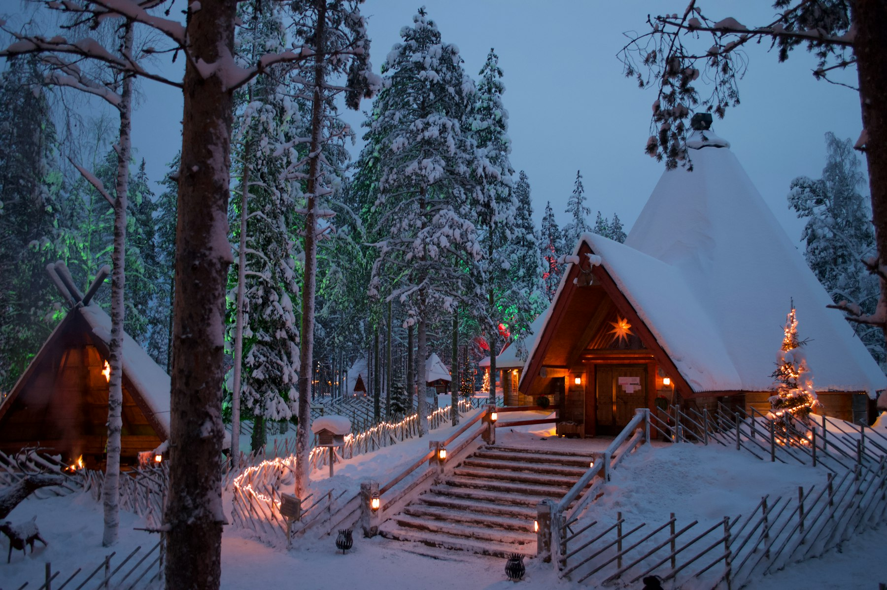
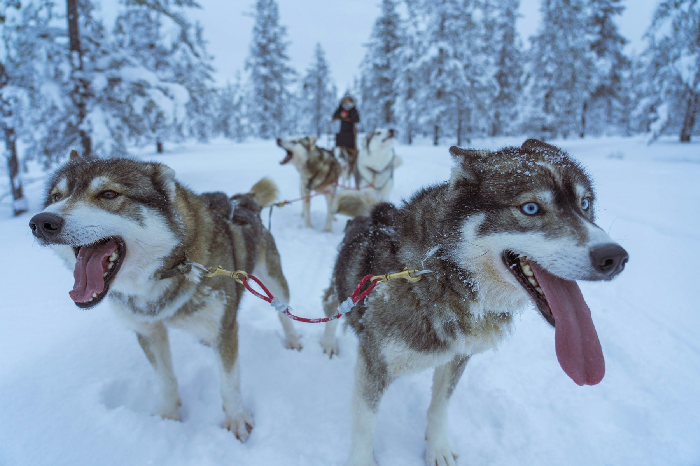
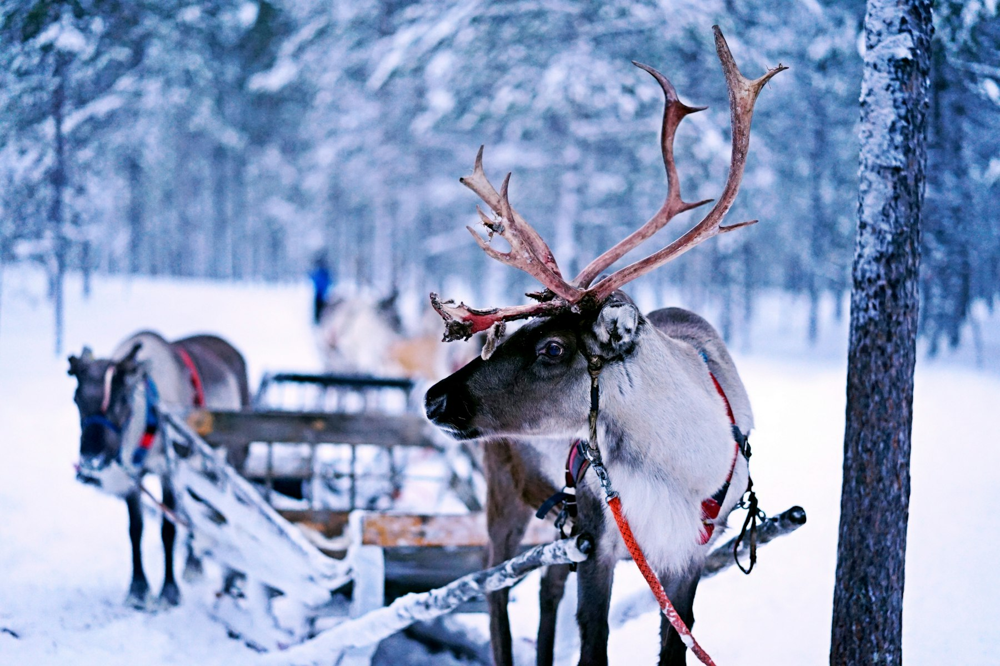
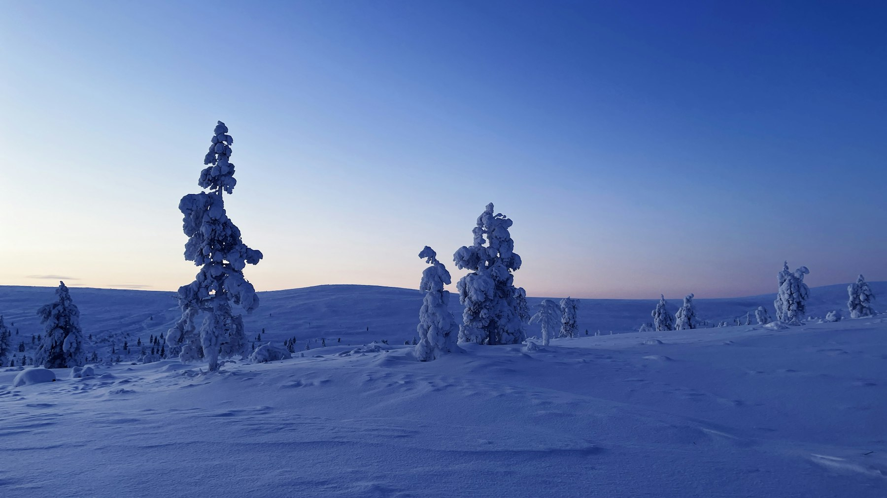
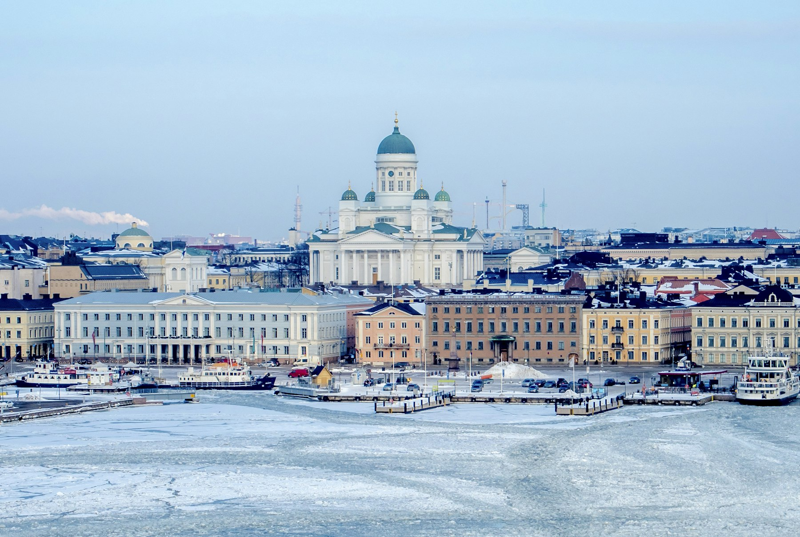

At −22°C (−8°F) the snow squeaks under your boots, and the air is so dry it feels warmer than it is. The guide switches off the van's lights on a frozen lake outside Saariselkä, and for ten minutes nothing happens. Then a pale band, like a cloud lit from inside, stretches across the north, turns green, and starts to move. Everyone forgets about their cold toes.

This trip is for anyone in the US who has wanted to see the northern lights, ride behind a team of huskies and sleep somewhere properly cold, without a package tour. It's planned for January, when the snow is deep, the daylight is coming back and the auroras are at their best. Once you land in Helsinki, it runs on trains, buses and one short flight, and it fits neatly into two weeks of vacation with travel days on either end.

## At a glance

| | |
| --- | --- |
| Best time to go | Mid-December to March for snow and auroras; January for the deepest cold and blue light |
| Days you need | 10 days, 9 nights |
| Getting there | Fly to Helsinki with one connection from most US airports, then the night train north |
| Daily budget | $315 – $620 (about €280 – €555) |
| Language | Finnish and Swedish; Sámi languages in the far north; English everywhere |
| Currency | Euro (€); €1 is about $1.12 |
| Good for | Northern lights, huskies, reindeer, snow, saunas |

## Why go

Finnish Lapland is the easiest Arctic to visit. Rovaniemi sits on the Arctic Circle with an airport, a railway station and more husky farms than you can count, and Saariselkä, about 155 miles further north, sits on the edge of Urho Kekkonen National Park, one of Finland's largest. In winter the whole region turns into a frozen world of snow-loaded pines, frozen lakes and silent fells, where the sky does strange things after dark.

Compared with Alaska or northern Canada, Lapland is surprisingly easy: towns are close together, trains and buses run on time in any weather, nearly everyone speaks English, and tour operators lend you the Arctic overalls and boots. It's also a place where the culture matters as much as the scenery. Lapland is home to the Sámi, the only recognized Indigenous people in the European Union, whose reindeer herding has shaped the north for centuries. And everyone, Sámi or Finnish, takes a sauna, whatever the temperature outside.

*Cabins lit up for winter in Rovaniemi. Photo: [Roman Protsyshyn](https://unsplash.com/photos/a-cabin-in-the-woods-is-lit-up-with-christmas-lights-sONokkSBDZA) on Unsplash*

## Getting there

**Flights:** Finnair's nonstop flights from the US are few in winter, so most Americans connect once in a European hub such as London, Amsterdam, Frankfurt or Stockholm. Finnair is in the oneworld alliance, so American Airlines and British Airways can sell you a single ticket through to Helsinki, and Icelandair connects many US cities to Helsinki via Reykjavík. Most eastbound flights are overnight, landing in Europe in the morning. Fly home from Helsinki too: Ivalo and Rovaniemi have mostly domestic and seasonal European flights.

**Time difference:** Finland is seven hours ahead of New York and ten ahead of Los Angeles in winter, so plan an easy first day.

**Entry rules:** US citizens don't need a visa for Finland or the rest of the Schengen area for stays of up to 90 days in any 180. Your passport must be valid for at least three months after you leave. The EU's Entry/Exit System now takes your fingerprints and photo at your first border check, so allow extra time at passport control. The planned ETIAS travel authorization hasn't started yet; check the [official EU ETIAS site](https://travel-europe.europa.eu/etias_en) before you go, and ignore websites that try to sell it to you early.

## Getting around

- **The Santa Claus Express:** VR's night train leaves Helsinki in the evening and reaches Rovaniemi about 12 hours later, around breakfast time. A private two-berth cabin starts at about €59 (about $66), or about €74 ($83) with its own shower, and prices rise for popular winter dates, so book on [VR's website](https://www.vr.fi/en) as soon as your dates are fixed.
- **Rovaniemi to Saariselkä:** Eskelinen's buses take about 3½–4 hours through the forest, with a stop at Sodankylä. Book a seat ahead in peak season.
- **Saariselkä back to Helsinki:** Ivalo airport is about 15 miles north of Saariselkä, with an airport bus timed to the Finnair flights, about 1 hour 40 minutes to Helsinki.
- **Local buses and pickups:** In Rovaniemi, bus line 8 runs from the center to Santa Claus Village. Almost every tour picks you up from your hotel, which matters more than you'd think at −4°F.
- **Driving yourself:** You can rent a car with a US license, and roads are plowed and well kept, but winter driving on packed snow and ice in near-darkness is hard work. The trains, buses and tour pickups make a car unnecessary on this route.

## Where to stay

- **Helsinki (first and last night):** [Scandic Grand Central Helsinki](aff:booking/hotel/fi/scandic-grand-central-helsinki.html) is at the central railway station, perfect for the night train (8.9 from 4,800 reviews, around $120). [Hobo Helsinki](aff:booking/hotel/fi/hobo.html) is a stylish small-room hotel near the Esplanade (9.1 from 4,700, around $130), [Citybox Helsinki](aff:booking/hotel/fi/citybox-helsinki.html) is the clean, cheap self-service pick (9.1 from 11,700, around $85), and [Eurohostel](aff:booking/hotel/fi/eurohostel.html) is the budget option near the Katajanokka ferry terminal (8.3 from 6,000, around $50).
- **Rovaniemi:** stay in the center for restaurants, or on Ounasvaara hill for snow and views. [Arctic Light Hotel](aff:booking/hotel/fi/arctic-light-rovaniemi.html) is the best-reviewed central hotel (9.4 from 1,600, around $400), [Scandic Rovaniemi City](aff:booking/hotel/fi/scandic-rovaniemi.html) is the dependable chain option (8.3 from 1,400, around $280), and [Hostel Café Koti](aff:booking/hotel/fi/hostel-cafe-koti.html) has private rooms and a good café (8.9 from 2,600, around $260). [Lapland Hotels Sky Ounasvaara](aff:booking/hotel/fi/lapland-sky-ounasvaara.html) sits on the hill above town (9.1 from 1,200, around $470), and for one glass-roofed night, [Arctic SnowHotel & Glass Igloos](aff:booking/hotel/fi/arctic-glass-igloos.html) is 14 miles out in the forest (8.7 from 690, around $575).
- **Saariselkä:** a small village of hotels and cabins at the foot of Kaunispää fell. [Lapland Hotels Riekonlinna](aff:booking/hotel/fi/lapland-riekonlinna.html) is in the center with a spa (8.0 from 670, around $240), and [Fell Centre Kiilopää](aff:booking/hotel/fi/fell-centre-kiilopaa.html) is 5 miles away inside the national park, with smoke saunas and trails from the door (8.9 from 870, around $175). [Arctic Log Cabins](aff:booking/hotel/fi/arctic-log-cabins.html) are private cabins with their own saunas (9.0 from 660, around $450), and [Northern Lights Village](aff:booking/hotel/fi/northern-lights-village.html) has glass-roofed cabins for watching the sky from bed (9.1 from 400, around $645).

*Ratings are guest scores on the booking site each link goes to, and prices are typical January weeknight rates for two, both checked in November 2026. Lapland is expensive in winter, and prices climb further around Christmas.*

## Top things to do

### Hunt the northern lights

Auroras appear when the sky is dark and clear and the sun is active, so your chances are best away from town lights, between about 9 pm and 1 am. Guides drive to wherever the clouds aren't, which is why a tour beats waiting outside your hotel. In Rovaniemi, the [guaranteed northern lights tour](aff:getyourguide/rovaniemi-l2653/rovaniemi-guaranteed-aurora-tour-with-96-succes-rate-t1110310/) offers a free second night if you see nothing (4.7 from 240 reviews, from about $60). In Saariselkä, the darker skies make the [aurora photography tour](aff:getyourguide/saariselka-l181615/saariselka-aurora-hunting-tour-with-northern-lights-experts-t826892/) the best-reviewed in the area (4.7 from 445, from about $156), with photos included.

### Drive your own husky team

Nothing wakes you up like eight huskies howling to run. On a self-driven safari you stand on the back of the sled, two people to a sled, and steer with your weight and a brake. The [Apukka husky adventure](aff:getyourguide/rovaniemi-l2653/rovaniemi-apukka-husky-adventure-7km-self-driven-t331216/) near Rovaniemi covers about 4 miles (4.6 from 1,560 reviews, from about $245), and in Saariselkä the [10 km husky safari with a kennel visit](aff:getyourguide/saariselka-l181615/saariselka-husky-safari-with-kennel-visit-t853272/) goes deeper into the forest, about 6 miles (4.8 from 366, from about $279). Both include warm overalls and boots.

*Huskies ready to run in Lapland. Photo: [Ugur Arpaci](https://unsplash.com/photos/brown-and-white-siberian-huskies-on-snowy-field-_UjPlnYdSqU) on Unsplash*

### Ride a reindeer sleigh

Reindeer are slower and calmer than huskies, and a sleigh ride through a snowy forest is a quiet, lovely hour. Better still, visit a family-run farm where the herders explain how reindeer herding works through the year. Near Rovaniemi, the [sustainable reindeer journey](aff:getyourguide/rovaniemi-l2653/roaniemi-1-hour-reindeer-journey-t331296/) includes a ride of a mile or two and a visit to the farm (4.5 from 1,020 reviews, from about $211).

*A reindeer sleigh in Inari. Photo: [Norman Tsui](https://unsplash.com/photos/reindeer-pulling-sled-KBKHXjhVQVM) on Unsplash*

### Cross the Arctic Circle at Santa Claus Village

Santa Claus Village, 5 miles north of Rovaniemi by bus line 8, is unashamedly commercial but genuinely fun. Entry is free: you can step over the white line that marks the Arctic Circle, visit Santa in his office, and send a card from his post office, which receives letters from children all over the world. The official photo with Santa and the Arctic Circle certificate cost extra. Go early in the day, before the tour buses arrive.

### Snowshoe in Urho Kekkonen National Park

Saariselkä's ski tracks and snowshoe trails lead straight into Urho Kekkonen National Park, a huge area of rounded fells, old pine forest and reindeer pasture. Climb Kaunispää fell from the village for the view over the trees, which turn into strange, snow-loaded shapes in winter. Join the [snowshoeing tour](aff:getyourguide/saariselka-l181615/saariselka-snowshoeing-tour-in-urho-kekkonen-national-park-t800450/) (4.8 from 118 reviews, from about $84) if you'd like a guide, a campfire and hot berry juice.

*Snow-loaded trees on a fell at blue hour. Photo: [Harri P](https://unsplash.com/photos/a-snowy-landscape-with-trees-covered-in-snow-uF8aW7JWOv0) on Unsplash*

### Learn the Arctic at Arktikum

Rovaniemi's Arktikum is a long glass tunnel half-buried in the riverbank, with a science center on the Arctic and the Lapland regional museum. It explains how the auroras form, how people live through the polar night and how Rovaniemi was rebuilt after 1944. Tickets are €22 (about $25) for adults. Give it two hours on your first afternoon, when you're still tired from the train.

### Meet Sámi culture at Siida in Inari

Inari, 25 miles north of Saariselkä on the shore of Lake Inari, is the center of Sámi culture in Finland. Siida, the Sámi museum and nature center, tells the story of the Sámi people and the northern landscape through the year, and the Sámi parliament building, Sajos, is nearby. Pair it with the [ice fishing tour to Lake Inari](aff:getyourguide/ivalo-l187030/ivalo-ice-fishing-tour-to-lake-inari-reindeer-lunch-t515305/), which includes a visit to reindeer and lunch (4.9 from 57 reviews, from about $184).

## Off the beaten path

### Float on a frozen lake

On an ice-floating trip you wear a thick floating suit and lie back in a hole cut in the lake ice, looking up at the stars or the auroras. It sounds crazy and feels oddly calm. Near Rovaniemi, the [forest lake ice floating](aff:getyourguide/rovaniemi-l2653/ice-floating-in-forest-lake-with-aurora-borealis-t178730/) runs in the evenings (4.3 from 950 reviews, from about $140).

### Sail on an icebreaker

From Kemi, on the frozen Gulf of Bothnia, an icebreaker cuts through the sea ice, and you can float in the channel it leaves behind. It's a long day from Rovaniemi, but it's unlike anything else in Finland. Book the [icebreaker cruise with transfers](aff:getyourguide/rovaniemi-l2653/axelsvik-icebreaker-cruise-with-shuttle-from-kemirovaniemi-t209241/) (4.7 from 490 reviews, from about $363).

### Kiilopää and a smoke sauna

Kiilopää, 5 miles south of Saariselkä, is a fell center inside the national park with trails, a wilderness hut and an old-style smoke sauna, where the stove heats the room for hours before the smoke is let out. Afterward, Finns roll in the snow or step into a hole in the lake ice. You don't have to, but you'll be glad you did.

### Ranua Wildlife Park

Ranua, an hour south of Rovaniemi, is a zoo for Arctic animals: polar bears, brown bears, lynx, wolverines, wolves and moose in large forest enclosures. It's a good choice for families, and for photographing animals you're unlikely to see in the wild. The [Ranua tour from Rovaniemi](aff:getyourguide/rovaniemi-l2653/rovaniemi-ranua-wildlife-park-tour-with-transfers-t1113959/) includes transportation (4.6 from 61 reviews, from about $70).

### Suomenlinna in winter

Back in Helsinki, take the regular city ferry to Suomenlinna, an 18th-century sea fortress spread over islands in the harbor and a UNESCO World Heritage Site. In winter it's almost empty: frozen sea, snowy ramparts and old cannons pointing at the ice. The ferry runs all year on a normal city transit ticket.

*Helsinki Cathedral above the winter harbor. Photo: [Jaakko Kemppainen](https://unsplash.com/photos/white-and-blue-mosque-among-buildings-For4352Fgwg) on Unsplash*

## Things you probably didn't know

- **In Saariselkä the sun doesn't rise for weeks.** The polar night, *kaamos*, lasts from early December to about January 11. It's not pitch dark: midday brings hours of blue and pink twilight.
- **The Finnish word for the northern lights means "fox fires".** *Revontulet* comes from a legend of an Arctic fox sweeping snow into the sky with its tail.
- **Finland has about three million saunas.** That's roughly one for every two people, and Finnish sauna culture is on UNESCO's list of intangible heritage.
- **Every reindeer has an owner.** Around 200,000 reindeer graze in Finnish Lapland, and each one is earmarked by a herding family.
- **Rovaniemi was rebuilt from ashes.** Retreating German troops burned the town in 1944, and Alvar Aalto drew its new street plan in the shape of a reindeer's antlers.
- **The Arctic Circle moves.** The line drifts north by about 50 feet a year as the Earth's tilt changes, so the marker at Santa Claus Village is a little south of the true circle.
- **You can walk almost anywhere.** Finland's "everyman's right" lets you hike, ski and pick berries on most land, as long as you don't disturb people or nature.

## What to eat

- **Sautéed reindeer (poronkäristys):** thin slices of reindeer fried in butter, served with mashed potatoes, lingonberries and pickles. It's Lapland's signature dish.
- **Salmon soup (lohikeitto):** a creamy soup of salmon, potatoes and dill, perfect after a cold day outside.
- **Karelian pies (karjalanpiirakka):** thin rye crusts filled with rice porridge, topped with egg butter. Every café and grocery store has them.
- **Squeaky cheese (leipäjuusto):** a baked cheese that squeaks against your teeth, warmed and served with cloudberry jam.
- **Arctic char and vendace:** fresh fish from Lapland's lakes, smoked, fried or grilled. Lake Inari's restaurants serve both.
- **Cinnamon buns (korvapuusti):** cardamom-scented buns with a strong coffee, the Finnish answer to any weather.

## A suggested itinerary

### Day 1: Arrive in Helsinki

- Morning: Land in Helsinki after an overnight flight from the US.
- Afternoon: Train to the center; Senate Square and Helsinki Cathedral.
- Evening: Dinner on the Esplanade and an early night to beat the jet lag.

### Day 2: Helsinki and the night train

- Morning: Ferry to Suomenlinna and a walk on the frozen ramparts.
- Afternoon: Temppeliaukio rock church and the Oodi library.
- Evening: Board the Santa Claus Express north.

### Day 3: Rovaniemi

- Morning: Arrive in Rovaniemi; drop bags and have breakfast.
- Afternoon: Arktikum, then rent winter clothing if you need it.
- Evening: Northern lights tour.

### Day 4: The Arctic Circle

- Morning: Santa Claus Village before the tour buses arrive.
- Afternoon: Reindeer farm visit and sleigh ride.
- Evening: Sautéed reindeer for dinner and a hotel sauna.

### Day 5: Huskies

- Morning: Apukka husky safari.
- Afternoon: Walk up Ounasvaara for the view over town.
- Evening: Ice floating on a forest lake.

### Day 6: North to Saariselkä

- Morning: Bus from Rovaniemi to Saariselkä.
- Afternoon: Check in and walk up Kaunispää fell.
- Evening: Aurora photography tour.

### Day 7: Urho Kekkonen National Park

- Morning: Snowshoeing tour in the national park.
- Afternoon: Kiilopää and its smoke sauna.
- Evening: Dinner in the village; watch the sky.

### Day 8: Inari

- Morning: Ice fishing on Lake Inari with reindeer and lunch.
- Afternoon: Siida, the Sámi museum, and Sajos.
- Evening: Back to Saariselkä for a last aurora hunt.

### Day 9: Husky run and fly south

- Morning: 10 km husky safari with a kennel visit.
- Afternoon: Airport bus to Ivalo and the flight to Helsinki.
- Evening: Dinner in Helsinki.

### Day 10: Fly home

- Morning: A walk along the frozen harbor and a last cinnamon bun.
- Afternoon: Train to Helsinki airport for your flight home.
- Evening: Westbound flights land in the US the same day, thanks to the time difference.

## What it costs

| Item | Budget | Mid-range |
| --- | --- | --- |
| Stay (per night) | $160 | $320 |
| Food (per day) | $45 | $80 |
| Local transportation (per day) | $10 | $20 |
| Tours and activities (per day) | $100 | $200 |
| **Total per day** | **$315** | **$620** |

On top of this, budget for your flights from the US, the night train (from about $66 for a cabin), the bus to Saariselkä and the flight from Ivalo to Helsinki. Lapland's tours are priced per person and are the biggest cost: a husky safari and an aurora tour each cost about $150–280. Save on food with grocery-store lunches; S-Market and K-Market have good salads, soups and pastries.

## Good to know

- **Dress in layers, not one big coat.** Wear thermal base layers, a fleece or wool middle layer, and a windproof outer shell, plus wool socks, mittens over gloves, and a hat that covers your ears. Bring your own base layers, and [rent a full winter set](aff:getyourguide/rovaniemi-l2653/rovaniemi-rent-winter-clothing-sets-t447238/) in Rovaniemi (4.7 from 560 reviews, from about $51) instead of buying an Arctic parka you'll never wear at home.
- **Think in Celsius, and protect your phone.** January days in Rovaniemi average about −14°C to −8°C (7°F to 18°F), and cold snaps below −30°C (−22°F) happen, so cover every patch of skin. Phones die fast below −15°C (5°F): keep yours in an inside pocket and carry a power bank.
- **Watch the aurora forecast.** The Finnish Meteorological Institute's aurora alerts and the many aurora apps show the activity level, but clear skies matter more. Check the cloud forecast and be flexible.
- **Expect little daylight.** In early January Rovaniemi gets about three hours of daylight, rising to about six by the end of the month. Plan outdoor activities around midday and auroras for the evening.
- **Money is all on cards.** Finland is almost cashless; tap-to-pay with a US credit card works for buses, cafés and even saunas. Use a card without foreign transaction fees. Tipping isn't expected, and prices already include tax.
- **Plugs and data.** Finland uses 230 V and the round two-pin European plug, so bring an adapter; most phone and laptop chargers handle the voltage, but check hair dryers. For data, check your carrier's international plan or install a Europe eSIM before you fly.
- **Alcohol is expensive.** Wine and beer cost a lot in restaurants, and anything stronger than 8% is sold only at state-run Alko stores.
- **Stay on marked ice.** Don't walk on lakes or rivers unless a guide or a marked trail takes you there; ice thickness varies, especially near currents.

## Final word

Lapland in January is cold, dark and expensive, and it's still one of the most rewarding winter trips you can take from the US. You'll sleep on a train that crosses half of Finland, ride behind huskies through silent forest, and stand on a frozen lake as the sky turns green. Go with warm socks, patience and an open evening calendar, because the auroras keep their own schedule.

*Cover: the northern lights over Inari, Finnish Lapland. Photo: [Ozgu Ozden](https://unsplash.com/photos/green-leaf-trees-under-aurora-lights-during-nighttime-zjTv9EMRGTs) on Unsplash.*
