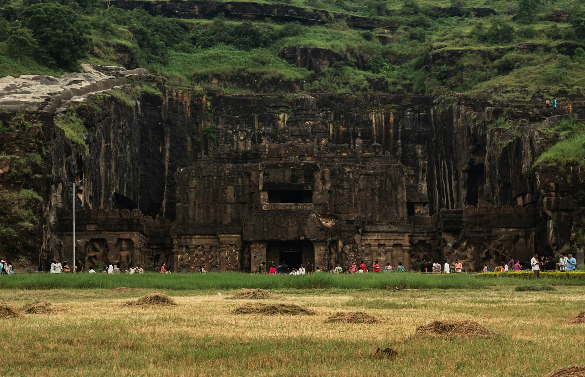
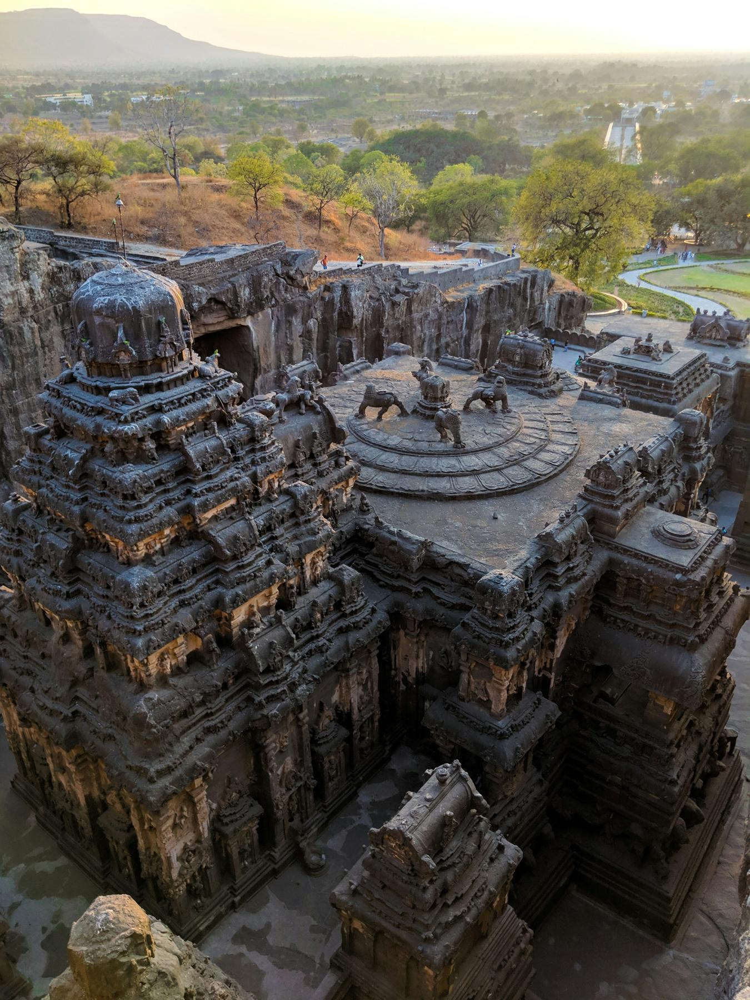
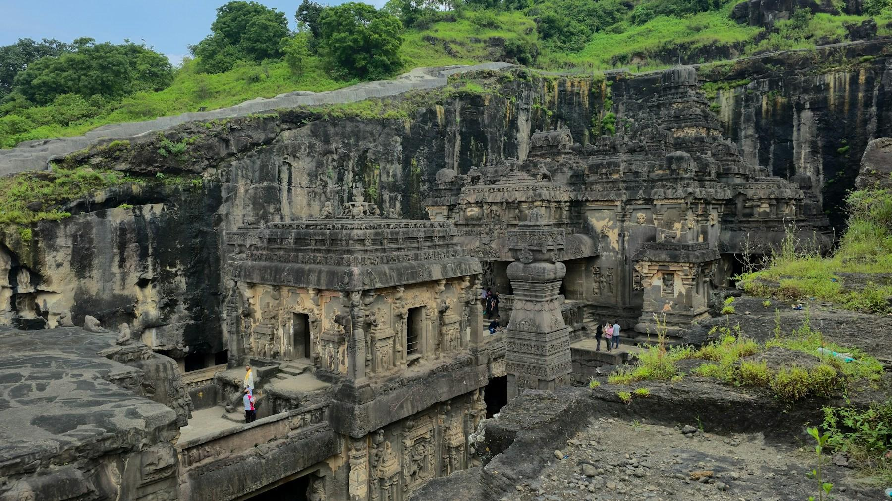
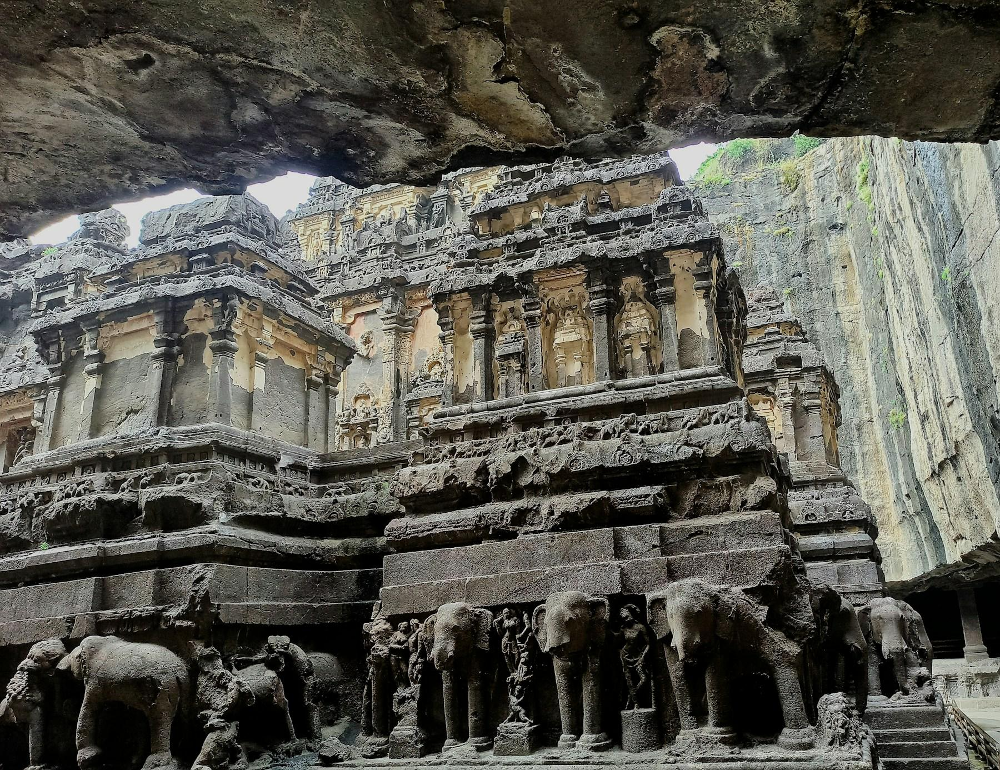

Imagine a hill. Not a dramatic one: a low, dark ridge of volcanic rock in the Deccan, with goats on top and scrub in the cracks. Now imagine a crowd of men climbing up onto it one morning, about twelve hundred years ago, carrying chisels, hammers and pickaxes. They don't build anything. They start to dig. They cut three deep trenches into the hilltop, in the shape of a giant "U", and they keep cutting, down and down, for years, until a block of rock as tall as a ten-story building stands alone in a pit. Then they start carving that block from the top, and as they go down, a temple appears.

That temple is Kailasa, Cave 16 at Ellora, and nothing quite like it exists anywhere else on earth. Pull up a chair. Here's its story.

## A wall in the hillside

The first thing you notice when you walk up to Kailasa is that you can't see it. Ellora's 34 caves run for more than a mile along the face of a basalt escarpment, about 18 miles from the city of Aurangabad (now officially Chhatrapati Sambhajinagar), in the state of Maharashtra. Buddhist monks began cutting monasteries into the cliff here in the 6th century; Hindu and then Jain carvers followed over the next few hundred years. From the meadow in front, Cave 16 looks like nothing more than a dark stone wall with a gateway in it.

You walk through that gateway, and the world opens up. In front of you, in a courtyard roughly 270 feet long and 150 feet wide, stands a full-size temple: towers, halls, balconies, staircases, bridges, life-size elephants, all of it one piece of rock, joined at the base to the ground it was cut from. Around it, the walls of the pit rise as high as 100 feet, and they are hollowed out into two-story galleries of their own. The top of the temple's spire stands about 107 feet above the courtyard floor.

Nothing was added. No stone was carried in, no block was laid on another. Everything you see was already there, inside the hill, and the sculptors simply took away everything that wasn't the temple.

*From the outside, Kailasa is just a wall in the hill. Photo: [Zoshua Colah](https://unsplash.com/photos/kailasa-temple-at-ellora-caves-TmiiIBJXdpE) on Unsplash*

## The king who signed his name in copper

Who made it? The temple itself carries no dedication, but a clue survives on copper. In the 8th century, the Rashtrakuta dynasty ruled much of the Deccan. Copper-plate land grants issued by their descendants, one of them around 812 CE, credit a king called Krishnaraja, generally taken to be Krishna I, who reigned from about 756 to 773, with building a wondrous temple of Shiva at Elapura, the old name of Ellora. One of them describes a temple so remarkable that even the gods were astonished, and its architect himself wondered how he had managed to make it.

Historians still argue about the details. Some think work began under Krishna's predecessor, Dantidurga, and others see the hands of later kings in parts of the temple, like the great panel of Ravana and the shrine of the river goddesses. Most agree, though, that the heart of Kailasa was cut in the second half of the 700s, which makes it about twelve hundred years old.

The name tells you what the king had in mind. Kailasa is the mountain in the Himalayas where Shiva lives with his wife Parvati. Krishna wasn't building a temple on a mountain. He was turning a mountain into a temple: a copy of Shiva's home, carved out of the living rock, and probably once coated in white plaster so it would gleam like a snowy peak.

*Looking down from the cliff top: the whole temple sits inside a pit cut into the hill. Photo: [sagar mahadik](https://unsplash.com/photos/grey-temple-on-hilltop-overlooking-the-valley-hofqOkMKK4I) on Unsplash*

## How do you carve a mountain?

Look up Kailasa online and you'll find claims about lost technology, laser cutters and even help from outer space. The truth is more impressive, because it was done by people.

The carvers began by marking out the temple's plan on the flat top of the hill. Then they cut three trenches, front, sides and back, straight down through the basalt, leaving the central block standing free. Working with iron chisels and hammers, gangs of stonecutters chipped the rock away in small pieces, and the rubble was carried out in baskets. As the trenches deepened, master sculptors followed them down, finishing the temple from the top: first the spire, then the upper halls, then the pillars, then the base.

This meant there was no room for error. You can fix a mistake in a building by taking out a brick. You cannot put rock back. Every hall, staircase and window had to be planned before the first blow, and kept in the carvers' heads for years as the temple emerged. Inside, they hollowed out a pillared hall, a shrine for the lingam and passageways, working by the light of oil lamps.

How long did it take? The archaeologist M. K. Dhavalikar, who spent years studying Ellora, worked it out: if about 250 workers each cut away around four cubic feet of rock a day, the main temple could have been finished in about five and a half years. Others think the whole complex took decades. Either way, the rock removed is usually estimated at around 200,000 tonnes, all cut by hand, and there's not a line in the temple that looks hurried.

*The vertical walls of the pit show how deep the carvers cut. Photo: [Zoshua Colah](https://unsplash.com/photos/kailasa-temple-at-ellora-caves-IzJ1xtEznEk) on Unsplash*

## What the stone remembers

Once you're inside the courtyard, slow down, because the details are the point.

Around the base of the temple, a herd of life-size elephants and lions seems to carry the whole building on their backs. Many have lost their trunks and faces to time, but you can still see the folds of skin on their legs. Two great stone flagstaffs, each carved from a single shaft of rock about 50 feet tall, stand in the courtyard beside two full-size elephants. A bridge of living rock connects the shrine of Nandi, Shiva's bull, to the main temple, and once, smaller stone bridges flew across the courtyard from the galleries; most have fallen.

On the south side is Kailasa's most famous sculpture. The demon king Ravana, ten-headed and twenty-armed, is trying to lift Mount Kailasa and shake Shiva off it. Above him, Parvati clutches Shiva's arm in alarm and a servant runs away, while Shiva, completely calm, presses down on the mountain with one toe and traps Ravana underneath. Art historians rank it among the finest pieces of sculpture in India.

Walk the base of the temple and you'll find the Ramayana and Mahabharata told in stone, like a comic strip running around the walls. Climb the stairs to the upper hall, and on the ceilings you'll find faded traces of paint. In the side galleries, look for Shiva dancing, Shiva as an ascetic, and the river goddesses Ganga, Yamuna and Saraswati standing on their animal mounts.

Before you leave, stand for a minute in the courtyard and look up at the cut walls of the pit. Somewhere up there, twelve hundred years ago, a man with a chisel made the first mark on a hilltop and imagined all of this inside it.

*Stone elephants appear to carry the temple on their backs. Photo: [Arundhati Pathak](https://unsplash.com/photos/a-group-of-elephants-standing-in-front-of-a-building-gx__j0fzilY) on Unsplash*

## Legend or history?

> Once, a king of these parts fell gravely ill. His queen prayed to Shiva at the nearby shrine of Ghrishneshwar and vowed that if he recovered, she would build a temple and not eat until she saw its top. The king got better, but the royal architects said a temple would take years. Then an architect named Kokasa promised she would see the top within a week: he would carve the temple from the top down, spire first. A week later the queen saw a stone peak rising from the hill and broke her fast, and the temple was named Manikeshwar after her.

**What we know:** This story was first written down in the *Katha-Kalpataru*, a text from around the late 15th or early 16th century, some seven hundred years after the temple was cut. No inscription at Ellora mentions a queen or a vow, and nobody could have finished even the spire in a week. But the legend gets one thing exactly right: the temple really was carved from the top down. The archaeologist M. K. Dhavalikar has suggested that Kokasa may echo the name of a real chief architect, and that Manikeshwar could be an early name for the temple.

> The copper plates say the gods themselves were amazed by the temple, and that its architect could not believe he had made it.

**What we know:** This one is history, or at least a record from the time. The Rashtrakuta copper plates of around 812 CE really do praise the temple in these terms. They are royal propaganda, of course, but they show that within a generation or two, people already thought Kailasa was a wonder.

## Local tellings

These are stories you'll hear from guides, taxi drivers and the internet. None of them can be confirmed, and some are almost certainly wrong, but they're part of how Kailasa is remembered.

- **The emperor who gave up.** In the 17th century, the story goes, the Mughal emperor Aurangzeb sent a thousand men to destroy Kailasa; they hacked at it for three years, barely scratched it, and he gave up. There's little evidence behind it, and the missing trunks and broken faces are just as easily explained by twelve centuries of monsoons and visitors.
- **Seven thousand workers, a hundred and fifty years.** This figure is repeated by guides and all over the internet. No record of the workforce survives, and it doesn't fit the copper plates, which credit one king; scholars' own estimates range from about five years for the main temple to a few decades for the whole complex.
- **The tunnels to an underground city.** Some say narrow passages beneath the temple lead to a hidden city. The small openings visitors point to are drainage channels and unfinished cuttings, and no underground city has ever been found.
- **The rubble that vanished.** A popular online claim says the 200,000 tonnes of cut rock were never found, so the temple can't have been carved by hand. Broken basalt makes good building material and road fill; over twelve centuries, it would have been carted away and reused.

## Things you probably didn't know

- **It's a monolith, not a cave.** Ellora counts it as Cave 16, but Kailasa is really a free-standing temple, carved from a single rock and still attached to the hill only at its base.
- **It covers about twice the area of the Parthenon.** And it's roughly half as tall again.
- **It was probably once white.** Traces of white plaster suggest the temple was painted to look like snowy Mount Kailasa.
- **Three faiths share the same cliff.** Ellora's caves are Buddhist, Hindu and Jain, carved side by side over about five centuries.
- **You can look down on it.** A path climbs to the top of the cliff, where you can stand on the original surface of the hill and look into the pit, the way the first carvers saw it.
- **Ellora has an older name.** The copper plates call it Elapura, and the village beside the caves is still called Verul.

## Timeline

- **6th–7th century CE** Buddhist monks begin cutting monasteries into the cliff at Ellora.
- **c. 735–756 CE** Dantidurga founds the Rashtrakuta kingdom; some historians think work on Kailasa began in his reign.
- **c. 756–773 CE** King Krishna I reigns, and most of the temple is carved.
- **c. 812 CE** Rashtrakuta copper plates credit "Krishnaraja" with the temple at Elapura.
- **9th–10th century CE** Later kings add shrines and galleries around the courtyard; Jain caves are carved at the north end of the cliff.
- **c. 1470–1535** The *Katha-Kalpataru* records the legend of the queen and the architect Kokasa.
- **1983** The Ellora Caves become a UNESCO World Heritage Site.
- **2023** Aurangabad, the nearest city, is officially renamed Chhatrapati Sambhajinagar.

## If you go

Ellora is about 18 miles (30 km) from Aurangabad (Chhatrapati Sambhajinagar), which has flights from Delhi, Mumbai, Bengaluru and Hyderabad. From the US, fly into Mumbai, then take a one-hour flight or a long day's drive. The caves are closed on Tuesdays. Foreign visitors pay about ₹600 ($7), and Indian citizens about ₹40. Arrive at opening time, before the tour buses, give Kailasa at least two hours, and save energy for the Buddhist Cave 10, with its ribbed "carpenter's" ceiling, and the Jain caves at the far end. October to March is dry and cool; in the monsoon, waterfalls pour over the cliff.

Most visitors combine Ellora with the painted Buddhist caves of Ajanta, about 60 miles away; the [Ajanta and Ellora day tour with all inclusions](aff:getyourguide/aurangabad-l431/from-aurangabad-ajanta-ellora-day-tour-with-all-inclusion-t504939/) does both from Aurangabad with a car and guide (4.8 from 120+ reviews on GetYourGuide, from $40). In Aurangabad, the [Welcomhotel Rama International](aff:agoda/partners/partnersearch.aspx?pcs=1&hid=9116746) has big gardens and a pool (8.6 from 940 reviews on Agoda, around $90 a night), and the [Lemon Tree Hotel](aff:agoda/partners/partnersearch.aspx?pcs=1&hid=108509) is a reliable alternative (8.3 from 1,000+, around $90).

## Sources

- [Ellora Caves](https://whc.unesco.org/en/list/243/), UNESCO World Heritage Centre
- M. K. Dhavalikar, *Ellora* (Oxford University Press, 2003)
- [Kailasa temple, Ellora](https://en.wikipedia.org/wiki/Kailasa_temple,_Ellora), Wikipedia, for the copper-plate inscriptions, dimensions and the *Katha-Kalpataru* legend
- [Ellora Caves](https://en.wikipedia.org/wiki/Ellora_Caves), Wikipedia

*Cover: the Kailasa Temple, Cave 16, at Ellora. Photo: [Zoshua Colah](https://unsplash.com/photos/kailasa-temple-at-ellora-caves-HzQlpSSYnlc) on Unsplash.*
