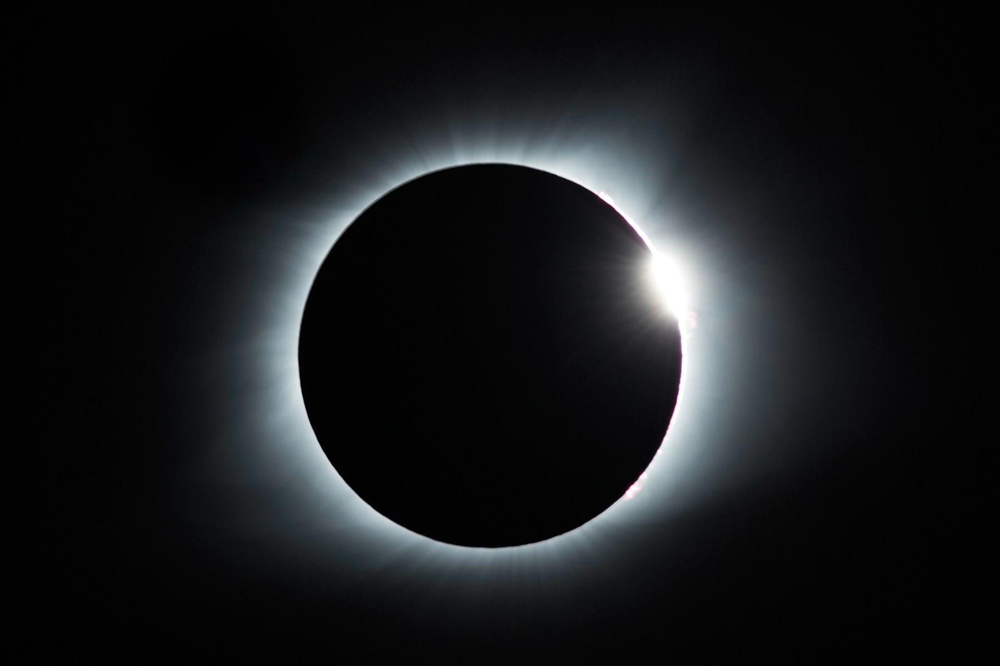
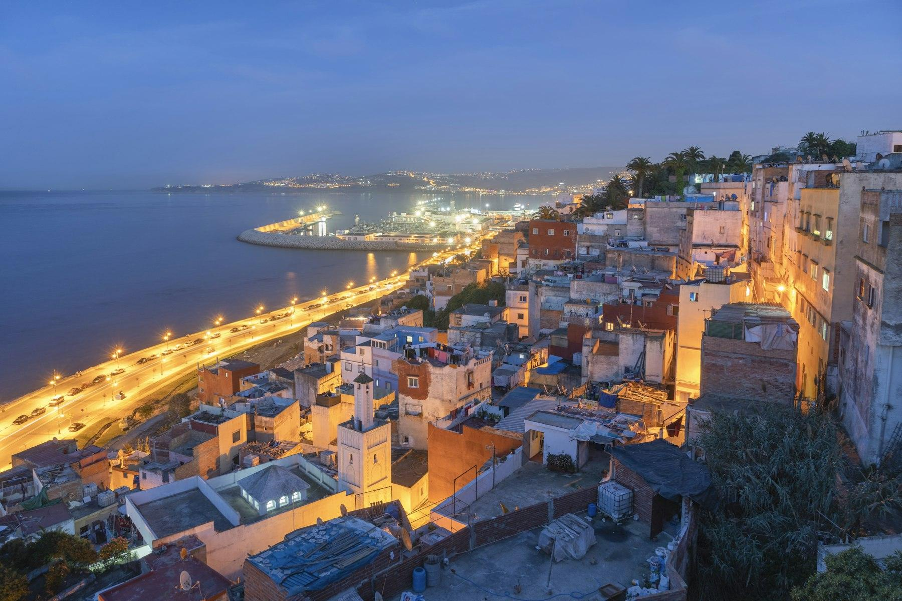
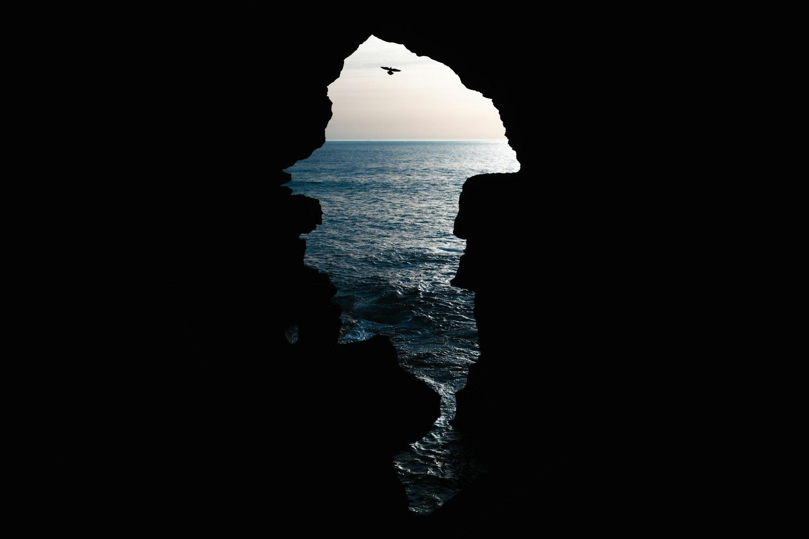
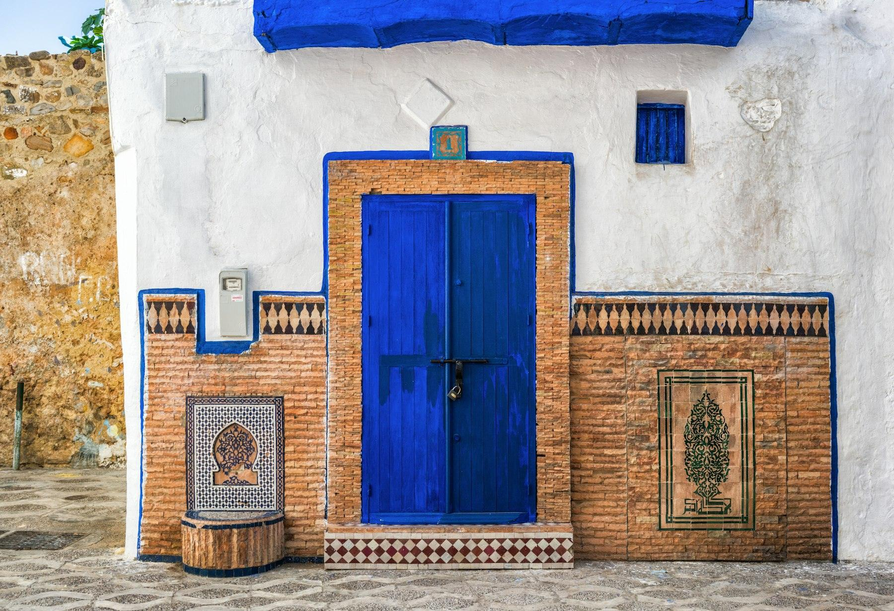
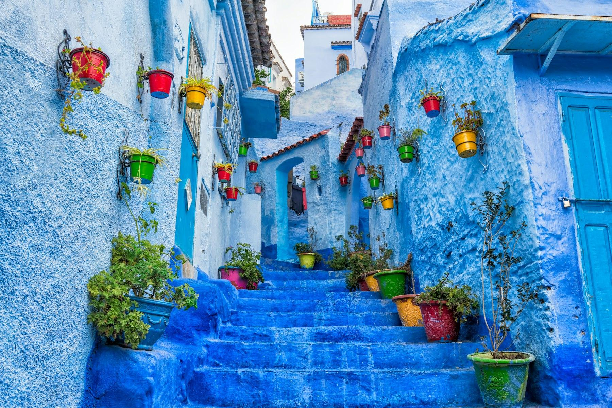
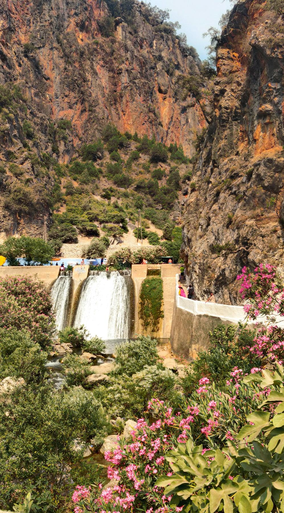

At 9:44 on the morning of Monday, 2 August 2027, the light over Chefchaouen will start to go wrong. The blue walls turn steel-grey, the swifts go quiet, the temperature drops, and the last bead of sunlight snaps out behind the Moon. For about four minutes the Sun is a black hole ringed by a white corona, with the Rif Mountains in twilight all around. Across the Strait in Cádiz, people who paid thousands of dollars for a room will get less than three minutes.

This story is for anyone in the US who wants to see the "eclipse of the century" without paying Spanish eclipse prices. Northern Morocco sits squarely in the path of totality, gets a longer eclipse than southern Spain's cities, and still has rooms for well under $150 a night. It's a seven-day plan for 28 July to 3 August 2027: two nights in Tangier, then four in Chefchaouen, the blue town in the mountains, with eclipse morning on day six.

## At a glance

| | |
| --- | --- |
| Best time to go | 28 July to 3 August 2027; totality is Monday 2 August, around 9:45 am |
| Days you need | 7 days, 6 nights |
| Getting there | Nonstop to Casablanca, then a 2-hour bullet train to Tangier |
| Daily budget | $145 – $320 (about MAD 1,300 – 2,900) |
| Language | Moroccan Arabic (Darija) and Amazigh; French and Spanish widely spoken |
| Currency | Moroccan dirham (MAD); $1 is about MAD 9 |
| Good for | Total eclipse, medinas, mountain towns, food, value |

## Why go

Two numbers make the case. In Tangier, totality lasts about 4 minutes 51 seconds, and in Chefchaouen about 4 minutes 15 seconds. In Cádiz it's 2 minutes 56 seconds, and in Málaga under 2 minutes. Morocco is closer to the centre line of the Moon's shadow, so you see the corona for longer. Then there's the price. When we checked Booking.com in November 2026 for the night of 1 August 2027, only 16 well-rated places were left in Cádiz, and the cheapest cost $1,439 for one night. In Chefchaouen the median well-rated room was $75.

There is a catch: Tangier itself is filling up. Its best-known hotels had rooms on 20 July and 10 August 2027 but none on 31 July or 1 August. That's why this plan sends you to Chefchaouen for the eclipse, which also has the lowest August cloud cover in northern Morocco, sheltered from the sea mists by the Rif Mountains. And unlike Spain, the eclipse is only one part of the trip: the medinas, food and mountains here would be worth the flight on their own.

*Totality looks like this: the 2017 total eclipse from Kentucky. Photo: [Mathew Schwartz](https://unsplash.com/photos/solar-eclipse-7YiZKj9A3DM) on Unsplash*

## Getting there

**Flights:** Royal Air Maroc flies nonstop to Casablanca from New York (JFK), Washington Dulles, Miami and, since June 2026, Los Angeles. Most eastbound flights are overnight and land in the morning. From Casablanca, take the train to Tangier. Alternatively, fly to Tangier Ibn Battouta airport (TNG) with one stop in a European hub such as Madrid, Paris, Lisbon or London. Book early: August is peak season, and eclipse travellers will push fares up.

**The bullet train:** Al Boraq, Africa's first high-speed train, runs from Casablanca to Tangier in about 2 hours 10 minutes, from roughly $15–25 in second class and $25–40 in first. Book on the ONCF website or app once tickets open, usually about a month ahead.

**Via Spain:** You can fly into Málaga or Seville and take the ferry from Tarifa to Tangier, about an hour across the Strait for roughly €40–50 one way on foot. Be warned: every summer around three million Moroccans living in Europe cross home through these ports, and the early August weekends are the busiest of the year. Book a fixed sailing, go on a weekday, and allow plenty of time.

**Entry rules:** US citizens don't need a visa for Morocco for stays of up to 90 days. Your passport must be valid for your whole stay and have a blank page for the entry stamp.

## Getting around

- **Tangier:** The medina and Kasbah are best on foot. Blue petit taxis cover the rest of the city and use the meter; ask the driver to switch it on. Cap Spartel and the Hercules Caves are about 30 minutes west by taxi or tour.
- **Tangier to Chefchaouen:** CTM buses take about 3 hours, cost under MAD 100, and can be booked online. A shared grand taxi is quicker but cramped, and you can pay for empty seats to get one to yourself. The [private transfer from Chefchaouen to Tangier](aff:getyourguide/tangier-l835/from-chefchaouen-one-way-transfer-service-to-tangier-t894462/) also runs the other way and drops you at the door (4.8 from 97 reviews, from about $43).
- **Chefchaouen:** The medina is all steep lanes and steps, so it's walk-only. Taxis wait at Plaza Outa el Hammam's lower gates and the bus station, a 15-minute walk below the old town.
- **Driving yourself:** You can rent a car with a US licence, and the roads in the north are good. But the medinas are car-free, parking is hard, and a driver costs little, so most visitors don't bother.
- **Eclipse morning:** If you're staying in Chefchaouen, you won't need to travel at all. If you want Tangier's longer totality, arrange a driver days ahead and leave by 6 am: the roads will be busy.

## Where to stay

- **Tangier (two nights before the eclipse):** stay in or next to the medina. [Mamora Bay](aff:booking/hotel/ma/mamora-bay-tanger.html) is the most-reviewed guesthouse in the old town (8.7 from 3,490 reviews, around $85 a night), [Kasba Green](aff:booking/hotel/ma/kasba-green.html) is a small riad near the Kasbah (9.1 from 550, around $85), and [Dar Souran](aff:booking/hotel/ma/dar-souran.html) is a top-rated riad with roof terraces over the Strait (9.4 from 920, around $130). In the quiet Marshan district, [villazancot](aff:booking/hotel/ma/villazancot.html) is one of the city's best-reviewed stays (9.7 from 650, around $95), and [Syrah Home](aff:booking/hotel/ma/syrah-home.html) is the budget pick (8.7 from 800, around $45).
- **Chefchaouen (four nights, including eclipse night):** stay inside the medina so you can walk everywhere and watch from a roof terrace. [Casa Amina](aff:booking/hotel/ma/casa-amina.html) is a friendly guesthouse in the old town (9.2 from 925, around $122 a night), [Riad Nila](aff:booking/hotel/ma/riad-nila.html) is a well-run riad (8.9 from 850, around $197 on eclipse night), and [Dar Ba Sidi & Spa](aff:booking/hotel/ma/dar-ba-sidi-amp-spa.html) is the splurge, with a hammam and pool (8.2 from 190, around $325).

*Ratings are guest scores on Booking.com, and prices are for two on the trip dates (30 July to 3 August 2027 in Chefchaouen, 28 to 30 July in Tangier), all checked in November 2026. Rooms for eclipse night are disappearing fast, so book now: most of these offer free cancellation.*

## Top things to do

### Watch totality from a Chefchaouen roof terrace

On 2 August the partial eclipse starts around 8:40 am. Totality arrives at about 9:45 and lasts just over four minutes, with the Sun high in the eastern sky, well above the mountains. Any roof terrace with a clear view east works. Wear certified eclipse glasses (marked ISO 12312-2) for the partial phases, take them off only during totality, and put them back on the moment the first bead of sunlight returns. Then just look: no phone.

### Get lost in Tangier's medina and Kasbah

Tangier's old town climbs from the port to the Kasbah, the old fortress at the top, through lanes of white and blue houses. Start at the Grand Socco, then walk up to the Kasbah Museum, the old sultan's palace. The Tangier American Legation, the oldest US diplomatic property in the world, tells the story of the two countries' early friendship. End the day at Café Hafa, open since 1921, where you drink mint tea on terraces stepping down the cliff above the Strait.

*Tangier's medina and bay at dusk. Photo: [Raúl Cacho Oses](https://unsplash.com/photos/aerial-view-of-city-near-body-of-water-during-night-time-atwIEcpyeSM) on Unsplash*

### Stand at Cap Spartel and the Hercules Caves

Cap Spartel, 14 km west of Tangier, is the northwestern tip of Africa, where the Atlantic meets the Mediterranean. A few minutes south, the Hercules Caves open onto the ocean through an opening shaped like a map of Africa. The [Cap Spartel and Hercules Cave tour](aff:getyourguide/tangier-l835/from-tangier-cap-spartel-and-hercules-cave-with-camel-ride-t710865/) covers both in three hours, with a short camel ride on the beach (4.7 from 2,067 reviews, from about $30). Go in the late afternoon, when the light on the ocean is best.

*The sea from inside the Hercules Caves. Photo: [Othman Alghanmi](https://unsplash.com/photos/a-bird-flying-over-the-ocean-from-a-cave-LxLT-B3L8pc) on Unsplash*

### Eat your way through Tangier

Tangier's food mixes Moroccan, Spanish and Andalusian traditions: grilled sardines at the port, bocadillos, bissara soup and pastries from French-era bakeries. The [Tangier food walking tour](aff:getyourguide/tangier-l835/tangier-food-walking-tour-t278397/) takes three hours through the medina's markets and stalls with a local guide (5.0 from 58 reviews, from about $73). Go hungry, and do it on your first evening to learn what to order for the rest of the trip.

### Spend a day in Asilah

Asilah, 45 km down the Atlantic coast, is a small whitewashed town inside 15th-century Portuguese ramparts. Every summer its walls get new murals from the town's arts festival, and the sunset from the bastion over the ocean is the best in the region. The [Asilah day trip with Cap Spartel](aff:getyourguide/tangier-l835/tangier-day-trip-to-asilah-cap-spartel-t801916/) combines it with the cape (4.8 from 95 reviews, from about $55). Eat grilled fish at one of the restaurants by the medina gate.

*A doorway in Asilah's medina. Photo: [Milad Alizadeh](https://unsplash.com/photos/a-blue-and-white-building-with-a-blue-door-ghydVxL2x7w) on Unsplash*

### Walk Chefchaouen's blue medina

Chefchaouen, founded in 1471 in a fold of the Rif Mountains, is painted top to bottom in blues. Start at Plaza Outa el Hammam, with its red-walled kasbah and the octagonal minaret of the Grand Mosque, then climb the lanes towards Bab Onsar. The [guided medina walk with mint tea](aff:getyourguide/chefchaouen-l104265/chefchaouen-hidden-gems-guided-tour-with-mint-tea-t537120/) shows you the quieter quarters in three hours (4.8 from 207 reviews, from about $25). Go out early, before the day-trippers arrive from Tangier and Fes at about 11 am.

*Steps in Chefchaouen's blue medina. Photo: [Milad Alizadeh](https://unsplash.com/photos/a-narrow-street-with-blue-steps-and-potted-plants-JibMa0FbyHw) on Unsplash*

### Swim at the Akchour waterfalls

Akchour, 45 minutes from Chefchaouen in Talassemtane National Park, is a gorge with turquoise pools and waterfalls, the best place to cool off in August. Hike up the river to the big cascade, or take the other trail to the Bridge of God, a natural rock arch high above the river. The [full-day Akchour trip](aff:getyourguide/chefchaouen-l104265/from-chefchaouen-full-day-trip-to-akchour-waterfalls-t600762/) includes transport, a guide and a tagine lunch (4.8 from 128 reviews, from about $55). Wear shoes you can get wet.

*The Akchour falls. Photo: [Yzouji](https://unsplash.com/photos/cascading-waterfalls-flow-between-rugged-rocky-cliffs-ST1FLbUFZq4) on Unsplash*

## Off the beaten path

### Tetouan's medina

Tetouan, 1 hour from both Tangier and Chefchaouen, has one of the most complete medinas in Morocco, a UNESCO World Heritage Site, yet few foreign visitors stop. It was rebuilt by Muslim and Jewish refugees from Granada in the 15th century, and the Andalusian look shows in its white houses and tiled fountains. Stop on the way from Tangier to Chefchaouen and visit the tannery and the craft school, the Dar Sanaa.

### The Spanish Mosque at sunset

A 30-minute walk up the hill east of Chefchaouen's medina, past the Ras el Maa spring, leads to an abandoned white mosque built by the Spanish in the 1920s. From its terrace you look down over the whole blue town as the sun sets behind the mountains. Take water and a torch for the walk back down after dark.

### Ras el Maa spring

At the top of Chefchaouen's medina, Ras el Maa is the mountain spring that gives the town its water. Women still wash carpets and clothes in the stone basins, and cafés by the stream serve mint tea in the shade. It's the coolest spot in town on an August afternoon.

### Perdicaris Park

On the hills west of Tangier, Perdicaris Park (Rmilat) is a forest of cork oaks and pines around the villa of Ion Perdicaris, a wealthy expatriate whose kidnapping in 1904 led President Theodore Roosevelt to send warships to Tangier. Today local families picnic and walk its trails above the Strait. It's 15 minutes by taxi from the city, and it makes a cool morning walk.

## Things you probably didn't know

- **It's the longest total eclipse on land until 2114.** Totality reaches 6 minutes 23 seconds in Egypt, the longest anyone can see from land between 1991 and 2114.
- **Morocco was the first country to recognise the United States.** Sultan Mohammed III opened his ports to American ships in 1777, and the 1786 treaty of friendship is still in force.
- **The American Legation is a US National Historic Landmark in Africa.** Given to the US in 1821, it's the only National Historic Landmark outside the United States.
- **Tangier was once run by a committee of countries.** From 1924 to 1956 it was an International Zone governed by several foreign powers, which made it a haven for spies, smugglers and writers.
- **Matisse painted Tangier.** Henri Matisse spent two winters here in 1912 and 1913, painting the view from room 35 of the Grand Hôtel Villa de France.
- **The Hercules Caves are shaped like Africa.** Seen from inside, the sea opening has the outline of the continent, reversed.
- **Morocco is an hour behind Spain.** On eclipse day, totality in Tangier comes at 9:45 local time, the same moment as 10:45 in Spain.

## What to eat

- **Bissara:** a thick fava bean soup with olive oil, cumin and paprika, the classic breakfast in the north. Small cafés in Chefchaouen serve it from big pots.
- **Chicken tagine with preserved lemon and olives:** slow-cooked in the clay pot it's named after, the dish you'll see everywhere.
- **Jben:** fresh goat's cheese from the Rif Mountains, sold wrapped in palm leaves at Chefchaouen's market.
- **Harira:** a tomato, lentil and chickpea soup with herbs, eaten with dates and a sweet chebakia pastry.
- **Grilled sardines:** fresh from the Strait and cooked on the street near Tangier's port.
- **Mint tea:** green tea brewed with fresh mint and plenty of sugar, poured from a height. You'll be offered it everywhere, and it's polite to accept.

## A suggested itinerary

### Day 1: Arrive in Tangier

- Morning: Land in Casablanca and take the Al Boraq train north.
- Afternoon: Check in to the medina; walk to the Grand Socco.
- Evening: Tangier food walking tour.

### Day 2: Tangier

- Morning: The Kasbah, Kasbah Museum and American Legation.
- Afternoon: Cap Spartel and the Hercules Caves.
- Evening: Sunset mint tea at Café Hafa.

### Day 3: Tetouan and on to Chefchaouen

- Morning: Drive to Tetouan and walk its medina.
- Afternoon: Continue to Chefchaouen and check in.
- Evening: Dinner overlooking Plaza Outa el Hammam.

### Day 4: Chefchaouen

- Morning: Guided walk through the blue medina.
- Afternoon: Ras el Maa and a slow lunch in the shade.
- Evening: Sunset from the Spanish Mosque.

### Day 5: Akchour

- Morning: Drive to Akchour and hike to the waterfalls.
- Afternoon: Swim, tagine lunch and the Bridge of God.
- Evening: Check your eclipse glasses, find your terrace, and go to bed early.

### Day 6: Eclipse day

- Morning: Watch the partial phases from 8:40 and totality at about 9:45.
- Afternoon: Rest; the town will be buzzing.
- Evening: A celebration dinner and a last walk through the blue lanes.

### Day 7: Fly home

- Morning: Transfer to Tangier airport (about 2½ hours).
- Afternoon: Fly home via Casablanca or Europe.
- Evening: Westbound flights land in the US the same day.

## What it costs

| Item | Budget | Mid-range |
| --- | --- | --- |
| Stay (per night) | $70 | $150 |
| Food (per day) | $25 | $50 |
| Local transportation (per day) | $20 | $50 |
| Tours and entry fees (per day) | $30 | $70 |
| **Total per day** | **$145** | **$320** |

On top of this, budget for your flight from the US to Casablanca or Tangier, usually $900–1,500 round trip in summer, and the train to Tangier (about $15–40). Compare that with Spain: one eclipse night in a well-rated Cádiz hotel was already $1,439 or more in November 2026, about ten times this whole budget for a day.

## Good to know

- **Book your room before anything else.** Rooms in the path are going fast on both sides of the Strait. Book a cancellable room now, then sort out flights.
- **Buy proper eclipse glasses.** They must meet the ISO 12312-2 standard; ordinary sunglasses are not safe. Buy them at home before you travel, from a reputable supplier, and bring a spare pair. Look without them only during totality itself.
- **Have a weather backup.** August is mostly sunny, but morning sea mist can sit on the Atlantic coast and the easterly Levante wind can push cloud onto the Mediterranean shore. Chefchaouen, inland, has the best odds. Check the forecast the day before and be ready to move.
- **Dress for the heat and for local customs.** August afternoons are hot, often 30°C (86°F) or more. Light, loose clothes that cover your shoulders and knees are comfortable and respectful, especially in the medinas.
- **Carry cash.** Cards work in hotels and bigger restaurants, but taxis, small cafés and souks want dirhams. ATMs are common in Tangier and Chefchaouen; the dirham can't be bought outside Morocco.
- **Handle the hustlers politely.** Unofficial guides in the medinas will offer to show you the way. A firm "no, thank you" works; if you want a guide, book a licensed one.
- **Plugs and data.** Morocco uses the round two-pin European plug at 220 V. Buy a local SIM from Maroc Telecom, Orange or inwi at the airport, or install an eSIM before you fly.
- **Ask before photographing people.** Many Moroccans, especially women in rural areas, don't want to be photographed.

## Final word

Spain will get the headlines on 2 August 2027, and the crowds and prices that go with them. Across the Strait, for a fraction of the cost, you get a longer totality, a blue mountain town, and a week of mint tea, waterfalls and medinas around it. Book the room now, pack the eclipse glasses, and at 9:44 that Monday morning, look up.

*Cover: Chefchaouen in the Rif Mountains. Photo: [Othman Alghanmi](https://unsplash.com/photos/a-view-of-the-blue-city-of-jodhpur-hLguP2Saayo) on Unsplash.*
