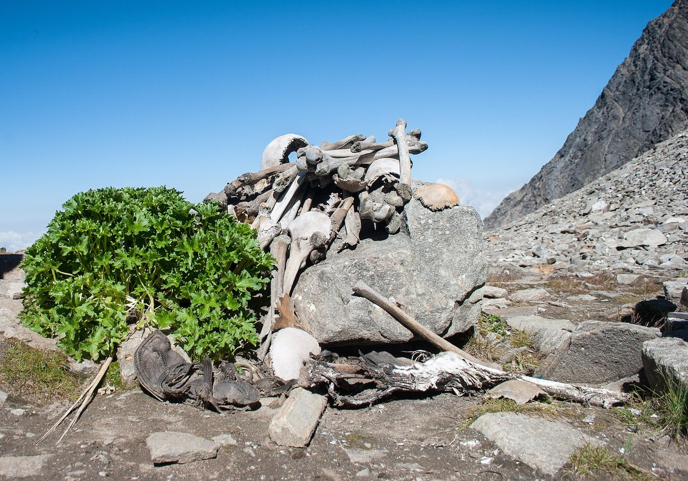
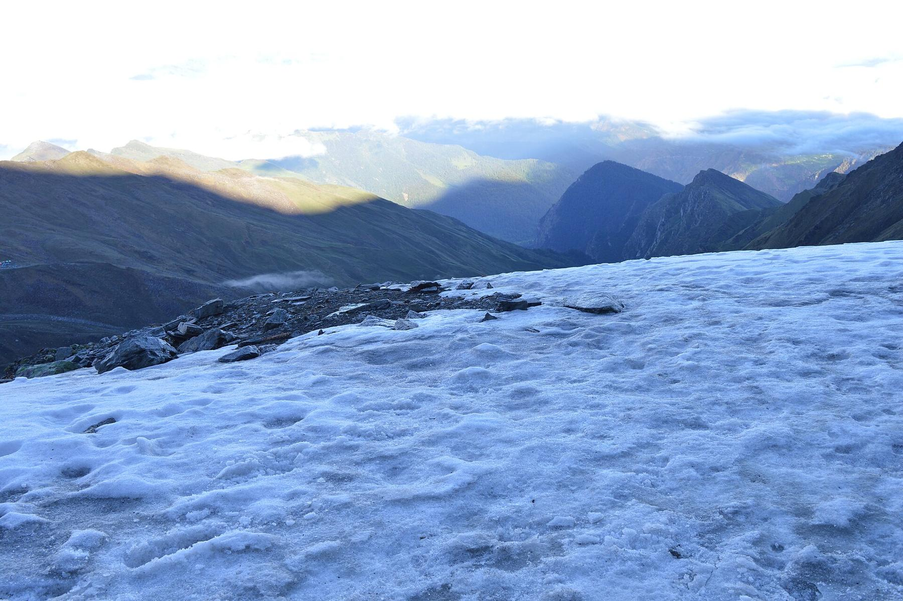
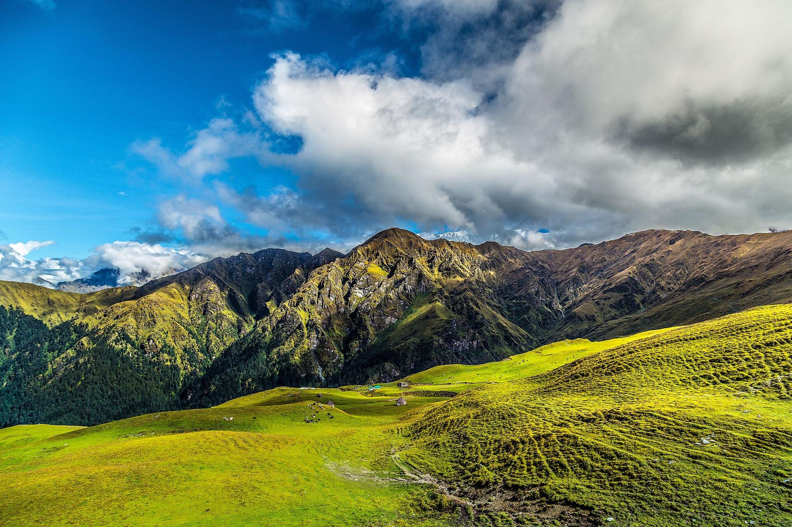
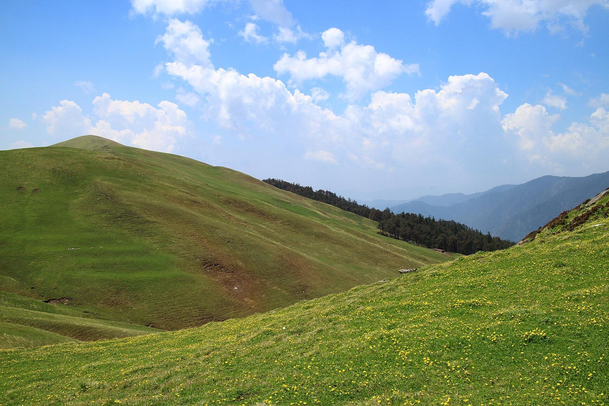
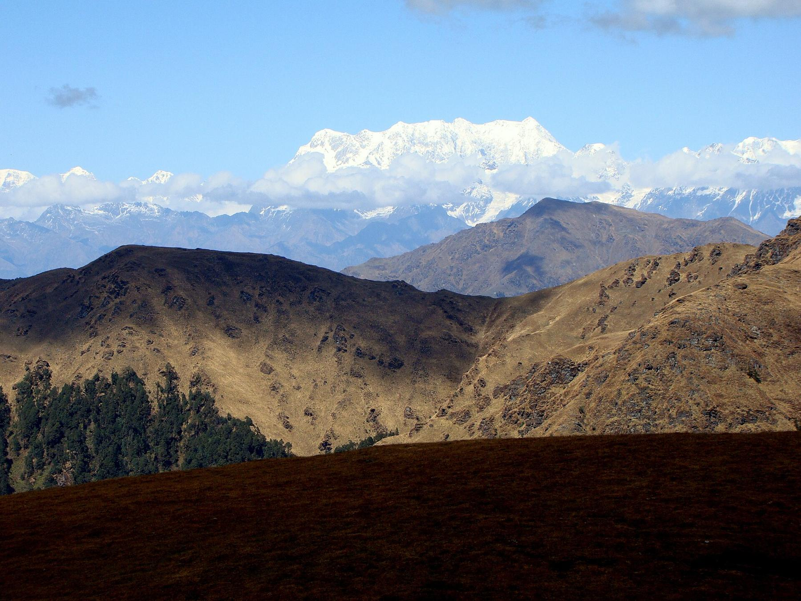

It is 1942, and a forest ranger named Hari Kishan Madhwal is climbing through the high, empty country below the peak of Trishul in the Indian Himalayas. The meadows are far below him now. Up here there is only rock, snow and thin, cold air, at a height of more than 16,000 feet. He reaches a small lake in a bowl of scree, still half-frozen, and looks down. In the ice and around the water's edge, there are bones. Skulls. Ribs. Leg bones. Not a few, but hundreds, as if a crowd of people had simply lain down here and never got up.

The lake is called Roopkund, and for more than eighty years, people have been trying to work out who those people were, and what happened to them. The answer, when it finally came, was stranger than any of the stories. Get comfortable. Here's the mystery of the lake of bones.

## A lake at the edge of the world

Roopkund lies in Chamoli district, in the state of Uttarakhand, about 16,500 feet up in a hollow between the peaks of Trishul and Nanda Ghunti. It isn't big: a glacial tarn about 130 feet across and perhaps 10 feet deep, so small you could throw a stone across it. For most of the year it is frozen solid and buried under snow. Only for a few weeks in late summer and early autumn does the snow melt back, the water clears to a pale green, and the bones appear in the shallows and on the slopes around it.

There are a great many of them. Estimates of the number of people run into the hundreds. Some skeletons are scattered and broken; the cold and the dry air have preserved others remarkably well. Over the years, visitors reported scraps of clothing, leather sandals, wooden objects and bits of jewelry among the bones.

To get here, you walk for days from the last villages, up through oak and rhododendron forest, across the huge high meadows of Ali and Bedni Bugyal, and over the bare shoulders of the mountain. It is the kind of place where no one goes by accident. Which is exactly what made the bones so puzzling.

*Bones gathered beside the lake. Photo: [Schwiki](https://commons.wikimedia.org/wiki/File:Human_Skeletons_in_Roopkund_Lake.jpg), CC BY-SA 4.0, via Wikimedia Commons*

## The army that never was

When news of Madhwal's discovery reached the British authorities in 1942, the timing could hardly have been worse. India was at war, Japanese forces were advancing through Burma, and the first fear was that these were the bodies of Japanese soldiers who had somehow slipped across the Himalayas and died trying to invade. Investigators were sent up to look.

It didn't take them long to rule it out. The bones were far too old to belong to soldiers of the 1940s. Whoever these people were, they had died long before anyone in India had heard of a Japanese army.

Over the next few decades, the theories multiplied. Perhaps they were the soldiers of a lost 19th-century army, returning from a disastrous war in Tibet. Perhaps they were victims of an epidemic, or traders caught by a sudden blizzard on a forgotten route. Perhaps it was mass ritual suicide. Each idea had its supporters, and none had any real evidence. The bones kept their secret.

*For most of the year, Roopkund is frozen and the bones are hidden under ice and snow. Photo: [Shubhamrathod15](https://commons.wikimedia.org/wiki/File:Roopkund_-_The_Mystery_Lake.jpg), CC BY-SA 4.0, via Wikimedia Commons*

## Death from the sky

The people who live in the valleys below Roopkund had their own explanation, and it had been sung for generations. In the folk songs of the region, a king traveling to worship the goddess Nanda Devi angered her on the way, and she punished his party with a storm of hailstones as hard as iron. Everyone died at the lake.

In 2004, a team of Indian and European scientists, supported by National Geographic, went up to study the remains. They found something that made the old song sound much less like a fairy tale. Several of the skulls had short, deep cracks, the kind of injuries made by blows from small, round, hard objects striking from above. The wounds were on the tops of heads and shoulders, as if people had been caught in the open with nowhere to shelter. Radiocarbon dating of the bones, done at Oxford, pointed to the 9th century CE.

The conclusion seemed obvious: a large group of people, probably travelers or pilgrims, had been caught in a sudden, violent hailstorm on the open mountainside around 850 CE, with hailstones perhaps the size of cricket balls, and all of them had died together. The folk song, it seemed, had remembered a real disaster for more than a thousand years. For fifteen years, that was the answer.

## What the DNA said

Then, in 2019, a large international team of geneticists, archaeologists and anthropologists, led by Éadaoin Harney at Harvard, published the results of a much more detailed study in the journal *Nature Communications*. They had extracted DNA from the bones of 38 people, dated them individually and analyzed what they had eaten. The results turned the story upside down.

The skeletons did not belong to one group of people who died in one storm. They belonged to at least three different groups. The largest, 23 people, had ancestry typical of people living in South Asia today. But they had not all died at the same time: their deaths were spread out between roughly the 7th and 10th centuries, perhaps in several separate events. Most strangely of all, a second group of 14 people had ancestry closest to people living in the eastern Mediterranean today, in mainland Greece and Crete. They had died about a thousand years after the first group, around 1800 CE, and probably all together. One last person had ancestry typical of Southeast Asia.

The chemistry of their bones agreed. The South Asian group had eaten a wide range of diets, while the Mediterranean group had eaten very little millet, a staple in the Himalayan villages. These people were not locals, and they had not been living in India long.

What were people from the Mediterranean doing at 16,500 feet in the Himalayas around 1800, and how did they die? Nobody knows. There's no record of a European expedition, no story of foreign pilgrims lost on the mountain, and no sign of what killed them. The scientists were candid: they had solved one mystery and opened another.

So the lake still keeps its secrets. Every September, when the snow melts back, the bones come up again into the light, and the pilgrims and trekkers who climb past them stop and wonder, just as the ranger did in 1942.

*The high meadows of Bedni Bugyal, on the way to Roopkund. Photo: [Shaswat Nimesh](https://commons.wikimedia.org/wiki/File:Bedini_Bugyal_01.jpg), CC BY-SA 4.0, via Wikimedia Commons*

## Legend or history?

> A king named Jasdhaval set out on a pilgrimage to the shrine of the goddess Nanda Devi, taking his pregnant queen, servants and a troupe of dancing girls. On the sacred mountain, the dancing and revelry offended the goddess. She sent a storm of iron-hard hailstones, and the whole royal party died at the lake.

**What we know:** This story is told in the region's folk songs, but there is no historical record of the king or his journey. The 2004 study did find skull injuries consistent with large hailstones, so a deadly hailstorm is quite possible. But the 2019 DNA study showed the South Asian dead were not one party: they died over two or three centuries, so a single royal pilgrimage cannot explain all of them.

> All the bones at Roopkund belong to one group of people who died in a single disaster around 850 CE.

**What we know:** This was the scientific consensus after 2004, and it turned out to be wrong. The 2019 study found at least three groups with different ancestries, who died about a thousand years apart. The 9th-century date fits the oldest group, but the Mediterranean group died around 1800.

## Local tellings

These are stories you'll hear in the villages, from trek guides, or online. None of them can be confirmed, and some clearly don't fit the evidence.

- **The dancing girls of Patar Nachauni.** On the trail below Roopkund is a campsite called Patar Nachauni, which locals connect with the dancing girls of King Jasdhaval's party: it's said to be where they danced, and where the goddess's anger began. It's a lovely piece of place-lore, but there's no way to test it.
- **Zorawar Singh's lost soldiers.** A popular theory holds that the bones are soldiers of General Zorawar Singh, whose army was destroyed in a winter campaign in Tibet in 1841. The dates and ancestry don't fit: the South Asian remains are about a thousand years older, and the 1800-era group had Mediterranean ancestry.
- **Alexander's Greeks.** After the 2019 study, some websites claimed the Mediterranean group were soldiers left behind by Alexander the Great. Alexander reached northwest India in 326 BCE, more than two thousand years before these people died.
- **The Japanese invaders.** The 1942 fear that the dead were Japanese soldiers still circulates online. The bones were already ancient when they were found.

## Things you probably didn't know

- **The bones only appear for a few weeks a year.** Roopkund is frozen and snow-covered most of the year; the remains are visible mainly in late summer and early autumn.
- **Visitors have carried bones away.** Over the decades, trekkers and others took skulls and bones as souvenirs, and officials have repeatedly called for the site to be protected.
- **A goddess's procession passes the lake.** The Nanda Devi Raj Jat, a pilgrimage held roughly every twelve years, climbs past Roopkund on its way to the shrine of Homkund, led by a four-horned ram.
- **The meadows below are vast.** Ali Bugyal and Bedni Bugyal, which the trail crosses on the way up, are among the largest high-altitude meadows in India.
- **The peak above it made climbing history.** Trishul, which towers over the lake, was climbed in 1907 by a British-led party, the highest summit anyone had reached at the time.
- **There's no single answer yet.** The 2019 study tested 38 of the several hundred people at the lake. Many more bones have never been studied.

## Timeline

- **c. 7th–10th century CE** People of South Asian ancestry die at the lake, probably in several separate events.
- **c. 1800 CE** A group of people with eastern Mediterranean ancestry, and one person of Southeast Asian ancestry, die at the lake, probably together.
- **1907** Trishul, the peak above Roopkund, is first climbed.
- **1942** Forest ranger Hari Kishan Madhwal reports the skeletons; the British briefly suspect Japanese soldiers.
- **2004** A scientific expedition dates bones to about the 9th century and links skull injuries to a hailstorm.
- **2014** The last full Nanda Devi Raj Jat pilgrimage passes the lake.
- **2018** Uttarakhand's High Court bans overnight camping in the high meadows, which restricts the trek.
- **2019** A DNA study of 38 skeletons reveals three groups who died about a thousand years apart.
- **2026** Reports say India's Supreme Court has lifted the camping ban, reopening the full trek.

*Ali Bugyal, one of the great meadows on the trail. Photo: [Vaibhav Dautkhani](https://commons.wikimedia.org/wiki/File:Ali_Bugyal.jpg), CC BY-SA 4.0, via Wikimedia Commons*

## If you go

Roopkund is a serious high-altitude trek, not a sightseeing stop. Most people take 6 to 8 days round trip from the village of Lohajung, climbing through forest to the meadows of Ali and Bedni Bugyal, then up to Bhagwabasa and the lake at about 16,500 feet. From the US, fly into Delhi, take an overnight train to Kathgodam, then drive about 10 hours to Lohajung. The best seasons are mid-May to June, when snow still covers the upper slopes, and mid-September to October, after the monsoon, when the lake is most likely to be clear.

The rules have changed more than once. From 2018, a High Court ban on overnight camping in the high meadows cut the classic route short; reports in July 2026 say the Supreme Court has lifted that ban, but forest-department permits and limits still apply. Go with an established trekking company that handles permits, camps and guides, check the current rules before you book, and plan for acclimatization days: altitude sickness is a real risk. Look at the bones, but leave them where they are.

*Chaukhamba from Bedni Bugyal. Photo: [Biswajit Majumdar](https://commons.wikimedia.org/wiki/File:Chowkhamba_from_Bedni_Bugyal_-_panoramio.jpg), CC BY-SA 3.0, via Wikimedia Commons*

## Sources

- Éadaoin Harney et al., "[Ancient DNA from the skeletons of Roopkund Lake reveals Mediterranean migrants in India](https://www.nature.com/articles/s41467-019-11357-9)", *Nature Communications* 10, 3670 (2019)
- [Biomolecular analyses of Roopkund skeletons show Mediterranean migrants in Indian Himalaya](https://www.eurekalert.org/news-releases/718077), EurekAlert! news release (2019)
- [Roopkund](https://en.wikipedia.org/wiki/Roopkund), Wikipedia
- [Nanda Devi Raj Jat](https://en.wikipedia.org/wiki/Nanda_Devi_Raj_Jat), Wikipedia

*Cover: Roopkund lake in August. Photo: [Schwiki](https://commons.wikimedia.org/wiki/File:Roopkund_Lake.jpg), CC BY-SA 4.0, via Wikimedia Commons.*
