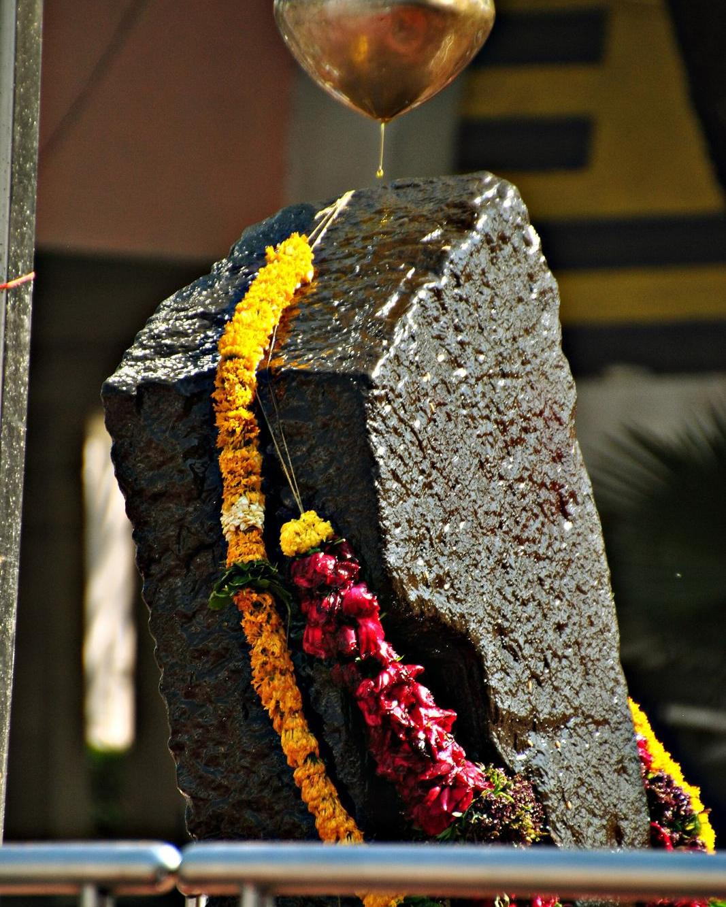
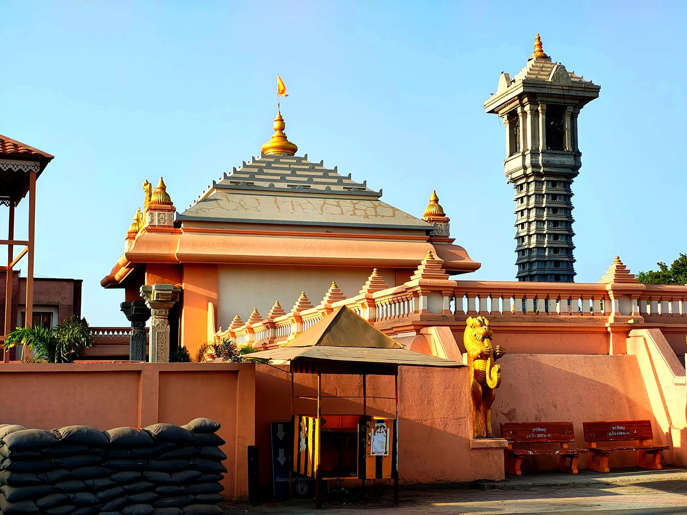
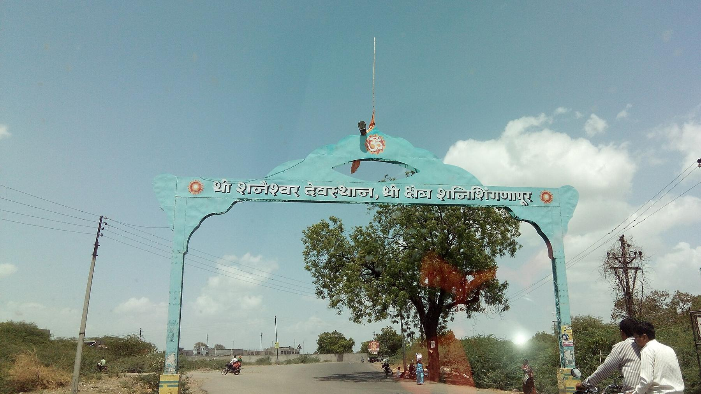
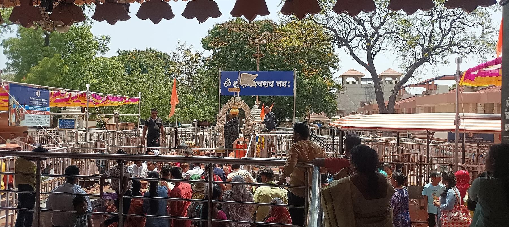
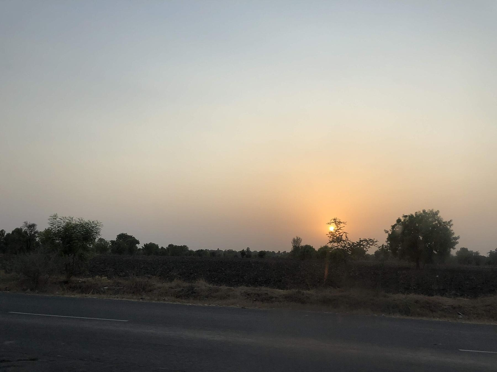
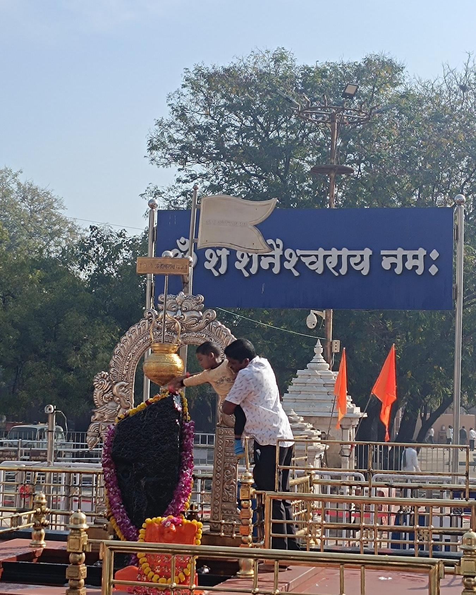

It is a Saturday evening in a flat, dusty corner of the Deccan plateau, and the sky is going orange over the sugarcane fields. In the middle of a village called Shingnapur, a queue of thousands of people shuffles toward a raised stone platform. There is no temple building around it, no roof, no walls. Just a slab of black rock, taller than a man, standing alone under the open sky, glistening with the oil poured over it all day.

Turn around and look at the houses along the lane. Some have a curtain hanging in the doorway. Some have a wooden frame with nothing in it. For as long as anyone here can remember, the people of Shingnapur did not lock their homes, because they believed the god in the stone was watching, and that any thief would be punished long before the police could catch him.

It is one of the most famous stories in India: the village without doors. Like most famous stories, it is a little more complicated than it sounds. Settle in. Here's the tale of the stone, the god of Saturn and the doors that came back.

## The stone that bled

The story the villagers tell begins with a flood. Several hundred years ago, they say, heavy rain swelled the Panasnala, the small river that runs past the village. When the water went down, a large black slab of rock had been left behind on its bank, where no one had seen it before.

A group of shepherd boys found it. Curious, one of them poked the stone with a pointed stick. And the stone began to bleed.

The boys ran back to the village, and the people gathered around the bleeding rock, frightened and amazed. That night, the story goes, the god Shani appeared in a dream to the most devoted of the shepherds. The stone, he said, was his own form, *swayambhu*, self-manifested, not made by any human hand. The shepherd asked if they should build a temple for it. Shani refused. The whole sky was his roof, he said, and he needed no other. Put the stone in the open, and he would protect the village. No one here would ever need a lock again.

So the villagers set the stone up on a platform in the open air, and there it has stood ever since, in sun and monsoon rain.

To understand why this mattered so much, you have to know who Shani is. In Hindu astrology, Shani is the planet Saturn, and the god who rules it. He is slow, stern and just, a judge who rewards hard work and punishes wrongdoing. He is also one of the most feared gods in the sky. Many Hindus believe a bad phase of Saturn in their horoscope can bring years of hardship, and they pray to Shani to soften his gaze. Saturday is his day; in Marathi and Hindi, it is literally *Shanivar*, Saturn's day. To have Shani himself guarding your village was a very serious thing.

*The stone of Shani, about five and a half feet tall. Photo: [Sabyasachi.baldev](https://commons.wikimedia.org/wiki/File:Shani_Shingnapur_-_Shrine_of_Shani.JPG), CC BY-SA 4.0, via Wikimedia Commons*

## A village without doors

Over the generations, the promise turned into a way of life. Houses in Shingnapur were built without front doors, or with an empty frame where a door would be. Shops had no shutters. Grain stores, cupboards and boxes stayed unlocked. If a family wanted privacy, they hung a cloth across the doorway. Within about a kilometer of the stone, people said, there was not a single lock.

The belief behind it was simple. Shani punishes thieves. Anyone who stole from the village, it was said, would be struck down: by blindness, by illness, by a run of terrible luck, or by the wrath of the god himself. So nobody stole. And because nobody stole, nobody needed a door.

As India's roads improved and pilgrims began to pour in from across the country, the village and its open houses became a wonder. Newspapers, television crews and foreign travel writers came to see the place where nobody locked anything. The crowds grew to tens of thousands of people on an ordinary day. The temple grew too: gates, queues, a long pillared hall and a tall tower rose around the open platform, though the stone itself was still left without a roof.

In January 2011, a bank decided to join in. The United Commercial Bank, UCO Bank, opened a branch in Shingnapur and announced it would respect local tradition: no lock on the front door. It made headlines across the country. The country's first lockless bank.

But by then, quietly, something was changing.

*The modern temple complex has grown up around the open platform. Photo: [Shivashanky](https://commons.wikimedia.org/wiki/File:Shree_Shanidev_Temple,_Shani_Shingnapur.jpg), CC BY-SA 4.0, via Wikimedia Commons*

## When the locks came back

The first crack in the legend was reported in 2010, when a visitor told police that cash and valuables had been stolen from him in the village. Then, in February 2011, thieves took about 73,000 rupees in cash and gold from the doorless house of a former temple trustee. The family went to the police. According to a 2015 report in *Open* magazine, the case was still unsolved years later, and some villagers were angry with the family, not for the theft, but for reporting it and damaging the village's good name.

The same reporter, Omkar Khandekar, found much more. Police records listed 46 criminal cases from the village over six years, most of them assaults and thefts. In the temple's own guest rooms, the curtains that once hung in the doorways had been replaced with sliding doors between 2005 and 2007, because guests didn't like sleeping behind a cloth. Many houses now had sliding panels that could be latched from inside. The "lockless" bank did have a door, made of glass, held shut by a remote-controlled electromagnetic lock, and its cash was reportedly sent to a nearby town before closing.

In September 2015, Shingnapur got its own police station, mainly to handle the huge crowds. At the opening, a minister proudly called it the only police station in the country without doors. The reporter checked. It had doors.

None of this means the villagers were lying. For many families in Shingnapur, the open doorway is still a matter of real faith, and some still live behind nothing more than a curtain. One villager whose house was robbed told the magazine that the theft hadn't shaken his family's faith at all. What changed was the world around them: more money, more strangers, more pilgrims, more temptation. The village without doors had become one of the busiest pilgrimage towns in Maharashtra, and a pilgrimage town needs police, guards and cameras.

*The arch on the road into the village. Photo: [Vishal0soni](https://commons.wikimedia.org/wiki/File:ShaniShingnapurEntranceGate.jpg), CC BY-SA 4.0, via Wikimedia Commons*

## Who may touch the stone

There was one more rule at Shingnapur, older and stricter than the one about doors. Men could climb onto the platform and pour oil over the stone themselves. Women could not. They had to worship from below, at a distance. Temple authorities described this as a tradition about 400 years old.

On Saturday, 28 November 2015, a young woman slipped past the security barrier, climbed onto the platform and offered prayers to the stone before vanishing into the crowd. The temple suspended seven security guards. Villagers performed a ritual cleansing of the stone with milk and shut their shops in protest. Her act, and the reaction to it, became national news.

Women's rights activists took up the cause. On 26 January 2016, India's Republic Day, hundreds of women led by the activist Trupti Desai and her group, the Bhumata Brigade, set out by bus to march on the temple. Police stopped them before they reached the village. The protests went on for weeks, and the case went to court. On 30 March 2016, the Bombay High Court told the state government that women could not be denied entry to any place of worship that men were allowed into.

The end came suddenly. On 8 April 2016, the festival of Gudi Padwa, the Marathi New Year, a group of male devotees pushed through the barricades and climbed onto the platform to pour holy water over the stone. That same day, the temple trustees met and announced that from now on, everyone, men and women alike, could go up to Shani. Within hours, women climbed the steps and poured oil over the stone for the first time anyone could remember.

Today, the queue at Shingnapur on a Saturday night is full of both. People step up, pour a little sesame oil from a steel pot over the black stone, fold their hands and step down. Under the open sky, as the legend says, the stone has no roof. Look around at the houses, though, and you'll see that it's the doors that have been slowly coming back.

*Devotees queue for the platform. Photo: [Gurtej Chauhan](https://commons.wikimedia.org/wiki/File:%E0%A8%B8%E0%A8%BC%E0%A8%A8%E0%A9%80_%E0%A8%B8%E0%A8%BF%E0%A9%B0%E0%A8%98%E0%A8%A8%E0%A8%BE%E0%A8%AA%E0%A9%81%E0%A8%B0.jpg), CC BY-SA 4.0, via Wikimedia Commons*

## Legend or history?

> After a flood on the Panasnala river, shepherds found a black slab on the bank. When a boy struck it with a stick, it bled. Shani appeared in a dream, said the stone was his own form, refused a roof and promised to protect the village.

**What we know:** This is the temple's own tradition, and there is no written record of the discovery. The versions don't agree on the details: some say it happened about 400 years ago, others about 300, and at least one says only about 160; the stick is sometimes a rod and sometimes a sword. What's certain is that the stone has stood on an open platform for a long time, and that the open-air shrine is central to how the village sees itself.

> No one in Shingnapur has ever stolen anything, and so no house has ever needed a door.

**What we know:** Thefts were reported in 2010 and 2011, and a 2015 *Open* magazine investigation found 46 criminal cases in police records over six years. Sliding doors and latches have spread through the village since the mid-2000s. The tradition is real and many villagers still live by it, but the village is not, and probably never was, entirely crime-free.

> The rule barring women from the platform is 400 years old.

**What we know:** The ban was real and was enforced until April 2016. The claim that it is 400 years old comes from the temple itself; no historical source confirms when the rule began.

## Local tellings

These are stories you'll hear from guides, shopkeepers and pilgrims, or read online. None of them can be confirmed.

- **The thief who couldn't leave.** People say that a thief who steals in Shingnapur will wander the village all night unable to find the road out, or go blind before he reaches the boundary. It's a good warning story, but the real thefts of 2010 and 2011 ended with police reports, not miracles.
- **The roof that wouldn't stay.** It's often said that people tried to build a roof over the stone and it fell down or burned, because Shani refused it. There's no record of any such attempt; the shrine has simply been kept open.
- **The tree that never grows tall.** Some visitors are told that the branches of the nearby tree break or wither whenever they grow far enough to shade the stone. It's a lovely detail and impossible to check.
- **Saturn's "bad time" cure.** Many pilgrims believe that a visit and an oil offering here will end a bad phase of Saturn in their horoscope. That's a matter of faith, not history, but it's the main reason the crowds come.

## Things you probably didn't know

- **The god is a planet.** Shani is Saturn, one of the nine celestial bodies worshipped in Hindu astrology, which is why Saturday is the busiest day and a new moon falling on a Saturday, *Shani Amavasya*, draws the largest crowds of all, reportedly up to 300,000 people.
- **Oil is the offering.** Devotees pour sesame oil over the stone, which is why it always looks black and glossy. Oil, black cloth and iron are all associated with Shani.
- **The bank's "no lock" had a catch.** UCO Bank's famous 2011 branch had no padlock, but its glass door is held by a remote-controlled electromagnetic lock.
- **The police station has doors.** Opened in September 2015 and hailed as doorless, it had both a sliding door and a hinged one.
- **Even men had rules.** Men who climbed the platform traditionally bathed first and went up in wet clothes. Accounts differ on the exact dress, and the temple reportedly dropped the wet-cloth rule in 2011.
- **The temple is in court.** In 2025, a state investigation into the temple trust alleged bogus employees on its payroll and fake apps taking money from devotees for online worship. The state took over the temple under a 2018 law; the courts have since gone back and forth, and in December 2025 the Supreme Court put a senior state official in charge until a new committee is formed.

## Timeline

- **c. 1600s (tradition)** A black stone is found on the bank of the Panasnala after a flood and set up in the open as Shani.
- **2005–2007** Sliding doors replace curtains in the temple's guest rooms.
- **2010** The first theft in the village is reported to police.
- **January 2011** UCO Bank opens its "lockless" branch in Shingnapur.
- **February 2011** About 73,000 rupees in cash and gold are stolen from a former trustee's doorless house.
- **September 2015** Shingnapur gets its own police station.
- **28 November 2015** A woman climbs the platform; the stone is ritually cleansed and seven guards are suspended.
- **30 March 2016** The Bombay High Court says women can't be kept out of places of worship open to men.
- **8 April 2016** On Gudi Padwa, the trust opens the platform to everyone, women included.
- **2018** Maharashtra passes a law allowing the state to take over the temple's management.
- **2025** A corruption probe hits the temple trust; the state appoints an administrator, and in December the Supreme Court names its own.
- **Today** The stone still stands under the open sky, and Saturdays still bring tens of thousands of pilgrims.

*Sunset over the flat farmland around the village. Photo: [Maskaravivek](https://commons.wikimedia.org/wiki/File:Sunset_at_Shani_Shignapur.jpg), CC BY-SA 3.0, via Wikimedia Commons*

## If you go

Shani Shingnapur is about 45 miles (72 km) from Shirdi, the pilgrimage town of the saint Sai Baba, and most visitors combine the two. From the US, fly into Mumbai, then take a short domestic flight to Shirdi or Chhatrapati Sambhajinagar (Aurangabad) and drive about 1½–2 hours. You can also drive from Pune in about 4 hours or from Mumbai in 6–7. Taxis from Shirdi do the round trip in half a day.

The temple is open every day from early morning until late at night, and there's no entry fee. Dress modestly, leave your shoes at the counters near the entrance, and expect a queue. If you want to see the platform without huge crowds, go on a weekday morning; if you want to see Shingnapur at its most intense, go on a Saturday evening, or on a Shani Amavasya. The best time of year is October to February, when the Deccan is dry and the days are warm rather than hot. Allow about two hours in the village, and take a walk down the lanes to look for the old open doorways.

*Pouring oil over the stone. Photo: [K.Venkataramana](https://commons.wikimedia.org/wiki/File:Pouring_Til_oil_on_the_Shani_idol_at_Shani_Shingnapur,_maharastra.jpg), CC0, via Wikimedia Commons*

## Sources

- Omkar Khandekar, "[Shani Shingnapur: It Takes a Village to Raise a Legend](https://openthemagazine.com/features/india/shani-shingnapur-it-takes-a-village-to-raise-a-legend)", *Open* magazine (2015)
- "[Shani Shingnapur temple lifts curb on women](https://www.business-standard.com/article/pti-stories/shani-shingnapur-temple-lifts-curb-on-women-116040800516_1.html)", PTI via *Business Standard* (8 April 2016)
- "[Maharashtra woman enters famous Shani temple, kicks off row](https://www.deccanchronicle.com/151130/nation-current-affairs/article/maharashtra-woman-enters-famous-shani-temple-kicks-row)", *Deccan Chronicle* (30 November 2015)
- "[A temple trust scam like no other in the country](https://www.siasat.com/a-temple-trust-scam-like-no-other-in-the-country-journey-from-innocence-to-evil-3245495/)", *Siasat Daily* (July 2025)
- "[Supreme Court takes over Shani Shingnapur temple management](https://lawchakra.in/supreme-court/shingnapur-temple-nashik-commissioner)", LawChakra (December 2025)
- [Shani Shingnapur](https://en.wikipedia.org/wiki/Shani_Shingnapur), Wikipedia

*Cover: the open-air platform and the stone of Shani. Photo: [KINNERA ARAVIND](https://commons.wikimedia.org/wiki/File:Shani_Shingnapur.jpg), CC BY-SA 4.0, via Wikimedia Commons.*
