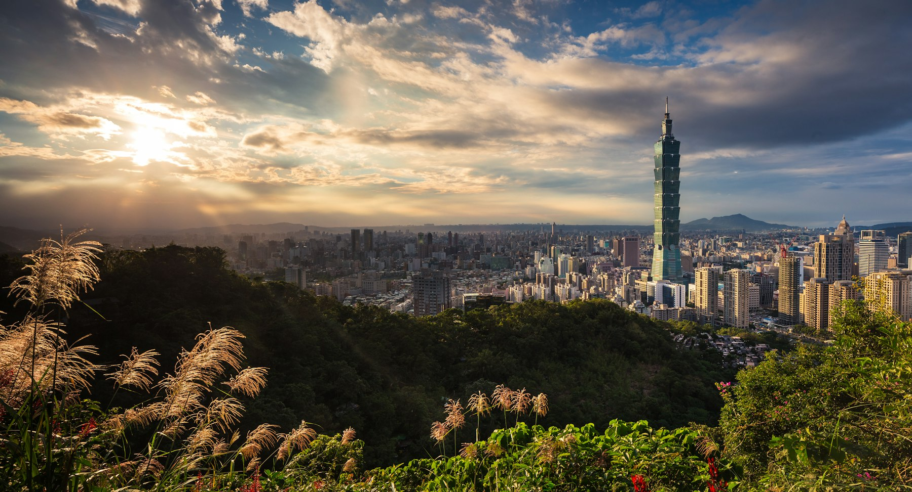
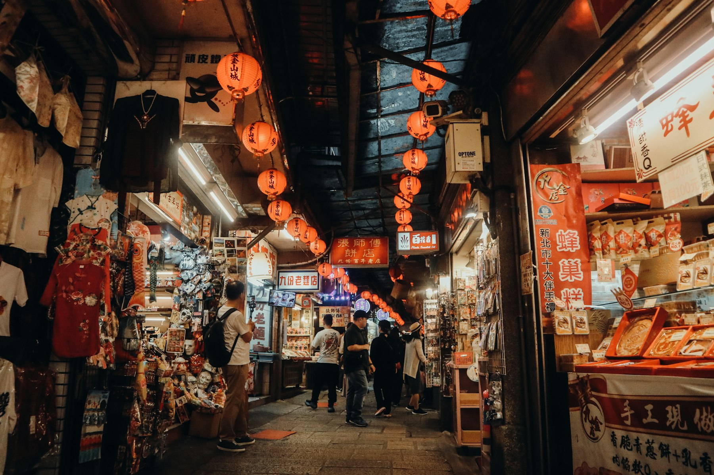
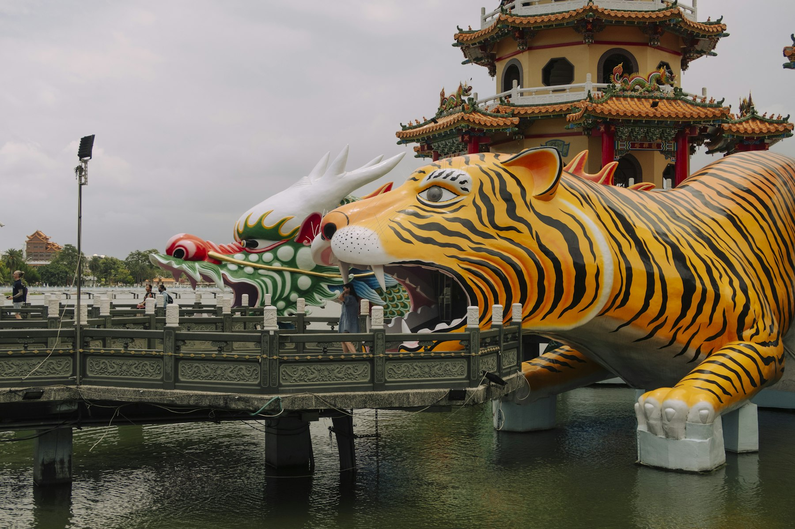
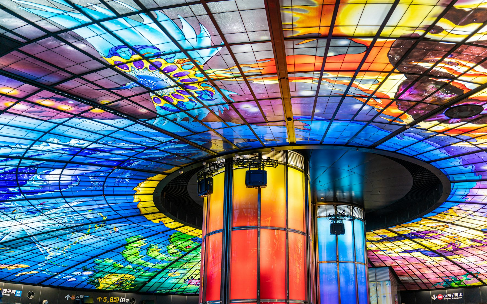
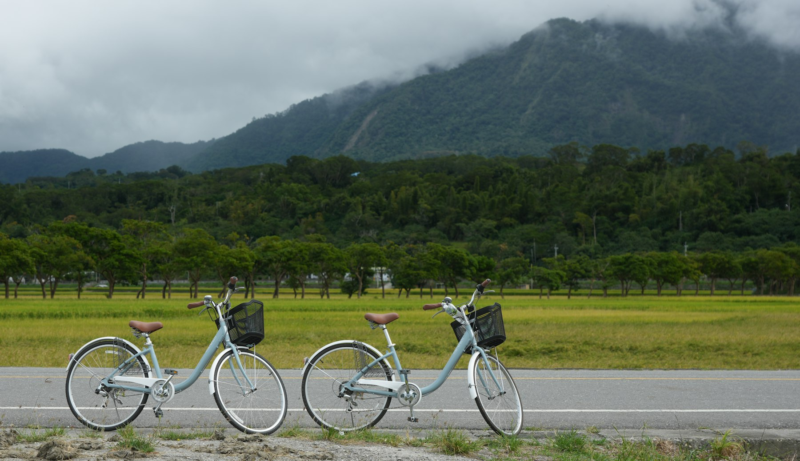

The express from Taipei runs through tunnels for most of the first hour. Then, somewhere past Yilan, the mountains open on the left and there is nothing but the Pacific, grey-blue and enormous, with the cliffs dropping straight into it. Four hours later you step out in Taitung, where the air is warmer, the buildings are lower and the people who stamp your ticket have more time to talk.

This trip is for first-timers who want more than Taipei. You get two nights in the capital for the night markets, temples and the view from Taipei 101, a night on the quiet east coast, and a night in Kaohsiung, the relaxed port city in the south, linked by some of the best train rides in Asia. It works for a long week off, and everything runs on public transport.

## At a glance

| | |
| --- | --- |
| Best time to go | October to December and March to May; typhoon season runs July to October |
| Days you need | 5 days, 4 nights |
| Getting there | Fly into Taipei (TPE), out of Kaohsiung (KHH) or back from Taipei |
| Daily budget | ₹6,200 – ₹17,000 (about $75 – $200) |
| Language | Mandarin; Taiwanese Hokkien in the south; English on transport signs |
| Currency | New Taiwan Dollar (NT$); NT$100 is about ₹280 |
| Good for | Food, trains, temples, coastlines, first trips to East Asia |

## Why go

Taiwan packs a lot into an island about the size of Kerala. Taipei is one of Asia's easiest big cities: safe at any hour, spotless, cheap to get around, and built around food, from Michelin-listed noodle shops to night markets that run past midnight. The National Palace Museum holds one of the world's great collections of Chinese art, and the temples are working places, full of incense and people asking for luck.

Most visitors never leave the west coast. The east is a different country: a thin strip between the Central Mountain Range and the Pacific, home to most of Taiwan's Indigenous peoples, with rice valleys, hot springs and empty beaches. Then the South-Link railway tunnels through the mountains to Kaohsiung, a port city that has turned its warehouses and harbour into one of Taiwan's most likeable places to spend an evening.

*Taipei 101 from Elephant Mountain at sunset. Photo: [Thomas Tucker](https://unsplash.com/photos/taipei-101-skyscraper-in-taipei-au3CYbd7vCU) on Unsplash*

## Getting there

**Flights:** Most travellers from India connect through Singapore, Bangkok, Kuala Lumpur or Hong Kong to Taipei Taoyuan (TPE). Kaohsiung (KHH) has fewer flights but good links to Southeast Asia, so an open-jaw ticket, into Taipei and out of Kaohsiung, saves you a day of backtracking.

**From the airport:** The Taoyuan Airport MRT reaches Taipei Main Station in about 35 minutes on the express. Buy a discounted [Airport MRT ticket on Klook](aff:klook/activity/11346-taoyuan-airport-mrt-ticket-taipei/) (4.8 from 22,700 reviews, about ₹450) or simply tap in with an EasyCard.

**Entry rules:** Indian passport holders need a visa from the Taipei Economic and Cultural Center in India, unless they qualify for the free online Travel Authorization Certificate. Check your eligibility on Taiwan's [Bureau of Consular Affairs site](https://www.boca.gov.tw/cp-220-1835-2ed68-2.html) before you book. Every visitor also fills in the free online Taiwan Arrival Card (TWAC) in the days before landing.

## Getting around

- **EasyCard:** a tap card for the MRT, buses, ferries, YouBikes and 7-Eleven. Get an [EasyCard on Klook](aff:klook/activity/5777-public-transport-easycard-taipei/) (4.8 from 22,800 reviews, about ₹280) and pick it up when you land.
- **Taiwan Railway (TRA):** runs the trains around the island. The Taipei to Taitung express takes 3½–4½ hours and costs NT$936 by Tze-Chiang (about ₹2,600); Taitung to Kaohsiung takes about two hours. Book on the TRA website or app, where tickets open about four weeks ahead. Seats on Puyuma and Taroko trains sell out at weekends, and those trains don't sell standing tickets.
- **High Speed Rail (HSR):** runs only down the west coast. Zuoying (Kaohsiung) to Taipei takes 94–120 minutes and costs NT$1,490 at the station. Foreign passport holders can buy cheaper [HSR tickets on Klook](aff:klook/activity/73749-thsr-one-way-ticket-taipei/) (4.8 from 25,600 reviews).
- **City transport:** Taipei and Kaohsiung both have cheap, clear MRT networks. If you'll ride a lot in a day, Kaohsiung's [unlimited MRT pass](aff:klook/activity/22715-unlimited-mrt-pass-kaohsiung/) (4.7 from 1,200 reviews, about ₹570) saves buying single tickets.
- **Scooters in Taitung:** the east coast's buses are infrequent, so most visitors hire a scooter or join a tour. [Scooters from Taitung station](aff:klook/activity/43657-taitung-scooter-rental/) (4.9 from 930 reviews, from about ₹600) need your passport, your licence with an International Driving Permit, and a credit card that isn't a Visa.

## Where to stay

- **Taipei, Ximending and Main Station:** central, near the airport train and the TRA. [Taiwan Youth Hostel & Capsule Hotel](aff:agoda/partners/partnersearch.aspx?pcs=1&hid=1620123) is a clean, well-run budget pick 300 m from Taipei Main Station (9.1 from 8,100 reviews, around ₹3,500 for two). [Cityinn Hotel Plus Ximending](aff:agoda/partners/partnersearch.aspx?pcs=1&hid=236926) is a short walk from Ximen MRT (9.0 from 11,100, around ₹9,200), and [citizenM Taipei North Gate](aff:agoda/partners/partnersearch.aspx?pcs=1&hid=2079109) has small, smart rooms by Beimen station (8.9 from 25,000, around ₹12,800). For a treat, [Hotel Resonance Taipei](aff:agoda/partners/partnersearch.aspx?pcs=1&hid=18793396) is near Shandao Temple MRT (9.2 from 9,300, around ₹20,500).
- **Taipei, Da'an and Zhongshan:** quieter streets, good cafes and food. [Hotel Gracery Taipei](aff:agoda/partners/partnersearch.aspx?pcs=1&hid=24718509) (9.1 from 15,400, around ₹10,900) and [Mitsui Garden Hotel Zhongxiao](aff:agoda/partners/partnersearch.aspx?pcs=1&hid=16362142) (9.1 from 21,500, around ₹14,800) are both near Zhongxiao Xinsheng MRT, and [The Okura Prestige](aff:agoda/partners/partnersearch.aspx?pcs=1&hid=400142) is the classic luxury hotel by Zhongshan MRT (9.1 from 10,900, around ₹18,600).
- **Taitung:** stay in the city for the night market and restaurants. [Kindness Hotel Taitung](aff:agoda/partners/partnersearch.aspx?pcs=1&hid=237975) sits in the centre and is famous for its free breakfast and evening snacks (9.0 from 8,500, around ₹6,100). [Norden Ruder Hostel](aff:agoda/partners/partnersearch.aspx?pcs=1&hid=4206778) is the backpacker favourite (9.1 from 9,700, around ₹2,700), and [Hotel Cham Cham Taitung](aff:agoda/partners/partnersearch.aspx?pcs=1&hid=929169) has a pool and bigger rooms (8.9 from 10,600, around ₹5,300). For a soak, [Toyugi Hot Spring Resort](aff:agoda/partners/partnersearch.aspx?pcs=1&hid=290553) is 14 km south in Zhiben (8.8 from 4,100, around ₹8,400).
- **Kaohsiung:** base yourself near Kaohsiung Main Station or Yancheng, by the harbour. [Kindness Hotel Kaohsiung Main Station](aff:agoda/partners/partnersearch.aspx?pcs=1&hid=670643) is the best-value stay (9.2 from 16,500, around ₹5,300), and [Legend Hotel Pier 2](aff:agoda/partners/partnersearch.aspx?pcs=1&hid=1270823) puts you by the arts district for very little (9.1 from 16,600, around ₹2,500). [Hotel Dua](aff:agoda/partners/partnersearch.aspx?pcs=1&hid=295765) is the stylish mid-range pick (9.1 from 13,800, around ₹8,100), and [Kaohsiung Marriott](aff:agoda/partners/partnersearch.aspx?pcs=1&hid=23388991) is the big-hotel splurge (9.1 from 11,100, around ₹13,300). Backpackers should try [Uno Backpackers Inn](aff:agoda/partners/partnersearch.aspx?pcs=1&hid=866860) (9.0 from 11,500, around ₹2,500 for two).

*Ratings are guest scores on the booking site each link goes to, and prices are typical December weeknight rates for two, both checked in November 2026.*

## Top things to do

### See Taipei from Taipei 101 and Elephant Mountain

Taipei 101 was the world's tallest building from 2004 to 2010, and its observatory on the 89th floor is reached in under a minute by one of the fastest lifts anywhere. Inside hangs the 660-tonne steel ball that steadies the tower in typhoons and earthquakes. Book a [Taipei 101 observatory ticket on Klook](aff:klook/activity/1659-taipei-101-taipei/) (4.7 from 41,900 reviews, from about ₹1,380) and go an hour before sunset. Then, for the view *of* the tower, take the MRT to Xiangshan and climb the steps up Elephant Mountain, a steep 20–30 minutes, for the city lights.

### Spend a morning in the National Palace Museum

The museum in Shilin holds hundreds of thousands of objects from the Chinese imperial collections, shipped to Taiwan in 1948–49, and only a small share is on show at once. The jade, bronzes, porcelain and calligraphy are the stars, and the famous Jadeite Cabbage draws the queues. It's closed on Mondays. Go at opening (09:00), take the audio guide and allow three hours.

### Light incense at Longshan Temple

Longshan Temple in Wanhua was founded in 1738 and has been rebuilt many times, most recently after being hit in a 1945 air raid. It's Taipei's busiest temple, honouring Guanyin alongside dozens of folk deities, and you can watch people throw moon blocks to ask the gods questions. Come in the early evening, when prayers are chanted, then walk to Ximending's shopping streets.

### Eat your way round a night market

Taipei's night markets are dinner, not a tourist show. Raohe is one long lane under a glowing temple gate, famous for black-pepper buns baked in a clay oven at the entrance. Ningxia, near Main Station, is smaller and all about food: oyster omelettes, taro balls and braised pork rice. Go hungry, bring cash and share everything so you can try more.

*A Taipei lane after dark. Photo: [jk retiza](https://unsplash.com/photos/people-walking-on-street-during-nighttime-YpsrN4LiDug) on Unsplash*

### Soak in Beitou or ride the Maokong gondola

Two easy half-days out of central Taipei. Beitou, at the end of the red MRT line, has the free Hot Spring Museum in an old Japanese-era bathhouse, the steaming Thermal Valley and public baths. Maokong is the opposite: a [gondola ride up to the tea hills](aff:klook/activity/16000-maokong-gondola-combo-ticket-taipei/) (4.7 from 11,900 reviews, about ₹860) for oolong in a teahouse with the city below. The gondola usually closes on Mondays for maintenance.

### Drive the Taitung coast

North of Taitung the road runs between the Pacific and the Coastal Range past sandstone shelves at Xiaoyeliu, the clifftop lookout at Jinzun, the old sugar factory turned art space at Dulan, and Donghe, known for its steamed buns. Either hire a scooter or join the [east coast half-day tour](aff:klook/activity/7917-east-coast-guided-nature-tour-taitung/) (4.7 from 193 reviews, about ₹2,850), which picks up from Taitung hotels at 08:30 and 13:30. The guide speaks Mandarin, so treat it as transport with stops.

### Walk through the dragon at Lotus Pond

Lotus Pond in Kaohsiung's Zuoying district is lined with temples, but the famous pair are the Dragon and Tiger Pagodas, built in 1976. Enter through the dragon's mouth and leave through the tiger's: the belief is that it turns bad luck into good. Then walk round the lake to the Spring and Autumn Pavilions, and climb the pagodas for the view across the water.

*The dragon and tiger at Lotus Pond. Photo: [Jonathan Ikemura](https://unsplash.com/photos/colorful-tiger-and-dragon-statues-with-a-pagoda-over-water-J_Fz8bn9od0) on Unsplash*

### Spend a day on Kaohsiung's harbour

From Gushan pier, a ferry crosses Kaohsiung harbour to Cijin Island in about ten minutes and costs a few dozen NT$ on an EasyCard. Walk up to the old lighthouse and fort, then eat grilled seafood on the main street.

Back on the mainland, Pier-2 Art Center fills a row of old harbour warehouses with galleries, giant sculptures, design shops and cafes. The light rail runs alongside, and the waterfront is good for a sunset walk or a YouBike ride. On the way, stop at Formosa Boulevard MRT station to look up at the Dome of Light, a huge glass ceiling by the Italian artist Narcissus Quagliata. End the day with a [Love River boat ride](aff:klook/activity/46975-love-river-boat-cruise-kaohsiung/) (4.8 from 2,000 reviews, about ₹390) past the lit-up bridges.

*The Dome of Light at Formosa Boulevard station. Photo: [Winston Chen](https://unsplash.com/photos/a-colorful-ceiling-in-a-building-with-a-glass-ceiling-4SD7fsm4NRQ) on Unsplash*

## Off the beaten path

### Tiehua Music Village

In Taitung city, a small open-air venue strung with paper lanterns hosts Indigenous and local musicians, with a craft market around it. It's the best place to hear the Amis and Puyuma songs that are part of east-coast life. Check the schedule before you go, and get there early on a weekend.

### Zhiben hot springs and forest

Zhiben, 15 km south of Taitung, is a hot-spring village at the mouth of a river valley. Spend an hour in a resort's public pools, then walk the trails of the Zhiben Forest Recreation Area. It's a calm alternative if you have a spare morning before the train south.

### Green Island

The ferry from Fugang harbour near Taitung reaches Green Island in about 50 minutes. It's known for coral reefs, a ring road you can scooter around in an hour, the Zhaori saltwater hot spring by the sea, and the former political prison that is now a human-rights museum. It deserves its own night, so add one if you can. Book [Green Island ferry tickets on Klook](aff:klook/activity/11080-green-island-round-trip-ferry-tickets-taitung/) (4.6 from 1,300 reviews, about ₹3,200 return).

### The east coast and South-Link railways

The trains on this route are a sight of their own. Going south from Taipei, sit on the left (the east side): after Yilan the line hugs the cliffs above the Pacific towards Hualien. South of Hualien it runs inland through the East Rift Valley, between two mountain ranges, past rice towns like Chishang and Guanshan. Buy a railway bento on board, as Taiwanese passengers do.

*Rice fields in Chishang in the East Rift Valley. Photo: [YING CHUN TSAI](https://unsplash.com/photos/two-bicycles-on-rural-roadside-hFsVrq0BmvE) on Unsplash*

From Taitung, the South-Link line runs south along the Pacific (sit on the left), then turns inland through the long tunnels under the Central Mountain Range and comes out among the mango and betel-nut farms of Pingtung. Just south of Taitung it passes Duoliang, a former station above the sea that is now a viewpoint.

### Fo Guang Shan

About an hour from central Kaohsiung, Fo Guang Shan is one of Taiwan's largest Buddhist monasteries, with a huge seated bronze Buddha, a museum and a line of pagodas. Entry is free, and the vegetarian restaurant is good. Buses run from Zuoying HSR station, so it fits on your last morning if you're taking the HSR north.

## Things you probably didn't know

- **The garbage truck plays Beethoven.** Taiwan's rubbish trucks play "Für Elise" (and sometimes "A Maiden's Prayer") so people know to bring their bags out.
- **Austronesian languages likely began here.** Taiwan's Indigenous languages are the oldest branches of the family that spread to the Philippines, Indonesia, Madagascar and Hawaii.
- **There are 16 recognised Indigenous peoples.** Most live in the east and the mountains, including the Amis and Puyuma of Taitung.
- **Bubble tea is Taiwanese.** Teahouses in Taichung and Tainan both claim to have invented it in the 1980s.
- **The island has more convenience stores per person than almost anywhere.** There are over 13,000, and they sell train tickets, take bill payments and heat your dinner.
- **Taiwan's highest peak is taller than Mount Fuji.** Yushan (Jade Mountain) reaches 3,952 m.
- **The railway around the island was only finished in 1992.** The South-Link line was the last piece, closing the loop between Taitung and Pingtung.

## What to eat

- **Beef noodle soup:** Taiwan's national dish; a rich braised broth with chunks of beef shank and thick noodles. Every Taipei neighbourhood has a favourite.
- **Xiaolongbao:** soup dumplings with thin, pleated skins, made famous by Din Tai Fung. There's one under Taipei 101.
- **Braised pork rice (lu rou fan):** minced pork belly simmered in soy, five-spice and shallots over rice, the cheapest good meal in Taiwan.
- **Pepper buns:** pork and spring onion buns baked against the wall of a clay oven, at Raohe's entrance.
- **Oyster omelette:** eggs, sweet potato starch and small oysters, fried and topped with a sweet-sour sauce, at any night market.
- **Railway bento:** pork chop, egg and pickles on rice in a paper box, bought at Taipei, Chishang or Fulong stations.
- **Sugar apples:** Taitung grows most of Taiwan's custard apples; buy them ripe and soft from roadside stalls in winter.

## A suggested itinerary

### Day 1: Arrive in Taipei

- Morning: Land at Taoyuan; Airport MRT to Main Station and drop your bags.
- Afternoon: Chiang Kai-shek Memorial Hall, then Longshan Temple.
- Evening: Ximending, then dinner at Ningxia Night Market.

### Day 2: Museums, hot springs and the skyline

- Morning: National Palace Museum at 09:00 (not a Monday).
- Afternoon: Beitou's Hot Spring Museum and Thermal Valley, or the Maokong gondola.
- Evening: Elephant Mountain for sunset, Taipei 101's observatory after dark, then Raohe Night Market.

### Day 3: The east coast express

- Morning: Early express from Taipei to Taitung; sit on the left for the sea.
- Afternoon: East coast half-day tour or a scooter to Xiaoyeliu, Jinzun and Dulan.
- Evening: Tiehua Music Village and dinner in town.

### Day 4: The South-Link to Kaohsiung

- Morning: Zhiben hot springs or a walk in Taitung Forest Park.
- Afternoon: South-Link train to Kaohsiung; Lotus Pond's pagodas before sunset.
- Evening: Love River boat ride, then Liuhe or Ruifeng night market.

### Day 5: Harbour city

- Morning: Ferry to Cijin for the lighthouse and a seafood lunch.
- Afternoon: Pier-2 Art Center and the Dome of Light.
- Evening: Fly out from Kaohsiung, or take the HSR to Taipei and the Airport MRT.

## What it costs

| Item | Budget | Mid-range |
| --- | --- | --- |
| Stay (per night) | ₹3,000 | ₹9,000 |
| Food (per day) | ₹1,400 | ₹3,500 |
| Local transport (per day) | ₹500 | ₹1,500 |
| Entry fees and activities (per day) | ₹1,300 | ₹3,000 |
| **Total per day** | **₹6,200** | **₹17,000** |

On top of this, budget about ₹2,600 for the Taipei–Taitung express, ₹1,300 for Taitung–Kaohsiung and up to ₹4,200 for the HSR back to Taipei, or less with a discounted Klook ticket. Night markets and convenience stores keep food cheap: a filling dinner can cost under NT$300 (about ₹850).

## Good to know

- **Sanxiantai's bridge is closed.** The eight-arch footbridge at Sanxiantai, north of Taitung, closed in May 2026 for about 18 months of repairs. The park is open, but you can't walk out to the island, so check before driving up.
- **Taitung's balloon festival is summer only.** Hot-air balloons fly over Luye only during the festival in July and August. Outside those months you won't see them.
- **Klook deals and codes.** In November 2026, Klook's HSR page offered code G02TAIWAN for 15% off or buy-one-get-one on selected HSR tickets, and most Taiwan tickets show a discount on the gate price. Codes change often, so check the activity page before you pay.
- **Get data on arrival.** A [Taiwan SIM card from Klook](aff:klook/activity/16614-chunghwa-4g-sim-taiwan/) (4.8 from 22,600 reviews, about ₹790) is collected at the airport and covers the whole trip.
- **Plugs and power.** Taiwan uses 110 V and flat two-pin sockets, so bring a [universal travel adapter](aff:amazon/s?k=universal+travel+adapter) for Indian plugs.
- **Don't eat or drink on the MRT.** It's banned in stations and on trains, even water, and fines are steep.
- **Cash still matters at markets.** Hotels, chains and convenience stores take cards, but night-market stalls and small eateries want cash. 7-Eleven ATMs accept foreign cards.
- **Typhoons close the east first.** From July to October a typhoon can stop ferries, trains and roads for a day or two. Keep a buffer day if you travel then, and watch the Central Weather Administration's warnings.

## Final word

Taipei is reason enough to visit Taiwan, but the trip comes alive on the train south: the Pacific on the left, rice fields and mountains on the right, then a small, sunny city where the night market is just down the road. Five days gives you a capital, a coast and a port. Then you'll be in Kaohsiung on the last evening, watching the lights on the Love River, wondering how soon you can come back for the island's other side.

*Cover: the Pacific coast in Taitung County. Photo: [Someus Christopher](https://unsplash.com/photos/red-flowers-near-body-of-water-during-daytime-bRFA0ra9-zQ) on Unsplash.*
