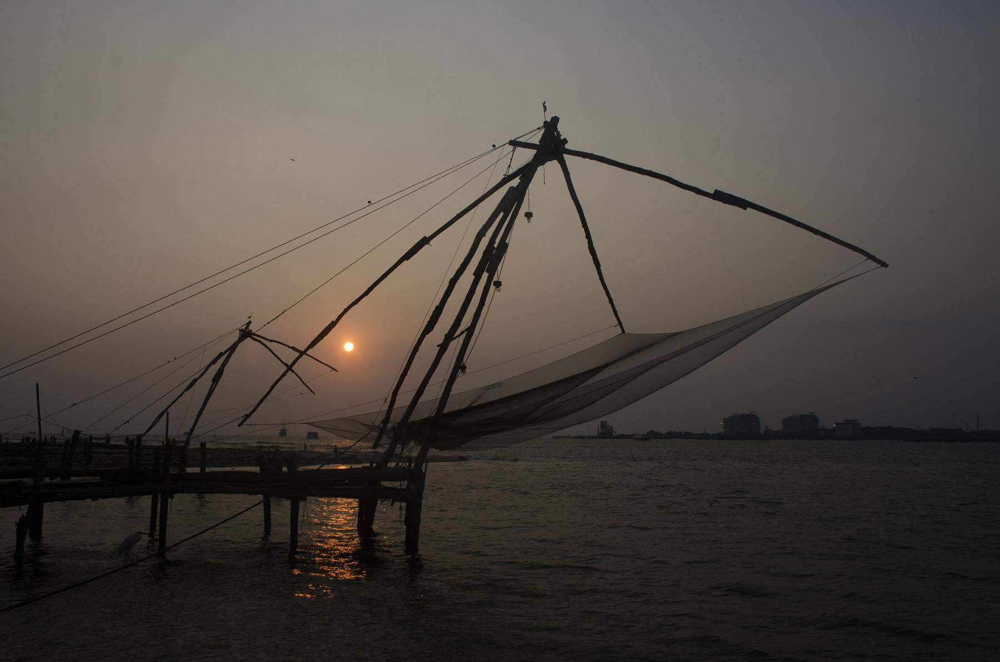
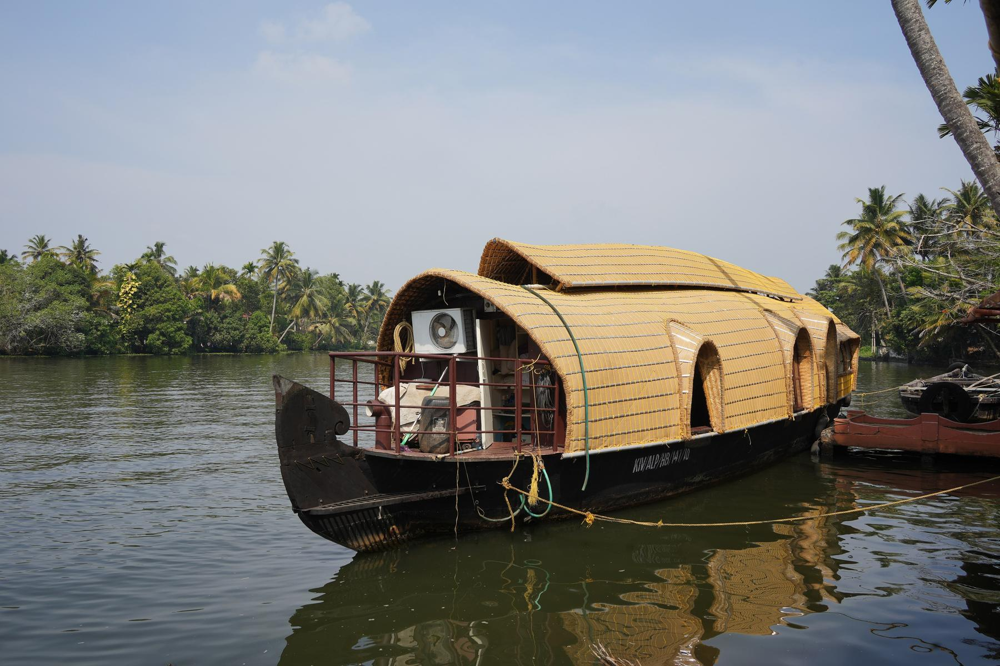
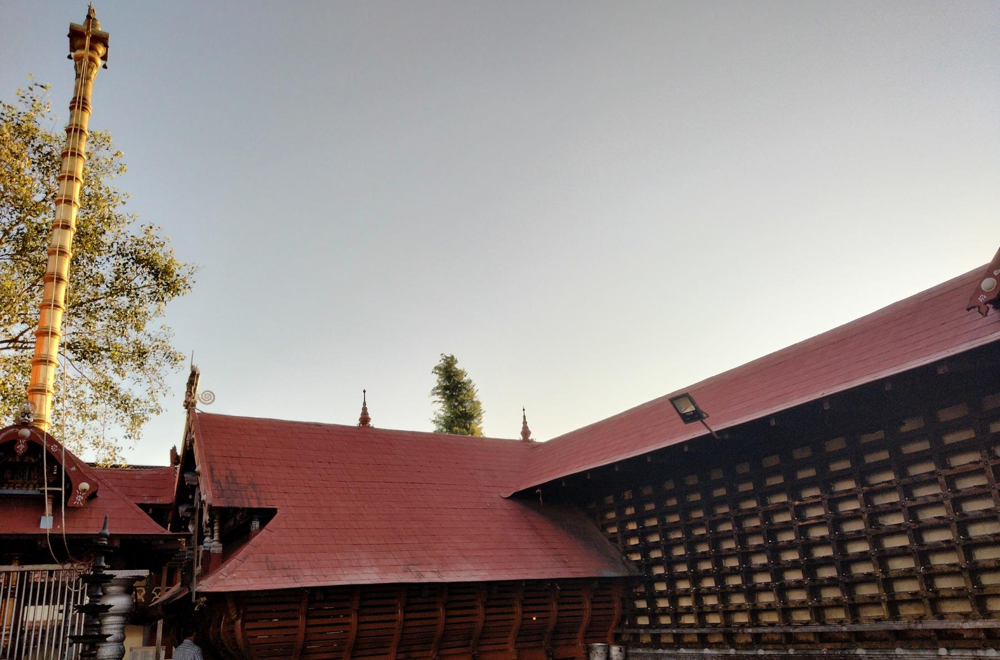
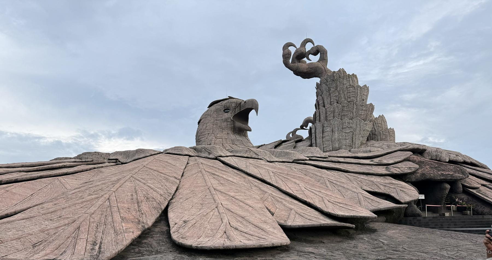
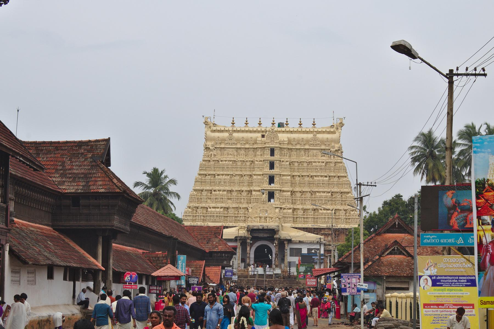

The overnight train from Bengaluru pulls into Ernakulam Town just after seven. By eight you are at Fort Kochi with a glass of sweet chai, watching four men haul up a Chinese fishing net the size of a house. They lean on a rope weighted with stones, the great wooden frame tips up out of the water, and the net comes up dripping with a few silver fish, a crab and a lot of weed. The men laugh, lower it again and wave you over to try.

That's the start of one of the best short road trips in South India: five days down Kerala's coast from Kochi to Thiruvananthapuram, with a night on the backwaters, a temple famous for its milk pudding, a sunset on the Varkala cliffs and the world's largest bird sculpture on a hilltop. It's about seven hours of driving in all, split into easy pieces, and it suits couples, families and friends looking for a long weekend with a day added on.

## At a glance

| | |
| --- | --- |
| Best time to go | October to March; the monsoon (June to September) is lush but rough at sea |
| Days you need | 5 days, plus an overnight train each way |
| Getting there | Overnight train or bus from Bengaluru to Ernakulam; home by train or flight from Thiruvananthapuram |
| Daily budget | ₹10,000 – ₹20,000 for two, including a car with driver |
| Language | Malayalam; English is widely spoken, and Hindi and Tamil are often understood |
| Currency | Indian rupee; UPI works almost everywhere |
| Good for | Backwaters, beaches, temples, seafood, couples, families, a long weekend |

## Why go

Most Bengaluru weekends in Kerala go to Munnar or Wayanad, in the hills. This route goes the other way, along the coast, where Kerala's history happened. Arab, Chinese, Jewish, Portuguese, Dutch and British traders all came here for pepper, and Fort Kochi still has their churches, warehouses and synagogue. Further south lie the backwaters, where people live along canals below sea level, and then a run of temples and beaches that ends at the gold-covered temple of the Travancore kings.

The distances are short, the roads are good, and every stop is different: a colonial port town, a lake, a temple town, a cliff above the sea, a hill with a giant bird on it, and a capital city. You also eat very well the whole way down.

*Chinese fishing nets at sunset, Fort Kochi. Photo: [Rangan Datta Wiki](https://commons.wikimedia.org/wiki/File:Sunset_with_Chinese_Fishing_Nets,_Fort_Kochi_1.jpg), CC BY-SA 4.0, via Wikimedia Commons*

## Getting there

**Train:** The Island Express (16526) leaves KSR Bengaluru at about 8 pm and reaches Ernakulam Town at 7:10 am, so you arrive ready for the day. A sleeper berth costs about ₹500, and an AC berth roughly ₹1,200–1,800; book on IRCTC as soon as bookings open, as it fills fast around long weekends. The day option is the Vande Bharat (26651), which leaves KSR Bengaluru at 5:10 am and reaches Ernakulam Junction at 1:50 pm, for about ₹1,650 in chair car.

**Bus or flight:** Kerala RTC and private sleeper buses leave Bengaluru every evening and reach Ernakulam in 10–11 hours, for about ₹1,200–2,500. Flights from Bengaluru to Kochi take about an hour, but Kochi airport is 45 minutes to an hour from Fort Kochi.

**Getting home:** The same Island Express runs the other way (16525), leaving Thiruvananthapuram Central at 12:40 pm and reaching Bengaluru early the next morning. That leaves time for a 6:30 am temple visit on your last day. Flights from Thiruvananthapuram to Bengaluru take about 1 hour 10 minutes, and the airport is 15 minutes from the temple.

## Getting around

- **Car with driver:** The easiest way to do this route. A sedan with a driver from Kochi costs roughly ₹10,000–14,000 for the four driving days, one way to Thiruvananthapuram, including fuel and the driver's daily allowance. Book through your Fort Kochi hotel or a local taxi service, and agree the stops and the price in writing.
- **Self-drive:** Self-drive rentals are available in Kochi, but one-way drop fees to Thiruvananthapuram add up. Kerala's roads are good but crowded, with buses that overtake on blind corners, so it's not a relaxing drive.
- **Train and bus:** On a budget, you can do almost all of it by train. Ernakulam, Alappuzha, Ambalappuzha, Varkala Sivagiri, Kollam and Thiruvananthapuram are all stations on the coastal line, and Kerala RTC buses cover the gaps. Jatayu Earth's Center is the hardest stop without a car.
- **Ferries:** In Kochi, the government ferry and the Kochi Water Metro both cross from Ernakulam to Fort Kochi in about 20 minutes, for a few tens of rupees. It's the nicest way to arrive.

The drive times on this route, without stops, are about 30 minutes from Ernakulam to Fort Kochi, 1.5 hours to Alappuzha, 25 minutes to Ambalappuzha, 2.5 hours to Varkala, 45 minutes to Jatayu and just over an hour into Thiruvananthapuram. There is one small toll of about ₹30 on the way.

## Where to stay

- **Fort Kochi:** stay inside the old town, where you can walk everywhere. [Tissa's Inn](aff:agoda/partners/partnersearch.aspx?pcs=1&hid=280902) is a small, much-loved heritage guesthouse (9.3 from 760+ reviews, around ₹10,100), and [Fort House](aff:agoda/partners/partnersearch.aspx?pcs=1&hid=625360) is a simple, good-value hotel on the waterfront (8.6 from 240+, around ₹5,700). [The Malabar House](aff:agoda/partners/partnersearch.aspx?pcs=1&hid=300818) is a boutique hotel in an 18th-century house (8.6 from 90, around ₹24,900). For the classic splurge, [Brunton Boatyard](aff:agoda/partners/partnersearch.aspx?pcs=1&hid=43752) is a rebuilt Victorian shipyard on the harbour (9.2 from 490+), and [Forte Kochi](aff:agoda/partners/partnersearch.aspx?pcs=1&hid=4899182) is a stylish hotel in a Portuguese-era building (9.3 from 230+); both were full on my date, so book early.
- **Alappuzha:** either a houseboat (see below) or a lakeside resort. [Malayalam Lake Resort](aff:agoda/partners/partnersearch.aspx?pcs=1&hid=1653575) is a family-run homestay of cottages on the water in Kuttanad, with home-cooked meals (8.7 from 720, around ₹2,300). [Sterling Lake Palace](aff:agoda/partners/partnersearch.aspx?pcs=1&hid=51331) is a large resort on the backwaters (8.4 from 1,700+, around ₹7,400), and [Lemon Tree Vembanad Lake Resort](aff:agoda/partners/partnersearch.aspx?pcs=1&hid=108955) sits on Vembanad lake with a pool (8.3 from 330, around ₹7,700).
- **Varkala:** stay on the North Cliff to walk to the cafés and the sunset. [Villa Jacaranda](aff:agoda/partners/partnersearch.aspx?pcs=1&hid=1212054) is a tiny, beautiful guesthouse in a garden near the cliff, the best-rated place in town (9.6 from 210+), but it was full on my date; book well ahead. [Gateway Varkala](aff:agoda/partners/partnersearch.aspx?pcs=1&hid=178019), run by Taj, is the full-service option with a big pool (8.4 from 560+), and [Elixir Cliff Beach Resort](aff:agoda/partners/partnersearch.aspx?pcs=1&hid=21916175) is right on the cliff (8.0 from 980); neither had rooms on my date either. [Hindustan Beach Retreat](aff:agoda/partners/partnersearch.aspx?pcs=1&hid=91907) is the reliable hotel on Papanasam beach itself (8.1 from 860+, around ₹5,200).
- **Thiruvananthapuram:** stay in the city centre, close to the temple. [Hyatt Regency Trivandrum](aff:agoda/partners/partnersearch.aspx?pcs=1&hid=51368964) is the smartest hotel in town (9.1 from 1,000+, around ₹11,800), [O by Tamara](aff:agoda/partners/partnersearch.aspx?pcs=1&hid=28295662) is a modern hotel with a rooftop pool (9.0 from 1,500+, around ₹9,800), and [Vivanta Thiruvananthapuram](aff:agoda/partners/partnersearch.aspx?pcs=1&hid=178020) is a calm Taj hotel (9.0 from 980, around ₹9,200). For less, [The Residency Tower](aff:agoda/partners/partnersearch.aspx?pcs=1&hid=300230) is a solid business hotel (8.7 from 470, around ₹5,200), and [KTDC Mascot Hotel](aff:agoda/partners/partnersearch.aspx?pcs=1&hid=111382) is a government-run heritage building with a pool (8.1 from 260+, around ₹5,100).

*Ratings are guest scores on Agoda. Prices are for two, per night before taxes, for weeknights in late January 2027, checked in November 2026. Christmas, New Year and long weekends cost more.*

## Top things to do

### Walk Fort Kochi and Mattancherry

Start at the Chinese fishing nets on the beach, then walk past St Francis Church, where Vasco da Gama was first buried in 1524, to the Santa Cruz Basilica. A short auto ride away, Mattancherry has the Dutch Palace, with some of the finest Ramayana murals in Kerala, and Jew Town, where the Paradesi Synagogue (1568) is lined with blue Chinese tiles. Both are usually closed on Fridays, and the synagogue on Saturdays too. If you'd rather be driven, a [private tuk-tuk tour with hotel pickup](aff:getyourguide/kochi-l743/kochi-private-tuk-tuk-city-tour-with-hotel-pickup-t392659/) covers it all in about four hours (4.8 from 340+ reviews on GetYourGuide, from about ₹1,200 for the group).

### See Kathakali up close

In the evening, watch a short Kathakali performance at the Kerala Kathakali Centre in Fort Kochi. Come an hour early to watch the actors put on their make-up: green faces, red eyes and paper frames built up layer by layer. The show itself, with drums and a singer, explains the gestures before telling a story from the epics. Tickets cost a few hundred rupees.

### A night on the Alleppey backwaters

Alappuzha's backwaters are a maze of canals, lakes and rice fields below sea level, with villages strung along the banks. The classic way to see them is an overnight houseboat: a converted rice barge with bedrooms, a deck and a cook who makes lunch, tea, dinner and breakfast on board. Boats leave around noon, cruise until about 5:30 pm (they must stop at night) and return by 9 am. Expect to pay roughly ₹9,000–16,000 for two, with all meals, on a weekday; agree the route, meals and AC hours before you pay, and book only through a licensed operator. If a night on the water feels like too much, a [three-hour shikara ride through the village canals](aff:getyourguide/alappuzha-l2626/alleppey-shikara-boat-ride-with-village-tour-canal-cruise-t890180/) goes where the big boats can't (4.6 from 120+, from about ₹1,750 per person).

*A houseboat at Nedumudy, near Alappuzha. Photo: [Ingo Mehling](https://commons.wikimedia.org/wiki/File:Nedumudy_-_Houseboat.jpg), CC BY-SA 4.0, via Wikimedia Commons*

### Palpayasam at Ambalappuzha

Twenty-five minutes south of Alappuzha, the Sree Krishna temple at Ambalappuzha is famous across Kerala for its palpayasam, a pink rice pudding slow-cooked in milk. The legend says Krishna, disguised as a sage, beat the local king at chess and asked for one grain of rice on the first square, two on the second and so on. When the king couldn't pay, Krishna let him settle the debt by serving payasam to pilgrims forever. The temple is open roughly 3 am to 12:30 pm and 5 to 8 pm, the payasam is given out around noon, and men remove their shirts to enter. The poet Kunchan Nambiar created the comic dance Ottamthullal while working here, and his drum is still kept in the temple.

*Ambalappuzha Sree Krishna temple. Photo: [Vijayanrajapuram](https://commons.wikimedia.org/wiki/File:Ambalappuzha_Sree_Krishna_Temple_01.jpg), CC BY-SA 4.0, via Wikimedia Commons*

### Sunset on the Varkala cliff

Varkala is the only place on the Kerala coast where red laterite cliffs drop straight into the Arabian Sea, and the cliffs are protected as a national geological monument. A path runs along the top of the North Cliff past cafés, bookshops and yoga studios, and everyone gathers on it at sunset. Below, Papanasam beach is where Hindus come to perform rituals for their ancestors; the Janardhana Swamy temple, said to be some 2,000 years old, stands on the hill above. Swim only between the lifeguard flags; the currents here are strong.

### Jatayu Earth's Center

On a rocky hilltop at Chadayamangalam stands the world's largest bird sculpture: Jatayu, the vulture king of the Ramayana, who fell here after fighting Ravana to save Sita. The sculpture, by the filmmaker and artist Rajiv Anchal, is about 200 feet long and 70 feet high, with a small museum inside. A cable car takes you up through the rocks in a few minutes, and the views over the green hills are wonderful. A ticket with the cable car costs about ₹500–600 per person. Go in the morning or late afternoon, and check that it's open before you drive out: the cable car stops in heavy rain and wind, and the adventure activities have been closed at times.

*The Jatayu sculpture. Photo: [డా. గన్నవరపు నరసింహమూర్తి](https://commons.wikimedia.org/wiki/File:Jatayu_sculpture.jpg), CC0, via Wikimedia Commons*

### Sree Padmanabhaswamy temple

The temple that gave Thiruvananthapuram its name ("the city of Lord Anantha") is one of the 108 sacred Vishnu temples. Inside, an 18-foot image of Vishnu reclining on the serpent Anantha is seen through three doors: face, navel and feet. In 2011, court-ordered checks of its vaults found gold and jewels worth well over a lakh crore rupees, which made it one of the richest temples in the world. Entry is for Hindus only, with a strict dress code: men in a mundu or dhoti with no shirt, women in a saree or a long skirt and blouse (you can rent them outside). Phones and cameras aren't allowed; deposit them at the counter. Morning darshan slots are around 6:30–7 am and 8:30–10 am. Anyone can admire the seven-tier gopuram and the temple tank from outside.

*The gopuram of Sree Padmanabhaswamy temple. Photo: [Shishirdasika](https://commons.wikimedia.org/wiki/File:Padmanabhaswamy_Temple_Gopuram.jpg), CC BY-SA 4.0, via Wikimedia Commons*

## Off the beaten path

### Kuthiramalika Palace

Right beside the Padmanabhaswamy temple, this 19th-century palace built by the musician-king Swathi Thirunal has 122 carved wooden horses holding up its eaves, which give it its name. Part of it is a small museum of royal treasures, and a classical music festival is held in its courtyard every January.

### Kappil and Ponnumthuruthu

Ten minutes north of Varkala, Kappil is where a backwater lake meets the sea, with a quiet beach on one side and calm water on the other. South of Varkala, a country boat takes you across Anchuthengu lake to Ponnumthuruthu, the "golden island", with a small temple in a coconut grove.

### Sivagiri Mutt

On a hill just outside Varkala is the samadhi of Sree Narayana Guru, the social reformer who challenged caste in Kerala around 1900 with the words "one caste, one religion, one god for man". It's a peaceful place, and thousands of pilgrims in yellow come for the Sivagiri pilgrimage at the end of December.

### Marari beach

If you want a quieter beach on the way down, Marari, 15 minutes north of Alappuzha, is a fishing beach with almost no shacks, where fishermen pull their boats up on the sand in the morning.

## Things you probably didn't know

- **The Travancore kings ruled as the god's servants.** In 1750, King Marthanda Varma dedicated his kingdom to Padmanabhaswamy and ruled as *Padmanabhadasa*, the servant of the lord.
- **Fort Kochi's fishing nets may be 600 years old.** They are thought to have come with traders from the court of Kublai Khan or with the Chinese explorer Zheng He; nobody knows for sure.
- **Kuttanad farms below sea level.** The rice fields near Alappuzha lie up to two metres below sea level, one of very few places in the world where farmers do this.
- **The chess story is a famous maths puzzle.** Doubling the rice on all 64 squares of a chessboard adds up to more rice than the world has ever grown.
- **Kerala had India's first communist government by vote.** In 1957, Kerala elected E. M. S. Namboodiripad, one of the first elected communist governments in the world.
- **Varkala gave its name to a rock formation.** The cliffs expose layers of sedimentary rock millions of years old, so distinctive that geologists call them the Warkalli Formation. Fresh water also seeps out of the cliff face in small springs.

## What to eat

- **Appam and stew:** lacy rice pancakes with a mild coconut-milk stew of vegetables, chicken or mutton, the classic Kochi breakfast.
- **Karimeen pollichathu:** pearl-spot fish from the backwaters, marinated in spices and roasted in banana leaf. Order it in Alappuzha.
- **Kerala meals:** red rice on a banana leaf with sambar, avial, thoran, pachadi, pickle and payasam, for ₹150–250 at a local "hotel".
- **Puttu and kadala:** steamed rice-flour cylinders with black chickpea curry.
- **Kappa and fish curry:** tapioca with fiery red fish curry, from the toddy shops of the backwaters (most serve families too).
- **Palpayasam and banana chips:** take a tin of Ambalappuzha payasam if the temple sells it that day, and a bag of fresh banana chips fried in coconut oil.

## A suggested itinerary

### Day 1: Fort Kochi

- Morning: Arrive at Ernakulam Town on the overnight train, then take a taxi or the ferry to Fort Kochi; breakfast near the fishing nets.
- Afternoon: Mattancherry Palace, Jew Town and the spice warehouses.
- Evening: Kathakali make-up and show, then seafood near the beach.

### Day 2: To the backwaters

- Morning: A last walk around Fort Kochi, then drive to Alappuzha (about 1.5 hours).
- Afternoon: Board your houseboat at noon and cruise the backwaters, or take a shikara ride from your lake resort.
- Evening: Sunset on the lake and dinner on board.

### Day 3: Ambalappuzha and on to Varkala

- Morning: Off the houseboat by 9 am, then drive 25 minutes to Ambalappuzha for darshan and the payasam at noon.
- Afternoon: Drive to Varkala (about 2.5 hours).
- Evening: Sunset from the North Cliff and dinner at a cliff café.

### Day 4: Varkala and Jatayu

- Morning: A swim at Papanasam beach and the Janardhana Swamy temple, or Kappil beach.
- Afternoon: Drive to Jatayu Earth's Center (about 45 minutes) and take the cable car up.
- Evening: Drive on to Thiruvananthapuram (just over an hour).

### Day 5: Thiruvananthapuram and home

- Morning: Padmanabhaswamy temple at 6:30 am, then Kuthiramalika Palace.
- Afternoon: Board the 12:40 pm Island Express home, or catch a flight to Bengaluru.
- Evening: Back in Bengaluru by night if you fly, or at dawn on the train.

## What it costs

| Item | Budget | Mid-range |
| --- | --- | --- |
| Stay (per night, for two) | ₹4,500 | ₹10,000 |
| Food (per day, for two) | ₹1,500 | ₹3,000 |
| Car with driver (per day) | ₹3,000 | ₹3,500 |
| Entry fees and activities (per day, for two) | ₹1,000 | ₹3,500 |
| **Total per day** | **₹10,000** | **₹20,000** |

On top of this, budget about ₹500–1,800 per person each way for the train, or ₹3,500–7,000 for a flight home from Thiruvananthapuram. The houseboat night (₹9,000–16,000 for two, with all meals) replaces a hotel night and that day's food. Temples are free, Jatayu is about ₹500–600 each, and Kathakali a few hundred rupees. Eat at local hotels and toddy shops to keep the food budget low; Fort Kochi and Varkala cafés charge city prices.

## Good to know

- **Dress for temples.** Kerala's big temples are strict. Men remove their shirts and wear a mundu; women wear a saree or traditional dress. Carry a mundu, or rent one at the gate.
- **Check opening days.** Mattancherry Palace and the Paradesi Synagogue usually close on Fridays, the synagogue on Saturdays as well, and some Thiruvananthapuram museums on Mondays.
- **Book the Island Express early.** It's popular with Malayalis travelling home; book as soon as IRCTC opens bookings for your date.
- **Respect the sea at Varkala.** Rip currents are strong, especially from May to September. Swim only where lifeguards are on duty.
- **Alcohol is tightly controlled.** Kerala sells alcohol only at licensed bars, beer-and-wine parlours and government outlets, and some days are dry; ask your hotel.
- **Agree the houseboat details in writing.** Confirm the route, meals, AC hours and number of bedrooms before you pay, and check that the boat is licensed.
- **Carry some cash.** UPI works almost everywhere, but small temples, boatmen and roadside stalls sometimes prefer cash.

## Final word

Five days from Bengaluru gets you a slice of everything Kerala does well: Fort Kochi's old trading port, a slow day on the backwaters, payasam at Ambalappuzha, a sunset on the Varkala cliffs, a giant bird on a hilltop and the gold of Padmanabhaswamy at dawn. Book the train early, hire a good driver, pack a mundu, and leave room in your bag for banana chips.

*Cover: the North Cliff and beach at Varkala at dusk. Photo: [Krissubh](https://commons.wikimedia.org/wiki/File:Varkala_Cliff_by_KS.jpg), CC BY-SA 4.0, via Wikimedia Commons.*
