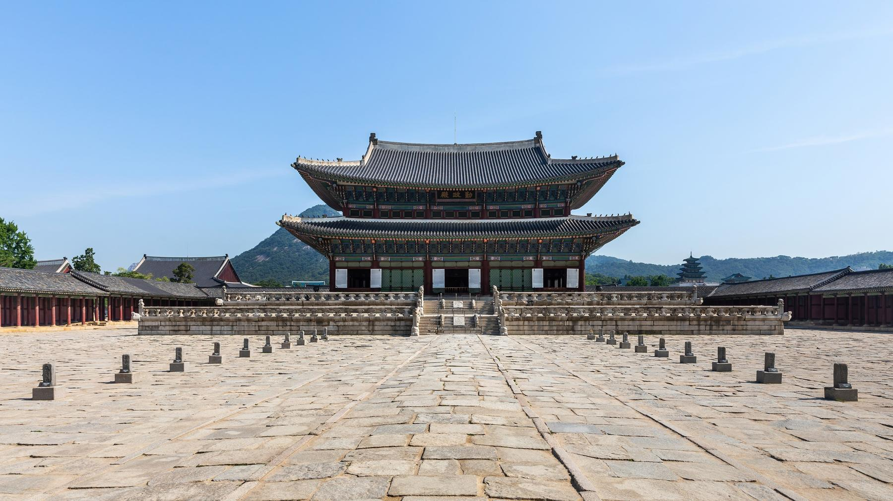
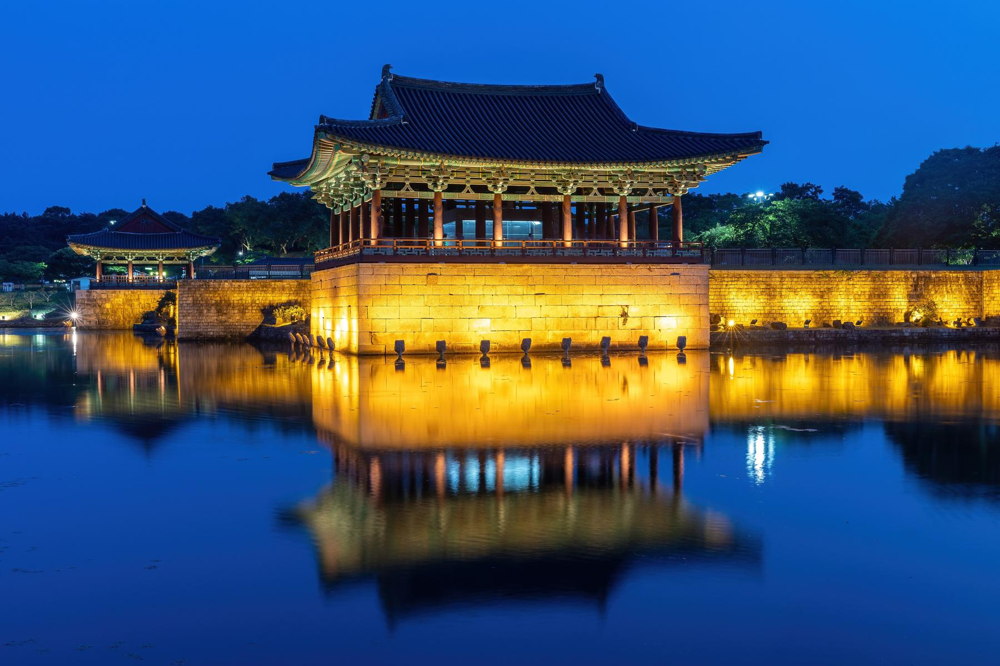
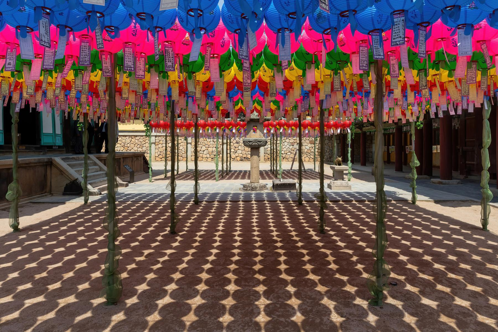
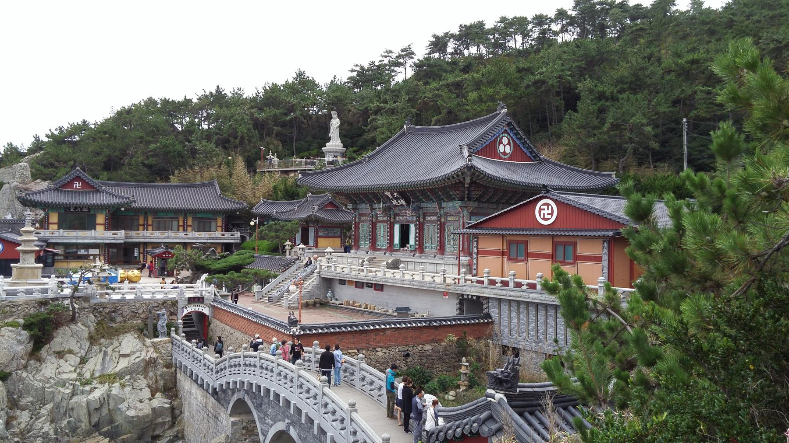
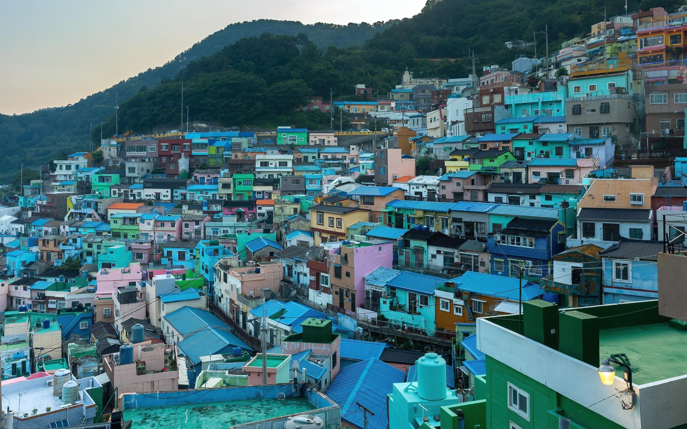
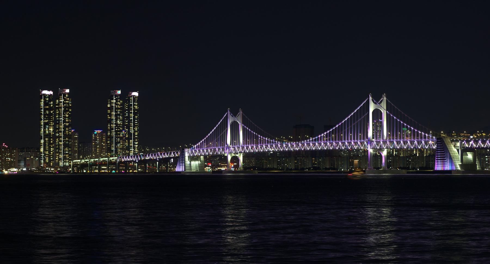

It's ten in the morning at Gyeongbokgung, and the gatekeepers are changing. Drums boom, a line of guards in red and blue silk robes marches across the stone courtyard, and the man in charge reads out the password of the day. Half the crowd watching is dressed for the occasion, in rented hanbok of pink, mint and gold, because in Korea you get into the palace free if you wear one. Twenty minutes' walk away, past the hanok lanes of Bukchon, a sixty-storey city goes about its Monday.

That's South Korea in one scene: very old and very new, side by side, and astonishingly easy for a first-timer to get around. This eight-day route from Bengaluru covers Seoul, the old Silla capital of Gyeongju and the port city of Busan, linked by fast trains. It suits couples, friends, K-drama fans and families with older kids, and it's planned for the cherry blossoms of early April, though autumn works just as well.

## At a glance

| | |
| --- | --- |
| Best time to go | Late March to May and late September to mid-November; cherry blossoms in early April |
| Days you need | 8 days on the ground, plus an overnight flight |
| Getting there | One-stop flights from Bengaluru via Singapore, Bangkok, Hong Kong, Hanoi or Delhi |
| Daily budget | ₹13,000 – ₹32,000 for two (about $140 – $350) |
| Language | Korean; English signs on trains and the metro, but little spoken English outside hotels |
| Currency | South Korean won (₩); ₩1,000 is about ₹69 |
| Good for | Palaces, temples, street food, shopping, K-culture, cherry blossoms, autumn colours |

## Why go

Few countries put this much variety within two and a half hours by train. In Seoul you can stand in a 600-year-old royal palace in the morning and in a neon-lit food market at night, with a day trip to the most heavily guarded border on Earth in between. Gyeongju was the capital of the Silla kingdom for nearly a thousand years, and its royal tombs rise like green hills in the middle of town. Busan wraps a big city around beaches, fishing harbours and a temple built on the rocks above the sea.

For Indian travellers there is an unexpected bond too. Korea's oldest history book tells of a princess from a faraway land called Ayuta, which many identify with Ayodhya, who sailed to Korea and married a king in 48 AD. Millions of Koreans named Kim and Heo trace their family back to her, and some of them visit Ayodhya every year.

*Geunjeongjeon, the throne hall of Gyeongbokgung. Photo: [Basile Morin](https://commons.wikimedia.org/wiki/File:Front_view_of_the_Imperial_Throne_Hall_Geunjeongjeon_at_Gyeongbokgung_Palace_with_blue_sky_in_Seoul.jpg), CC BY-SA 4.0, via Wikimedia Commons*

## Getting there

**Flights:** There are no nonstop flights from Bengaluru to Seoul. The smoothest one-stop routes are Singapore Airlines via Singapore (an overnight flight from Bengaluru, then about six hours to Seoul), Thai via Bangkok and Cathay Pacific via Hong Kong. VietJet and Vietnam Airlines via Hanoi or Ho Chi Minh City are usually the cheapest, and Air India connects through Delhi, which has nonstop flights to Seoul. Expect about ₹45,000–75,000 return in economy, more in cherry-blossom season and in October, so book two to three months ahead. Fly into Seoul (Incheon, ICN) and, if the fare works, home from Busan (Gimhae, PUS): Singapore Airlines flies to both, which saves you a 2.5-hour train ride back to Seoul on your last day.

**Time difference:** Korea is 3 hours 30 minutes ahead of India.

**Visa:** Indian passport holders need a visa before they fly; there is no visa on arrival and no e-visa for ordinary tourists, and the K-ETA doesn't apply to Indians. Apply for a C-3-9 short-term visit visa through the Korea Visa Application Centre for your area. The single-entry visa fee went up to ₹3,600 from 1 August 2026, plus a service charge of roughly ₹1,100–1,400, and it usually takes about two weeks. Expect to show six months of bank statements, income tax returns, a leave letter from your employer, your flight and hotel bookings and a day-by-day plan. Each consulate's checklist is slightly different, so check the latest one on the Korean embassy's India website before you apply, and apply about six weeks before you fly.

**Before you land:** Since 1 January 2026, every foreign visitor must fill in Korea's free online e-Arrival Card in the 72 hours before arrival, on the official site e-arrivalcard.go.kr. Keep the confirmation on your phone, and ignore look-alike sites that charge a fee.

**From Incheon airport:** The AREX airport railway's express train reaches Seoul Station in about 45 minutes for about ₩11,000, and the all-stop train takes an hour for less than half that. From Seoul Station, the metro gets you to Myeongdong or Jongno in minutes.

## Getting around

- **Metro and buses:** Seoul and Busan have excellent metros, with signs and announcements in English. Buy a T-money card (about ₩3,000 at any convenience store or station machine, plus credit) and tap it on the metro, buses and many taxis in every city on this route. A metro ride in Seoul starts at ₩1,550.
- **KTX trains:** Korea's bullet trains link Seoul to Gyeongju in about 2 hours 10 minutes and Busan in about 2.5 hours. Gyeongju's KTX station (called Singyeongju until 2023, and still on some maps under that name) is about 20 minutes from town by bus or taxi. Seoul to Gyeongju costs roughly ₩45,000–50,000 (₹3,100–3,500) one way, and Gyeongju to Busan about ₩11,000. Book on the Korail website or app a week or two ahead in cherry-blossom season; foreign cards work. A Korail Pass rarely saves money on a route this simple.
- **Taxis:** Taxis are cheap by world standards and safe. Use the Kakao T app to call one; you can register a foreign card, or pay the driver by card or T-money.
- **Maps:** Google Maps doesn't give walking or driving directions in Korea. Download Naver Map or KakaoMap before you go (both have English), and Papago for translation.
- **Your phone:** Set up a Korean eSIM before you fly, or pick up a tourist SIM at Incheon. Indian roaming packs work but cost more over eight days.

## Where to stay

- **Seoul:** stay in Myeongdong or Jongno, between the palaces, the markets and the airport train. [Hotel 28 Myeongdong](aff:agoda/partners/partnersearch.aspx?pcs=1&hid=1265917) is a stylish small hotel with very good service (9.3 from 7,100+ reviews, around ₹26,600). [L7 Myeongdong by Lotte](aff:agoda/partners/partnersearch.aspx?pcs=1&hid=1061346) is modern and a minute from the street-food stalls (8.9 from 15,200+, around ₹27,000), and [Nine Tree by Parnas Insadong](aff:agoda/partners/partnersearch.aspx?pcs=1&hid=9119187) is walkable to Gyeongbokgung and Bukchon (8.9 from 27,100+, around ₹21,600). For less, [ibis Styles Ambassador Myeongdong](aff:agoda/partners/partnersearch.aspx?pcs=1&hid=798582) is a reliable chain hotel (8.2 from 6,800+, around ₹15,800), and [K-Grand Hotel Myeongdong](aff:agoda/partners/partnersearch.aspx?pcs=1&hid=1164282) has small, simple rooms in the same area (7.8 from 3,200+, around ₹7,100).
- **Gyeongju:** sleep in a hanok, a traditional house, at least once. [Gyeongju Hwangnamgwan Hanok Hotel](aff:agoda/partners/partnersearch.aspx?pcs=1&hid=570232) is right by the royal tombs and Hwangnidan-gil (8.5 from 3,600+, around ₹8,300), with rooms where you sleep on heated floor mattresses. By Bomun Lake, 15 minutes out, [Lahan Select Gyeongju](aff:agoda/partners/partnersearch.aspx?pcs=1&hid=256174) is a modern lakeside hotel under the cherry trees (8.7 from 7,400+, around ₹15,500), and [Hilton Gyeongju](aff:agoda/partners/partnersearch.aspx?pcs=1&hid=65486) is the splurge (8.7 from 5,800+, around ₹27,600). [The K Hotel Gyeongju](aff:agoda/partners/partnersearch.aspx?pcs=1&hid=296905) is the cheaper Bomun option (8.1 from 5,100+, around ₹10,400).
- **Busan:** stay in Haeundae for the beach and the east-coast sights. [Toyoko Inn Busan Haeundae 2](aff:agoda/partners/partnersearch.aspx?pcs=1&hid=4592179) is the best value, two minutes from the sand, with free breakfast (8.8 from 13,400+, around ₹5,400). [Shilla Stay Haeundae](aff:agoda/partners/partnersearch.aspx?pcs=1&hid=1974844) is a comfortable mid-range pick (8.7 from 21,200+, around ₹12,000), and [Grand Josun Busan](aff:agoda/partners/partnersearch.aspx?pcs=1&hid=16933389) sits right on the beachfront (9.1 from 11,400+, around ₹20,800). For a treat, [Signiel Busan](aff:agoda/partners/partnersearch.aspx?pcs=1&hid=13870752) fills the top of one of Korea's tallest towers (9.2 from 8,300+, around ₹28,100). On a tight budget, [Kimchee Busan Downtown Guesthouse](aff:agoda/partners/partnersearch.aspx?pcs=1&hid=1270975) has simple private rooms (8.3 from 3,200+, around ₹2,200).

*Ratings are guest scores on Agoda. Prices are for two, per night before taxes, for early April 2027 (cherry-blossom season), checked in November 2026. Late April, May and autumn are often cheaper.*

## Top things to do

### Wear a hanbok to Gyeongbokgung

Gyeongbokgung, the main palace of the Joseon kings, was built in 1395, burnt down more than once and rebuilt. Entry is ₩3,000, or free if you're wearing a hanbok, and the rental shops around Gyeongbokgung Station make that easy. [Daehan Hanbok's rental with palace entry](aff:getyourguide/seoul-l197/seoul-hanbok-rental-with-gyeongbokgung-palace-entry-t568307/) is next to the station (4.6 from 1,000+ reviews on GetYourGuide, from $8, about ₹750). Arrive by 10 am for the changing of the guard at the main gate, then walk on to the pond pavilion of Gyeonghoeru. The palace is closed on Tuesdays.

### Walk Bukchon and Insadong

Between Gyeongbokgung and Changdeokgung, the lanes of Bukchon are lined with hundreds of hanok, tiled-roof houses that are still people's homes. Keep your voice down, and go in the daytime: parts of the village are closed to visitors in the evening, and fines apply. Walk downhill to Insadong for tea houses, calligraphy brushes and paper crafts, and to Jogyesa, the city's main Buddhist temple, which is hung with thousands of lanterns in spring.

### Visit the DMZ

The demilitarised zone between the two Koreas is an hour north of Seoul, and it's an unforgettable, sobering day. You walk down into the Third Tunnel, dug by North Korea under the border and found in 1978, look across into the North from an observatory, and stand at Imjingak, where families separated by the war leave messages on the fence. You can only visit on a tour, and you need your passport. The [DMZ tour with a North Korean defector Q&A](aff:getyourguide/seoul-l197/seoul-dmz-3rd-tunnel-and-optional-suspension-bridge-tour-t430077/) is the most popular (4.9 from 23,800+, from $50, about ₹4,600). On Mondays, some tours visit a different tunnel.

### Eat your way through Seoul's markets

Gwangjang Market, open since 1905, is Seoul's great food hall: rows of stalls frying mung-bean pancakes, rolling bite-size mayak kimbap and ladling out knife-cut noodles. Sit at the counter and point. In the evening, Myeongdong's street-food carts sell egg bread, tornado potatoes and sweet hotteok, and the Hongdae area fills with buskers and dance crews.

### See Seoul from Namsan

N Seoul Tower sits on Namsan, the mountain in the middle of the city. Walk up the forest paths from Myeongdong in about 40 minutes, or take the cable car, and stay for the lights coming on across a city of ten million. The walk and the views from the base are free; the observatory costs extra.

### Explore Silla's capital in Gyeongju

For almost a thousand years, until 935 AD, Gyeongju was the capital of the Silla kingdom, and the whole town is a UNESCO site. In Daereungwon, 23 royal burial mounds rise like grassy hills; inside Cheonmachong, the one tomb you can enter, they found a gold crown and a painting of a flying horse. Nearby stands Cheomseongdae, a 7th-century stone tower thought to be the oldest surviving observatory in East Asia. In the evening, walk to Donggung Palace and Wolji Pond (₩3,000), where the restored pavilions are lit up and reflected in the water.

*Donggung Palace and Wolji Pond at dusk. Photo: [Basile Morin](https://commons.wikimedia.org/wiki/File:Water_reflection_of_Donggung_Palace_in_Wolji_Pond_at_blue_hour_in_Gyeongju_South_Korea.jpg), CC BY-SA 4.0, via Wikimedia Commons*

### Bulguksa and Seokguram

On the slopes of Mount Toham, Bulguksa is the most famous temple in Korea, a 1,250-year-old complex of stone staircases, bridges and painted halls. A shuttle bus or a steep path leads up to Seokguram, a small artificial cave where a granite Buddha has looked out towards the East Sea since the 8th century. Both are UNESCO World Heritage Sites, and entry to both has been free since 2023. City buses run from Gyeongju town in about 40 minutes; go early, before the tour groups.

*Lanterns in a courtyard at Bulguksa. Photo: [Basile Morin](https://commons.wikimedia.org/wiki/File:Courtyard_of_colorful_paper_lanterns_and_shadow_patterns_at_Bulguksa_temple_Gyeongju_South_Korea.jpg), CC BY-SA 4.0, via Wikimedia Commons*

### Haedong Yonggungsa, Busan's temple by the sea

Most Korean temples hide in the mountains. Haedong Yonggungsa, first built in 1376, sits on the rocks right above the waves on Busan's east coast. Walk down the 108 steps past stone lanterns, cross the bridge and watch the surf break below the main hall. Entry is free. It's about 30 minutes by bus or taxi from Haeundae; go at opening to beat the crowds.

*Haedong Yonggungsa. Photo: [Christian Bolz](https://commons.wikimedia.org/wiki/File:Haedong_Yonggungsa_Temple_near_Busan.jpg), CC BY-SA 4.0, via Wikimedia Commons*

### Gamcheon, Jagalchi and the old port

Gamcheon Culture Village climbs a hillside in pastel blocks, built by refugees during the Korean War and brightened by artists since 2009. Pick up a stamp map at the information centre and wander the alleys. Then head down to Jagalchi, Korea's biggest fish market, where the ajummas (market aunties) sell octopus, crabs and fish you've never seen. Buy upstairs and they'll cook it for you, or stick to the snacks: fishcakes, and the seed-filled ssiat hotteok pancakes of BIFF Square next door. If you'd rather see Busan in one guided day, the [one-day tour of Busan's top sights](aff:getyourguide/busan-l32281/busan-top-attractions-authentic-one-day-guided-tour-t858010/) covers Gamcheon, Jagalchi and Haedong Yonggungsa with transport (4.9 from 3,000+, from $51, about ₹4,700).

*Gamcheon Culture Village. Photo: [Basile Morin](https://commons.wikimedia.org/wiki/File:Colorful_houses_in_Gamcheon_Culture_Village_at_sunset_in_Busan_South_Korea.jpg), CC BY-SA 4.0, via Wikimedia Commons*

### Haeundae and Gwangalli by night

Haeundae is Busan's big city beach, with the Blueline Park coastal railway running along the cliffs to the fishing village of Cheongsapo; the tiny "sky capsule" cars sell out, so book online a few days ahead. After dark, go to Gwangalli beach for the view of the Gwangan Bridge lit up across the bay. On most Saturday nights there is a drone light show over the water.

*The Gwangan Bridge at night. Photo: [Jeena Paradies](https://commons.wikimedia.org/wiki/File:Gwangan_Bridge_seen_Marine_City_at_Night_01.jpg), public domain, via Wikimedia Commons*

## Off the beaten path

### Changdeokgung's Secret Garden

Seoul's prettiest palace hides a royal garden of ponds, pavilions and 300-year-old trees behind it. You can only enter the Huwon (Secret Garden) on a guided walk, with English tours a few times a day; book on the palace website, as spring places go fast. The palace is closed on Mondays.

### Ikseon-dong

A pocket of 1920s hanok near Jongno 3-ga, now full of tiny cafés, bakeries and restaurants in the old houses. It's at its best for a late breakfast on a weekday, before the queues.

### Yangdong Folk Village

Forty minutes north of Gyeongju, this is a real village of about 150 traditional houses, some over 500 years old, where descendants of two clans still live. It's a UNESCO site, much quieter than the hanok villages of Seoul, and worth an extra morning if you have one.

### Huinnyeoul Culture Village, Yeongdo

On Yeongdo island in Busan, a row of white houses clings to the cliff above the sea, with a coastal path below. It's a short bus ride from Nampo-dong and a calmer alternative to Gamcheon for the same kind of view.

## Things you probably didn't know

- **A Korean royal line traces back to "Ayodhya".** The Samguk Yusa, written in the 13th century, says Princess Heo Hwang-ok sailed from Ayuta to marry King Suro of Gaya in 48 AD. A memorial park to her in Ayodhya was built with Korean help.
- **The Korean alphabet was invented on purpose.** King Sejong and his scholars created Hangul in the 1440s so ordinary people could learn to read. Most visitors can learn its 24 basic letters on the flight.
- **Gyeongju was once one of the biggest cities in the world.** At its peak in the 8th century, the Silla capital is thought to have had close to a million people.
- **Koreans dropped the "Korean age" in 2023.** Until then, everyone was one year old at birth and aged a year every 1 January. A law change made the international age system official.
- **The Third Tunnel was built to move an army.** It's about 1.6 km long and two metres high, wide enough for thousands of soldiers an hour, and it ends less than an hour's drive from Seoul.
- **Cherry blossoms move up the country.** They open in Busan and Gyeongju in late March and reach Seoul in early April, so a south-to-north route can catch them twice.

## What to eat

- **Bibimbap:** rice topped with seasoned vegetables, egg and gochujang chilli paste, stirred together in a hot stone bowl. It's easy to order without meat.
- **Korean barbecue:** pork belly (samgyeopsal) or marinated beef (bulgogi) grilled at your table and wrapped in lettuce with garlic, kimchi and sauce.
- **Kimbap and tteokbokki:** seaweed rice rolls and chewy rice cakes in a sweet-spicy sauce, the snacks of every market and convenience store.
- **Dwaeji gukbap:** Busan's pork and rice soup, eaten with chives and a little salted shrimp.
- **Hotteok and Gyeongju bread:** sweet filled pancakes from street carts, and Gyeongju's little red-bean pastries stamped with a flower, sold all over town.
- **For vegetarians:** Korea isn't easy. Fish sauce, anchovy stock and dried shrimp go into soups, kimchi and many "vegetable" dishes. Learn the word *chaesik* (vegetarian), carry a translation card saying no meat, fish or seafood, and look for temple-food restaurants (*sachal eumsik*), which are fully plant-based. Itaewon and the areas around Myeongdong and Dongdaemun have plenty of Indian restaurants when you need dal and roti.

## A suggested itinerary

### Day 1: Arrive in Seoul

- Morning: Land at Incheon after the overnight flight via your connecting hub.
- Afternoon: AREX train into the city and check in to your hotel in Myeongdong or Jongno.
- Evening: Street food in Myeongdong, and an early night.

### Day 2: Palaces and hanok

- Morning: Rent a hanbok and see the changing of the guard at Gyeongbokgung at 10 am.
- Afternoon: Bukchon's hanok lanes, then tea in Insadong and the lanterns at Jogyesa.
- Evening: Dinner at Gwangjang Market and a walk along the Cheonggyecheon stream.

### Day 3: The DMZ

- Morning: DMZ tour, with the Third Tunnel and the observatory.
- Afternoon: Back in Seoul by mid-afternoon; rest.
- Evening: Walk or ride up Namsan to N Seoul Tower for the city lights.

### Day 4: Seoul at your own pace

- Morning: Changdeokgung and the Secret Garden.
- Afternoon: Brunch in Ikseon-dong, then cherry blossoms at Seokchon Lake or Yeouido.
- Evening: Hongdae for buskers, shopping and Korean barbecue.

### Day 5: To Gyeongju

- Morning: KTX to Gyeongju (about 2 hours), then bus or taxi into town.
- Afternoon: Daereungwon's royal tombs, Cheonmachong and Cheomseongdae.
- Evening: Donggung Palace and Wolji Pond lit up, and a night in a hanok.

### Day 6: Bulguksa and on to Busan

- Morning: Bulguksa and Seokguram, early.
- Afternoon: Train or bus to Busan (about 1 hour) and check in at Haeundae.
- Evening: Dinner and a walk on Haeundae beach.

### Day 7: Busan's east coast

- Morning: Haedong Yonggungsa at opening.
- Afternoon: The Blueline Park sky capsule along the cliffs to Cheongsapo.
- Evening: Gwangalli beach and the lit-up Gwangan Bridge.

### Day 8: Old Busan and home

- Morning: Gamcheon Culture Village.
- Afternoon: Jagalchi fish market and ssiat hotteok in BIFF Square.
- Evening: Fly home from Gimhae, or take the KTX back to Seoul for an Incheon flight.

## What it costs

| Item | Budget | Mid-range |
| --- | --- | --- |
| Stay (per night, for two) | ₹6,500 | ₹18,000 |
| Food (per day, for two) | ₹3,500 | ₹7,000 |
| Local transport (per day, for two) | ₹1,000 | ₹2,000 |
| Entry fees and tours (per day, for two) | ₹2,000 | ₹5,000 |
| **Total per day** | **₹13,000** | **₹32,000** |

On top of this, budget about ₹45,000–75,000 per person for return flights, about ₹5,000 per person for the visa with the service charge, and about ₹4,000 per person for the KTX from Seoul to Gyeongju and on to Busan (plus about ₹3,700 if you take the train back to Seoul). A market or casual-restaurant meal costs ₩9,000–15,000 (₹600–1,000), while barbecue for two with drinks runs ₩50,000–70,000. Many palaces and temples cost ₩3,000 or nothing at all, so the DMZ tour is the only big entry cost. Use a forex card or a credit card with a low foreign-exchange markup: cards work almost everywhere in Korea, even in many market stalls.

## Good to know

- **Your Indian plugs fit.** Korea uses 220V and round two-pin sockets (types C and F), so Indian two-pin chargers work without an adapter. Three-pin plugs need one.
- **Check opening days.** Gyeongbokgung is closed on Tuesdays and Changdeokgung on Mondays. Many museums close on Mondays too.
- **No tipping.** Tipping isn't expected in restaurants or taxis, and prices include tax.
- **Claim your tax refund.** Shops marked "Tax Free" give a refund on purchases above ₩15,000; many do it at the till with your passport, and the rest at Incheon or Gimhae airport.
- **Mind the etiquette.** Don't stick chopsticks upright in rice, pour drinks for others rather than yourself, and give up the priority seats on the metro, even when they're empty.
- **Carry some cash anyway.** Cards work almost everywhere, but a few market stalls, rural buses and temple donation boxes prefer cash. "Global ATM" machines in convenience stores take foreign cards.
- **Pack for the season.** Early April is 6–17°C in Seoul and a little warmer in Busan, with chilly evenings, so bring a jacket and layers.
- **Learn a few words.** *Annyeonghaseyo* (hello), *gamsahamnida* (thank you) and *igeo juseyo* (this one, please) go a long way.

## Final word

Eight days gives you Korea's greatest hits without rushing: the palaces and markets of Seoul, a sobering afternoon at the border, a hanok night among Gyeongju's royal tombs, and Busan's temples and fish market by the sea. Apply for the visa six weeks ahead, fill in the e-Arrival Card three days out, download Naver Map, and leave room in your bag for skincare and snacks.

*Cover: hanok houses in Bukchon, Seoul, with N Seoul Tower behind. Photo: [S h y numis](https://commons.wikimedia.org/wiki/File:Bukchon_Hanok_Village_%EB%B6%81%EC%B4%8C_%ED%95%9C%EC%98%A5%EB%A7%88%EC%9D%84_October_1_2020_15.jpg), CC BY-SA 4.0, via Wikimedia Commons.*
