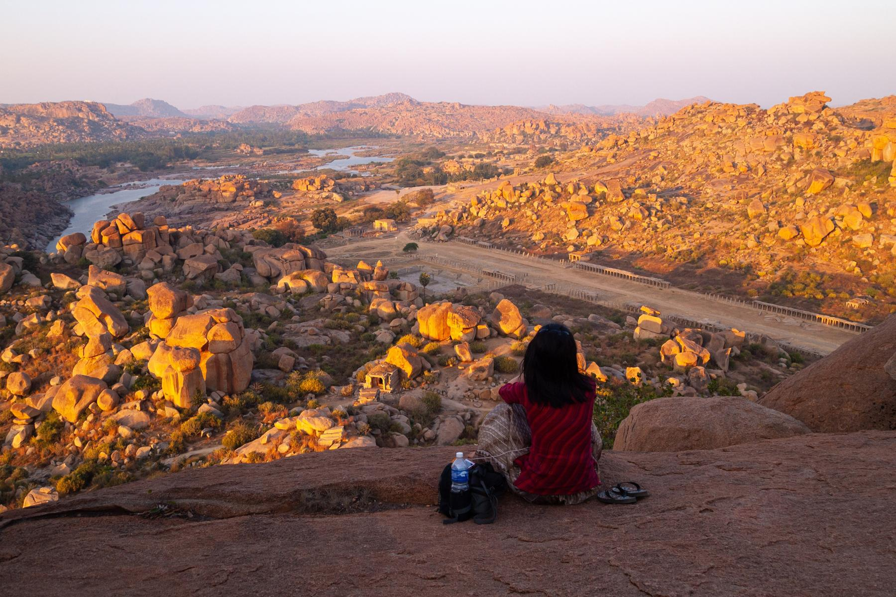
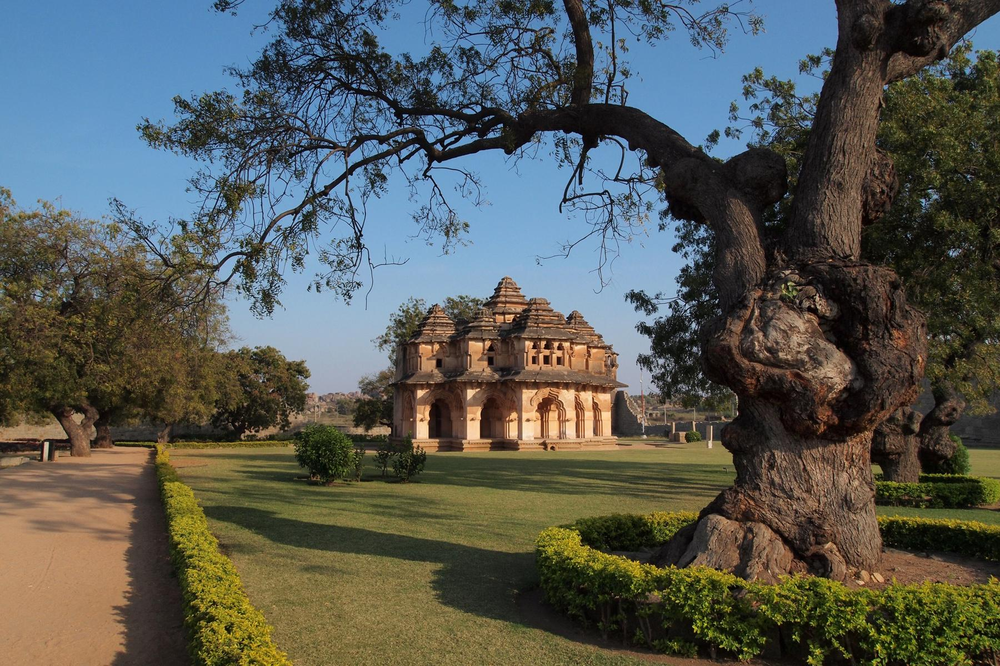
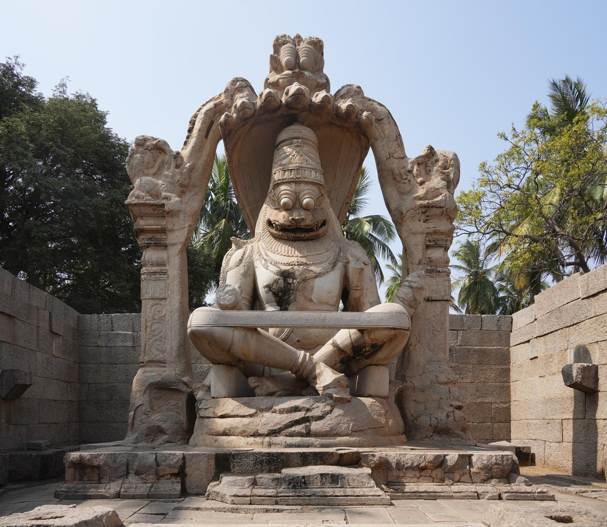
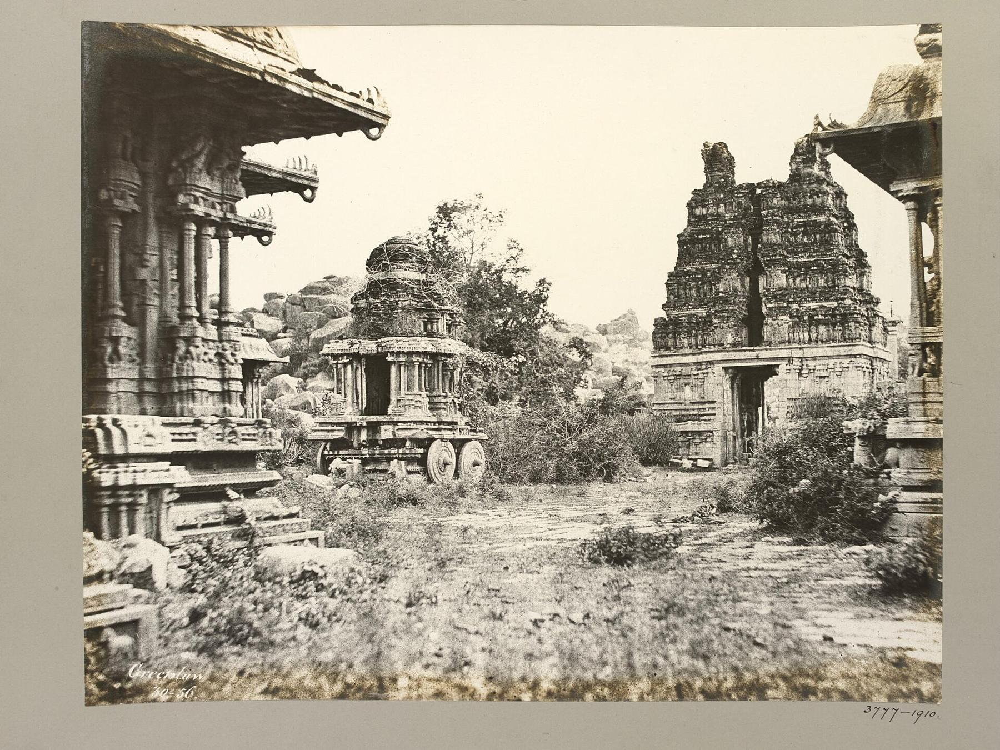

It is 1520, and a Portuguese traveler named Domingo Paes is standing on a hill, trying to take in a city. In front of him, between piles of enormous granite boulders, stretch seven rings of walls, broad streets lined with stone colonnades, temples with towers of carved gods, palaces, orchards, water tanks and canals. Merchants are selling pearls, rubies and diamonds openly in the bazaars. Elephants walk by. He tries to estimate how far it goes, and gives up. It cannot all be seen from any one spot, he writes later. It seems to him as large as Rome.

Today, the same view from the hills above Hampi shows something very different: banana plantations, a river, a village and miles of broken stone. The streets are still there, and the temples, and the walls. But the people, the bazaars and the kings have been gone for more than four centuries.

What happened? Settle in. This is the story of Vijayanagara, the City of Victory, which rose from a legend about a hare, grew into one of the greatest cities in the world, and fell in a single afternoon.

## A hare that turned on the hounds

In the early 1300s, South India was in turmoil. Armies from the Delhi Sultanate had swept down from the north, toppling the old kingdoms of the Deccan one after another. Into that chaos stepped two brothers, Harihara and Bukka, sons of a man called Sangama. Around 1336, on the south bank of the Tungabhadra River, they founded a new capital and a new kingdom. It would become the Vijayanagara Empire, and it would last more than 200 years.

Why here? The story says that one of the brothers was hunting near the river when his dogs chased a hare. Instead of running, the hare turned and attacked the hounds. Amazed, the hunter told a holy man what he had seen, and the sage said that any land where even a hare was that brave was a place for a capital. So the city was built on that spot.

It was a good choice for other reasons too. The site was already sacred. Hampi had been a place of pilgrimage for centuries, home to the temple of Virupaksha, a form of Shiva, and to Pampa, the local river goddess who gives Hampi its name. Many people also believed it was Kishkindha, the kingdom of monkeys in the Ramayana, where Rama met Hanuman. And the landscape was a natural fortress. Billions of years of weathering had left the hills piled with house-sized granite boulders, with the river guarding the north. Between the hills lay fertile valleys that could be watered with canals.

The Sangama brothers and the kings who followed them built walls, temples and tanks, and turned the riverbank into a royal city.

*The boulder country of Hampi from Matanga Hill. Photo: [Vyacheslav Argenberg](https://commons.wikimedia.org/wiki/File:Hampi_landscape_from_Matanga_Hill,_Hampi,_India.jpg), CC BY 4.0, via Wikimedia Commons*

## The richest city in the world

Vijayanagara grew rich on trade. Its kings controlled the ports of India's west coast, and through them the trade in spices, cotton and, above all, horses, which were brought by sea from Arabia and Persia for the cavalry. Diamonds came from the mines of the Deccan. The city sat in the middle of it all.

Foreign visitors could hardly believe what they saw. In 1443, Abdur Razzaq, an ambassador from Persia, described a city ringed by seven lines of walls, with jewelers selling pearls, rubies, diamonds and emeralds openly in the bazaar. He said he had never seen or heard of anywhere like it. Around 1520, Domingo Paes wrote the comparison with Rome, and described the most well-provided city in the world, with markets full of rice, wheat, fruit and flowers. A few years later, a Portuguese horse trader, Fernão Nunes, recorded the history the courtiers told him, including the story of the brave hare.

The city they saw was really two cities. In the Royal Centre, the kings held court on great stone platforms, watched festivals and kept their elephants in a long stable with domed rooms. Around the Sacred Centre stood the great temples, each with its own bazaar street running down to a ceremonial gate. In between, canals and stone aqueducts carried water to tanks, baths and gardens.

Vijayanagara's builders also mixed styles freely. The Lotus Mahal, a pavilion in the women's quarters, has Hindu temple towers on top and arches below that would look at home in a sultan's palace. The kings employed Muslim soldiers and archers, and some of their buildings borrowed from the very kingdoms they fought against.

*The Lotus Mahal in the Royal Centre. Photo: [Vyacheslav Argenberg](https://commons.wikimedia.org/wiki/File:Hampi,_India,_Lotus_Mahal.jpg), CC BY 4.0, via Wikimedia Commons*

## The poet-king

The empire reached its height under Krishnadevaraya, who ruled from 1509 to 1529. He was a soldier first. In 1520 he won the great Battle of Raichur against the Sultan of Bijapur, and he pushed the empire's borders north and east, as far as Odisha.

He was also a scholar and a poet. He wrote *Amuktamalyada*, a long Telugu poem about the Tamil saint-poet Andal, and he kept eight great poets at his court, remembered as the *Ashtadiggajas*, the eight elephants who held up the corners of the world. Stories about his clever court poet, Tenali Rama, are still told to Indian children today.

Krishnadevaraya poured his wealth into building. He added gateway towers to the Virupaksha temple and expanded the Vittala temple, whose halls have pillars carved so finely that they ring like musical notes when tapped. In front of it stands the famous stone chariot, actually a shrine to Garuda, the eagle who carries Vishnu, carved to look like a temple car on wheels. In 1528, near the end of his reign, a single granite boulder was carved into a seated figure of Narasimha, Vishnu's man-lion form, about 22 feet tall, under the hoods of a seven-headed serpent.

When Krishnadevaraya died in 1529, Vijayanagara was the most powerful kingdom in South India and its capital was one of the great cities of the world. It had 36 years left.

## One afternoon at Talikota

After Krishnadevaraya, real power passed to a nobleman named Aliya Rama Raya, who ruled in the name of a puppet king. Rama Raya was clever and ambitious. For years he played the five Deccan sultanates to the north (Bijapur, Ahmednagar, Golconda, Bidar and Berar) against one another, siding with one, then another. It worked, until they stopped fighting each other.

In 1564, four of the sultanates formed an alliance against Vijayanagara. On 23 January 1565, their armies met Rama Raya's on the plains near the villages of Rakkasagi and Tangadagi, north of the Krishna River. The battle is usually named after the nearby town of Talikota.

Vijayanagara's army was huge, and for a while it seemed to be winning. Then everything collapsed. The sultanates' artillery cut into the Vijayanagara ranks, and some accounts say two of Rama Raya's own Muslim commanders changed sides at the crucial moment. Rama Raya, by now an old man, was captured and beheaded. When his army saw his head held up on a spear, it broke and fled.

The road to the capital lay open. The royal family escaped south with what treasure they could carry, and the alliance's armies marched into Vijayanagara. For about five months they looted it: smashing statues, burning wooden halls, prying apart buildings in search of gold. The great Narasimha's arms and legs were broken. The city was never lived in again as a capital. The empire went on for another century from new capitals further south, at Penukonda and then Chandragiri, but it never recovered its old power.

*The 22-foot Narasimha, carved in 1528 and damaged after 1565. Photo: [Ingo Mehling](https://commons.wikimedia.org/wiki/File:Hampi_-_Lakshmi_Narasimha_Temple_-_Narasimha_Statue.jpg), CC BY-SA 4.0, via Wikimedia Commons*

## The forgotten empire

For more than two centuries, the ruins were left to the boulders, the river and the farmers who planted bananas and sugarcane in the old streets. Pilgrims still came to the Virupaksha temple, where worship never stopped. Everyone else forgot.

In 1800, Colin Mackenzie, a Scottish engineer who later became the first Surveyor General of India, mapped the site. In 1856, Alexander Greenlaw photographed it, and his pictures show the stone chariot half-buried in scrub. In 1900, the British historian Robert Sewell published the travelers' accounts of Paes and Nunes in a book whose title said it all: *A Forgotten Empire*. Historians today argue with parts of his story, especially his picture of the war as a simple fight between Hindus and Muslims, but his book put Vijayanagara back on the map.

Archaeologists have been uncovering the city ever since. In 1986, UNESCO made Hampi a World Heritage Site. In 1999 it was put on the list of sites in danger, when new bridges over the river threatened the ruins, and taken off again in 2006 after the plans were changed.

Today, the stone chariot is on the back of India's 50-rupee note. Coracle boatmen ferry visitors across the river where the hounds once chased the hare. And every morning, in the Virupaksha temple, priests still ring the bells for the god who was here before the empire, and outlasted it.

*The stone chariot and the Vittala temple in 1856. Photo: Alexander Greenlaw, [public domain](https://commons.wikimedia.org/wiki/File:Garuda_Temple,_Maha_Mandapa_and_Eastern_Gopura,_Vitthala_Temple_Complex_1856_photo.jpg), via Wikimedia Commons*

## Legend or history?

> One of the founding brothers watched a hare turn and attack his hunting dogs by the river, and a holy man told him to build his capital where even a hare was so brave. The story was written down by Fernão Nunes in the 1530s, two centuries after the founding.

**What we know:** Very similar "brave hare" stories are told about the founding of other South Indian cities, so historians treat it as a traditional tale rather than an event. What's certain is that Harihara and Bukka founded a kingdom here around 1336, and that Hampi was already a sacred site long before.

> The brothers were guided by the sage Vidyaranya of the Sringeri monastery, who helped them found the city and the empire.

**What we know:** This story became popular later, partly through records connected with Sringeri. Some of the documents that tell it are thought to be later copies or forgeries, and historians still debate how big a role, if any, Vidyaranya played. Early inscriptions do show the Sangama kings supporting the Sringeri monastery.

> Hampi is Kishkindha, the monkey kingdom of the Ramayana, and Anjanadri Hill across the river is the birthplace of Hanuman.

**What we know:** The identification is old and deeply believed locally, and places in Hampi are named after scenes from the epic. But the Ramayana's geography can't be pinned to a map, and other places in India also claim to be Hanuman's birthplace.

## Local tellings

These are stories you'll hear from guides and visitors at Hampi; none of them can be confirmed.

- **The British cut open a musical pillar to find the music.** A popular guide's tale, but there's no record of it, and the pillars ring because of the way the solid stone is carved.
- **The stone chariot's wheels once turned.** Many guides say so, and the wheels were carved as separate rings. Whether they ever really turned, no one can show, and they were fixed in place long ago to protect them.
- **Treasure is still buried in the ruins.** Stories of hidden gold have tempted treasure hunters for centuries, and some have damaged monuments digging for it. No hoard has ever been found.
- **Tenali Rama outwitted everyone at court.** The stories of Krishnadevaraya's witty poet are much-loved folk tales, collected long after his time, and very few can be tied to the real man.

## Things you probably didn't know

- **Hampi's boulders are among the oldest rocks on Earth.** The granite is about 2.5 billion years old, and its giant piles were left by weathering over millions of years, not thrown by anyone.
- **The Vittala temple's pillars really do ring.** Tapping its slender granite columns produces musical notes. Visitors are now asked not to try it, to protect them.
- **The stone chariot is a shrine.** It was built for Garuda, Vishnu's eagle, who faces the temple from inside it.
- **Hampi's name comes from a river goddess.** Pampa was the local name of the Tungabhadra and its goddess, who is said to have married Shiva here as Virupaksha.
- **The empire outlived its capital by a century.** After 1565, Vijayanagara kings ruled from Penukonda and Chandragiri until the mid-1600s.
- **It was once on UNESCO's danger list.** From 1999 to 2006, because of two bridges planned across the river.
- **You can find Hampi in your wallet.** The stone chariot has been on the back of India's 50-rupee note since 2017.

## Timeline

- **c. 7th–9th century** Shrines to Virupaksha and Pampa make Hampi a place of pilgrimage.
- **c. 1336** Harihara and Bukka found the Vijayanagara kingdom on the Tungabhadra.
- **1443** Abdur Razzaq, the Persian ambassador, visits and describes the city's seven walls.
- **1509–1529** Krishnadevaraya's reign, the empire's golden age.
- **c. 1520** Domingo Paes compares the city to Rome.
- **1528** The giant Narasimha statue is carved from a single boulder.
- **23 January 1565** Vijayanagara's army is defeated near Talikota, and the capital is sacked for months.
- **1800** Colin Mackenzie surveys the ruins.
- **1986** Hampi becomes a UNESCO World Heritage Site.
- **2017** The stone chariot appears on India's 50-rupee note.
- **Today** Hundreds of thousands of visitors a year explore the ruins, and worship continues at Virupaksha.

## If you go

From the US, fly into Bengaluru (Bangalore), then take an overnight train or bus to Hosapete, about 8 hours away, from where Hampi is a 20-minute ride. There's also a small airport at Toranagallu, about an hour from the ruins, with flights from Bengaluru. Allow at least two full days: one for the Sacred Centre and the Vittala temple, one for the Royal Centre and the river. The best season is October to February, when days are warm and dry; in summer it's well over 100°F. A single ticket covers the Vittala temple, the Lotus Mahal, the elephant stables and the site museum on the same day (about $7 for foreign visitors); the Virupaksha temple is still a working temple, so dress modestly and leave your shoes at the gate. For a fuller plan, see our [three-day Hampi itinerary](/stories/2026/hampi/).

For a stay to match the story, [Evolve Back Hampi](aff:agoda/partners/partnersearch.aspx?pcs=1&hid=25135711) is a resort built in the style of a Vijayanagara palace, near the ruins (9.6 from 99 reviews on Agoda), and [Hyatt Place Hampi](aff:agoda/partners/partnersearch.aspx?pcs=1&hid=407715) is a reliable chain hotel about 45 minutes away (8.3 from 730+, around $130 a night).

## Sources

- Robert Sewell, *[A Forgotten Empire (Vijayanagar)](https://www.gutenberg.org/ebooks/3310)* (1900), with the accounts of Domingo Paes and Fernão Nunes, Project Gutenberg
- "[Group of Monuments at Hampi](https://whc.unesco.org/en/list/241)", UNESCO World Heritage Centre
- "[Battle of Talikota](https://www.britannica.com/event/Battle-of-Talikota)", *Encyclopaedia Britannica*
- [Vijayanagara Empire](https://en.wikipedia.org/wiki/Vijayanagara_Empire), [Hampi](https://en.wikipedia.org/wiki/Hampi) and [Battle of Talikota](https://en.wikipedia.org/wiki/Battle_of_Talikota), Wikipedia
- "[Stone Chariot](https://www.karnatakatourism.org/tour-item/stone-chariot-hampi/)", Karnataka Tourism

*Cover: the stone chariot of the Vittala temple. Photo: [Suraj S Rao](https://commons.wikimedia.org/wiki/File:Stone_Chariot_Vittala_Temple.jpg), CC BY-SA 4.0, via Wikimedia Commons.*
